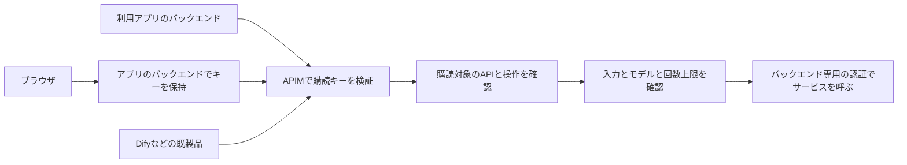

# Gatewayキー認証への変更計画

> **履歴資料：2026-11-01の文書整理前スナップショット。現行の操作手順ではありません。** 本文の日付・検証結果・構成・認証方式は当時の記録です。現在の配備状態や試験合格を示しません。[現行の参照文書](../reference/gateway-key-auth-plan.md)と[履歴一覧](README.md)を参照してください。

保存元：`docs/reference/gateway-key-auth-plan.md`。整理開始前に保存した本文を保持し、履歴の注記と配置に伴う相対リンクだけを調整しています。

> 本書は2026年10月28日時点の変更計画を保存したものです。当時の18 APIに文書解析が加わり、現行資材は19 APIです。現在の一覧と配備順は[API定義](pre-20261101-api-design-proposal.md)・[運用手順](../operations.md)を参照してください。本書の「未適用」は当時の状態であり、現在の環境の配備結果を示しません。

2026年10月28日。キー認証を基本とする設計と、実装へ進むための変更範囲をまとめる。Graphを含む標準18 APIを維持し、共通入口の購読キー検証と、個人向けAPIの本人OAuth接続を分けて扱う。本変更はコードと登録資材へ反映し、Azureへは未適用である。実環境への切替と実通信の受入は本書の手順で行う。

利用アプリは、既存の接続先URLとAPIキーの設定でGatewayを利用する。APIMが購読キーを検証し、購読に許可されたAPIへ要求を通す。キーが表す主体はアプリや利用枠であり、利用者個人とは区別する。

## 利用経路と認証の分担



| 場所 | 担当すること |
| --- | --- |
| 利用アプリ | 製品が対応する接続先とキーを設定し、API要求へキーを付ける |
| APIM共通ポリシー | 入口経路、資格情報の形式、検証済み購読の存在を確認する |
| APIMのAPIとProduct | 購読の利用範囲、公開する操作、モデルと入力条件を設定する |
| APIMのバックエンド設定 | Foundry等をマネージドIDで呼ぶ。外部サービスにはそのサービス用の資格情報を使う |
| Portalと管理操作 | 画面へのサインインとAzure管理権限を、それぞれの用途で管理する |

利用アプリをGatewayのEntraアプリへ個別登録する手順は、標準のキー利用手順から外す。Graph等の個人向けAPIでは、Microsoftサインインによる本人OAuth接続をAPI固有の処理として接合する。

購読キーと本人接続セッションは、既存バックエンド・BFF・承認済みSaaSの秘密設定で保持する。ブラウザからはそのバックエンドを呼ぶ。CORSや送信元IPは本人確認の代わりにはしない。

## 受信するキーの契約

新しい公開例の既定ヘッダーは、Azure OpenAIクライアントとの接続を想定した`api-key`とする。`gateway.authentication.subscriptionKeyHeader`で環境の共通ヘッダーを設定する現在の仕組みを使い、API定義と共通ポリシーへ同じ値を渡す。

```http
POST /models/openai/v1/chat/completions HTTP/1.1
Host: gateway.example.com
api-key: <APIM_SUBSCRIPTION_KEY>
Content-Type: application/json
```

| クライアントの送信形式 | 変更計画での扱い |
| --- | --- |
| `api-key: <key>` | 標準の接続形式。DifyのAzure OpenAI設定などで実際の要求と疎通を確認する |
| `Ocp-Apim-Subscription-Key: <key>` | 共通ヘッダーをこの名前に設定した環境で使用する。標準例の`api-key`との自動併用は追加しない |
| `Authorization: Bearer <key>` | OpenAI系製品で使われる別の形式。標準のヘッダー形式との適合を別に確認し、受信ポリシーで書き換えれば使えるとは扱わない |
| URLの`subscription-key`や`api-key` | 受け付ける経路から外し、キーはヘッダーで渡す |
| Microsoftのアクセストークンだけを送る | 新しい標準入口の利用条件にはしない |

APIMのAPI設定には、キーを受け取るヘッダー名がある。キーの検証にはAPIM組み込みの購読検証を使い、独自のキー一覧や要求ごとの管理API呼び出しで照合する方式は追加しない。[Microsoftの購読キー仕様](https://learn.microsoft.com/en-us/azure/api-management/api-management-subscriptions)

共通入口では、有効な設定済みキーヘッダーと`Authorization`が同時に届いた場合は、購読キーで利用枠を判定する。下流へは入口のAuthorizationを除去してからサービス用の認証を設定する。個人向けAPIが要求する本人・接続の確認は、このキー検証に続くAPI固有の処理として設計し、現行の所有者検査を単に削除する変更は行わない。

## 購読とAPIの許可

1. 業務APIと、そのAPIを公開するProductで購読を必須にする。
2. キーが有効で、購読がactiveであり、そのAPIを利用できる範囲かをAPIMで検証する。
3. 共通ポリシーでも`context.Subscription`と購読IDの存在を確認する。
4. API側で公開Operation、モデル、入力条件、回数上限を検査する。
5. 下流へ送る前に入口のキーを取り除き、サービス用の認証を設定する。

通常はアプリや利用枠ごとに購読を作り、`model-users`や`tool-users`などのProductへ対応付ける。クライアントIDやユーザーObject IDの個別許可一覧を購読検証へ付け足さない。

現在の`gateway-token-entry`は、Entra tokenだけでも通すための購読不要Productである。変更後はこのProductとのAPI関連を解除し、Coreが所有する旧Productを移行対象にする。API側の`subscriptionRequired`だけを変更しても、既存の購読不要Productとの関連が残る場合がある。Microsoftの仕様でも、Open Productに関連するAPIではキーなしの処理へ進み得るため、実リソースの関連まで確認する。

認証と操作制約は共通ポリシーとAPIポリシーで適用する。API単位・全API向けの購読ではProductポリシーが適用されない場合があるため、Productポリシーだけを根拠に許可しない。

キーの発行、停止、primaryとsecondaryの交換は購読ID単位で管理する。現在の公開処理は設定の`enabled`からactiveまたはsuspendedを再設定するため、GUIで停止した購読を再公開時に意図せず有効化しない運用を決める。変更後も、公開計画に購読状態の差分を表示し、停止済み購読の再有効化を明示的に扱う。

## APIごとの変更

APIとOperationの分類、および32モデルとの対応は、[API定義](pre-20261101-api-design-proposal.md)の考え方を継承する。認証方式を変えるために、モデルごとのAPI分割や新しいOperationの追加は行わない。

| 対象 | 認可・所有者の基準 | API固有の設定 |
| --- | --- | --- |
| 推論、埋め込み、画像、Speech、音声、Decision、PII | 購読キーとAPI・Productの利用範囲 | モデル・入力条件とバックエンドMI認証を設定する |
| Realtimeの作成、終了、observer | 検証済みAPIM購読IDをセッション所有者に使用 | call ID、チケット署名、期限を照合し、別購読からの操作を拒否する |
| PIIから生成するネイティブMCP | RESTと同じProductの購読キー | 内部REST呼び出しへの購読引き継ぎを実Azureで確認する |
| `graph-profile-v1` | 本人のGraphプロフィール取得 | CM本人sessionで確認済みの本人と接続を照合し、Graphを呼ぶ |
| 外部REST、MCP、A2A、gRPC、Hosted Agent | 購読キーと固定の公開操作 | APIMから下流へ渡すMI・登録済みサービス資格情報、必要なCM接続を設定する |

ネイティブMCPの購読検証と内部RESTへの引継ぎは、補助APIの公開前に実Azureで確認する。成立しない場合はその補助APIの公開を保留し、認証を省略する方式へ切り替えない。

標準定義はGraphを含む18件（HTTP 12 API・18 Operation、WebSocket 6 API）を維持する。初期32モデルの対応範囲を引き継ぎ、PII生成MCPなどの補助APIは別に数える。

個人のGraph接続は、認証した本人と、その接続を使用できる要求との対応を確認して使う。Graph APIはCredential Managerの下流OAuth接続を利用し、購読キーと本人接続セッションを照合する。

## GraphとDynamic Authの接合

Dynamic Authは、APIMのCredential Manager接続を必要時に作成し、OAuthのログインURLを返す方式として扱う。GraphのREST APIでも、本人OAuth接続を必要とするMCP等でも利用できる。

1. APIMが入口の購読キーを検証する。
2. 対象APIが、利用を許可されたプロバイダーと本人接続を選択する。
3. 接続が認証済みなら、CMから下流用のアクセストークンを取得し、Graph等へ要求を送る。
4. 認証が必要なら、ログインURLを返して本人のサインイン・同意へ案内する。
5. 完了後に対象接続を使って再実行する。以降の下流token取得・更新はCMで扱う。

ログインURLを含むJSONを返す処理と、ブラウザでそのURLを開く処理は分けて確認する。添付例のHTTP 200・`status:need_login`は独自のAPI応答であり、通常のRESTクライアントやMCPクライアントが自動的に画面を開くことまでは保証しない。[CMの公式フロー](https://learn.microsoft.com/en-us/azure/api-management/credentials-process-flow)

`get-authorization-context`の`identity-type:managed`はAPIMのMIが接続を使用できるかを確認する。元の呼出元がその接続を使えるかは、別に確認する。ヘッダーの`X-Connection-Id`をそのまま所有者の証明にせず、検証済み購読・本人セッション等と接続の利用権の対応を設計する。共有購読内の各個人を分離する条件は、Graph等の個人向けAPIの実装着手前に確定する。[接続のアクセス権検証](https://learn.microsoft.com/en-us/azure/api-management/get-authorization-context-policy)

## 回数制限と監査とセッション

| 項目 | 変更後の基準 |
| --- | --- |
| 呼出主体 | `subscription:<APIMの購読ID>` |
| 回数制限 | 購読ID単位。公開例の共通枠は既定で無効（無制限）。明示的に有効化した場合だけ指定回数を適用する |
| キー交換 | 同じ購読のprimaryとsecondaryで、回数枠とセッション所有者を共用する |
| セッションの操作 | 元の購読IDと署名付きticketにより照合し、別購読のcall操作を拒否する |
| 監査 | 要求ID、購読ID、API、Operation、モデル、状態、使用量を記録する |
| 利用アプリが送るユーザー名やID | 必要なら申告情報として区別し、認証済み個人やセッション所有者の根拠には使わない |

Realtimeの購読所有者ticketは旧本人所有者ticketと異なる版にし、新しい検証処理で旧形式を拒否する。既存セッションの終了時期と切り替え時刻を移行計画へ含める。

共有キーを使うアプリ内では、複数利用者が同じ購読主体になる。個人単位の利用制御や同じ購読内のユーザー分離を、この方式の保証として記載しない。

APIMのDiagnostics、独自監査、試験CLIでキー値を記録しない。入口の`api-key`、既定APIMキーヘッダー、入口のAuthorizationなどを、下流サービス用の認証を設定する前に除去する。上流がキー認証の場合は、上流専用の資格情報を改めて設定する。

URLにキーを送るとAPIMへ到着する前のApp Gateway等で記録され得るため、APIMでのquery拒否だけで全ログへの非記録を保証しない。公式の利用例はヘッダー形式にそろえる。

## プロトコルと既製品の受入

| 通信 | 受入で確認すること |
| --- | --- |
| HTTPとSSE | キーヘッダー、既存のpathと要求形式、途中応答と正常終端、キー削除と下流認証 |
| Dify Azure OpenAI | 既存の接続先・モデル・APIキー設定で、想定pathと`api-key`を送ること。対応Operationを実際に呼ぶこと |
| ブラウザのHTTP | キー用ヘッダーを許可するCORSとOPTIONSを設定し、実APIへの要求にはキーを要求すること |
| ネイティブgRPC | TLS・HTTP/2上のmetadataでキーを送り、本文を読み切らずストリーミングできること |
| サーバー側WebSocket | 接続開始時のキーヘッダー、許可モデル、固定接続先、接続の正常終端 |
| ブラウザのWebSocket | 標準`WebSocket` APIは任意のHTTPヘッダーを設定できないため、キーを保持する既存BFF等の経路で試験する |
| MCP | キーヘッダー設定に対応するクライアントで試験する。OAuthのみのクライアントとの互換性は別の条件として扱う |
| 外部サンプル | 下流が現在受け付ける認証とAPIMの送信方式が一致すること |

ブラウザWSSのために長期購読キーをURLへ入れる経路は追加しない。別途短期接続ticketを提供する場合は、新しい接続契約として設計する。既存製品が対応しないAPI操作や認証形式を、接続先URLの変更だけで利用できるとは扱わない。[ブラウザのWebSocket API](https://developer.mozilla.org/en-US/docs/Web/API/WebSocket/WebSocket)、[APIMのWebSocketポリシー適用範囲](https://learn.microsoft.com/en-us/azure/api-management/websocket-api)

## 設定と基盤の変更

| 項目 | 作業内容 |
| --- | --- |
| `gateway.authentication` | `subscriptionKeyHeader`と、必要時の`credentialLogin`を設定する |
| APIの`authorization` | 操作・モデル・本文の制約を残し、共通入口は購読キーとして整理する。Graph等の本人・接続所有者の条件はAPI固有の設定として設計する |
| `keySubscriptions` | 標準APIとProductで使用できるよう、現在のモード依存の検査・生成を更新する |
| `gateway.rateLimits` | 基本の回数枠を購読IDへそろえる。個人向けAPIで検証した本人の計測は、接続の本人確認条件と併せて設計する |
| Named Values | キーヘッダー、上流audience、入口経路、音声ticket署名等、実際にポリシーが参照する値を設定する |
| `azureTenantId`とAzure用ID | Azure構築、RBAC、Key Vault、管理VM、DNS用ID、配備用OIDCで使用する値を維持する |
| `entraTenantId`とEntraアプリ | 入口token用の必須条件を外す。Portal等に必要な認証テナントはその用途の設定として管理する。既存アプリや秘密を自動削除する工程は追加しない |
| 基盤構築とAPI登録 | `azd up`が基盤を作り、API登録コマンドがAPI・Product・購読・共通ポリシーを反映する現在の分担を継承する |

新しい公開例の入口設定案は次のとおり。実装後にSchemaと公開例を同時に更新する。

```json
{
  "gateway": {
    "authentication": {
      "subscriptionKeyHeader": "api-key"
    }
  }
}
```

本人接続が必要なAPIは、CM接続用の`start`・`status`・`logout`と、ブラウザの`launch`・`callback`を使う。これらはAPIM上の専用APIとして実装し、取引・購読・確認済み本人・接続の対応を保持する。[本人接続の手順](../setup/credential-manager-login.md)

キー方式の標準導入では、Gateway用scopeの公開や管理者同意、Gateway共通ログイン用シークレットの準備を必須工程にしない。Portal自身のログイン、Azure管理、下流サービスの認証は、それぞれの手順に残す。

API定義の認可方式は`subscriptionKey`に統一する。`operationConstraints`で公開する操作・モデル・入力を制限し、CMは接続所有者と購読を照合する追加検証として設定する。

## ファイルごとの作業範囲

| 作業 | 主な対象 |
| --- | --- |
| 共通認証とエラー応答 | `apps/gateway/apim/policies/service.xml`、`scripts/deployment/helpers/apim_authentication.py`、`scripts/render_apim_policy.py` |
| APIとProductと購読 | `apps/gateway/apim/api-publication.bicep`、`scripts/deploy_gateway.py`、`scripts/api_migration.py` |
| API固有の認可と転送 | `apps/gateway/apim/policies/gateway.xml`、`protocol.xml`、`mcp.xml`、`rate-limit.xml`、`audit-context.xml`、`gateway-telemetry.xml` |
| 音声のセッション所有者 | `apps/gateway/apim/policies/realtime-create.xml`、`realtime-hangup.xml`、`realtime-observer.xml`、関連するLive・WebRTC処理 |
| 入力検査とSchema | `scripts/deployment/helpers/configuration.py`、`schemas/params.schema.json`、`configuration.schema.json`、`options.schema.json` |
| 公開例と生成補助 | `params/test.example.json`、`production.example.json`、`config/test.json`、`production.json`、`apps/gateway/apim/apis/`、`scripts/configure_trial.py`、`prepare_coverage.py` |
| 名前付きの値の配備 | `apps/gateway/deploy/apim-settings.bicep`、`apps/gateway/deploy/main.bicep`、`scripts/deploy_gateway.py`。共有Key Vaultの秘密はCoreの構築・秘密入力で準備する |
| CM接続の本人確認 | `apps/gateway/apim/policies/credential-login/`、`credential-connection.xml`、`scripts/deployment/helpers/credential_login.py`、`scripts/cleanup_credential_connections.py`。旧共通ブラウザログイン資材を撤去し、API固有の本人接続へまとめる |
| MCPの認可 | 生成MCPと外部MCPで購読キーを検証する。下流の本人接続が必要なAPIにはCM接続セッションを設定する |
| 試験クライアント | `scripts/integration_client.py`、`voice_client.py`、`realtime_browser.py`、関連する公開契約と試験用入力 |
| 手順 | `README.md`、`DEVELOPMENT.md`、`INTEGRATION_TESTS.md`、`CONSTRUCTION_TESTS.md`、`apps/gateway/apim/README.md`、`scripts/README.md`、`docs/setup/02-entra.md`・`04-params.md`・`05-config.md`・`06-deploy.md`、`docs/operations.md`、API定義とポリシー一覧 |

ブラウザログインの文書と試験も、共通入口とAPI固有の本人認証の役割に合わせて整理する。テストは旧仕様の単純な期待値置換ではなく、購読の範囲・本人接続の所有権・拒否経路を検証する内容へ改める。すべてのXMLに、目的・入力・失敗時の動作が分かる説明コメントを付ける。

接続確認で必要になったヘッダー名・下流の認証方式・公開pathを公開契約として整理する。

## 実装の作業順

1. Graphを含む18 APIの入力形式、キー用ヘッダー、購読ID、個人向けAPIの追加条件を確定する。
2. APIM組み込みの購読検証を前提に、API・Product・購読と共通認証の生成を変更する。
3. HTTP・MCP・gRPC・WSSのポリシー、購読単位の上限・監査、音声ticketを更新する。
4. Graph APIを維持し、Dynamic Auth・CMとの接合、およびAPI固有のログイン案内を整理する。
5. 基盤構築時の入口token用設定を整理し、Azure・下流MI・Portal用途の設定との依存を検査する。
6. API定義、ポリシー一覧、Entraと配備の手順を実装に合わせて更新する。
7. ローカル試験、Bicepコンパイル、登録計画、第三者レビューを完了し、Azureへの反映手順を確定する。
8. 検証環境へ反映し、実APIMと既存クライアントで受入する。

## 完了条件

- キーなし・空・重複・不正・停止・削除・交換前の旧キーで、上流サービスを呼ばない。
- 有効なprimaryとsecondaryは同じ購読として動き、対象外API・Productへの利用は拒否する。
- 有効なキーと期限切れのAuthorizationが同時に届いても、共通入口の利用枠はキー方式で判定する。Graph等の追加の本人確認はAPI固有の条件で検査する。
- 認証不要Productや古いAPI関連が残っても、共通ポリシーを経由する業務APIは購読を確認する。
- 一般APIの登録に必要な認可設定は、購読と公開操作の条件で完結する。
- Graphの1 APIを含む18 APIを維持し、32モデルとの対応が一致する。
- Graphの接続取得・ログインURL案内・認証後の再実行を確認し、他人のCM接続を選択する要求を拒否する。
- 購読Aの音声ticketを購読Bで使えず、改ざん・期限切れ・異なるcall IDを拒否する。
- 音声ticketの旧本人所有者形式を、新しい購読所有者として受け入れない。
- HTTP、SSE、WSS、gRPC、PII生成MCPでキーの検証・転送・正常終端を確認する。
- バックエンドには入口キーを流さず、上流MIや登録済みサービス認証で接続する。
- DifyのAzure OpenAI設定で対応APIを呼び、URL・ヘッダー・要求形式の適合を確認する。
- 監査にキー値・token・個人の申告IDを本人証明として記録しない。
- 購読の停止状態と、コードから外した旧リソースの移行を公開計画で確認できる。
- XML、Schema、公開例、CLI、試験、手順で認証の説明が一致する。

主な回帰対象は`test_common_authentication.py`、`test_standard_gateway_authorization.py`、`test_configuration.py`、`test_publish_apis.py`、`test_api_publication_size.py`、`test_api_products.py`、`test_contract_rate_policy.py`、`test_realtime_policy.py`、`test_mcp_publication.py`、`test_websocket_publication.py`、`test_apim_diagnostics.py`と、変更したprotocol・設定の試験とする。

C#式やローカル試験ではAPIMの`context.Subscription`を模擬するため、active・scope・キー交換の組み込み検証は実APIMで受入する。Bicepコンパイルだけで既製品との接続成功を判定しない。

## 既存環境への反映準備

実装前の状態と独立した差分を保持し、環境固有paramsと秘密をGit管理へ含めない。既存の未コミット変更を、今回の準備のためにリセットしない。

反映前には全体ポリシーのXMLとETag、対象APIのProduct関連、購読の状態、旧ログインAPI・専用ロールの実在を読み取る。共通認証の更新は管理対象ブロックの差分として扱い、GUIで追加されたCORSや応答ヘッダー等と照合する。

Incremental配備では、テンプレートから外したAPI・Product関連・専用ロール等がAzure上に残り得る。Coreが所有する旧資源を識別して移行計画へ列挙し、既存APIや個人接続を一括削除する方式は使わない。購読IDを維持する変更では、キーの再発行が必要かを差分で確認する。

基盤の変更は`azd up`、API・Product・購読・共通ポリシーはAPI登録工程へ分けて反映する。API配備成功後に共通ポリシーを適用して読み直し、途中失敗時は資源の状態とXMLを照合して復旧する。今回のキー認証への変更を理由とした環境全体の`azd down`は前提にしない。
