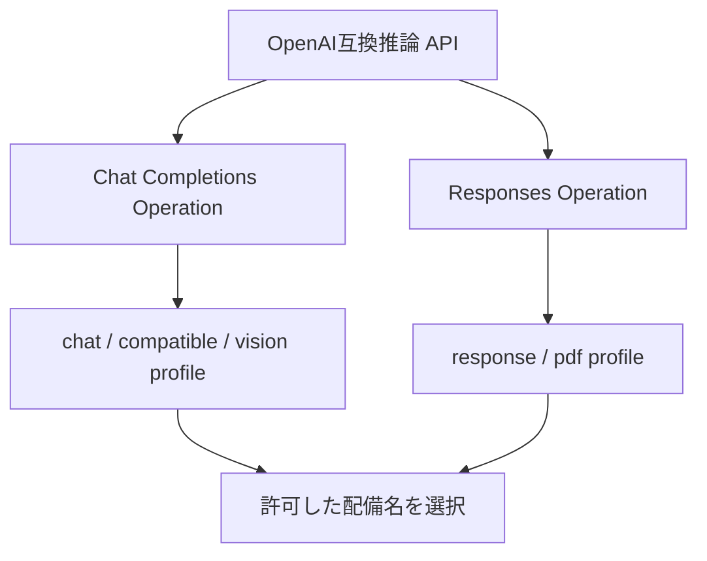

# Core API・Operation定義

初期配備28モデルとPII・Graph・文書解析を提供する**標準19 APIの登録定義**を説明する。正本は [API別JSON](../../apps/gateway/apim/apis/)と [モデル設定](../../config/test.json)。`azd up`は共通基盤の完了後、GatewayのAPI公開とPortal配備まで実行する。登録後の実通信・受入判定は2つのテスト仕様書で別途記録する。ポリシーの適用順は[APIMポリシー一覧](apim-policy-catalog.md)を参照する。

入口認可と本人接続の分担は[Gatewayの購読キー認証](gateway-key-auth-plan.md)を参照する。現行の標準19 APIでは、共通入口の購読キー検証と、個人向けAPIの本人OAuth接続を分けて設計する。

## 現在の公開定義

初期28モデルとPII・Graph・Document Analysisを19 APIで提供する。本人のGraphユーザー情報取得は、CMを使う1つのAPIへまとめる。文書解析はモデル配備とは別のFoundryサービスを使い、独立したAPIとして登録する。

| 数える対象 | 定義数 |
|---|---:|
| HTTP API | 13 |
| HTTP Operation（method＋route） | 19 |
| WebSocket API | 6 |
| API登録定義の合計 | **19** |
| 操作定義で扱う初期配備モデル | **28** |

上表はリポジトリの標準API定義の件数である。Azureに登録済みの件数とは区別する。WebSocketの`invoke`／`onHandshake`は接続時の代表操作として扱い、HTTP Operationの件数には含めない。PII生成MCPと、採用時のCM補助API2個は別計上する。

Live会話・リアルタイム文字起こしの3 APIは、Microsoft公式のAzure用接続先に対応する。公開前に、実環境の上流URL・MI権限・ネットワーク到達と音声イベントの受入を確認する。

## APIとOperationの分類思想

APIは引き続き、**公開契約 × 公開major version × 通信方式 × 権限の意味**で分割する。

| 階層 | 何を区別するか | 例 |
|---|---|---|
| API | 要求・応答・認証境界・通信方式としてまとまった公開契約 | OpenAI互換推論、Cohere、FLUX、Realtime WebSocket |
| Operation | HTTPメソッドとルートで表す操作 | Chat Completions、Responses、画像生成、画像編集 |
| 入力profile | 同じOperation内の入力・要求上限・モデル別パラメーターの違い | 通常会話、画像入力、互換Chat、PDF入力 |
| モデル配備 | 実行する配備名・固定版・SKU・容量 | `gpt-6.1-sol`、`DeepSeek-V4-Pro`、`FLUX.2-pro` |
| Product | APIを提供・購読するまとまり | `released-apis`、`model-users`、`pii-users`、`connection-users` |

OpenAI互換のChat要求は、既存の`openai-inference-v1`へまとめる。このAPI名のOpenAIは公開プロトコルを表す。DeepSeek・Mistral・Grok・Routerの追加は、そのChat Operationの許可モデルとprofileの拡張として扱う。[AzureのOpenAI互換v1 API](https://learn.microsoft.com/en-us/azure/foundry/openai/api-version-lifecycle)

同じ要求・応答形式のモデル差は、Operation内のモデル選択・profile・固定ルーティング表へ寄せる。独立した会話セッション契約を持つLiveとRealtimeは、APIを分ける。WebSocket内のイベントは、その接続契約のメッセージとして管理する。

## 標準API一覧

完成URLは`scheme://gateway.example.com`＋URLプレフィックス＋Operationのサフィックス。HTTPは`https`、WebSocketは`wss`を使う。表のprefixは先頭`/`付きで示すが、設定の`apiDefinitions[].path`には先頭`/`を付けない。`v1`はGatewayの公開契約版であり、上流API版・モデル版は接続定義で管理する。

### HTTP API：13件・19 Operation

| # | API識別子 | URLプレフィックス | Operation：method＋サフィックス | 主な契約 |
|---|---|---|---|---|
| 1 | `openai-inference-v1` | `/models/openai/v1` | `chat-completions`：`POST /chat/completions` `responses-create`：`POST /responses` | ChatへDeepSeek・Mistral・Grok・Routerを追加。モデル別の出力制約を設定 |
| 2 | `openai-embeddings-v1` | `/models/openai-embeddings/v1` | `embeddings`：`POST /embeddings` | OpenAI埋め込み2モデルを維持 |
| 3 | `cohere-inference-v1` | `/models/cohere/v1` | `cohere-embeddings`：`POST /embed` `rerank`：`POST /rerank` | Embed v4とRerank fast／proを扱う |
| 4 | `openai-images-v1` | `/models/openai-images/v1` | `image-generate`：`POST /generations` `image-edit`：`POST /deployments/{deployment}/edits` | GPT Imageの3モデルを共通操作で扱う |
| 5 | `blackforest-images-v1` | `/models/blackforestlabs/v1` | `flux2-generate`：`POST /flux-2/generations` `flux2-edit`：`POST /flux-2/edits` | flex／proを同じ操作にまとめ、モデル別に上流を選択 |
| 6 | `azure-speech-v1` | `/models/azure-speech/v1` | `tts`：`POST /synthesize` `stt`：`POST /recognize` | SpeechのSSML読み上げ・WAV認識を維持 |
| 7 | `openai-audio-v1` | `/models/openai-audio/v1` | `audio-transcriptions`：`POST /deployments/{deployment}/transcriptions` | ファイル文字起こしに`gpt-transcribe`を使用 |
| 8 | `microsoft-decision-v1` | `/models/microsoft-decision/v1` | `systemone`：`POST /systemone` | `decision-1`の判断APIを維持 |
| 9 | `openai-realtime-control-v1` | `/models/openai-realtime/v1` | `realtime-create`：`POST /calls` `realtime-hangup`：`POST /calls/{callId}/hangup` | RealtimeのWebRTC接続準備・終了と所有者照合を維持 |
| 10 | **`openai-live-control-v1`** | **`/models/openai-live/v1`** | **`live-create`：`POST /sessions`** | **GPT-LiveのWebRTCセッション作成** |
| 11 | `pii-v1` | `/tools/pii/v1` | `pii_redact_text`：`POST /redact` | Azure LanguageのPII処理を維持 |
| 12 | `graph-profile-v1` | `/tools/graph/v1` | `graph_profile_self`：`GET /me` | CMの本人接続でGraph /meの氏名・所属・連絡先・アカウント状態など12属性を取得 |
| 13 | `document-analysis-v1` | `/tools/documents/v1` | `analyze_document`：`POST /analyze?model=...` | PDF・画像から文字、レイアウト、表を抽出。Read／Layoutモデルを選択 |

`{deployment}`・`{callId}`はURL変数。HTTPの通常応答とSSEは同じOperationの応答方式として扱う。

### WebSocket API：6件

| # | API識別子 | 接続先プレフィックス | セッション・モデル | 主な契約 |
|---|---|---|---|---|
| 1 | `openai-realtime-ws-v1` | `/models/openai-realtime/v1/ws` | Realtime通常／mini | 現行のmodelクエリー選択を維持 |
| 2 | `openai-realtime-observer-v1` | `/models/openai-realtime/v1/observer` | 所有するRealtime callのsideband | 所有者ticketとcall IDの照合を維持 |
| 3 | `azure-voice-live-ws-v1` | `/models/voice-live/v1/ws` | Azure Speech Voice Live | サービス固有の接続定義を維持 |
| 4 | `azure-voice-live-webrtc-v1` | `/models/voice-live/v1/webrtc` | Voice LiveのWebRTC制御 | 通常WSSと異なる制御用接続を維持 |
| 5 | **`openai-live-ws-v1`** | **`/models/openai-live/v1/ws`** | **`gpt-live-1`のLiveセッション** | **Live固有の開始・終了・音声イベントを扱う** |
| 6 | **`openai-transcription-ws-v1`** | **`/models/openai-transcription/v1/ws`** | **`gpt-live-transcribe`の文字起こしセッション** | **認識途中・確定テキストを返す** |

接続先はprefix自体である。APIMの`onHandshake`はこの接続時に実行され、音声・認識・終了イベントは接続後のメッセージとなる。

### Live・文字起こしAPIの完成URL

| API | method／方式 | 完成URL |
|---|---|---|
| `openai-live-control-v1` | POST | `https://gateway.example.com/models/openai-live/v1/sessions` |
| `openai-live-ws-v1` | WebSocket | `wss://gateway.example.com/models/openai-live/v1/ws` |
| `openai-transcription-ws-v1` | WebSocket | `wss://gateway.example.com/models/openai-transcription/v1/ws` |

## 初期28モデルとAPI・Operationの対応

表のモデル名は、この環境で使う配備名を表す。固定版・SKU・容量の正本は`services.modelDeployments`、モデルの選定理由は[モデル一覧](foundry-model-catalog.md#初回配備する28モデル)を参照する。

| # | 配備名 | API識別子 | 操作・選択方法 |
|---|---|---|---|
| 1 | `gpt-6.1-sol` | `openai-inference-v1` | Chat／Responses。既存のvision／pdfも使用 |
| 2 | `gpt-6-luna` | `openai-inference-v1` | Chat／Responses |
| 3 | `gpt-6-sol` | `openai-inference-v1` | Chat／Responses |
| 4 | `gpt-6-astra` | `openai-inference-v1` | Chat／Responses |
| 5 | `gpt-5.6-luna` | `openai-inference-v1` | Chat／Responses |
| 6 | `gpt-5.6-sol` | `openai-inference-v1` | Chat／Responses |
| 7 | `gpt-5.6-terra` | `openai-inference-v1` | Chat／Responses |
| 8 | `DeepSeek-V4-Flash` | `openai-inference-v1` | Chatのcompatible profile |
| 9 | `DeepSeek-V4-Pro` | `openai-inference-v1` | Chatのcompatible profile |
| 10 | `Mistral-Large-3` | `openai-inference-v1` | Chatのcompatible profile |
| 11 | `grok-4.7` | `openai-inference-v1` | Chatのcompatible profile |
| 12 | `gpt-live-1` | `openai-live-control-v1`・`openai-live-ws-v1` | Liveセッション作成／接続 |
| 13 | `gpt-realtime-2.1` | `openai-realtime-control-v1`・`openai-realtime-ws-v1`・`openai-realtime-observer-v1` | WebRTC制御／WSS／sideband |
| 14 | `gpt-realtime-2.1-mini` | `openai-realtime-ws-v1` | WSSのmodelクエリー選択 |
| 15 | `gpt-live-transcribe` | `openai-transcription-ws-v1` | 認識途中／確定テキスト |
| 16 | `gpt-transcribe` | `openai-audio-v1` | ファイル文字起こし |
| 17 | `gpt-image-2.5-flare` | `openai-images-v1` | 画像生成／編集 |
| 18 | `gpt-image-2.5-sunburst` | `openai-images-v1` | 画像生成／編集 |
| 19 | `gpt-image-2` | `openai-images-v1` | 画像生成／編集 |
| 20 | `FLUX.2-flex` | `blackforest-images-v1` | FLUX 2生成／編集、flex profile |
| 21 | `FLUX.2-pro` | `blackforest-images-v1` | FLUX 2生成／編集、pro profile |
| 22 | `text-embedding-3-large` | `openai-embeddings-v1` | embeddings |
| 23 | `text-embedding-3-small` | `openai-embeddings-v1` | embeddings |
| 24 | `embed-v-4-0` | `cohere-inference-v1` | cohere-embeddings |
| 25 | `Cohere-rerank-v4.0-fast` | `cohere-inference-v1` | rerankのモデル選択 |
| 26 | `Cohere-rerank-v4.0-pro` | `cohere-inference-v1` | rerankのモデル選択 |
| 27 | `model-router` | `openai-inference-v1` | Chatのrouter profile |
| 28 | `decision-1` | `microsoft-decision-v1` | systemone。提供モデル名は`Microsoft-Decision-1` |

モデル対応はOperationの許可モデル・profile・固定上流、および音声セッションの接続契約で定義する。

## モデル別の制約と上流の選択

### Chat・Responsesと入力profile

ChatとResponsesの2つのOperationを使い、同じ操作内の差をprofileで分ける。profileは`X-Egakumi-Profile`で選び、省略時は`chat`／`response`を使う。

| Operation | profile | 対象 | 出力token項目・モデル別上限 |
|---|---|---|---|
| `chat-completions` | `chat` | 上表1〜7のOpenAIモデル | `max_completion_tokens`、128,000 |
| `chat-completions` | **`compatible`** | DeepSeek 2種・Mistral・Grok | `max_tokens`、DeepSeek 384,000／Grok 500,000。Mistralは未確認のため数値を表示しない |
| `chat-completions` | **`router`** | Model Router | 振り分け先によって変わるため、自動値を使用 |
| `chat-completions` | `vision` | `gpt-6.1-sol` | 既存の画像入力形式、128,000 |
| `responses-create` | `response` | 上表1〜7のOpenAIモデル | `max_output_tokens`、128,000 |
| `responses-create` | `pdf` | `gpt-6.1-sol` | 既存のPDF入力形式、128,000 |

上限と確認元は [model-capabilities.json](../../apps/gateway/apim/model-capabilities.json) で一元管理し、API配備とPortalカタログの双方へ展開する。要求の初期値とモデル上限は別の値であり、初期値を最大値まで増やすものではない。実際に出力できる量は入力とコンテキスト残量によっても変わる。

モデルごとに受け付ける推論設定・出力token項目・ストリーミング形式を確認して登録する。compatible内に追加の差がある場合も、同じOperation内のprofile／モデル別制約へ分ける。現行のAzureカタログでChat対応を確認したモデルをChatに、Responses対応を確認したモデルをResponsesに対応付ける。

Routerは`model-router`配備をChatから呼び出す。候補モデルとルーティング方針はFoundryのRouter設定で管理する。APIMは要求した配備名を監査し、実際の選択先はFoundry側の記録や応答で確認する。[Azure Model Router](https://learn.microsoft.com/en-us/azure/foundry/openai/how-to/model-router)

### FLUX 2の生成・編集

公開Operationは`flux2-generate`・`flux2-edit`の2件を共用する。flex／proはprofileと許可配備名で選び、検証済みprofileの`backendUrlTemplate`から上流を選択する。

| profile | 許可配備名 | Azure provider route |
|---|---|---|
| `flex`（default） | `FLUX.2-flex` | `/providers/blackforestlabs/v1/flux-2-flex?api-version=preview` |
| `pro` | `FLUX.2-pro` | `/providers/blackforestlabs/v1/flux-2-pro?api-version=preview` |

両モデルのprovider routeと受け付ける生成パラメーターには差がある。profileごとに上限・追加パラメーターを定義し、公開側の既存の要求上限を引き継ぐ。profileとモデルの一致を検査してから固定URIへ転送する。[AzureのFLUX仕様](https://learn.microsoft.com/en-us/azure/foundry/foundry-models/how-to/use-foundry-models-flux)

### Embedding・Rerank・画像・Decision

- OpenAI Embeddingは`input`、Cohere Embedは`texts`・`input_type`を使う契約を維持する。次元・モデル・版と検索インデックスの対応を管理する。
- Cohere Rerankのfast／proは共通の`rerank` Operationで選ぶ。
- GPT Image 3モデルは生成・編集の2 Operationで選ぶ。生成は本文の`model`、編集はURLの`{deployment}`へモデル選択を拘束する。Azureの対応API版・画像形式・品質指定を照合する。
- Decisionは`decision-1`を固定配備として既存の`systemone` Operationから呼び、`state`・型付き質問と結果の契約を維持する。

## 音声APIを分ける根拠と公開条件

| 契約 | モデル・サービス | 要求とイベントの特徴 | APIMでの分類 |
|---|---|---|---|
| ファイル文字起こし | `gpt-transcribe` | 音声ファイルをTranscriptions APIへ送る | 既存HTTP Operation |
| Realtime会話 | `gpt-realtime-2.1`系 | 会話セッション、WebRTCのcall制御、Realtimeイベント | 既存HTTP制御／WSS／Observer |
| Live会話 | `gpt-live-1` | Liveセッション、`session.start`・`session.close`などLive固有のイベント | HTTP制御＋WSS |
| リアルタイム文字起こし | `gpt-live-transcribe` | transcriptionセッションで認識途中と確定テキストを返す | WSS |
| Speech TTS／STT | Azure Speech | SSMLの読み上げ／WAVの認識 | 既存Speech APIの2 Operation |
| Voice Live | Azure Speech Voice Live | サービス固有の音声会話・WebRTC制御 | 既存の2接続契約 |

OpenAI公式では、LiveのWebRTC作成は`POST /v1/live/sessions`、WebSocketは同パスへ接続後に`session.start`でモデル等を指定する。音声ストリームの終了は`session.close`イベントとして扱う。これに合わせ、Live制御APIのHTTP Operationはセッション作成の1件とする。[LiveのWebRTC](https://developers.openai.com/api/docs/guides/voice-webrtc?api=live)、[LiveのWebSocket](https://developers.openai.com/api/docs/guides/voice-websockets?api=live)

OpenAI公式のリアルタイム文字起こしは、transcription用の接続意図を指定して接続し、`session.update`で文字起こしモデルを設定する。会話用WSSと、開始設定・返却イベントの契約を分ける。[Realtime transcription](https://developers.openai.com/api/docs/guides/realtime-transcription)、[ファイル文字起こし](https://developers.openai.com/api/docs/guides/speech-to-text)

### Azure接続定義と公開前の受入

| API | Azure側の接続先 | モデルの設定箇所 |
|---|---|---|
| Live WebRTC制御 | `POST https://<resource>.openai.azure.com/openai/v1/live/sessions` | Operationの固定配備名から`session.model`を生成 |
| Live WSS | `wss://<resource>.openai.azure.com/openai/v1/live/sessions` | クライアントの`session.start.session.model` |
| 文字起こしWSS | `wss://<resource>.openai.azure.com/openai/v1/realtime?intent=transcription` | `session.update.session.audio.input.transcription.model` |

Live WSSのURLは公開bindingの`LIVE_WS_BASE_URL`、文字起こしWSSは`TRANSCRIPTION_WS_BASE_URL`へ指定する。後者の`intent`は`websocket.queryParameters`からポリシーが固定設定するため、bindingのURLにはqueryを付けない。これらのv1接続先はAPI版queryを付けない。[Azure Live WSS](https://learn.microsoft.com/en-us/azure/foundry/openai/how-to/gpt-live)、[Azure Live WebRTC](https://learn.microsoft.com/en-us/azure/foundry/openai/how-to/gpt-live-webrtc)、[Azure文字起こしWSS](https://learn.microsoft.com/en-us/azure/foundry/openai/how-to/realtime-audio-websockets#transcribe-audio-in-real-time)

Live WebRTCの公開入力は`{sdp,instructions?,voice?}`。ポリシーが固定モデル・`delegation.type=client`・`transport.type=webrtc`を組み立て、上流の応答を`{sessionId,sdp}`へ整える。初期voiceは`marin`、JSONは128 KiB、SDPは65,536文字、instructionsは8,192文字を上限とする。

WSSの`websocket.session.models`は、クライアントとカタログが参照するモデル契約である。APIMはhandshakeの購読キー・接続先・固定query・回数上限を検査する。接続後のmodel指定・音声frame・セッション設定は、クライアント実装と上流サービスで検査する。WSS接続時の監査は接続と主体を記録し、frame内の実モデルや音声利用量はサービス側の記録と照合する。[APIMのWebSocketポリシー境界](https://learn.microsoft.com/en-us/azure/api-management/websocket-api)

実環境ではMIのRBAC・audience、Private Endpointへの到達、Liveの`session.started`→音声／transcript→`session.closed`、文字起こしの途中／確定イベントを受入する。WebRTCメディアは端末とサービスのICE経路を確認し、WSS接続確認と別に試験する。

TTSはAzure Speech、PII分析はAzure Languageを使う。文書OCRは既存FoundryのDocument Intelligenceを使う独立した`document-analysis-v1`として標準APIへ追加している。ファイル本文を受け付け、上流の非同期処理をGateway内で待って解析結果を返す。[文書解析の契約](document-analysis.md)・[モデルと専用サービスの区分](foundry-model-catalog.md#モデル配備とazureの専用サービス)

## 認証・Product・テナントの扱い

| 場所 | 担当する設定・検証 |
|---|---|
| 初期構築 | 購読キーヘッダー、入口経路、Realtime署名鍵等の名前付きの値とCM providerを設定 |
| API登録時の共通ポリシー | APIM Subscription key、購読ID、信頼した入口経路、要求ID |
| API・Operation・profile | 購読キーによる共通認可、操作・モデル・本文形式・サイズ・出力上限。CMの接続セッション検査は必要なAPIで設定 |
| セッション制御 | 検証済みの呼出主体とsession／callの所有関係、ticketの署名・期限 |
| バックエンド | サービスごとのマネージドID・audience・接続先、CMの委任設定 |

API登録処理が全体ポリシーのXMLとETagを確認し、API登録の成功後に共通キー認可を適用する。通常のキーはリリース済みAPIをまとめた`released-apis`へ所属する。検証用製品はモデル・音声の`model-users`、PII・文書解析の`pii-users`、本人接続の`connection-users`を維持する。本人接続APIは、購読とCMセッションの所有者・接続・期限を照合する。

Graph等の本人接続APIは、セッション未指定・期限切れ・CM再認証時にHTTP 409 `ConnectionRequired`と認証URL・完了確認用の情報を返す。基盤がMicrosoft認証・CM・SQLを担当し、呼び出しアプリはURL表示・完了確認・利用者ごとのセッション保存・元要求の1回再実行を行う。[本人接続の利用手順](../setup/credential-manager-login.md)

`azureTenantId`はAzure配置・Key Vault・RBAC・構築用認証、`entraTenantId`はCMの本人認証テナントとして扱う。後者の省略時は前者を使う。CMは購読ID・provider・確認済み本人・期限に結び付けた接続セッションを参照する。BFFはログイン利用者と保存セッションを対応付ける。[Entraの準備](../setup/02-entra.md#azureとentraのテナントを決める)

すべてのXMLポリシーに、各処理の目的・入力・適用条件・失敗時の応答が分かる日本語コメントを付ける。

## API変更時の確認順

| 順序 | 対象 | 内容 |
|---|---|---|
| 1 | Azure／提供元の接続仕様 | 固定上流と音声契約を公式資料に照合。実環境のURL・権限・到達を確認 |
| 2 | `apps/gateway/apim/apis/<API名>.json` | 対象APIの許可モデル・profile・固定上流を変更する。新規APIは1ファイルを追加する |
| 3 | `schemas/`・`scripts/deployment/helpers/configuration.py` | モデル別ルーティングとLive系入力・WSS設定の検査を追加 |
| 4 | `scripts/configure_trial.py`・`prepare_coverage.py`・`deploy_gateway.py` | 新しい接続定義の合成・検査・登録計画を生成 |
| 5 | `apps/gateway/apim/api-publication.bicep`・`apps/gateway/apim/policies/` | FLUXモデル別の固定上流選択、Liveセッション制御、文字起こしWSSの登録・ポリシー生成を実装 |
| 6 | 接続クライアントの確認 | モデル選択・profile・新しい音声イベントを扱うクライアントから受入 |
| 7 | ローカル試験・Azureでの受入 | 件数・モデル対応・権限・通常／SSE／音声の正常終端を確認し、APIMへ公開 |

モデル配備とAPI登録は内部工程を分ける。`azd up`が共通基盤とFoundryモデルを準備し、続くGateway工程がDB・Brokerの準備とAPI・Operation・バックエンド・Product・ポリシーを登録してからPortalを配備する。個別更新も同じ`deploy_gateway.py`を使う。

## 受入条件と実施結果

動作の対象・手順・受入条件・結果は [動作テスト仕様書](../testing/integration-tests.md)、資材・構築・再公開・撤去は [構築テスト仕様書](../testing/construction-tests.md)で管理する。API・Operation・モデルの登録件数や公開成功だけを、業務APIの実通信の合格へ読み替えない。

## 補助APIの数え方

PII MCPは`pii-v1`の`pii_redact_text`から生成し、RESTと同じProductの購読キーで利用する。CMを採用する構成では、サインイン開始・状態照会・切断用のAPIと、ブラウザー用の起動・戻り先APIを追加する。これらの補助APIは19登録定義とは別に数える。

## 現行資材の参照先

- 初期配備28モデル：`config/test.json`・`config/production.json`と[モデル一覧](foundry-model-catalog.md)。
- 標準19 APIの配備定義：[apps/gateway/apim/apis/](../../apps/gateway/apim/apis/)。1 API 1ファイルで、APIの名前とファイル名を一致させる。
- 現行の登録・検査・移行：`scripts/deploy_gateway.py`・`scripts/deployment/helpers/configuration.py`・`scripts/api_migration.py`。
- 公開の実装：`apps/gateway/apim/api-publication.bicep`・`apps/gateway/apim/policies/`。
- 本文の19 API一覧と28モデル対応表：登録内容の確認と受入試験に使用する。
- ポリシーの適用順・検査内容：[APIMポリシー一覧](apim-policy-catalog.md)。

## 整理前の記録

変更前の調査・設計・検証記録は [2026-11-01整理前のスナップショット](../history/pre-20261101-api-design-proposal.md)に保存しています。現在の仕様・手順・受入判定と区別して参照してください。
