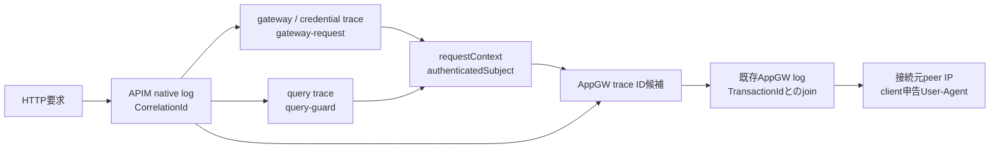

# APIM監査の識別情報

この文書はWIPである。監査出力の契約と照会用資材を説明し、資材の実装、ローカル検証、対象環境への適用と受入を区別する。保存先、保持期間、アクセス権限の設計は既存の監査基盤に従う。識別情報を追加しただけで、J-SOXへの適合や実施した自然人の特定が完了したとは扱わない。

[audit-identification.kql](../../scripts/audit-identification.kql)は、APIMの要求を1行ずつ残し、認証主体、要求の情報、App Gatewayのネットワーク観測を照会する。[audit-usage.kql](../../scripts/audit-usage.kql)の利用量集計は変更しない。新queryで利用量や課金配賦を推測しない。

## 情報源と要求の相関

共通ポリシーは、監査データの準備を2つのleaf fragmentとして実行する。認証前の`core-request-context`が要求情報を作り、認証後の`core-audit-authenticated-subject`が確認済みの識別情報を作る。処理の順序と認証方法の選択は、`policies/`直下の`service.xml`が示す。要求情報を作った後、`core-trusted-ingress`がHTTP入口を確認し、拒否時には同じ要求情報と既存の監査処理を使って403を記録する。

STEP4の認証本体は`fragments/authentication/core-common-authentication/`に置く。同名XMLが分岐と検証順序を示し、同名C#の5区画を対応する式へ生成時に埋め込む。認証成功を示す2変数と確認済みの内部JSONを、後続の監査部品が照合する。標準Entra検証が失敗した場合は、共通`on-error`の`core-entra-authentication-error`が失敗を記録して401を返す。短いXML式だけのため、このエラー部品にC#ファイルは置かない。

監査の3部品は`policies/fragments/audit/<部品名>/`、入口確認は`policies/fragments/ingress/core-trusted-ingress/`へ置く。各部品フォルダには同名のXMLとC#を置き、`core-gateway-telemetry.cs`は同名XMLの認証主体の読取処理を担当する。query監査は`fragments/audit/core-query-telemetry/`の専用XML／C#へ整理する。CM拒否監査は`snippets/audit/credential-telemetry/`、接続応答の監査は`fragments/authentication/core-credential-connection-outbound/`の同名XML／C#が各messageと主体投影を所有する。配置先と移設手順は[管理構成](../../apps/gateway/apim/policies/README.md)を参照する。

C#は生成時にXMLへ組み込み、APIM内で実行するため、新しい外部通信は発生しない。部品化とフォルダ移設で、出力項目、未確認の扱い、長さ・形式の確認、保存先・保持期間を変更しない。

APIM nativeの`CorrelationId`を要求の主キーとする。custom traceの`requestId`と同じGUIDであることを確認して、新しい認証主体と要求contextを採用する。`gateway-request`はGateway／Credentialのtrace、`query-guard`はquery観測のtraceで記録する。独立した`context`イベントは追加せず、各traceの`requestContext`に共通情報を含める。共通識別情報は`auditSchemaVersion:2`で識別する。イベント名は維持し、`schemaVersion`は`query-guard`だけ2、`gateway-request`等の他イベントは既存の1を使う。

クエリ検査⑥で承認した有無・複数値の取得を維持し、利用目的が明確でない件数区分`countBucket`の計算・出力を削除する。棚卸⑦で`core-query-observation`へ観測専用化し、要求ごとの`gatewayQueryObservation`は`route`・`httpMethod`・`presence`・`duplicates`だけを持つ。監査側は要求・認証済み主体と`phase`・`statusClass`を合わせ、mode・`query-rejected`・`guard-error`は新規出力しない。段階は`received`・`backend-response`・`policy-error`である。過去の旧phase・modeは移行前の記録として区別し、旧`query-guard`のschema 1もKQLで読み取れる互換を維持する方針である。

query観測のローカル改修・検証は完了し、Azureには未反映で、Azureへのまとめ反映と実接続の受入は未実施である。旧API参照・旧fragment・旧Named Valueは、新参照の反映・読戻し後にAzureから撤去する。後続の入口検査と不備時の400監査もローカル整備済みで、Azureには未反映である。設定選択は操作の基本設定とモデル別差分へ整理し、旧profileヘッダーを使わない。本文／モデル制約・URI変換・WAFに残る処理は別に棚卸し、観測専用化だけでqueryの通過や機能互換性が整ったとは扱わない。以後の推奨は必要性・効果・負荷・複雑さを比較して判断する。

入口検査の`gatewayApiInputValidationPassed`がfalseの場合は、共有HTTP APIテンプレートで`rejected`・`INVALID_CONTENT_TYPE_HEADER`・400を監査へ記録し、理由`Invalid Content-Type header`の本文なし400を返す。`apim-request-id`と`Cache-Control: no-store`を維持する。既存の要求情報と確認済みの利用者情報を使い、この段階で未確認のモデルやAPI個別の利用許可、Content-Typeの生の値は記録しない。trueは宣言条件の通過または対象外による検査省略を表し、完全なMIME構文や要求全体の妥当性を保証しない。監査JSONの項目・版番号は変更せず、保存済みの旧理由コードも書き換えない。過去の広い入力検査による拒否を、すべてContent-Type不備として再解釈しない。

AppGWの`x-appgw-trace-id`は、要求headerを読んだ時点では相関候補である。GUID形式や信頼した入口の検査は、本人の認証を意味しない。既存AppGWログの`TransactionId`とGUIDを正規化してjoinし、一致するログがあるかを別に確認する。native診断で既に収集する同headerも候補のfallbackに使う。contextの採用を見送った場合も、同じ要求へ結び付くtrace ID候補は保持する。contextとnativeを含む候補が異なる場合は、片方を選ばず`inconsistent-candidate`とする。

この相関はHTTP要求の経路を対象とする。WebSocket確立後のframe、WebRTCのメディア通信まで同じheader相関で識別できるとは扱わない。

## 出力する項目

### 認証主体

通常の経路では、共通ポリシーの認証の`choose`を通過した後、検証済みの要求内状態から`gatewayAuthenticatedSubject`を1回作る。各traceはその変数から許可した項目だけを`authenticatedSubject`へ写す。認証前の早期拒否など、変数が未作成の段階では`unverified`を使う。本文、要求headerや生tokenを読み直して主体を補わない。API操作の認可結果とは独立しており、認証済みでも操作が拒否された要求を未認証に置き換えない。

Bearerの標準トークン検証と本人識別が完了した後に、会社設定や内部処理の不備で終了する場合は、失敗監査用の`gatewayEntraFailureSubject`を使う。`core-common-authentication.cs`の`entra-failure-subject`区画が、先に保存した本人情報を現在の要求IDと検証通過の証拠に照合し、確認できた本人だけを記録する。本人情報が未成立なら`unverified`、保存情報や証拠が不整合なら`inconsistent`とし、本人IDを採用しない。この監査のために、後続APIが参照する認証完了の変数を成功へ変更しない。

本人情報の不備は401・`INVALID_AUTHENTICATION`、会社設定の不備は500・`INVALID_GATEWAY_CONFIGURATION`、予期しない内部処理の不備は500・`AUTHENTICATION_PROCESSING_ERROR`として記録する。失敗時のtraceだけ、既存の`core-gateway-telemetry.cs`の読取先を専用変数へ変えて展開する。正常時の監査部品と出力項目は維持し、例外の詳細や生の設定JSONを出力しない。

| 項目 | 型・値 | 情報源と意味 |
| --- | --- | --- |
| `status` | `verified` / `unverified` / `inconsistent` | 共通認証の検証済み状態と主体情報の整合。欠落から成功を推測しない |
| `kind`・`method` | `entraUser`・`user`、または`apimSubscription`・`subscriptionKey` | 実際に通った認証経路。有効キーとBearerの同時提示ではキー経路を維持 |
| `callerId` | string。購読の経路は269文字以内 | 検証済みのユーザーまたは購読から組み立てる呼出主体 |
| `subscriptionId` | string、256文字以内 | APIMが検証した購読。キーの値自体は記録しない |
| `tenantId`・`principalId` | 正規化したGUID | 検証済みEntraのテナントとObject ID |
| `clientId` | GUID、または空文字 | 検証済みtokenから得たクライアント。採用できる値がない場合は空文字とし、任意のUser-Agentや申告アプリ名で補完しない |
| `allocationId` | string | 同じ検証済みユーザーの利用枠への帰属 |

購読はアプリや複数利用者が共有できる認証主体であり、自然人を証明しない。Entraの主体やクライアントの識別子も、実施者・委任関係の確認では既存の台帳と照合する。IP、User-Agent、親要求ID、HTTP成功だけで本人を確定しない。

購読IDの256文字は、本リポジトリが扱う購読IDの上限に合わせた値である。`subscription:`の13文字を加えた呼出主体は269文字まで扱い、主体の作成・監査への転記・KQLの読取りを揃える。Azure全体の購読IDの最大長を示す値ではない。

STEP5の主体作成では、認証完了2変数と内部JSONを型付きで読み取り、購読IDの保存値や社員・テナント・呼出主体・利用枠の対応を照合する。情報が未確認なら`unverified`、型や対応に不整合があれば`inconsistent`だけを渡し、IDを採用しない。監査の照合に失敗しても認証済みのAPI要求は続行し、生JSON・トークン・例外本文を記録しない。

### 要求context

| 項目 | 出力の型・上限 | 情報源・信頼の範囲 |
| --- | --- | --- |
| `requestId`・`apiId`・`operationId` | string | APIMの要求・API・Operation。従来のトップレベル3項目も維持 |
| `requestReceivedAt` | UTCのISO文字列 | APIMが取得した要求時刻。LAWの`TimeGenerated`とは別 |
| `httpMethod` | string | APIMが取得したHTTP method |
| `operationTemplate` | string / null、512文字以内 | 登録済みOperation templateからqueryを除去。実要求のURLやパラメーター値を記録しない |
| `apimPeerIp` | 正規化したIP文字列 / null | APIMの直前の上流peer。AppGW等のproxyのIPになり得る |
| `reportedUserAgent` | string / null、512文字以内 | clientがHTTP headerで申告した値。認証されたアプリの証明には使わない |
| `appGatewayTraceId` | 正規化したGUID / null | AppGWログとの相関候補。認証・操作認可に使わない |

contextの追加で、要求本文の読み取り、外部への照会、tokenの再decode、追加の要求拒否を行わない。取得・整形に失敗した補助項目を、資格情報の再提示や通信停止で補わない。監査の主体情報が矛盾した場合は、その矛盾を出力して認証条件と分けて確認する。

### AppGWで観測した補助情報

queryは`AGWAccessLogs.TransactionId`とのjoinが一意に成立した場合に、`appGatewayClientIp`、`appGatewayUserAgent`、HTTP／backend statusとログ時刻を出す。複数の異なるログ候補がある場合は`ambiguous-log`を残し、どれかのIPを採用しない。同じ情報の重複取り込みは、同じ要求の別実行とは数えない。

`ClientIp`はAppGWが観測した直前の接続元である。社内proxyやNATが前段にあればそのpeerを示すため、個人端末のIPとは断定しない。任意の`X-Forwarded-For`の先頭値を本人IPとして採用しない。`UserAgent`はHTTP clientの申告であり、検証済み`clientId`と別に表示する。queryのUser-Agent出力は512文字に制限し、AppGW側の値を切り詰めた場合は`appGatewayUserAgentTruncated`を出す。切り詰めた部分だけが異なるログも内部の完全値比較で区別し、`appGatewayDistinctVariants`（最大32）と`ambiguous-log`で示す。

## queryの採用規則

| 状態 | queryの扱い |
| --- | --- |
| nativeに要求がありcustom traceがない | 要求を残し、認証主体は`unverified`、contextは`missing`。nativeのHTTP結果を表示 |
| 旧traceだけがある | 旧イベントとphaseを表示。旧`authorization:allowed`や購読列から新しい`verified`を合成しない |
| 初期`unverified`の後に整合した`verified`がある | explicit `verified`の主体が1種類で、矛盾がなければ採用。初期未確認の観測件数も表示 |
| 複数の異なる`verified`主体、explicit `inconsistent`、不正な`verified`構造 | 主体を`inconsistent`にし、採用するID列を空にする。許可項目だけの候補を`authenticatedSubjectVariants`に残す |
| 新contextの要求ID・API・Operationがnativeと不一致、形式不正、複数の異なるcontext | `requestContextStatus:inconsistent`。contextを採用せず候補とnative情報を残す |
| AppGW候補なし／ログ未着／複数候補 | `no-candidate`／`unmatched`／矛盾のstatusを表示。本人認証やネットワーク観測を推測しない |

同じ要求の`accepted`・`backend-response`・`query-guard`等は観測であり、実行回数ではない。queryはnativeの要求単位で集約してから左joinし、phaseの数で要求件数を増やさない。`customObservationCount`は観測数として区別する。CorrelationIdが欠けたnative行も消さずquery内の行識別子を付けるが、その識別子は再照会で安定する要求IDではない。

最終HTTP結果はnativeの`ResponseCode`・`BackendResponseCode`を表示する。2xx、SSEの接続成功、backend到達は、ツールの完了や業務処理の成功を証明しない。native自身の重複行に異なる情報があれば`nativeMetadataStatus:inconsistent`を別に表示する。

KQLのstring列では欠落が空文字となる。metadataが未確認の場合、採用する主体・contextは空bag、stringは空文字、datetime／数値／boolは対応するnullを使う。APIポリシーのJSONにおけるnullと、queryの表示形式を混同しない。

## 処理量と確認範囲

APIMのポリシー式には独自の構文と許可メンバーの制約がある。制御文の本体は1行でも`{ }`で囲み、[公式の許可メンバー表](https://learn.microsoft.com/azure/api-management/api-management-policy-expressions)と照合する。時刻は`ToString("O")`で表現し、許可されていない`ToUniversalTime()`は呼び出さない。照会では`Z`または`+00:00`を持つUTCのISO文字列を検証する。通常のC#コンパイラーによるfixtureの成功だけで、APIMへの適用成功を判断しない。

正常の経路では、共通認証の後に主体のsnapshotを1回作り、各traceは小さなsnapshotとcontextから許可項目を写す。主体の検証処理を各fragmentへ重複展開しない。Bearerの設定・内部処理エラーでは、保存した本人情報から失敗監査用の主体を準備し、従来の失敗traceを1件出して終了する。本文読み取り・buffer・外部network要求を追加しない。正常時は既存のGateway／Credential／query traceの発行回数を維持する。従来traceがなかった信頼した入口の403拒否だけは同じGateway監査を1件追加し、拒否条件とHTTP statusを変えない。

各traceのJSONは識別項目の分だけ大きくなる。User-AgentとOperation templateには512文字の上限を設ける。[合成fixture](../../tests/test_audit_identification.py)の`run_fixture([], benchmark=True)`は、変更前のbaselineと主体snapshot・2件のGateway traceを比較し、ローカルの処理時間とJSONサイズの増分を返す。実行にはPowerShellとRoslynが必要である。Azure上の処理時間、LAWの取り込み量・費用は未計測であり、ローカルの合成測定から実環境の値を推測しない。保存設計や保持設定を変更せず、既存の診断・ログ転送の条件に従う。

queryはAPIM/AppGWの資源と時間区間を先に絞り、custom traceを展開した後、要求単位に集約してjoinする。候補のbagには上限を設け、body・URL/query・token・Cookie・任意headerを出力しない。資材や合成fixtureの検証を、対象環境への適用済み・性能検証済みとして報告しない。

[照会fixture](../../tests/audit_identification_fixture.py)の`prepare_query()`は、正本のqueryへ独立した合成datatableと固定時間区間を渡し、要求単位の期待値を返す。fixtureの生成自体はAzureへ接続せず、KQLエンジンの実行を意味しない。エンジンで検証するときも、この合成版を使い、実ログの読み取りや設定変更と区別する。

公式仕様: [APIM Gateway Logs](https://learn.microsoft.com/azure/azure-monitor/reference/tables/apimanagementgatewaylogs)、[AppGW Access Logs](https://learn.microsoft.com/azure/azure-monitor/reference/tables/agwaccesslogs)、[AppGWによる要求headerの追加](https://learn.microsoft.com/azure/application-gateway/how-application-gateway-works#modifications-to-the-request)。
