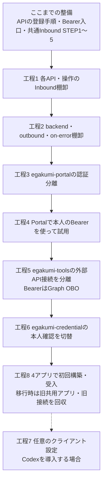
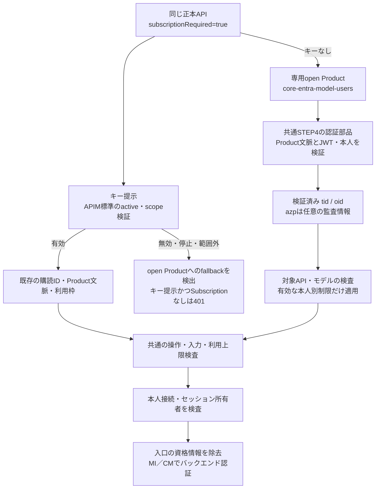

# Entraアプリ分離とアクセストークン認可の作業計画

依頼項目#8は、工程3〜8のEntraアプリ分離、アクセストークン認可、空環境の構築手順を指す。[PR #78](https://github.com/hrkd83/egakumi/pull/78)でマージした時点の構築手順は、Codexを含む5アプリ構成だった。

現在の[正式な初回構築手順](../../README.md#新規クローンから構築する)は、API・Tools・Credentialを事前登録し、`azd up`でCoreと認証用の公開証明書を準備する。API用の公開証明書登録と4つ目のPortalアプリの手動登録・同意を済ませ、GatewayとPortalを順に個別配備する。Codexは基盤の受入後に必要な場合だけ接続する。この一連のAzure配備、Entra登録・同意、実接続は実環境での受入待ち。以下にある個別のAzure確認記録は、各変更を確認した時点の結果である。既存環境の移行では、工程8で旧共用アプリ・接続を回収する。実環境の作業と証跡は環境別の保護領域に記録する。

工程1（APIMのInbound棚卸）と工程2（backend・outbound・on-errorの棚卸）は完了判定前。共通認証・要求準備やテンプレート整理の実装が進んでいる。全操作の適用先・制御・継承の照合と、Gateway配備後の実効ポリシー・代表経路の確認が残る。工程3のPortal証明書認証と工程4の本人Bearerによる試用は実装済みで、実環境の受入を待つ。

## 工程3〜8の資材と受入条件

| 工程 | 資材 | 実環境で確認すること |
|---|---|---|
| 3 Portalの認証分離 | ACA JobでPortalの署名鍵と公開証明書を準備し、別アプリへ登録。サインインとAPI試用に専用の証明書認証を使用 | 公開証明書登録と同意、ログインと本人の照合 |
| 4 PortalのAPI試用 | Portalログインと別のAPI用OAuth、本人照合、専用の暗号化SQL保存、キー／Bearerによる試用 | 両方式の正常処理、更新と失効、別本人の拒否、非同期・ストリーミング・Realtime |
| 5 ToolsとGraph OBO | 購読キーでは本人がToolsで作成したCM接続を使用。BearerではBrokerがAPI専用証明書でGraphへOBO交換 | Graph再同意・更新、OBOの証明書登録と実交換、Graphの本人とscope照合、同意不足時のエラー |
| 6 Credentialの本人確認 | Toolsとは別のOIDCクライアント・戻り先・secretを入力。新規構築では専用アプリを指定 | ブラウザーの本人確認、PKCE／state／nonce、他人の接続の拒否 |
| 7 Codex端末への配布（任意） | 基盤の受入後に選ぶクライアント向けの[TIPS](../tips/codex-gateway-oauth.md)。AzureポータルでのPublic client登録、PKCE、端末での手動設定と切り戻しを扱う | 採用時にCLI・Desktop別の先行端末、Enterprise併用、更新・推論・SSEを確認 |
| 8 4アプリで初回構築 | [API](../setup/02-entra-api.md)・[Tools](../setup/03-entra-tools.md)・[Credential](../setup/04-entra-credential.md)を先に登録 → `azd up`でCoreと公開証明書2枚を準備 → API証明書を登録し、Portalアプリを作成・証明書登録 → Gateway → Portal | 空のAzure環境で正式手順を一貫して実行。既存環境の旧アプリは利用先を照合した上で回収 |

空環境では[Core前の登録手順](../../README.md#新規クローンから構築する)と[初回構築手順](../setup/08-provision-core.md)を使う。Coreの初回は`portal.authentication`を省略する。Portalの公開証明書をEntraへ登録し、管理者の同意を得てから、そのアプリのTenant ID・Client IDを同じ環境別paramsに追加する。その後、Gateway、Portalを順に配備する。

同じ業務APIのURLで、購読キーの提示を優先し、キーがなければBearerを検証する。両方式への対応を標準とし、公開設定に有効化スイッチ、Bearer対象APIの選択、クライアントアプリ許可リストは設けない。

各APIの先頭で承認した3処理は、`X-Core-Caller-Id`／`X-Core-Subscription-Id`を削除して続行、`x-ms-client-request-id`をAPIMの要求IDで上書き、共通認証の完了が未設定またはfalseなら503で停止する。各APIテンプレートの`<base />`直後から、XMLだけの[要求準備の部品](../../apps/api-gateway/policies/fragments/request/core-api-request-preparation/README.md)を呼ぶ。認証の再実行ではなく、後続処理への引渡しを整える。後段の要求ID再設定やBearerの再確認は、別の棚卸対象として維持する。

棚卸⑦では、URLクエリ部品を`core-query-observation`へ観測専用化する方針を承認した。API操作の`queryObservation`、生成MCPの`mcp.queryObservation`、外部MCPの`mcpProxy.endpoints[].queryObservation`から、操作ID辞書`queryObservations`と`HTTPメソッド + 空白 + 公開相対path`辞書`mcpQueryObservations`を生成する。サービス・モデル形式・入力制約kindで対象を推測しない。公開pathと下流の`uriTemplate`を区別し、標準3ラベルと対象入口を保持する。観測ラベルはASCII英字で始まる1～64文字の英数字・`_`・`-`とし、小文字の`none`／`unknown`を完全一致で予約する。

要求ごとの`gatewayQueryObservation`は`route`・`httpMethod`・`presence`・`duplicates`だけを保存する。mode・許可判定・応答statusと、この部品による400／500の拒否分岐を撤去する。観測できない情報は`unknown`として扱う。認証完了は先行する`core-api-request-preparation`が確認し、この部品では重複確認しない。要求準備のマーカー未設定／falseに対する503は維持する。HTTP／生成MCP／外部MCPで、認証後・本文前の既存の実行位置を保ち、WebSocketへは追加しない。

⑥で承認した有無・複数値の取得を維持し、件数区分`countBucket`の計算・出力を削除する。query監査のイベント名`query-guard`、`schemaVersion: 2`、共通識別情報の`auditSchemaVersion: 2`は維持する。新規出力は`received`・`backend-response`・`policy-error`の3段階とし、mode・`query-rejected`・`guard-error`は出力しない。過去の旧phase・modeは移行前の記録として区別する。他イベントのschema 1と旧query/schema 1のKQL読取り互換は別に保持する方針である。

旧`gateway.queryGuards`、APIの`queryGuard`参照、`core-query-guard`fragment、`core-query-guard-modes` Named Valueは廃止対象であり、新規設定に使わない。④・⑤までのmode補完・設定不備で停止する方式は移行前の設計となる。ローカル入力とAPI定義を新契約へ移行し、新fragmentと参照APIのAzure反映・全graph照合・読戻し、正本checkpoint更新を完了した。APIMではキー／BearerのResponses JSON・SSEと対応する監査照合を確認した。旧fragment・旧Named Valueは参照不在を確認して退役し、読戻しで不在を確認した。現行生成元・構築入力・正本checkpoint・通常配備の期待値に旧資材が含まれないことも確認した。所有・currentの一般照合と過去の保護証跡は維持する。query観測・転送や他の経路の受入は未完である。反映・実接続の受入・旧資材退役は別に管理する。

今後の追加対象にはBox・WorkIQ・社内HTTP API・外部MCPと、Claude等のResponses／Chat Completions以外のモデル契約も含める。共通認証・利用者監査・汎用転送をサービス名やモデル形式から分離する方針で棚卸を進める。棚卸⑦ではquery観測を専用部品へ整理し、その後の[入力検査](../../apps/api-gateway/policies/fragments/request/core-api-input-validation/README.md)では標準13操作を`inputContract={}`で選び、query制限・HTTPメソッド再確認・入口MIME一覧比較の撤去を承認した。対象表の操作値も`{}`とし、共通のContent-Type宣言条件だけを確認する。操作登録とAPIMの照合、入口不備時の`INVALID_CONTENT_TYPE_HEADER`監査と本文なし400・要求ID・no-storeは維持する方針を承認済みである。段階2では旧ヘッダーを選択条件に使わず、API・モデルから内部設定を自動選択する。Portal・試験CLIの旧付与も撤去し、APIMの転送前削除だけを残す。操作の基本設定＋モデル名をキーとした`modelSettings`差分へ整理し、`profiles`・`defaultProfile`・`modalities`を新正本から撤去する。モデル別の出力項目・上限・固定URIと既存受付条件は維持する。 後段のMIME制御・Speech転送・URI変換・モデル本文検査・生成MCPのPII向け制約は別工程で棚卸する。ソース整備・Azure読戻し・実受入は分けて確認する。限定確認以外の実APIM受入、queryの転送や任意形式の下流受付、基盤全体のサービス互換性まで完了したとは扱わない。残る処理は必要性・効果・負荷・複雑さを比較して採否を判断する。

承認したPII入口の分割は、APIMではなくApp GatewayのWAF設定である。現行構成では、`g-pii-rest`を`/tools/pii/v1/redact`の`RequestArgValues / Equals / text`だけへ、`g-pii-mcp`を`/tools/pii-v1-mcp/mcp`の`RequestArgValues / Equals / params.arguments.text`だけへ対応付ける。Portalの`p-pii-redact`は維持する。このWAF変更はAPIMの入力検査とは独立し、APIのURL・キー／Bearer認証・モデル機能・OBOを変更しない。URI制約と他のWAF規則は未棚卸のまま保持する。

PII分割のAzure反映・読戻しと、正常なREST要求およびMCP初期化・ツール照会・PII実行の通過・マスキング確認を完了した。旧`g-pii-redact`は参照がないことを確認して退役した。WAFとAPIMの適用・受入は分け、一連の変更を一括コミットする。通常reconcileによる旧資源の自動削除へは変更せず、移行時の保持・復旧と成功後の限定退役を区別する。移行元は通常の新規構成と区別し、同名queryへの除外やAzureのJSON解析の挙動をローカル生成だけで確認済みとは扱わない。[設定と移行順](../testing/waf-compatibility.md#pii入口の除外をrestとmcpへ分ける)を参照する。

`core-query-observation`と`core-query-telemetry`は専用フォルダの同名XML／C#へ整理し、Azureの日本語説明・新人向けの処理説明を揃える。APIの[REST、WebSocket、外部MCP、生成MCP](../../apps/api-gateway/policies/api-templates/README.md)は`api-templates/`、All APIsの全体ポリシーは`service.xml`で管理する。外部MCP用の観測フローは`mcp/external.xml`に定義する。

## 完遂までの順序

基盤用のEntraアプリは**4つ**。以下の工程番号は依頼項目#8の作業区分を表す。工程7は基盤の受入後に行う任意のクライアント設定とする。工程ごとの現在の適用状況は冒頭の表を参照する。既存環境を移行するときは、新構成の実接続と旧構成への依存を照合してから、旧アプリ・CM接続・秘密参照を回収する。



| アプリ名 | 最終的な責務 | 分離・整備する工程 |
|---|---|---|
| egakumi-api | APIMで公開するAPIの宛先。Gateway.Invokeを公開。下流トークン交換の中間APIも兼ねる | APIごとの入口制御は工程1～2、GraphのOBO資格情報と委任権限は工程5 |
| egakumi-portal | Portalのサインインと本人のGateway.Invokeの取得 | 工程3〜4。証明書認証でサインインとAPI用OAuthを実行 |
| egakumi-tools | CMがGraph等の外部API向け委任トークンを取得・更新 | 工程5。専用secretで本人のCM接続を取得・更新 |
| egakumi-credential | 接続ログイン窓口で本人を確認 | 工程6。外部APIの業務権限やPortal管理権限は持たせない |

既存環境の移行では工程8で旧共用アプリの利用先を確認して回収する。Azure側のManaged Identityは用途ごとに管理する。Codexを採用する場合は基盤の受入後に専用のPublic clientを登録する。 [Codexの接続手順](../tips/codex-gateway-oauth.md)

認証用EntraとAzure基盤は別の設定とする。PortalとGraph OBOは同一・別テナントの双方を対象とし、Azure側の鍵で署名する。個別の公開証明書を認証Entra側へ登録する。本文監査の中継は別の認証経路を持つため、有効時の[同一テナント条件](request-body-audit.md#初回構築)を確認する。

工程5のGraph `/me` は、本人BearerをOBO、購読キーをCM本人接続へ渡す構成を実装済み。実環境では対象アプリへの証明書登録と委任 `User.Read` の同意を確認し、両経路で同じ本人を取得できることを確認する。

Gateway.Invokeのトークンはegakumi-api向けなので、OBOの交換もegakumi-apiのclient IDで認証する。実処理をBrokerへ置く場合でも、egakumi-toolsやegakumi-credentialのclient IDで同トークンを交換しない。egakumi-apiの専用証明書とGraphの委任権限で下流を認可する。

| 工程 | 次へ進むための完了条件 |
|---|---|
| 1 各API・操作のInbound | 制御を一つずつ説明・判断し、採用した処理を整理・反映・疎通確認。部品を初めて扱う段階で最終フォルダ・同名XML／C#・Azureの日本語説明・処理説明を揃え、未判断項目を明記する。APIM独自のモデル機能制限を未確認のまま残さない |
| 2 backend・outbound・on-error | 転送先・下流認証、ストリーミング、応答・エラー・監査を確認。policies配下の全資材が最終フォルダ構成に収まり、不要なlegacy系ファイルと参照が残らない状態でポリシー棚卸を完了 |
| 3 Portal認証分離 | 新アプリでサインイン・管理Graphが動作し、既存のユーザー・キー所有権・本人接続状態を維持 |
| 4 PortalのAPI試用 | 同じAPIへキー／Bearerを選択して送信でき、更新・再認証と全対象機能の所有者確認が成立 |
| 5 Tools分離・Graph OBO | CMの新接続の取得・更新、再同意と回収、BearerのOBOとキーのCM経路を確認 |
| 6 Credential分離 | 新アプリで接続ログインの本人確認が動作し、既存CM接続を別人へ引き継がない |
| 7 Codex展開（任意） | 基盤受入後の追加試験。採用時に対象のDesktop／CLIでOAuth・推論・ツール、管理設定の配布・復旧を確認 |
| 8 旧構成撤去 | 旧アプリ・旧資格情報・旧provider/profile・旧設定の参照がなく、正式手順で最終構成を新規構築できる |

基盤の各工程にはEntraの画面付き事前準備、params／schema、IaC／配備、機能の実装、検証、正式手順の更新を含める。アプリを登録しただけで分離完了とは判定しない。

### 工程1・2を完了とする配置・撤去条件

工程1・2を終えて工程3のPortal分離へ進む時点で、`apps/api-gateway/policies/`の全資材を、[管理README](../../apps/api-gateway/policies/README.md)の最終フォルダ構成へ収める。共通の`service.xml`は直下、その他のポリシー資材は`fragments/`、`api-templates/`、`operation-policies/`、`snippets/`等の目的別階層へ配置する。分離したC#は同名XMLと同じ部品フォルダへ置く。

不要なlegacyフォルダ・旧XML／C#・旧inlineテンプレート・移行用コピーを残さない。別名や別フォルダへの移動だけで撤去済みとは扱わない。生成・配備処理、旧方式専用の検査・テスト、文書の参照も整理し、旧資材がなくても新規構築と再配備が成立することを確認する。

この配置・撤去は工程1・2の完了条件であり、工程8へ先送りしない。工程8で扱う旧Entra共用アプリ・旧CM接続等の撤去とは区別する。

## 証明書・シークレットの選択

対象はEntraアプリのclient secretである。証明書の秘密鍵、Portalのセッション署名・暗号化鍵、CMが保持する本人のrefresh token等の管理は引き続き必要になる。

| 対象 | 新規構築で使う方式 | 受入する工程 |
|---|---|---|
| egakumi-api | APIの入口はEntraが発行した本人トークンを検証。Graph OBOは証明書client assertion | 工程1・2で設計、工程5でOBO実装・証明書登録・交換の受入 |
| egakumi-portal | Key Vaultの非exportable鍵で署名する証明書client assertion | 工程3。同一・別テナントとローカル開発の認証を確認 |
| egakumi-tools | CM専用のclient secret | 工程5。接続の作成、再同意、更新を確認 |
| egakumi-credential | BrokerのOIDCコード交換に専用client secret | 工程6。本人確認・別人拒否を確認 |

Microsoftの[CM公式手順](https://learn.microsoft.com/en-us/azure/api-management/credentials-how-to-azure-ad)は、secret方式とFIC方式の両方を案内している。CMのFICは、APIMが表示するIssuer・Subject・Audienceを、EntraアプリのFederated credentialsへ「Other issuer」として登録する。現在の`credential-manager.bicep`と秘密入力はclient secretを前提としているため、製品の対応だけで既存実装がsecret不要になったとは扱わない。対応するARM／API・生成設定、登録順、接続の再同意と更新、復旧を確認する。

CMのFICと、Managed IdentityをEntraアプリへ直接信頼させるFICは別の方式として調査する。後者の[公式仕様](https://learn.microsoft.com/en-us/entra/workload-id/workload-identity-federation-config-app-trust-managed-identity)はManaged Identityとアプリ登録が同じテナントに属する条件を持つ。その条件をCMの「Other issuer」方式へ自動的に当てはめない。認証EntraとAzureが別テナントの構成でも、CMのFICが成立するかを先行試験で確認する。

PortalとOBOの署名はAzure側のManaged Identityを用い、個別の公開証明書を認証Entra側へ登録する。Azure側と認証側が別テナントの場合も、署名と登録で対応するテナントを照合する。

ToolsのFIC対応とCredentialの証明書対応は、採用する場合に更新・失効・復旧を含めて別に検証する。

## 初期導入の方針

- **APIエンドポイントを共通にし、同じURLへ`api-key`または`Authorization: Bearer ...`を送る。** 別URL・社員APIの複製は作らない。既存APIの正本・Product・キーの購読範囲を維持する。
- Bearer対象は全業務APIの正本・生成MCP・設定済みCM保護入口から自動生成する。ブラウザー／callbackは専用の一時取引認証を保持する。全transportの実受入を完了条件とし、一部の試験だけを全対応の受入と記録しない。
- **APIの`subscriptionRequired=true`を維持する。** 対象APIだけを、購読不要の専用Product `core-entra-model-users`へ追加する。既存の購読必須Product・関連付け・キーを変更しない。
- 有効なキーはAPIM標準のactive状態・API／Product／all-APIs／service範囲検証へ進め、キーなし要求だけを専用open Productの文脈でJWT検証する。無効キーがopen Productへフォールバックしても、キー提示と`context.Subscription == null`を共通認証で検出して401にする。有効なJWTでも救済しない。
- 認証用Entraテナントのユーザー全員を利用対象とする。専用の利用者／グループ許可台帳を初期必須条件にしない。APIMにクライアントアプリの許可リストは設けず、クライアントへの委任許可・同意・割当はEntraで管理する。
- Bearer利用は基本無制限とし、毎分トークン上限・月間等の期間quotaは`null`で明示的に無効化する。機械的な大量要求を抑えるrequest rateだけを暫定的に設け、有効な制限は全員共通の設定値を本人`tid+oid`ごとに計数する。キー側の既存上限・counterは維持する。
- Gateway.Invokeは入口の呼出権限。API・モデルの許可、利用枠、CM接続所有者の検査を省略する条件にしない。
- トークン認証失敗をキー方式へ自動的に切り替えない。本人が不明な要求、認可障害、制限設定の欠落・不正値を明示的な`null`と同じ無制限設定へ変換しない。
- 各段階の受入完了まで旧アプリ・旧provider・必要な旧証明書を残す。撤去は独立した最後の作業にする。

## 準備：変更前に確定・記録すること

| 作業 | 成果物・完了条件 |
|---|---|
| 作業差分と現在の正本を確認 | 最新mainを確認し、通常の作業ブランチで編集する。既存の未コミット変更を破棄せず、作業用コピーへ変更を切り出してコミット内容を合成しない。既存機能の基準試験を記録 |
| 対象の棚卸し | 有効API、REST操作、MCP、SSE、WebSocket、WebRTC制御、非同期結果・取消、CM補助操作の一覧 |
| 実際の設定を読戻す | APIM SKU、API/Productの購読要件、global→product→API→operationの有効ポリシー、MI/RBAC、AppGW経路・buffer・timeout |
| テナントと管理担当を分離 | Azure側の作業と認証Entra側のアプリ・同意作業を別工程にする |
| CM設定の結合を解消 | credentialLoginの本人確認設定をcredentialProvidersから独立させる。当初は旧アプリを参照し、外部API用Client ID変更で本人確認まで変わらないようにする |
| 復旧単位を用意 | ポリシー・API公開定義・イメージdigest・構成・証明書versionを戻せる記録と、機能の無効化手順 |

並行する実装は別worktree・作業ブランチで進める。共通CLI・configuration・試験・構築出力に影響する変更では、相手の差分を確認してから統合する。mainへのマージと同じAzure環境への適用は順番に行い、後の作業側は最新mainを取り込んで変更を統合し、必要な検証と構築出力を更新する。並行作業前の生成物や準備記録を、そのまま後の適用へ流用しない。

実値・secret・token・環境証跡はチェックアウト直下の.local/<environment>/と.azure/に限定する。公開文書にはプレースホルダーだけを使う。計画・読戻し・変更内容を分け、環境と所有resourceを照合する既存CLI方式を利用する。

現行仕様の根拠は[キー認証の設計](gateway-key-auth-plan.md)、[ポリシー一覧](apim-policy-catalog.md)、[本人接続v2](credential-manager-login.md)。これらの現行仕様は、実装完了時に新旧経路を区別して更新する。

## Entraの事前準備手順を改訂する

旧手順ではPortal・接続窓口・CMでWebアプリを共用していた。新規構築では、登録ごとに役割・権限・資格情報・準備順を定めた[基盤用アプリの登録手順](../../README.md#新規クローンから構築する)を使用する。

### 事前準備で作る設定一覧

| アプリ | プラットフォーム・戻り先 | 権限・scopeの分担 | 資格情報 |
|---|---|---|---|
| egakumi-api | APIリソース。戻り先不要 | Gateway.Invokeを公開、requestedAccessTokenVersion=2。OBO用のGraph委任User.Readと管理者同意 | OBO専用の公開証明書 |
| egakumi-portal | Web。Portalの/api/auth/callback/microsoft。API追加認証の/api/api-auth/callbackも同時に登録 | ログインはopenid/profile/email。「試す」はegakumi-apiのGateway.Invoke委任権限と必要なoffline_access | KV署名用証明書の公開部分。Entra client secretは作らない |
| egakumi-tools | Web。CM標準redirect | Graph /meは委任User.Read、OIDC・更新に必要なscope。WorkIQはresource別に確認。Portal管理Graph権限は付けない | CM専用client secret |
| egakumi-credential | Web。接続窓口の/auth/connections/browser/identity-callback | OIDC本人確認。Graph業務委任やPortal管理権限を付けない | 本人確認専用client secret |

登録先は認証用Entraを基本とし、Azure基盤のtenantを自動的に採用しない。Single tenant、Implicit grant OFF、clientごとの管理者同意・Enterprise applicationの利用者割当・MFA／条件付きアクセスを確認する。

OIDCのscope、外部APIの委任権限、Graph管理のアプリケーション権限を分けて説明する。現在の「7権限を全部同じアプリへ追加」「3戻り先を同じWebアプリへ追加」「1つのsecretを全用途で共用」という手順を、新構成の手順として残さない。

### 新規構築と既存環境の移行を分ける

| 導入方式 | 手順に含めること |
|---|---|
| 基盤の新規構築 | 4アプリのClient ID、scope、予定の戻り先を役割別に扱う。Coreで生成した2つの公開証明書をEntraへ登録し、GatewayとPortalを順に配備する |
| 既存共用アプリからの移行 | 現アプリのclient ID、権限、redirect、利用先、secretの用途を確認。新アプリを並行追加し、段階ごとの切替・再同意・取引排出・rollbackを案内する |
| 開発用認証 | Portalのlocalhost Web callbackは本番の登録・鍵と分ける。本番アプリへ開発戻り先を無条件に追加しない |

Portal証明書を非exportableなKV鍵で生成するにはAzure側Key Vaultが先に必要である。新規構築手順には、(1)認証Entraのアプリ登録・API公開、(2)Azure側のCore基盤・KV・署名identity準備、(3)KV証明書生成と認証Entraへの公開証明書登録・同意、(4)資格情報preflight、(5)Gateway／Portal配備、の依存順を明記する。

新規構築は `azd up` または同じCore工程を実行する `azd provision` で基盤の準備を終え、Entra担当による2つの公開証明書の登録後に、GatewayとPortalを個別配備する。各コマンドの実行結果を記録する。

構築前の入力検査とアプリ配備直前の証明書preflightを分ける。初期入力の段階で未生成の鍵version／thumbprintを必須にしてCore構築を止めない。証明書実体・公開証明書登録・署名の対応は、基盤準備後に確認してからアプリを有効化する。

### 改訂対象のファイルと成果物

| 対象 | 計画に含める改訂 |
|---|---|
| [Core前のEntra登録](../../README.md#新規クローンから構築する)と[Core後の証明書登録](../setup/09-egakumi-portal.md) | 4アプリの責務、機能別の必要登録、準備順、画面ごとの設定、同意・割当、確認値、新規／移行の分岐を示す案内へ改訂。詳細は各章のアプリ別手順を使う |
| [prepare_registration.py](../../scripts/prepare_registration.py)・[registration-names.bicepparam](../../infra/registration-names.bicepparam)・[登録準備試験](../../tests/test_prepare_registration.py) | 役割別の予定redirect・必要な入力を案内できる形式へ拡張。Portal hostとCM用の戻り先は用途を分けて検査。既存命名出力と呼出元の互換性も確認。登録済みIDやsecretを要求せず事前計算できる契約を維持 |
| [07-params.md](../setup/07-params.md)・schemas・configuration.py | 基盤用4アプリのclient ID／認証tenant／scope／資格情報参照の記入先を役割別に説明。CM providerからPortalや接続窓口の設定を暗黙に導出しない |
| [portal.md](../setup/12-deploy-portal.md)・[Portalローカル認証](../testing/portal-local-auth.md) | Portal専用アプリ、公開／開発callback、証明書準備、API追加同意、KV到達・署名認可、ローカルruntime設定へ更新 |
| [credential-manager-login.md](credential-manager-login.md)・[credential-sql.md](../setup/11-deploy-gateway.md) | toolsのCM認可とcredentialの本人確認を分離。redirect、provider/profile、secret参照、旧接続移行の対応表を更新 |
| [README](../../README.md)・[01-prerequisites.md](../setup/01-prerequisites.md)・[scripts README](../../scripts/README.md) | Entra準備への導線、担当権限、機能別前提、Core bootstrapと再開手順を整合させる。既存リンク・見出し参照を確認 |
| [06-deploy.md](../setup/08-provision-core.md)・配備CLI／lifecycle | Core準備→認証証明書準備→Gateway／Portal配備の停止・再開と段階別preflightを案内。「一括構築1回で常に完了」の前提を改訂 |
| [construction-tests.md](../testing/construction-tests.md)・[integration-tests.md](../testing/integration-tests.md) | アプリ別登録・権限種別・同意・redirect・credential・v2 aud/scp・同一／別tenant・移行／rollbackの受入項目を追加 |
| Entra説明画像・設定図 | 共用アプリ画面を新構成の設定例として流用しない。役割別の画面・説明を用意し、実画面を扱う場合はAGENTS.mdの保存・公開規則に従う |

prepare_registration.pyは現在、公開名・CM redirect等をローカル計算するCLIであり、アプリを作成しない。この責務を維持する。アプリ作成／更新を自動化するなら、別の管理操作CLIで認証tenant・対象ID・所有stateを照合し、読取計画と実行を分ける。Graph／KV操作をARM用clientへ混在させず、秘密値を出力しない。

### 事前準備の受入と旧設定の整理

- 基盤用4アプリの設定一覧から、登録先tenant、client IDとObject IDの違い、権限種別、redirect、同意、資格情報の保管先を確認できる。
- 新規環境は必要な機能だけの準備手順で配備へ進め、別tenant構成でもCore→証明書準備→アプリ配備を再開できる。
- 既存環境は旧アプリを再作成・一括改名・secret失効せず、新アプリと旧接続を並行利用できる。
- 旧Portal redirect／Graph管理権限、旧CM redirect／外部API権限、旧本人確認redirectは、それぞれの利用先とrollbackが不要になってから個別回収する。他環境・他アプリが使う権限やsecretを削除しない。
- 旧PRE-003〜PRE-009の登録・権限7件・戻り先3件・共用secretのPASSを、新しい4アプリ構成の合格へ読み替えない。新条件は未実施として独立して記録する。
- 手順の追加と実装は段階ごとに揃える。新しい準備手順を、まだ未対応の現行CLIで実行できるものとして掲載しない。

## 入口認証の設計・実装内容（ここまでの整備）

### 1-1 Entraを準備する

認証用Entraにegakumi-apiをSingle tenantで登録し、次を設定する。

| 設定画面 | 設定 |
|---|---|
| APIの公開 | Application ID URI = api://<API_APP_CLIENT_ID> |
| スコープの追加 | Gateway.Invoke。基本は管理者同意 |
| Microsoft Graph形式のmanifest | api.requestedAccessTokenVersion = 2 |
| 証明書とシークレット・認証 | このAPIリソース登録にはsecret・証明書・redirectを追加しない |

Gatewayの入口認証をAzureへ反映し、APIを直接呼んで購読キーとBearerの経路を確認する。Portalは専用アプリで試用を受け入れる。Codexを接続する場合は基盤の受入後にPublic clientを登録し、先行端末から試験して管理設定を配布する。 [Codex接続のTIPS](../tips/codex-gateway-oauth.md)

### 1-2 認証主体と利用枠を分ける



Bearer要求では、署名・期限・自社tenant/issuer・v2のaud=<API_APP_CLIENT_ID>・scp内のGateway.Invoke・有効なtid+oidを検証する。api://...という要求scopeをv2のaudへそのまま設定しない。ID token、Graph token、アプリケーション専用tokenをユーザー委任tokenの代わりに認可しない。azpは単一の有効GUIDなら監査へ記録し、欠落・不正・重複・空・zero GUIDでも認可を狭めない。

利用対象は認証テナントの全ユーザー。検証済み本人に対し、対象API・モデルと有効にした全員共通の制限だけをサーバー側で適用する。`userLimits`の`requestRate`・`tokensPerMinute`・`tokenQuota`はすべて指定し、各`null`はその制限だけの明示的な無効化とする。非nullは内部必須項目と有限の正整数・period・boundsを検査する。クライアント申告の購読ID・所有者・providerを信用しない。有効な制限は複数API・モデル・clientをまたいでtid+oid単位に集計する。

初期案はrequest rateの暫定防御値を1000 requests／60秒とし、毎分トークン上限・期間quotaは`null`とする。1000は確定した推奨値ではなく、採用するクライアントで長い処理・ツール継続・retry・並列処理を確認して調整する。HTTP要求数は人のプロンプト数と異なり、これらの継続や再送は複数callになる。1推論内のreasoningだけで別HTTPが発生するわけではない。rateだけで攻撃を判定せず、既存WAF・Entra認証・client権限・API／モデル制約を維持する。提供元とAPIMの技術上限は別に適用される。

内部コンテキストは「認証方式」「検証済み本人」「正本API ID」「利用許可／利用枠ID」「監査主体」を区別する。context.SubscriptionはAPIMが検証したキー要求だけで使用し、トークン要求に仮の購読オブジェクトを作らない。

### 1-3 変更する箇所

| 対象 | 変更候補 |
|---|---|
| [schemas](../../schemas/)・[configuration.py](../../scripts/deployment/helpers/configuration.py) | gateway.authentication.entraはaudience・requiredScope・userLimitsだけを公開。enabled・allowedClientIds・apiNamesは未知項目として拒否。3つの制限は各nullで無効化でき、欠落・不正値は拒否。Entra設定のない旧構成は従来キー方式 |
| [api-publication.bicep](../../apps/api-gateway/api-publication.bicep)・[api_publication.py](../../apps/api-gateway/deploy/api_publication.py)・[entra_publication.py](../../apps/api-gateway/deploy/entra_publication.py) | APIはsubscriptionRequired=trueのまま、固定ID `core-entra-model-users`・所有marker `core-owned-entra-model-users-v1`のopen Productを作成。業務API正本・生成MCP・設定済みCM保護入口を自動関連付け、Productは各sectionのbaseだけを継承。CMブラウザー入口は除外。同名未所有resource・別open Product・未知policyで停止し、URL・operation・既存Productを保持してreadback |
| [service.xml](../../apps/api-gateway/policies/service.xml)・[core-common-authentication](../../apps/api-gateway/policies/fragments/authentication/core-common-authentication/README.md)・[apim_authentication.py](../../scripts/deployment/helpers/apim_authentication.py)・[apim_common_authentication.py](../../scripts/deployment/helpers/apim_common_authentication.py) | 信頼した入口検査後、キー提示時は従来キー検証。無効キーのopen Product fallbackを401で拒否し、キーなしでは専用Productの文脈を共通側で確認してJWT検証する。全API共通とし、API名・操作の対応フラグによる認証分岐は設けない。標準検証の失敗は共通on-errorのcore-entra-authentication-errorで処理する。base継承と既存キー＋任意Authorizationの互換性を保持 |
| REST、WebSocket、外部MCP、生成MCPのテンプレート | 共通の検証済み主体を使う認可へ拡張。API ID固定判定、モデル・query検査を両認証方式で維持 |
| `subscription-profile snippet`・[core-entra-user-profile](../../apps/api-gateway/policies/fragments/quota/core-entra-user-profile/README.md)・[core-rate-limit](../../apps/api-gateway/policies/fragments/quota/core-rate-limit/README.md)・[core-token-limits](../../apps/api-gateway/policies/fragments/quota/core-token-limits/README.md) | 既存キーのcounterと設定を保持。社員分岐はAPIへ埋め込むchooseから、入れ子のincludeを持たない`core-entra-user-profile`を呼び、共通認証で検査済みの構成由来制限を引き継ぐ。nullの制限は実行せず、本人不明・構成不正は先行処理が拒否。SQL取得不備は既存監査へ記録して503で停止 |
| audit-context.xml・fragments/audit/core-gateway-telemetry/core-gateway-telemetry.xml | 認証方式、tid/oid、任意のazp、利用枠、正本API、request ID、モデルを関連付ける。token・key・本文を記録しない |
| fragments/authentication/core-credential-connection/・credential-login/*.xml・[credential-broker](../../apps/credential-broker/) | Bearer本人を初回取引からcallback・業務利用・更新・logout/disconnectまで照合。キーとユーザーcs2は相互流用せず、確認済み接続はtid+oidで再利用。SQL v4・Broker・XMLを揃えて更新し、既存キーv2契約を維持 |
| realtime-create/observer/hangup・live・非同期結果取得 | 本人と利用枠をticket・call・結果所有者へ結び付ける。旧購読所有の契約も維持 |
| [application-gateway.bicep](../../infra/modules/ingress/application-gateway.bicep)・経路の更新処理 | 共通URLでBearerがAPIMへ到達すること、既存rewrite・WAF範囲・タイムアウトを確認。常設のL7入口証明が通常APIの直接アクセスを拒否し、AppGWからFirewallのTLS検査を経由するAPIMへのHTTPS443転送でも機能することを確認する |

初期の利用対象は認証テナント全ユーザー、利用は基本無制限で有効な制限だけ構成の共通値を使い、個人grant台帳・利用許可resolverは追加しない。CMとsessionの本人所有者契約は入口認可と別に維持する。将来、グループ別の利用枠が必要になった段階で、責務に沿って追加する。内部通信ではAPIM以外が本人情報を偽装できないことを試験する。既存グループ購読を利用枠へ対応させる場合は、実際の購読状態・API範囲・停止の反映も確認する。

Bearer認証は全API共通で、実行時にAPI名の一覧や対応フラグで受付を選別しない。API一覧は配備対象・Product所属・読戻しの照合に使い、認証分岐の条件とは区別する。キー提示時はキー検証を優先し、無効なキーを有効Bearerで救済しない。キーなし要求は、共通側で専用open Productの文脈と購読情報の混在がないことを確認したうえでBearer検証へ進む。APIの購読要件は配備中・公開後・閉鎖後もtrueのままにする。

STEP4の認証成功は、キー／Bearer共通の`gatewayCommonAuthenticationValidated`と、Bearerのトークン・本人・会社設定までの`gatewayEntraAuthenticationValidated`で後続へ伝える。標準検証、本人情報、会社設定を確認する順序と、認証不備401・設定／内部不備500の分類を維持して部品化する。XMLと同名C#の対応は[認証部品の説明](../../apps/api-gateway/policies/fragments/authentication/core-common-authentication/README.md)を参照する。

公開controllerはcurrent・onlineのrevision 1が1つだけある対象APIを照合し、V2 source manifestでAPI型・全操作・生成MCP・CM保護入口と必要なimport内容を管理する。gRPCの新規登録は拒否し、旧V2 sourceに含まれるproto format/valueは既知の所有契約との厳密な照合に限って保持する。旧sourceの読戻しに不一致があれば停止する。複数revisionや既存の保護source不足を新規構築へ流さない。旧形式は既知の生成元と実policyが厳密一致する場合だけ移行する。真の新規構築は過去配備・checkpoint・旧managed Entra・選択API全revision・共有資材の衝突がないことを完全GETで確認し、closed stagingでsourceを確立してから公開する。部分再公開は旧sourceと新sourceを合わせ、既存の所有APIのBearer受付も維持する。

既存globalの手動処理は保持し、既知のCore NamedValue/backendを事前照合する。globalが存在しない場合のclosed baseline作成は、APIM全API inventoryが空であることを確認した新規構築だけに限定する。

[MicrosoftのSubscriptions仕様](https://learn.microsoft.com/en-us/azure/api-management/api-management-subscriptions)では、APIのsubscriptionRequired=falseは提示キーを無視する。一方、trueのAPIへopen Productを1つ関連付けると、有効キーは従来の購読文脈、キーなしはopen Product文脈になる。不正キーもキーなしへフォールバックするため、rawキーの存在と検証済み購読の欠落をJWT検証より先に拒否する。専用Productの非公開化だけではアクセスを無効化できない。

旧CM v2のsubscriptionId欄へ社員の利用枠IDを代入しない。ユーザー経路は検証済みcaller IDを取引とsessionへ結び付け、旧キーv2の索引・所有権・更新契約を保持する。Bearerへの切替はCM startからユーザー用cs2を取得する。CM本人確認tenantがGateway認証tenantと違うprofileは拒否する。SQL v4・Broker・全補助ポリシーを揃えた実受入が完了するまで、CM経路の利用開始を完了としない。

Globalの共通ブロックは既知の旧形式だけ移行する。ETag付き更新とreadbackを維持し、APIを先に安全な無効状態で準備してから認証分岐を有効化する。baseを削除して親の拒否を迂回する実装にしない。

### 1-4 受入ゲートと公開順

1. 同じAPIM SKUで、購読必須APIの変更前と専用open Product追加後を比較する。APIのsubscriptionRequired=true、open Productが最大1つ、正本APIとrevisionの関連付け、所有marker、Productのbaseのみのpolicyを読戻す。
2. primary/secondary、無効・停止・削除・別Product/API範囲のキーを比較する。API／all-APIs／serviceキーもAPIM標準の文脈で検証し、Product policyが適用される範囲を変更前と比較する。masterを社員へ配布せず、serviceキーは隔離した非破壊試験に限定する。
3. 無効キー＋有効JWT、空・重複・query提示を拒否する。APIキーをAuthorization: Bearerへ移した要求も拒否し、正しいキー＋既存用途のAuthorizationはキー側の従来動作を維持する。
4. 正常tokenとtenant/issuer/aud/v2/scp不一致、tid/oid欠落・不正、期限切れ、改変、app-only、認証なしを確認。azpの欠落・不正・重複が認可を狭めず、単一の有効GUIDだけ監査へ残ることも確認する。global→Product→API→operationのbase継承と、JWT検証前のAuthorization・キー変更やearly returnがないことを有効policyで確認する。
5. キー利用枠が変わらず、社員の有効なrequest rateと監査が効き、nullの毎分トークン・期間quotaは適用されないことを確認。採用するクライアントで長い推論・ツール継続・retry・並列処理の通常利用を比較する。有限枠の拒否境界は隔離した少数の合成要求で別途確認し、CM session・call ticket・非同期結果の別人／認証方式間の転用拒否を確認する。
6. 全業務APIをキーとBearerで確認する。Graph本人接続、REST-backed MCP、非同期API、音声・Realtime、WebSocket handshakeの認可と所有者を含める。CMブラウザー／callbackは一時取引認証を保持し、未登録operation/methodと無認証を拒否する。
7. Responsesはresponse.completed・エラー・function_call/call_id・function_call_output・複数ターンを確認。モデルaliasとdeployment、api-version、store=falseの場合の入力履歴再送も確認。
8. AppGWを含む逐次転送・timeoutを確認。共有AppGWのresponse buffering変更が必要なら、既存APIの回帰試験を行ってから変更する。
9. 安全なキー専用状態でAPIとpolicyを準備し、読戻し後に対象open Product関連付けとBearer分岐を有効化する。途中失敗ではキーなしを拒否できる状態を維持する。無効化・rollbackを新しい試行として確認し、成功した有効化試験を復旧の合格へ流用しない。

キーなしのBearer要求は専用open Productの文脈となり、既存の購読必須Productのpolicyを引き継ぐとは仮定しない。専用Productはbaseのみとし、必要な認可・制限・監査・変換はglobal/APIで実行する。有効なProductキーは従来のProduct policyを維持する。API／all-APIs／serviceキーではProduct policyが適用されないという[既存の継承仕様](https://learn.microsoft.com/en-us/azure/api-management/api-management-howto-policies)も維持する。バックエンド定義・MIのtoken宛先・RBACはAPIごとに確認し、APIアプリの委任権限と別に検証する。

MCPのREST-backed operationIdは同じREST操作へ関連付け、Bearer検証済みの主体が内部呼出し先へ引き継がれることを確認する。WebSocketはhandshake、WebRTCは制御APIと所有者を検証し、接続後frameやメディアまでHTTP JWT検証が繰り返されるとは扱わない。

### 試験用のPKCE補助CLI

[entra_signin.py](../../scripts/entra_signin.py)の`user-token`は、MSAL PublicClientApplicationとAuthorization Code＋PKCEで試験用access tokenを取得する再利用候補である。既存登録だけを使い、secret・Graph User.Readを追加しない。認証tenant、試験に使うPublic clientのID、登録済みloopbackを明示する。ここではAPIが受理する委任tokenを確認する。採用する端末のサインインや更新は、その端末で個別に試験する。

```bash
python3 -B scripts/entra_signin.py user-token \
  --environment '<ENVIRONMENT>' \
  --tenant-id '<AUTH_TENANT_ID>' --client-id '<PUBLIC_CLIENT_ID>' \
  --scope 'api://<API_APP_CLIENT_ID>/Gateway.Invoke' \
  --redirect-uri 'http://127.0.0.1:43127/callback' \
  --token-file '.local/<ENVIRONMENT>/secrets/gateway-user-token.txt' \
  --cache-file '.local/<ENVIRONMENT>/secrets/gateway-msal-cache.json'
```

上記はプレースホルダーを使ったPOSIX環境用の例である。保存先の所有者限定権限・リンク・既存ファイルとの分離を先に確認する。`--environment`を明示してazdの既定環境読取りを避け、token・cache・認証URLを別の保護ファイルへ保存する。認証URLの固定引渡し先は`.local/<ENVIRONMENT>/state/gateway-login-url.txt`であり、`--login-url-file`オプションはない。URLは公開ログへ出さず、本人が保護された引渡し先からブラウザーで開く。

分離worktreeのコードから実行する場合は、利用者が選んだ主チェックアウトの絶対パスを`--runtime-root '<ABSOLUTE_RUNTIME_CHECKOUT>'`で明示する。認証URL・既定token・相対指定したtoken／cache／secretの保存先・読取先はその主チェックアウトを基準とし、ソースのimport先は変えない。`.local`・`.azure`のリンク、既存保存先の所有者限定権限、選択環境を検査する。作業用worktreeの`.local`や主チェックアウトの公開領域への出力を拒否し、既存入力・cacheを探索・コピーしない。明示した外部の保護ファイルを使う既存の受付は維持する。省略時は従来どおり実行コードのチェックアウトを使う。

共有先への書込みは、呼出し側の`OperationContext.locked()`で同じ環境の`.operations.lock`を保持したままCLIを子として実行し、ほかの通常操作と排他する。CLI内には別のlock実装を追加しない。

依存は[auth-requirements.txt](../../scripts/auth-requirements.txt)のMSAL 1.39.0を専用runtimeへ用意する。このMSALは`openid`・`profile`・`offline_access`を内部追加するため、補助CLIの`--scope`へこれらを明示すると予約scopeとして失敗する。クライアントへのOAuth設定は採用する製品の仕様に従う。補助CLIは毎回対話flowを開始し、保存cacheからのsilent refresh専用操作を実装していない。

`protected_text`はPOSIXの所有者・0600とWindows nativeの実DACLを検査し、新規の空ファイルを保護してから書き込む。既存の共有ファイルの権限を自動修復しない。WSL等から使う場合もWindowsブラウザー→WSL loopbackの到達とport/pathを先に非秘密のcallback試験で確認する。実Entraサインインと採用クライアントでの更新・モデル推論は未実施として記録し、ローカル保存・callback・MSALの合成PKCE試験を実接続のPASSへ置き換えない。

**戻し方：** 所有を照合した専用open Productの対象API所属を先に解除し、社員経路の閉鎖を読戻してから共通認証のBearer分岐を無効化する。APIは購読必須のままにし、キーなし要求の拒否と既存キー利用を確認する。途中失敗ではBearer受付を停止し、閉鎖を確認できなければ復旧未完として新しい読戻しを行う。Productを非公開にするだけ、Incremental Bicepの定義を省くだけでは復旧完了にしない。旧globalを戻す場合もETag・現在値・継承を確認する。進行中streamの扱いと新方式sessionの排出は別に定義し、SQL状態を無条件に削除しない。

## Codex先行試験（全社展開より前に行う）

基盤の初回構築と受入後、Codexを採用する環境では、先行端末でGateway OAuthとResponses推論を確認する。端末設定・試験・展開・切り戻しの順序はTIPSを使う。 [端末の設定と受入](../tips/codex-gateway-oauth.md)

### 入力profileの段階移行

段階2の構成では、Portal・試験CLI・Codexはprofileヘッダーを付けず、API・操作とモデル名からAPIMが内部設定を自動選択する。残る`X-Egakumi-Profile`は選択や値数・IDの検査に使わず、下流への転送前に削除する清掃だけを残す。このヘッダー移行後、内部設定を操作の基本設定＋モデル別差分へ整理する。profiles・defaultProfile・modalitiesを新正本から撤去し、購読利用枠やCMの接続profileは変更しない。以下は既存環境をその構成へ移行するときの順序である。

1. 内部profileを保持して、旧ヘッダー方式とヘッダーなしの新方式を並行受入する段階1を反映する。`X-Egakumi-Profile`がある要求は従来の選択・検査・403を維持し、ない要求だけAPI・操作とモデル名から設定を選ぶ。`profiles`のない操作への旧ヘッダー指定に対する従来403も残す。ここまでの承認済みAPIM変更も同じ生成元へ揃え、新fragment・必要なNamed Valueを先に登録し、参照API・操作の更新と全資材の読戻しを行う。現在のBearerによるResponses通信を維持する手順を選び、社員Productの所属を解除する通常のclosed transitionをこの通信維持の移行へそのまま使わない。
2. Codexを採用済みの環境では、既存の接続が維持されることを確認してから、利用者がCodex設定の旧profileヘッダーを外す。アプリを再起動し、Responses推論・SSE完了・会話とローカルツールの継続、モデルalias・利用者監査を実確認する。既定`response`、`codex-auto-review`の解決、FLUX等の別モデルの固定URI選択も確認する。設定編集や再起動だけを実疎通成功と扱わない。
3. 新設定での実疎通確認後の段階2で、Portal等の旧ヘッダー付与、選択・検査、関連する旧設定・説明をまとめて撤去する。残る旧ヘッダーは選択条件に使わず、下流へ渡さない扱いに揃える。段階1では従来の付与・選択・検査・下流転送前の削除を残し、内部profile自体の撤去は別段階とする。旧query資材は新参照の反映・読戻し後に退役するが、このヘッダー撤去の完了条件と混同しない。

CLIの生成専用出力は期待値であり、APIの適用完了ではない。対象環境のまとめ反映・読戻し・端末再起動後の実接続を、それぞれ確認する。PIIのWAF分割はAPIMと適用・受入を分け、一連の承認済み変更を一括コミットする。[受入項目](../testing/integration-tests.md#apiとモデルによる内部profile選択の受入)で確認する。

## 工程1：各API・操作のInboundを棚卸する

### IaC生成・配備サイズの余裕を確保する

350万bytesはリポジトリの配備前検査予算であり、APIMが個々のXMLへ適用する上限ではない。ただし、[ARMの公式上限](https://learn.microsoft.com/en-us/azure/azure-resource-manager/templates/best-practices#template-limits)には、変数・パラメーター・反復資源を展開したテンプレート全体の4MBと、資源定義ごとの1MBがある。要求全体の大きさによって4MB未満でも拒否されるため、検査予算を引き上げるだけの対処はしない。現在の展開見積りはAzure内部のjobサイズ計算そのものではない。

APIMの[ポリシー文書](https://learn.microsoft.com/en-us/azure/azure-resource-manager/management/azure-subscription-service-limits#api-management-gateway-runtime-limits)と[フラグメント](https://learn.microsoft.com/en-us/azure/api-management/policy-fragments)の単体上限は別に確認する。C#は生成時にXMLへ組み込むため、単体サイズは完成XMLを測る。全体の見積りには配備資源だけでなく、照合用の生成元出力と中間変数も含まれ、同じXMLが複数回数えられる。

照合用の生成元を資源配備要求から分離する方式を実装する。同じBicepを一度コンパイルし、既存APIMを参照して完成XMLを出力する生成専用の要求と、API等の資源を配備する要求へ分ける。生成式と資源定義は変更しない。各要求の全outputs・metadata・送信パラメーターを含む見積りを公式4MBの70%以下（280万bytes以下）に収め、追加API・利用枠・CMを含む合成設定でも余裕を確認する。コメント削除や制御・監査の省略で収めない。

生成専用要求には、コード・入力・生成時に確認したAPIMのManaged Identityへ結び付けた別の配備IDを使う。再利用時は保存コードのexportと入力・結果を照合し、生成中のIdentity変更や記録の上書きを検出する。生成結果を得ただけで適用済みとは扱わず、実配備の成功・全graph読戻し・checkpoint保存を終えてから社員Productを開く。旧生成元は保護checkpointを優先し、checkpointがない場合も成功した実配備のIDが指す記録だけを読む。未適用の最新生成を自動採用しない。

現在値の読戻しを正本に置き換えず、同じソースから生成した期待値で照合する。次の制御棚卸より前に、生成・実配備・失敗時の再開、正式CLIとの統合を確認する。このチャットのAPIM接続を維持し、Foundryの容量やAppGWを再配備する変更は含めない。API数の増加で再び予算へ近づく場合は、資源の配備単位をさらに分割する。現在の余裕を、任意のAPI数で上限がなくなる保証にはしない。

共通Inbound STEP5を終えた要求は、呼出元API／操作の`<base/>`の次の処理へ戻る。APIや操作に`<base/>`より前の短絡処理があれば、それも実行順に確認する。最初は`rest/rest.xml`を使用する推論APIから再開し、他のAPI・操作へ進む。

最初の設定準備は、API固有データを各APIに残し、`<base/>`前に`core-api-settings`を呼ぶ方式で共通化する。API定義から生成した監査・制御のJSON文字列を受け取り、従来の`gatewayAuditSettings`／`gatewayControlSettings`へ渡す。通常HTTPの操作別監査接続情報の選択、認証後のprofile反映、WebSocketのモデル更新、MCPの計測役割は維持する。この共通化だけで後続の制御項目の棚卸を完了とはしない。

各APIを順番に回り、同じ処理を繰り返し判断しない。共通テンプレートを基準に、実際の適用順で棚卸し、各APIでは設定値・利用する部品・例外だけを確認する。

| 順序 | 棚卸の単位 | 進め方 |
|---|---|---|
| 1 | 3テンプレートの共通先頭 | `base`後の本人申告ヘッダー削除、要求ID設定、共通認証の完了確認を、一項目ずつ確認する |
| 2 | RESTの`rest/rest.xml` | query・要求形式、profile、認証結果、モデル／機能、利用枠、資格情報除去、下流接続を実行順に確認する。CM本人接続・工程2の下流認証の確認でOBOの採否と設計を確定する |
| 3 | `ws/ws.xml`と`mcp/external.xml`の差分 | 外部MCPの`base`前のメタデータ用パス処理も確認し、WebSocketの接続開始、モデルquery、固定query、転送・CM接続へ進む。既確認の共通処理は同じ内容・順序かを照合する |
| 4 | `mcp/generated.xml`の差分 | REST操作から生成するMCP表口を確認する。`base`前の短絡、tool引数、本人と監査の引継ぎ、REST側との二重計数を確認する |
| 5 | 操作ポリシーの種類別 | PII、文書解析、Live／Realtime、画像・音声等の処理を種類ごとに確認する。各APIでは所属する種類、モデル、接続先、固有制約の差分を照合する |
| 6 | 工程1の横断確認 | 有効API・全操作の対応表を埋め、未確認の処理・差分・参照先が残っていないことを確認して工程2へ進む |

一つの処理の判断を他の種類へ無条件に流用しない。同じ処理は説明・判断を一度にまとめ、差分があれば別項目として確認する。推奨は現状維持を前提にせず、各処理の必要性・効果・処理負荷・複雑さを示して判断を求める。部品を初めて棚卸または改修する段階で、配置・名前・Azureの日本語説明・XML／C#の処理説明を揃える。複数項目の判断が残る場合は未判断を明記し、配置だけの整理を全制御の承認済みとは扱わない。

以後は、項目ごとに棚卸・判断・ローカル改修を進め、対象ファイル内の変更がまとまってから、承認した差分をAzureへ反映して疎通確認をまとめて行う。項目ごとにはAzureを書き換えず、未判断の条件は変更しない。後続のローカル改修前に作った準備記録を、そのまま適用しない。反映時には最新のソースと承認内容から期待値・差分の証明を作り直し、適用先と先行部品の現在値・呼出し順を再照合してから実行する。ローカル実装済みとAzure反映済み・接続受入済みは別に記録する。
改修したブロックの必要なローカル検証をまとめ、Azureでは変更対象だけを反映・読戻しする。接続試験は影響するAPI種類の代表操作と認証方式を確認し、成功した無関係の試験を毎回繰り返さない。工程1・2の完了時には、全対象の対応と最終フォルダ構成・legacy撤去を確認する。

HTTPのJSONサイズ確認は、モデル選択で測った元本文のバイト数を後段へ引き継ぎ、サイズ確認だけの再読取りを省く方針を採用した。選択後のモデル上限との比較・超過413、未測定操作の従来の読取り、PIIの6倍受信枠を維持する。[core-model-limitsの測定値再利用](../../apps/api-gateway/policies/fragments/request/core-model-limits/README.md#json本文の測定値の再利用)としてローカル実装し、元本文保持と各条件を実C#式の試験で確認した。

この共有部品の出力トークン項目名・整数型・最小値・最大値と、そのためのモデル上限表による独自拒否を撤去した。汎用の`integerLimits`・`arrayLimits`・`stringChoices`による型・必須・範囲・件数・選択肢の拒否も撤去し、指定値を変更せず提供元へ任せる。出力・整数・配列・文字列検査だけの本文JSON読取りはなくなる。Portalの表示・要求生成・入力検査、Realtimeで使う能力表と設定、配備前検査は維持する。現標準APIには非空の`arrayLimits`表がなく、その撤去の主な影響は追加APIである。

Embeddingの他提供元項目の存在、入力形式・非空・空白・トークン形式、次元最大値・許可一覧・整数・1以上の独自拒否を撤去した。専用分岐と、次元表・提供元選択・登録モデルの再確認・本文JSON読取りも削除する。`embeddingDimensionsByModel`はPortalの次元選択・入力検査・JSON schemaと配備前検査に残す。Cohereの`images`／複合`inputs`の公式方式もこの部品のテキスト必須条件では止めないが、Foundryの実経路での受入は未確認である。

Rerankの検索文`query`・文書`documents`の型・非空・空白と、取得件数`top_n`の型・最小値・文書数比較の独自拒否を撤去した。専用分岐と文書配列・本文JSON読取りを削除し、入力仕様は提供元へ任せる。Portalの入力・件数検査と配備前検査は維持する。Embedding／Rerankは、この部品ではバイト数測定1回・JSON読取り0回となり、本文保持と413を維持する。後段のJSON・モデル照合は残るため、不正JSONや内部モデル一覧不備は現行の後段で403になり得る。この分類も後段の棚卸で整理してからまとめ反映する。

本文サイズ部品の想定外例外を外側`try`／`catch`で400・`INVALID_REQUEST`へ変換する処理も撤去した。内部設定JSONと測定結果の読取りの2つの小catch500、明示した形式・上限設定500、本文413を維持し、それ以外の例外は既存API／操作の`on-error`へ渡す。通常HTTPの`POLICY_ERROR`監査・APIM標準応答とPII／Document専用502の現処理を使い、個別応答分類・監査の差は後続で棚卸する。例外詳細や本文を新しく記録せず、実C#の伝播確認とAzureの実応答・監査確認は分ける。

関連3モジュールの96件をローカルで検証し、本文保持・読取り削減・設定500・本文413・想定外例外の伝播を確認した。呼び出し元では状態コード取得を先にし、設定不備500を`policy-error`、本文超過413を`rejected`とする監査分類を実装・検証した。通常の失敗応答は500の理由文を`Gateway processing failed`、413を`Request too large`へ整理し、`Cache-Control: no-store`を追加した。実サイズ検査の結果から実呼出し元の変数設定・監査式・公開応答式までの対照を確認し、HTTP状態・公開JSON・要求ID・PII専用413を維持する。APIMの応答処理やHTTPキャッシュを再現した試験ではなく、Azureの実応答・監査照合は未実施である。

後段のモデル・機能確認は、準備済みの`gatewayOperationConstraint`を直接読み、API設定全体のBase64復元・取得元の存在分岐・JSON取得成功後のnull確認を撤去した。[core-api-target-validation](../../apps/api-gateway/policies/fragments/request/core-api-target-validation/README.md)の同名XML・C#へ既存式を移し、生成・配備の依存と読戻し用期待値を揃えた。既存のモデル一覧・本文・ツールの判定条件と、これらの拒否／本文側例外を403・`AUTHORIZATION_DENIED`へ分類する処理を維持する。protocol／MCPのBase64生成は変更しない。移動前後の判定条件を照合して保持を確認し、生成値・正本・構文・既存条件と呼出し順序のローカル検証を完了した。

続けて、同部品の内部操作設定JSONの取得・解析失敗だけを500・`OPERATION_SETTINGS_INVALID`へ分けた。結果を`gatewayTargetDecision`の`allowed`・`status`・`code`として渡し、HTTP呼び出し元は500を`policy-error`・`Gateway processing failed`、既存条件の403を`rejected`・`AUTHORIZATION_DENIED`・従来の理由文へ対応付ける。要求の停止・要求ID付きの本文なし応答と、既存のモデル・本文・ツール条件を維持する。新たな形式再検査や設定項目を追加せず、内部JSON・例外詳細を出力しない。関連13モジュールの289件で288件成功・既存POSIX権限確認1件スキップとなり、内部設定500・正常200・既存拒否403と実監査変数・応答式の対照を確認した。合成要求ID整理後のProtocol29件も成功し、ローカル検証を完了した。

`pathModel`の登録モデル一覧403を撤去し、空欄・空白だけ・「.」「..」の既存拒否を維持した。標準対象は画像編集と文字起こしのパス指定モデルで、追加APIの同じ種類にも作用する。操作のURI書換えでモデル名を一つの要素として安全に埋め込み、固定接続先・提供元のパス/query/API版・認証・本文サイズ枠を維持する。Portal・監査・公開パス生成で使う`allowedModels`設定は残す。現AppGWの用途別WAFは登録モデルの完全パスへ適用され、新モデルの別パスには既定WAFが使われるため、同じ受付枠の保証とは扱わない。今回のAPIMと転送パスの改修はローカル実装・関連検証済みで、WAF適用範囲は別の横断棚卸で判断する。関連14モジュールで292件を実行し、ARM試験評価器の標準関数未対応を補完して影響する10件を再実行した後に、残る失敗がないことを確認した。既存POSIX権限確認1件はWindowsでスキップした。実Bicep生成URI式をC#で実行する22対照も成功した。

モデル追加のたびにAPIMを修正しない方針を採用した。同じ登録済みFoundry接続先・同じAPI形式であれば、提供元へ新モデルを配備し、要求でその配備名を指定して共通ポリシーを適用する。HTTP共通の本文モデル・Embedding・Rerank・Responsesと、動的WebSocketモデルの登録一覧による要求拒否を撤去した。未登録モデルには操作の基本設定を適用し、登録済みモデルの個別設定・aliasは既存の選択処理として維持する。接続先やURIが異なるモデルのルーティング、Portalの表示・入力検査・能力表、監査項目の選択を、APIMの登録一覧による要求拒否とは区別する。実C#の関連2モジュール73件は72件成功・既存POSIX権限確認1件スキップで、同じ接続先の未知GPTがChat／Responsesの基本設定を使い本文を保持する対照も成功した。実BicepによるAPI生成・下流接続・監査の関連14件も成功した。ローカル実装・関連検証済みで、Azureへは未反映である。

WAFも、画像編集を`/models/openai-images/v1/deployments/*`、文字起こしを`/models/openai-audio/v1/deployments/*`へ割り当てる方針を採用した。全WAF用途と経路を横断して候補を比較し、既存の2パス設定以外の規則・除外・本文設定・接続先・rewrite・WAF参照を維持する。正本の正式2操作署名に一致するときだけ末尾パターンを生成し、モデル一覧の増減で割当てを変えない。画像生成とFLUXの共有パスを維持し、未知の末尾パスと別メソッドはAPIMの操作照合を受付境界とする。別の公開操作・MCP入口がこの配下へ入り得る場合や、反映先の独立経路と交差する場合は停止してWAF用途を見直す。生成元・配備前検査・反映先の元の全経路照合・試験を揃え、ローカル実装と関連検証を完了した。既存6モジュール196件の成功後、試験fixtureを整理して新モデル経路モジュール10件を再実行し全件成功した。関連206件に残る失敗はないが、7モジュールを一度に全件成功した記録とは区別する。

追加APIの非モデル変数をクエリから下流パスへ使う場合、`.`・`..`による階層変更は別の棚卸残件とする。合成の旧方式・新方式の文字列組立てと.NETによる正規化が同じ結果になることを確認したが、実APIMの比較は未実施である。標準画像編集・文字起こしは変数がモデル名だけであり、その既存拒否を維持する。非モデル変数への新しい拒否条件はこのブロックで加えない。

Azure反映・読戻し・提供元の実受入はこの変更ブロックでは未実施である。認証・利用枠・接続先と本文サイズ上限は維持し、受付条件を提供元へ委ねたことを経路全体の受入保証とは扱わない。次は後段の本文JSONと残る設定不備の失敗分類・本文機能を棚卸し、Speech等の別の失敗応答も個別に確認して、関連変更をまとめて反映・受入する。

HTTP共通の本文model型の再確認も撤去した。`bodyModel`・`textEmbeddings`・`rerank`は、この確認だけに使っていたJSON読取りを削除し、本文を読まず後続へ渡す。Responsesは残る状態参照・入力・ツール条件のためのJSON読取りとオブジェクト取得確認を維持し、model型だけを再確認しない。先行するモデル別設定・alias選択のJSONとmodelの確認、入力不備400・設定不備500・本文超過413は維持する。型確認で止めていた要求が後続へ進むのは、先行処理がモデルを選択しない場合であり、Gateway全体のJSON読取り撤去とは扱わない。関連87件がすべて成功し、実C#の読取り回数・元本文保持・先行処理の停止と実Bicep生成を確認した。今回の整理はローカル実装・関連検証済み、Azure未反映である。

続けてResponsesの本文をJSONオブジェクトとして読めない場合だけを、403から400・`INVALID_REQUEST_BODY`へ分けた。読取りの例外と既存のnull確認を局所的に分類し、呼び出し元は監査を`rejected`、応答理由を`Invalid request body`とする。要求ID付きの本文なし応答を維持する。状態参照・input・background・tools等とメソッド・パスの403、内部設定JSONの500、Hosted／A2Aの本文読取り分類は変更しない。標準Responsesの通常のJSON不備は先行の設定選択が400で停止するため、主にその選択をしない追加Responsesなどの後段読取り分類を整理する変更である。同じ4対象の87件がすべて成功し、読取り不備400から実監査・応答式への引渡し、残る403・500・正常結果と先行の失敗分類の維持を確認した。ローカル実装・関連検証済みで、Azureへは未反映である。

Responses部品の`POST`・`/responses`再確認も撤去した。正式設定検査が`statelessResponses`のメソッド・パスと提供元種別を限定し、同じ操作定義をAPIMへ登録する。APIMの操作照合後、先行処理がその操作IDで設定を選ぶため、後段の重複確認を省く。未登録メソッド・パスはAPIMの操作照合へ任せ、新しい操作や転送先を追加しない。手動で登録操作のメソッド・パスだけを変更した場合の二重チェックはなくなる。本文JSON不備400・残る本文条件403・内部設定JSON不備500と他用途の確認は維持する。直前の87件と正式設定検査3件を合わせた90件がすべて成功し、正常登録と不正なメソッド・パス／kindの拒否、部品単独の本文判定・読取り回数を確認した。ローカル実装・関連検証済みで、Azureへは未反映である。

`previous_response_id`は、指定時の403を撤去し、既存の`store=false`本文編集で値をJSONの`null`へ強制的に上書きして続行する方針を採用した。指定値の型や内容によらず過去IDを転送せず、未指定なら項目を追加しない。同じ本文読取りで編集し、元本文のサイズ確認・alias・inputや暗号化されたItemsの保持・応答透過を維持する。本文JSON不備400・内部設定JSON不備500と、conversation・conversation_id・prompt、input・background・tools等の残る403は維持する。関連91件がすべて成功し、実判定の指定値7種類と実本文編集の16対照でnull化・未指定保持・store=false・他値の保持・読取り回数を確認した。過去IDを監査へ記録せず、ローカル実装・関連検証済みで、Azureへは未反映である。

続けて`conversation`も、指定時の403を撤去し、同じ既存の本文編集で指定値をJSONの`null`へ上書きして続行する。未指定なら追加せず、`previous_response_id`との同時指定も両方をnullにする。`store=false`、元本文のサイズ確認・alias・inputや他値の保持・JSON／SSE応答の透過を維持し、本文読取りを追加しない。本文JSON不備400・内部設定JSON不備500、conversation_id・promptとinput・background・tools等の残る403は変更しない。関連91件がすべて成功し、実判定の各指定値7条件と実本文編集の40対照で単独・両指定・両null・片方nullと未指定保持、store=false・alias/input保持・読取り回数を確認した。ローカル実装・関連検証済みで、Azureへは未反映である。両項目をnullにした実Foundryの受付はまとめ反映時に確認する。

`conversation_id`が存在するだけで403にする独自条件も撤去した。確認した公開Responses入力仕様では会話の指定はconversationであり、conversation_idをGatewayが使う箇所もないため、値を変更せず提供元へ渡す。提供元の受付・無視・拒否は提供元の仕様に従い、previous_response_id・conversationのnull上書きとstore=false、本文JSON不備400・内部設定JSON不備500、prompt・input・background・tools等の残る403を維持する。読取り・パーサー・設定や監査項目は追加しない。関連92件がすべて成功し、実判定の3項目各8条件と、実本文編集のconversation_id原値保持16対照・既存2項目のnull化40対照で、他値や未指定状態の保持と読取り回数を確認した。ローカル実装・関連検証済みで、Azureへは未反映である。

`prompt`も、指定時の403を撤去し、保存テンプレートのID・version・variablesを含む値全体を既存の本文編集でJSONの`null`へ上書きして続行する。未指定なら追加せず、不要になった状態項目の拒否一覧を削除する。variablesに指定できる保存済み画像・ファイルIDも同じ上書きで参照を解除し、クライアントが送ったinputで処理する。store=false、previous_response_id・conversationのnull上書き、conversation_idの原値転送、元本文のサイズ確認・alias・他値の保持・応答透過と本文読取り回数を維持する。本文JSON不備400・内部設定JSON不備500とbackground・input・tools等の残る403は変更しない。input必須は維持するためpromptだけの要求は現在の条件に従う。初回93件は旧試験ケース名の参照が1件残りエラーとなり、参照修正後に同じ93件を再実行して全件成功した。実本文編集のprompt26対照と既存の2項目40対照・conversation_id原値保持16対照で、上書き・未指定保持・他値と読取り回数の維持を確認した。ローカル実装・関連検証済みで、Azureへは未反映である。保存テンプレートの正式利用は受付と保存ファイルの参照範囲を別途判断する。

`background`も、型やtrueを理由に403にする条件を撤去し、既存のstore=false本文編集で指定値をJSONのBoolean falseへ上書きして続行する。未指定なら追加せず、streamを変更せず通常のJSON／SSEと既存の応答待機・タイムアウトに従う。Foundryの公式仕様は背景実行にstore=trueを要求し、Gatewayはジョブの結果取得・取消・所有者確認を提供していないため、非同期の正式受付は別契約として扱う。元本文のサイズ確認・alias/input保持、保存参照3項目のnull化・conversation_id原値転送、本文読取り回数・応答透過と本文JSON不備400・内部設定500・input/files/tools等の残る403を維持する。関連94件が初回から全成功し、実判定の8条件と実本文編集の32対照で指定時Boolean false・未指定保持・stream true/false・alias/inputや他値と読取り回数の維持を確認した。ローカル実装・関連検証済みで、Azureへは未反映である。

Responsesのinput欠落・文字列/配列以外という理由だけの403も撤去し、値を保って提供元の入力仕様判定へ渡す。JArrayとして取得できたinputだけを、既存の保存済みitem/file等の参照条件で走査し、必須・型の判定をcatch403へ戻さない。保存参照の条件・範囲は維持し、続く棚卸で個別に判断する。本文JSON不備400・先行model確認400・内部設定500・本文サイズ413、tools等の残る403、Portalの入力検査と利用枠・受付記録を維持する。既存の本文補正・aliasや他値の保持・応答透過と読取り回数は変更しない。関連95件が初回から全成功し、実判定のinput10条件と配列内保存参照4条件、実本文編集の20対照で原値・未指定と既存の補正・他値や読取り回数の維持を確認した。ローカル実装・関連検証済みで、Azureへは未反映であり、任意型の実受付は未確認である。

| 確認する処理 | 主な対象 |
|---|---|
| 共通処理から戻った後の要求情報・認証結果・query観測 | [APIテンプレート](../../apps/api-gateway/policies/api-templates/README.md)、`fragments/request/core-query-observation/core-query-observation.xml`／同名C# |
| モデルの入力・機能・ツール形式を制限する処理 | `rest/rest.xml`等の本文検査。function以外のtool拒否、保存済み状態・ファイル参照・include制限などを別々に判断 |
| 利用枠・トークン数・購読または社員の扱い | `subscription-profile snippet`、[core-entra-user-profile](../../apps/api-gateway/policies/fragments/quota/core-entra-user-profile/README.md)、[core-rate-limit](../../apps/api-gateway/policies/fragments/quota/core-rate-limit/README.md)、[core-token-limits](../../apps/api-gateway/policies/fragments/quota/core-token-limits/README.md)の同名XML／C# |
| CMの本人接続・外部API向けトークン取得 | `fragments/authentication/core-credential-connection/`、`fragments/authentication/core-credential-session-use/`、`credential-login/`、該当API／操作ポリシー |
| 個別操作・生成ポリシー | `api-publication.bicep`、`policies/operation-policies/document-analysis/document-analysis.xml`、`policies/operation-policies/document-analysis/document-analysis-status.xml`、`policies/operation-policies/realtime/`、`policies/fragments/authentication/core-realtime-observer/`等 |

### 工程1の現在の残件

CMの本文なし外部応答（MOD-95）は、Broker authorize／Graph本人ID／challengeの3検査式で「応答なし503→非200の状態分類→200の本文検査」の順へ整理しました。本文なしでもBroker403／409は同状態、Graph401は409・403は403、challenge403／429は同状態とし、その他非200と本文のない200は503です。元の本文検査以降は独立トークン比較でBroker568・Graph150・challenge478トークンが一致しました。既存のGraph403のclaims検査など、他処理の本文読取りは維持します。challengeを正規snippets/authentication/credential-challengeの同名XML／C#へ移し、長い応答検査だけをC#が所有します。旧XMLを撤去し、配備／保護source／Python、fixture・所有正本・Razor・設定案内を揃えました。Azure fragmentは追加しません。

MOD-95の関連47件は13.156sで成功（失敗・error・skipなし）しました。既存4試験へ真のBody=null、読取り禁止Bodyと回数、応答欠落、拒否後SQL非到達の35合成対照を追加し、新規試験メソッドは追加していません。初回は単体challengeの旧path読取り1error（24件、7.280s）を検出し、正規aliasとC#をorigin／settings置換前に展開する参照を修正しました。別実行の配備／保護source一致・容量1件は16.226sで成功しました。12provider完成fragmentの32KiB検査、session-use／outbound両方の生成等価も成功し、独立レビューの最終所見なしです。外部所有者・秘密・期限・失効・世代・URL・返却項目の条件と安全な監査は維持しました。実CM／Graph／SQL受入は未実施、工程1／2全体は未完了、Azure未反映です。

CMの固定設定検査（MOD-94）は、配備前に検査済みのproviderName形式・service接続名形式・personal方式の再確認3条件だけを撤去しました。正式構成の正規化が値と登録先の対応を検査し、HTTP／外部MCPへBicepが毎要求固定値を渡します。enabledの型・無効化403、内部caller欠落500、service／personalの実行分岐と外部Broker／CM／Graph／SQLの本人・秘密・期限・失効・世代条件は維持します。保存した変更前XMLから3行を除いた値が変更後と改行込みで完全一致しました。正規fragments/authentication/core-credential-connectionの配置とAzure名、同名caller C#は維持し、説明を更新しました。既存関連37件は13.851sで全件成功（失敗・error・skipなし）し、新規試験は追加していません。本文なし外部応答の分類と内部設定の読取り不備は別の続く棚卸で扱います。工程1／2全体は未完了、Azure未反映です。

Realtimeの本人情報引き継ぎ（MOD-93）はローカル実装・検証済みです。確認済みのdecision.method／callerIdから既存v3／v4の所有者表現を受け取り、社員JSON・認証印・GUID・購読との再照合を省きました。3経路の同じ受取りを正規snippetへ置き、生成時inlineで共有します。開始・終了はoperation-policies/realtimeの同名XML／C#、監視は既存Azure名core-realtime-observerの同名XML／C#へ移し、旧3XMLを撤去しました。配備／保護source／Python展開・fixture・所有正本・Razor・WebSocket制約・説明を揃えています。createは通話作成前、hangup／observerは外部チケット解析のcatchより前に内部情報を受け取り、対象PolicyIdだけ監査付き本文なし500／no-storeへ分けます。外部チケットの署名・call ID・本人・方式・期限・queryの403、SDP・短期token・補償は維持します。独立比較で旧署名末尾138トークン、hangup外部解析318トークン、observer外部解析355トークンが一致しました。独立レビューの指摘は生成等価・WebSocket検査・実ticket式の例外伝播試験を補強して解消し、最終所見なしです。

MOD-93の最終関連30件は33.049sで成功しました。別実行の配置／renderer／Razorは13件成功し、同じ実行で容量の誤selector1件がerrorでした（実行14件、8.445s）。正しいselectorのsource／容量1件は別実行で19.528s、成功しました。初回はrenderer結線前の実行と試験のJavaScript誤検出で28件中9failures／5errors（21.746s）、次は旧fixtureの不完全なdecisionを新しい本人として扱う対照1error（28件、33.227s）でした。後者を実認証結果の引き継ぎを使う対照へ修正しました。別実行を一度の全件成功へまとめません。新しい2試験メソッドは受取り不備の通話前停止、実ticket式の内部例外と専用ID500、他エラー分類の維持を検証します。実Azure・Realtime受入は未実施で、工程1／2全体は未完了です。

工程2の提供元要求ID退避（MOD-92）は、外部ヘッダーの受入検査を全て維持して正規fragments/audit/core-backend-auditの同名XML／C#へ移設した。Azure名・変数・outbound/base前の呼出し、本文非読取り・監査照合専用の用途を維持する。旧XMLは撤去し、Bicepの配備／保護source、Python renderer、fixtureの明示参照とownership／Razor／展開一致表、説明を揃えた。独立レビューで実コード160トークンと文字列が旧式と一致した。既存関連15件（12.076s）と別実行のsource／容量1件（20.967s）は全件成功した（失敗・エラー・スキップなし）。新規試験は追加していない。詳細は[正本部品の説明](../../apps/api-gateway/policies/fragments/audit/core-backend-audit/README.md)と[テンプレート説明](../../apps/api-gateway/policies/api-templates/README.md)に記録した。応答変換前後・短絡時の監査順序等は残件で、工程1／2全体は未完了、Azure未反映である。

工程2のbackend転送設定（MOD-91）は、必要な挙動を維持して3テンプレートの継承説明を修正した。各APIは独自forward-requestを1つ定義し、serviceの既定forwardを継承しない。operation側のbackend/baseがAPI側を展開する。240秒の応答ヘッダー待機、転送時のbufferとHTTP版／既定値、固定接続先・認証・REST参照・再送なしを維持し、3XMLのコメント以外の構造・属性・実行式が不変であることを確認した。正規api-templates内の説明是正で、新規試験は追加せず、既存生成source／容量2件が成功した（12.830s、失敗・エラー・スキップなし）。独立レビュー所見なし。ネットワーク上の転送実測やSSE全時間制限の確認とは区別する。詳細は[テンプレート説明](../../apps/api-gateway/policies/api-templates/README.md)に記録した。工程2も初回棚卸時に正規配置・参照・説明を揃え、工程1／2終了時の最終フォルダー構造と旧資材撤去の完了条件を維持する。全体未完了、Azure未反映である。

MOD-90はローカル実装・関連検証済みである。WebSocketのモデル設定とquery設定を扱う2setterで停止した場合を、完全一致PolicyIdで限定した監査付き500へ分けた。正常入力・既存403・外部MCPの空設定は維持し、WebSocketへquery監査対象を追加しない。既存関連10件（26.976s）と別実行のsource／容量1件（34.724s）は成功した。新回帰の初回2件はfixtureの置換でnamespaceを変えてしまいコンパイル失敗した（18.625s）。メソッド識別子だけの置換へ修正後、別実行の2件は全件成功した（20.088s、合成105ケース、失敗・エラー・スキップなし）。2PolicyId・正常入力・固定上書き・既存401／429・監査1回・MCPだけquery記録・本文読取り0・詳細非反映を確認した。独立レビュー所見なし。実施と限界は[テンプレート説明](../../apps/api-gateway/policies/api-templates/README.md)へ記録した。内部例外の原因をJSONだけに断定せず、正規配置を維持する。工程1／2全体は未完了、Azure未反映である。

MOD-89は自律棚卸方針でローカル実装・関連検証済みである。WebSocketのquery名・単一値の条件を維持し、後続の固定writerが上書きする値と、先行getter／後続writerが同じ可変modelを使う値の比較だけを省いた。固定項目の誤値は403にせず、転送値を宣言済み固定値へ揃える。未知名・多重値・空model・既存設定catch、固定接続先・MI・Observerの所有者境界は維持する。正規api-templatesのprotocol.xml内のreturnと説明各1行だけで、全文逆変換照合でも他コード不変を確認した。関連9件が全件成功した（15.141s、失敗・エラー・スキップなし）。既存2期待値を更新し、新規試験は追加していない。確認範囲と限界は[テンプレート説明](../../apps/api-gateway/policies/api-templates/README.md)へ記録した。未知queryや内部障害分類は未判断で、工程1／2全体は未完了、Azure未反映である。

CM保護操作のstart（MOD-96）は、正規operation-policies/credential-loginの同名XML/C#へ移設し、共通認証済みのcallerIdを直接引き継ぐ構成へ整理しました。schemaVersion・GUID・ID再構築・caller／allocationの重複照合だけを省き、成功印・キー／Bearer分岐・空文字／401・固定Broker・30秒forward・on-errorを維持します。既存関連97件が69.573秒で全件成功し、失敗・エラー・スキップなし、Azure未反映・実CM受入は未確認です。

続くstatus（MOD-97）も1操作だけを同名XML/C#へ移し、startと同じ`gatewayUserAuthentication.callerId ?? ""`の受取りへ整理しました。成功印、キー／Bearerの分岐、catchと既存401、status外側の転送・ヘッダー・本文・on-errorを維持します。配備／保護source／Python／fixture／Razor／所有検査を結線し、既存の実式対照をstatusへ広げました。関連45件が23.654秒で全件成功し、失敗・エラー・スキップなし、Azure未反映です。残るsession-commit・logout・logout-all・disconnectの4保護操作、4ブラウザー操作を一つずつ扱います。CM全体と工程1／2全体の完了とは区別します。

監査用のHTTP本文モデル名取得（MOD-98）は、Azure ID `core-audit-body-model`を維持し、正規fragments/audit配下の同名XML/C#へ移設しました。今回の判断は正本の配置と生成・日本語説明を揃えることであり、本文保持・モデル名の文字種と長さ・未登録モデルの記録・読取り失敗時の空文字を維持します。関連31件が18.681秒で全件成功し、失敗・エラー・スキップなし、Azure未反映です。設定の再読取りと例外分類は別の棚卸項目です。

CMのsession-commit（MOD-100）は同名XML/C#への移設とcaller重複照合の撤去を完了しました。本人session・既存拒否・固定転送・応答処理を維持し、関連45件が20.309秒で全件成功しました。失敗・エラー・スキップなし、Azure未反映です。

未使用の旧要求情報取得式（MOD-99）は、XML・Bicep・テストに使用先がないため、C#と生成helperの死登録を撤去しました。関連31件は30件成功・Bicep設定未指定による1件スキップ（6.273秒）、その1件をコンパイラー指定で別実行して成功（2.790秒）しました。現行要求情報の正本と認証処理は維持し、Azure未反映です。

disconnect（MOD-103）を同名XML/C#へ移設し、確認済みcallerIdの受取りへ整理しました。社員情報の形式・GUID・ID再構築・caller/allocation再照合を撤去し、成功印・キー/Bearer分岐・欠落/null/catchの空文字と既存401、本人session・固定Broker・下流応答/on-errorを維持します。配備・保護source・Python・fixture・Razor・所有検査を同じ正本へ結線しました。関連45件が21.564秒で全件成功し、失敗・エラー・スキップなし、Azure反映と実CM受入は未実施です。

CMのlogout（MOD-101）：logoutを同名XML/C#へ移設し、確認済みcallerIdを引き継ぐ形へ整理しました。schemaVersion・GUID再解析・ID再構築・caller/allocation再照合だけを撤去し、成功印・キー/Bearer分岐・欠落/null/catchの空文字と既存401、本人session・固定Broker・下流/error/応答を維持します。配備と保護source、Python、fixture、Razor、同名所有を結線しました。初回は関連15件中14件成功・試験importパス不備1件（20.343秒）でした。その31件のCM試験を正しいパスで別実行し、全件成功しました（2.410秒）。製品変更は追加していません。 Azure反映・実CM受入は未実施です。

CMのlogout-all（MOD-102）：logout-allを同名XML/C#へ移設し、確認済みcallerIdを引き継ぐ形へ整理しました。schemaVersion・GUID再解析・ID再構築・caller/allocation再照合だけを撤去し、成功印・キー/Bearer分岐・欠落/null/catchの空文字と既存401、本人session・固定Broker・下流/error/応答を維持します。配備と保護source、Python、fixture、Razor、同名所有を結線しました。コンパイラー設定を引き継がない初回起動で一部がスキップしたため、設定を補って関連45件を再実行し、28.446秒で全件成功しました。失敗・エラー・スキップはありません。 Azure反映・実CM受入は未実施です。

棚卸は、一項目ずつ推奨判断・ローカル改修・関連検証・記録を閉じてから次へ進める。ユーザーの都度決定は省略する。調査と独立レビューは並行し、工程3／4のPortal、ネットワークの別タスクとは編集範囲・共有箇所・取り込み順を連絡する。Azure反映は区切りでまとめ、各部品のローカル完了を工程1／2全体の完了と区別する。

直近ではMOD-87の生成MCP内部設定エラーを安全な500へ分離し、MOD-88のMCP予約パスを名前の終端／子パスだけへ限定して正本XMLを共通化した。MOD-88の構造／生成12件（6.935s）とsource／容量1件（14.112s）は別実行で成功した。読戻し等は8件成功・新試験名の指定誤り1エラー（0.752s）、正しい新C#試験の初回はfixtureのResponse不足で失敗（7.247s）した。応答前のnullを表すfieldを用意した後の1件は成功した（6.694s、51パス対照）。旧生成元との完全一致読戻し12対照、新旧不一致／旧改変拒否も確認した。旧guardは照合専用に限定し、新配備には使わない。実施・維持範囲と実行別結果は[テンプレート説明](../../apps/api-gateway/policies/api-templates/README.md)と[予約パスの正本](../../apps/api-gateway/policies/snippets/request/mcp-metadata-guard/README.md)へ記録した。独立レビューの移行互換性指摘は修正済み、再レビュー所見なし。実routing／URL正規化は未確認で、Azure未反映である。

| 段階 | 未完了の主な範囲 |
| --- | --- |
| 工程1 | WebSocketの接続query、Realtime／CM保護操作の本人情報引継ぎ、外部MCP／CMの残る外部境界、PII・Live／Realtimeの操作固有処理、Agent実行契約、全入口の横断表 |
| 工程2 | backendの転送設定と説明、原応答／最終応答の監査、CM再認証応答、on-error横断分類、正規配置と旧資材撤去、まとめ反映・読戻し・影響する実受入 |

MOD-77はローカル実装・関連検証済みである。CMの内部callerId読取り失敗・欠落／null／空文字を既存の空ID条件で500へ分類し、Broker・CM・Graphを呼ばない。CM接続fragment直後、session-use前にAPIへ同じcredential-caller-error snippetを展開し、core-gateway-telemetryへpolicy-error／AUTHENTICATION_PROCESSING_ERROR／500を渡して要求ID・no-store付きの本文なし500で停止する。接続設定・所有者・session・Graph・期限・失効の既存403／409／503は維持する。最初のinline監査追加の容量precheckは標準33,537bytesで32KiB超過だったため、API側で既存監査部品を呼ぶ配置へ調整した。調整後の標準26,762bytes／12pool29,894bytesは上限内で、入れ子のfragmentを追加しない。まとめ試験はその後の別実行で、関連164件が初回から全件成功した（39.283s、失敗・スキップなし）。実caller・selection・外部段階の条件・API guard・正規監査とHTTP応答を接続し、内部不備6種・親引き渡し後のID損失、正常キー／社員と既存拒否の対照を確認した。完成fragmentとHTTP／外部MCP APIのPython／実Bicep／保護source一致、CMなし／WebSocket／生成MCPへの非追加、既存CM拒否・容量・所有・説明・構文も成功した。独立レビュー所見なし。MOD-76の結果は変更前の別実行として保持する。CM全体と工程1・2全体は未完了、Azure未反映である。

MOD-75はローカル実装・関連検証済みである。「登録済みAgentの指示・ツールを使う」選択に合わせて本文4項目の許可表を撤去し、instructions・tools・agent_reference・promptとprevious_response_id・agent_session_idの従来403を目的別に明示する。その他の本文項目は原値で渡し、既存Hosted本文編集でstore:falseと指定時conversation:null／background:falseへ揃える。未指定・非Hostedへ追加せず、metadata・input透過・CI直下拒否・JSON400・元サイズ・認証／枠を維持する。関連123件が初回から全件成功した（38.115s、失敗・スキップなし）。共有Hosted264条件（200=201、400=12、403=51）で既存3条件を200へ更新し、通常オプション・定義／状態選択・conversation／background・深さの90条件を追加した。型比較は代表項目へ集約した。親の追加70条件で同じ編集と読取り回数、全指定型・省略・同時指定・オプション保持・非Hosted非変更、6項目の先行403と後段未到達を確認した。実Bicep生成・配備／読戻しsource・正本所有・容量・Razor・説明も同じ実行で成功した。本文modelは原値であり、登録済み指示・toolsを使う契約をAgentモデルや定義全体の優先順位の保証へ広げない。MOD-74の123件（35.467s）とは別実行である。共通Agent受付のローカル棚卸は一区切りとするが、runtime／既存資源の所有者／正式A2Aと工程1全体は未完了、Azure未反映である。

MOD-74はローカル実装・関連検証済みである。`hostedAgentPost`のinput必須・型・user／content配列・input_text・許可属性のサンプル検査をまとめて撤去し、完全なmessage／reasoning／function、一般ID・file_id・引用情報と値・順序・未指定を保持する。配列直下の明示的なcode_interpreter_callだけは通常Responsesと同じ条件で403を維持する。MOD-74時点では本文4項目・JSON400・設定500・元サイズ・認証／利用枠・store:falseと既存metadataを維持した。関連123件が初回から全件成功した（35.467s、失敗・スキップなし）。共有Hosted174条件（200=146、400=12、403=16）で既存74条件を200へ更新し、CI境界・直接履歴・完全Items・引用情報・本文直下拒否の35条件を追加した。親の追加22条件でinput欠落・null・別型・ID／file原値保持、CI直下拒否／深い位置透過、target1回＋編集1回と先行拒否後の未到達を確認した。実Bicep生成・配備／読戻しsource・容量・正本所有・Razor・説明も同じ実行で成功した。input内の参照を提供元へ渡す変更であり、所有者隔離や全Hosted状態の保存停止を達成したとは扱わない。MOD-73の123件（42.035s）とは別実行で、工程1全体は未完了、Azure未反映・実Agent受入未確認である。

MOD-73はローカル実装・関連検証済みである。追加HTTPの`hostedAgentPost`でstoreがBoolean false必須という403だけを撤去し、転送前に省略・true・null・別型を含む全要求へBooleanの`store:false`を必ず設定する。対象は操作のkindで選び、`targetAgent`が空の追加Hostedも含む。既存のmetadata本文編集へまとめ、親要求IDの注入は従来どおり`targetAgent`が非空のときだけ行う。非Hostedへstoreを追加せず、既存のmetadata注入対象も維持する。input・streamと本文直下4項目限定・参照形式の拒否、JSON不備400・元本文のサイズ確認・認証・利用枠を維持する。関連123件が初回から全件成功した（42.035s、失敗・スキップなし）。共有Hosted139条件では旧store6条件を200へ更新し、新しい4型の通過を追加した。親の追加76条件（store18・metadata14・input／stream12・非Hosted24・先行拒否8）で、全指定型のfalse化、空配列・Unicode等の入力保持、metadataの条件、400／403／413／500での本文編集前停止を確認した。targetの直接評価は本文を編集せずJSON読取り1回で、Hosted親フローはtarget1回と編集1回の計2回となる（サイズ測定・読取りは別）。既存のAgent名ありHostedはmetadataと保存指定を同じ読取りで編集し、Agent名なしHostedは保存指定のための1回を追加する。計数停止は実APIMカウンターの実測ではなく、実XMLの拒否return→本文編集→回数枠の順序と親フローの後段未到達で確認した。合法な追加APIのAgent名あり／なし、Hosted2操作（backendOverrideを含む）と非Hostedneighborについて、実Bicep配備XMLと読戻し用sourceの双方へ完成した本文編集・制約・処理順が渡ることも検証した。正本一致・容量・同名所有・Razor・説明も成功し、独立レビューの所見はなかった。MOD-72の120件（37.063s）とparams統合の結果は当時の別実行として保持する。外部Hostedのfalse遵守・実受入・保存防止は未確認、工程1全体は未完了、Azure未反映である。

MOD-72はローカル実装・関連検証済みである。追加HTTPの`hostedAgentPost`でinput／content配列の空だけを理由にした403を撤去し、空配列をそのまま渡す。文字列inputと、それ以外のinput／各contentで配列を取得できない欠落・null・別型の拒否、全message／partのrole・型・許可属性・参照形式の検査を維持する。空contentで成功を確定せず、後続の全要素を検査する。本文を編集せず、storeがBoolean false必須、本文直下4項目限定、JSON不備400・本文サイズ・親要求ID・利用枠・受付監査も維持する。関連120件が初回から全件成功した（37.063s、失敗・スキップなし）。共有Hosted135条件では以前の空配列2条件を200へ更新し、新規5通過・14拒否対照を実target C#と親フローで確認した。空input／contentと混在入力のUnicode・順序・値の完全保持、空content後のID・ファイル参照・null・別型・後続partの拒否、読取り1回・既存拒否分類・監査・標準操作境界を確認した。親の新しい生JSON5対照と、実Bicep生成・保護source一致・容量・同名所有・Razor・説明も成功した。独立レビューで後続要素の検査省略や入力編集がないことを確認した。MOD-71の120件（32.205s）とMOD-70の最終120件（35.950s）は当時の別実行として保持する。Hostedのstore必須や本文・入力構造等の未判断条件は今回変更しない。実Hostedの空配列受入・保存仕様は未確認、工程1全体は未完了であり、Azure未反映である。

MOD-71はローカル実装・関連検証済みである。追加HTTPの`hostedAgentPost`で各メッセージのcontent配列の1件上限だけを撤去し、非空配列の全partへ既存のObject、type／text限定、input_text、text文字列の検査を適用する。全メッセージ・全partの検査後にだけ許可し、テキストの結合・削除・本文の編集は行わない。inputのuser・role／content限定、空input／contentの403、文字列input、storeがBoolean false必須、本文4項目限定、JSON不備400、参照形式の拒否、サイズ、親要求ID、利用枠は維持する。関連120件が初回から全件成功した（32.205s、失敗・スキップなし）。共有Hosted116条件には新part31条件（通過3・拒否28）と、従来content件数だけで403だった2条件の200への更新を含む。実target C#と親フローで後続partの参照・型不備の拒否、順序・値、読取り1回、既存拒否分類・監査・標準境界を確認した。親の新しい生JSON4対照でも複数message／partのUnicode・空白保持と、後続のID、file_id、input_file拒否を確認した。実Bicep生成と保護source一致・容量・同名所有・Razor・説明も成功し、独立レビューで判定漏れや入力編集がないことを確認した。MOD-70の最終120件（35.950s）とそのfixture補正は当時の別結果として保持する。残る非空・役割・構造等の条件は今回は変更しない。実Hostedの複数part受入・保存仕様、工程1全体は未確認・未完了で、Azure未反映である。

MOD-70はローカル実装・関連検証済みである。追加HTTPの`hostedAgentPost`でinput配列の1件上限だけを撤去し、1件以上の全メッセージへ既存のObject、role／content限定、user、content1件、input_text、type／text限定、text文字列の検査を適用する。空配列の403、文字列input、storeがBoolean false必須、本文4項目限定、JSON不備400、保存済みID・ファイル等の参照形式の拒否、本文サイズ、親要求IDの付与、利用枠は維持する。入力は読み取るだけで順序・内容を変更しない。最終の関連120件が全件成功した（35.950s、失敗・スキップなし）。共有Hosted85条件のうち新規複数入力35条件（通過3・拒否32）を実target C#と親フローで検証し、親の生JSON3対照でも複数userのUnicode・空白を含む入力保持、最後のmessage ID・content file_idの拒否を確認した。既存の拒否分類、読取り回数、監査と標準操作境界、実Bicep生成と保護source一致・容量・同名所有・Razor・説明も成功した。初回120件（39.691s）はUnicodeを含む合成ケースの送信表記と期待表記の違いで1件失敗し、そのケースの生JSONを明示して完全一致比較を維持した後、同じ120件を再実行して成功した。独立レビューでも全要素を検査し、本文への代入・削除がないことを確認した。contentの1件上限と他の未判断条件は今回は変更しない。MOD-69の56件（26.665s）とは別実行である。実Hostedの複数入力受入と保存仕様、工程1全体は未確認・未完了で、Azure未反映である。

MOD-69はローカル実装・関連検証済みである。HTTP末尾の`x-ms-client-request-id`再上書き1行を削除し、`base`直後の`core-api-request-preparation`による同じAPIM要求IDの設定を維持する。Protocol／MCPのsetterは変更しない。関連56件が全件成功した（26.665s、失敗・スキップなし）。実XML／C#の要求準備25合成対照で偽装・複数値・別の要求IDの上書きと旧処理との同値、本人申告ヘッダー除去、認証完了印の503・例外伝播を確認した。全HTTPの正規準備の呼出し順と実fragmentの設定、重複した固定writerの不存在、宣言済み下流認証と固定ヘッダーの既存優先順、操作別接続先、CM有無・無効・追加API、実Bicep生成と保護source一致・容量余裕・Razor・診断も成功した。独立レビューでも末尾の1行以外の処理順は同一と確認した。資格情報とCM専用ヘッダーの除去、固定接続先・下流認証、転送前の受付監査は必要な処理として維持し、HTTP共通末尾のローカルInbound棚卸は一区切りとする。MOD-68の40件（26.027s）とは別実行である。追加Hosted／A2Aの本文契約とCM本体等の残件、実経路の受入、工程1全体は未完了で、Azure未反映である。

MOD-68はローカル実装・関連検証済みである。HTTPの`gatewayCredentialConnection`設定代入を既存CM生成区画へ移し、CM宣言がないAPIでは未使用の空代入も省く。CM宣言があるAPIは有効・無効のどちらも従来と同じ設定値を保持し、接続確認→セッション使用確認へ同じ順序で渡す。Bicepの生成分岐、通常下流認証、資格情報除去、固定接続先、利用枠、監査、CM本体とHTTP Outbound／Protocol／MCPは維持する。関連40件が全件成功した（26.027s、失敗・スキップなし）。実Bicep生成と保護source一致・容量余裕、全CM未設定HTTPの設定代入と全文の変数参照不存在、追加の外部キー認証とFoundry HTTP、マネージドIDのaudience、キー取得設定、資格情報の除去順、操作別接続先、CM有効・無効と追加HTTPの設定値・2部品の呼出し順、Razorを確認した。独立レビューでも承認範囲以外の動作変更はないと確認した。MOD-67の73件（35.159s）とは別実行であり、未変更のCM本体の再検証結果へ転用しない。HTTP末尾の要求IDヘッダー再上書きは別の未承認候補として残る。Azure未反映・工程1全体は未完了である。

MOD-67はローカル実装・関連検証済みである。HTTP InboundのCM設定非空による再判定を削除し、CM宣言があるAPIは既存の接続確認→セッション使用確認を直接呼び出す。CM宣言がないAPIは既存のBicep生成分岐で宣言済みの通常下流認証へ置換する。設定setter・生成区画marker・CM本体の本人、期限、失効、無効設定、取得障害による停止・資格情報の除去・固定接続先・利用枠・受付監査は維持する。HTTP OutboundとProtocol／MCPは変更しない。関連73件が全件成功した（35.159s、失敗・スキップなし）。実Bicep生成と保護source一致、容量余裕、標準Graphと追加HTTPのCM無効時の直接呼出しと通常認証へのfallbackなし、CM有効・非CMの認証と操作別backend、資格情報の除去、実CM式の無効・本人・セッション不備等の既存停止、Razor・Chat／Document／回数枠の処理順を確認した。MOD-66の164件（33.446s）とは別実行である。CM未設定HTTPにも残る空の設定setterは今回は維持し、次の別候補とする。Azure未反映・工程1全体は未完了である。

MOD-66はローカル実装・検証済みである。SQL利用枠の取得不備503の直前へ、既存telemetryの`policy-error`／`LIMIT_PROFILE_UNAVAILABLE`／503を追加した。正本は`subscription-profile snippet`の同名XML／C#へ移し、`gatewayFetchedProfile`の取得応答検査式だけをC#が所有する。cache・社員分岐・取得要求・応答はXMLに保持し、APIへinline展開する方式を維持する。新しいAzure登録fragmentは作らない。関連164件が全件成功した（33.446s、失敗・スキップなし）。実C#・実503分岐・正本telemetryで取得失敗51対照、正常・明示null等の取得成功8対照、cache hit・disabled・免除等の4対照を確認し、監査1回・認証済み呼出者・要求ID・本文や診断の非出力・後段停止・既存503とヘッダー・30秒cacheを検証した。全HTTP・WebSocket・外部MCPの実Bicep配備と保護source生成は完成snippetと一致し、同名所有・Razor・説明保持・利用枠有効化検査も成功した。独立レビューでも取得検査式は旧実装と同一、XMLの変更は監査4ノードだけと確認した。SQLから受け取る値の購読照合・型・範囲・期間・明示nullと、cache・固定取得契約・社員優先・免除は、後段へ有効な枠を渡すために必要と確認した。同じ要求内で確認済みの社員設定とは異なる供給経路であり、削除を推奨できる重複検査はない。この取得snippetのローカルInbound棚卸は一区切りとする。実SQL経路の受入はAzureまとめ反映後に確認する。Azure未反映であり、工程1全体の完了とは区別する。

MOD-65までの承認分はローカル実装・関連検証済みである。社員利用枠の取得部品の構造・必須項目・型・範囲・期間の再検査を先行共通認証へ集約し、社員JSON解析・limits取得・既存JSON返却の3処理を維持する。設定不備は共通認証が500で停止し、取得失敗は無制限へ補完せず既存on-errorへ渡す。関連125件が全件成功した（29.737s、失敗・スキップなし）。実C#で12件の人工取得値対照と同じ設定の共通認証500先行停止を分け、取得失敗7対照・変数非アクセス・同じ有限枠と明示null・計数キー・免除を確認した。実Bicepコンパイル・生成一致・同名所有・Razor・説明保持と既存転送先・診断も成功した。この取得部品のローカルInbound棚卸は一区切りとし、当時は次の対象をSQL利用枠の供給元としていた。MOD-64の元設定照合撤去と123件（25.556s）、MOD-63の社員ID再照合撤去と122件（28.680s）、MOD-62の認証成功再確認撤去・正本移設と121件（36.106s）は変更前の別記録である。回数・トークン部品もローカルInbound棚卸を一区切りにしており、MOD-61の88件（31.368s）とMOD-60の85件（26.796s）も別実行である。Azure未反映であり、工程1全体の完了や全APIの実受入とは区別する。MOD-66とSQL取得snippetの確認後に残る範囲を次の4群に整理する。

| 残件 | 確認する範囲 |
|---|---|
| 追加Agentの残る契約 | 共通Agent Responses入口のサンプル制限撤去・通常オプション透過・保存防止はMOD-74／75でローカル棚卸を一区切りとした。固定した指示・tools／Agent対象と、既存応答・session選択の拒否を維持する。残件はPrompt／Hostedの配備契約、Hostedのsession・volume・内部モデルと既存資源の所有者、request modelとAgentモデルの優先順位、正式A2Aの版・method・Task／contextである。HTTP共通末尾の資格情報・CM専用・L7ヘッダー除去、下流接続と受付監査はMOD-69の一区切りを保持する |
| CMの本人接続と認証窓口 | 接続・session・challenge・login補助処理の所有者確認と資格情報の取得。OBOの採否とMCP側の本人識別・resource／scope・隔離設計を判断する |
| Protocolと生成MCPの差分 | `base`前のメタデータ・短絡処理、WebSocketの固定query・session、外部MCPの経路・CM接続・監査、生成MCPの引数とREST側の計数との関係 |
| 個別操作と横断確認 | PII・Live／Realtime・画像・音声等の固有URI・query・body・header差分を確認し、全有効API・操作の対応表を閉じる。DocumentのInbound①～㉝とTTS入力の決定済み整理を残件へ戻さない |

Foundryの正式APIを使うAgentは、外部実装の完成を待たず、公開仕様を基に設計する。現行の`hostedAgentPost`はPOST・末尾`/responses`・接続先・audienceの宣言であり、FoundryのPrompt／HostedというAgent型を識別していない。サンプル由来の本文4項目と`role=user`・`input_text`の限定はMOD-74／75で撤去した。content文字列と過去assistantメッセージを含む直接入力は原値で渡し、`agent_reference`は固定Agent endpointを使う契約として従来の拒否を明示して維持する。project endpointへAgent選択を渡す別方式を、この契約で提供済みとは扱わない。

対象はPrompt Agentと、自作コードをコンテナーへ載せるHosted Agentの両方であり、登録済みAgentの指示・ツールを使う契約を採用した。Agent定義・コンテナーイメージの保存と、利用者の応答・会話・ファイル等の保存を分ける。共通のAPIM入力・本文オプション・保存指定はMOD-74／75でローカル実装・関連検証済みである。本人委任、コンテナーの実装、session管理、Foundry側の設定・配備・実受入は未実施で、全保存停止の保証として扱わない。

| 設計項目 | 両方に共通するAPIMの契約 | Agent型ごとの責任・確認範囲 |
|---|---|---|
| 呼出し先 | 宣言したAgent固有Responses endpointへ固定して転送する。正式な形は`{project}/agents/{agent}/endpoint/protocols/openai/responses?api-version=v1`。モデル名の登録一覧を呼出し条件にしない | Prompt／Hostedを同じ`hostedAgentPost`という内部名から判別したとは扱わない。Agentの種類・採用protocol・保存機能は配備契約で明示する。project Responsesの`agent_reference`方式を使う場合はAgent選択の許可範囲を別途決める |
| 応答・会話履歴 | `store:false`を必ず設定し、指定時だけconversation=null／background=falseへ揃える。クライアントが過去メッセージ・完全な出力Itemsを次回inputへ直接再送する方式を基本とし、通常のstreamは保持する。既存応答・実行sessionを選ぶprevious_response_id／agent_session_idは従来の403を維持する | 通常Promptには公式の保存なし呼出し例がある。Hostedはfalseを尊重するコード契約とResponses adapterを確認する。APIMの保存指定無効化はローカル検証済みだが、Hostedのsession・volume・内部モデルの保存停止とは分ける |
| 本文・入力 | サンプルの形式・許可項目制限を撤去し、user／assistantの直接メッセージ、content文字列、reasoning／functionの完全なItems、通常本文オプションを原値で渡す。単なる型の適否は提供元へ任せ、input配列直下の明示Code Interpreterだけ403を維持する | 登録済み指示・toolsと固定対象を使うためinstructions・tools・agent_reference・promptの既存403を明示する。input内の一般ID・file_idは透過だが、所有者隔離を達成したとは扱わない。本文modelは原値で、Agentモデルとの優先順位や全保存機能の制限を保証したとはせず、配備契約・実受入で確認する |
| 利用者データを保存する別機能 | 利用者別に隔離できない資源へデータを蓄積させない。応答storeとは別にMemory・File Search・Code Interpreter・session・ファイル保存を評価する | Promptではこれらを使わない構成を基本案とし、必要な業務ツールはMCP＋CM側で帰属を管理する。conversation必須のCopilot harnessを保存なし案へ含めない。Hostedではアプリのログ・ファイル・State Store・キャッシュとplatformのsessionを別々に確認する |
| 本人とツール接続 | 共通認証済みの購読／利用者と監査のcallerIdを引き継ぐ。クライアントが送ったuser IDをそのまま本人とみなさない | 購読キーだけでは呼出し元の購読を識別できても、その背後の個人は確定しない。CMが確認する接続アカウントと、各要求の利用者との対応は別途確認する。個人が確定しない要求に個人用の保存領域を自動割当てしない。MCPは確認済み主体・接続所有者に基づいてデータを読む |
| Hostedの本人委任 | 共有APIM MIのFoundry呼出し権限を個人の所有者確認と同一視しない。本人委任を行う場合はAPIMが検証済みの主体から値を作る | `x-ms-user-identity`には所定の委任権限が必要で、自前利用者間のuser→session対応と他人sessionの参照拒否はアプリ側の責任。ヘッダーを追加しただけで隔離済みとはしない。本人委任の採用・権限変更は未決定で、CM棚卸と合わせて設計する |
| A2A | Responsesと別protocolとして扱い、RPCの`id`をTask所有者確認へ流用しない | 最新Hosted公開仕様はincoming A2A v1.0・単一ターンSendMessageで、GetTask等をサポートしない。version未指定はv0.3扱いでHosted非対応のため、`A2A-Version:1.0`または`a2a-version=1.0`を明示する。現fixtureのAgent Card 0.3.0／JSON-RPCサンプルを正式Hosted対応済みと扱わず、採用版と操作・sessionの契約を照合する |

直接入力を渡すケースと、保存資源を使うケースを次のように分ける。現在欄は`hostedAgentPost`を宣言した操作のローカル実装であり、Prompt／Hostedの実環境受入を示すものではない。

| リクエストのケース | 現在のAPIM（ローカル実装） | 採用契約と残る確認 |
|---|---|---|
| `{"input":"質問","store":true}` | 通過後に`store:false`へ上書き | 現行のfalse強制を維持し、Prompt／Hosted双方へ同じ値を送る |
| user／assistant／userのメッセージをinput配列へ直接入れ、contentに文字列を使う | 全メッセージの順序・本文を保持して転送 | 履歴はクライアントが再送し、提供元の入力仕様へ任せる |
| function_callとfunction_call_outputを完全なItemsとしてinputへ再送する | call_id・arguments・outputなどを保持して転送 | 保存資源を持つ内蔵ツールのItemとは分け、明示Code Interpreterは拒否する |
| `input:[]`、`content:[]`、`stream:null` | 他の条件を通れば原値を保持して転送 | これらだけを理由にした独自の拒否を再導入せず、入力の適否は提供元へ任せる |
| `conversation`や`background`を追加する | 指定時conversation=null／background=falseへ揃える。未指定なら追加しない | store:falseとは別の会話保存・背景処理を使わず、通常JSON／SSEで処理する |
| include／text／出力設定／tool_choice／modelなどを追加する | 原値を提供元へ転送 | 入力の適否とAgentモデルの優先順位は提供元・実受入で確認する。モデル登録一覧は使わない |
| requestにtools／instructions／agent_reference／promptを追加する | 指定値がnullでも従来の403を維持 | 登録済み指示・toolsと固定Agentを使う。保存ツールの実装・配備契約は別途確認する |
| previous_response_id／agent_session_idを本文直下に指定する | 指定値がnullでも従来の403を維持 | 既存応答・sandboxの選択は直接Itemsの再送と区別し、所有者／状態の契約を別に扱う |
| input内に一般ID・file_id・引用注釈を含める | 原値を転送。明示Code Interpreterの直下Itemは403 | 既存資源の読取り所有者とHostedの非蓄積を達成済みとは扱わず、実装・実受入で確認する |

公式例に沿った複数ターンの共通入力は次の形になる。内容は独立した合成例で、クライアントが保持した履歴を毎回送る。APIMはstoreをfalseにし、inputの文章を結合・削除しない。この形式の透過はMOD-74／75でローカル検証済みであり、Prompt／Hostedの実環境受入とは区別する。

```json
{
  "input": [
    {"role": "user", "content": "最初の質問"},
    {"role": "assistant", "content": "前回の回答"},
    {"role": "user", "content": "続きの質問"}
  ],
  "stream": true,
  "store": false
}
```

Hostedの保存防止は`store:false`だけで完了としない。[Hostedのprotocol別session](https://learn.microsoft.com/en-us/azure/foundry/agents/concepts/hosted-agents#how-sessions-and-conversations-work-with-each-protocol)では、sessionは初回利用時に作成され、通常のvolume-backed sessionはHOMEとファイルを永続化する。Invocationsはplatform管理の会話履歴を持たないが、sessionとファイルは扱うため、protocolを変えるだけで保存禁止になるとは扱わない。[session管理](https://learn.microsoft.com/en-us/azure/foundry/agents/how-to/manage-hosted-sessions#delete-a-session)のstopはvolumeを残し、deleteはcleanupと永続volumeの削除を行う。事後削除は保存自体の停止とは区別する。保存しないコードの設計は可能でも、会話なし・store:falseでplatformが何を残すかは実受入の条件として残る。

Hostedの具体案は、[stateless呼出しのsession選択](https://learn.microsoft.com/en-us/azure/foundry/agents/how-to/manage-hosted-sessions#sessions-versus-conversations)に従って各要求を新しいsessionへ送り、conversationと既存sessionを再利用せず、自作コードで履歴・入力ファイル・checkpoint・State Store・利用者データを含むログを保存しない方式とする。共有MIで呼ぶことと、全要求が同じsandboxへ自動集約されることは別であり、session選択を実際に確認する。コンテナー内からモデルを呼ぶ場合も`store:false`を設定し、外側のfalseが内部呼出しへ自動継承されるとは仮定しない。

[memory snapshot](https://learn.microsoft.com/en-us/azure/foundry/agents/how-to/use-hosted-agent-memory-snapshots#check-session-state-requirements)の`enableMemorySnapshot:true`も検討できる。この方式ではidle休止・再開をまたいでHOME・ローカルファイル・process memoryを保持せず、version起動時の共通baselineへ戻る。ただしbaseline snapshot自体は保存し、Responsesの会話履歴は別管理なので、利用者データを一切書き込まない保証や全面保存停止フラグとして採用しない。session DELETEによる後片付けも候補だが、SSE継続中や失敗・切断後のcleanupを設計してから採用し、未実装の処理をAPIMが行うとは記載しない。

実受入では、Promptの応答・会話を保存せず直接履歴で継続できること、Hostedの外側・内部のfalse遵守とsession／volume／ログの保存範囲、requestから保存ツールを有効化できないことを確認する。Hostedは新sessionへの振分けと、snapshotを使う場合のidle後のファイル・memory非復元、削除を使う場合の正常終了・失敗・切断後のcleanup完了を確認する。本人隔離を採用する場合は、別人のsession・file・CM接続へ切り替えた要求の拒否を、正しい本人の成功と対照で確認する。未構築でもこの契約と受入条件を設計し、platformの保存停止が未確認のHostedを利用者データ非蓄積の達成済みとして公開しない。

共通の根拠は[Foundry Agentの種類](https://learn.microsoft.com/en-us/azure/foundry/agents/overview)、[Prompt Agentの正式な呼出し例](https://learn.microsoft.com/en-us/azure/foundry/agents/quickstarts/prompt-agent)、[応答を保存しない公式例](https://learn.microsoft.com/en-us/azure/foundry/agents/concepts/runtime-components#generate-a-response-without-storing)、[Hostedの利用者別sessionと委任の境界](https://learn.microsoft.com/en-us/azure/foundry/agents/how-to/isolate-sessions-per-user#isolate-sessions-for-your-own-users)である。公式の保存なし例は`store:false`と会話なしのAgent呼出し、次回inputへのuser／assistantの再送を示す。[Agent endpointの認可](https://learn.microsoft.com/en-us/azure/foundry/agents/concepts/agent-endpoint-authorization)は、Agent scopeの呼出し権限がprojectのファイルを隔離しないと明記する。これらをFoundry全体や全Hosted状態の保存禁止の証拠へ広げず、未確認のrequest上書きや既存資源の所有者照合を、確認済みのAPI認可と区別する。

MOD-76は、[接続部品](../../apps/api-gateway/policies/fragments/authentication/core-credential-connection/README.md)でGatewayの認証済み呼出者IDを引き継ぐ承認済みの整理である。対象はCM付きHTTPとCM付き外部MCP。HTTPは認証結果の引渡しに失敗すると先行処理が500で停止し、外部MCPも`protocol.xml`の認証結果引渡し・500停止を通った後、`__CREDENTIAL_CONNECTION_INBOUND_XML__`から同じCM部品へ進む。その間のgatewayDecisionの上書きがないことをソースで確認した。RESTから生成するMCPの表口にはCMを追加せず、現在の正式設定は生成MCP付きRESTのCM宣言も拒否する。WebSocketは今回のCM挿入対象外である。

| CMで確認する目的 | MOD-76の実装 |
|---|---|
| Gatewayの呼出者IDを渡す | 確認済みgatewayDecision.callerIdから既存credentialCallerIdへ引き継ぐ。共通認証・Bearer成功印、社員JSON・形式番号・GUIDの再読取り／整形、callerId／allocationIdの再照合を削除する |
| 同じ認証結果を再照合する | 接続選択でのgatewayDecision再解析とallowed・認証方式・callerIdの再照合を撤去し、callerId空欄の停止を維持する |
| CM接続・アカウントの帰属を確かめる | enabled・provider・mode・接続設定、本人session、brokerのtenant／owner、CM取得tokenとGraph本人ID、使用直前の期限・失効・更新確認は維持する。これはGatewayの認証結果の再確認とは別の照合である |

呼出者IDを取得するC#は次のとおりである。読取り失敗を空欄へ戻す既存の停止契約を維持し、内部不備の500分類は別の棚卸へ分ける。購読キーのcallerIdは購読のIDであり、CMで確認した個人アカウントと同一視しない。

```csharp
try {
  return (string)JObject.Parse((string)context.Variables["gatewayDecision"])["callerId"] ?? "";
} catch { return ""; }
```

MOD-76はローカル実装・関連検証済みである。正規フォルダーへ同名XML／C#と説明を揃え、Azure名core-credential-connectionと後段の変数・ID表記を維持した。初回129件（62.994s）は126件成功・CM3モジュールのimportエラーだった。試験用のimportパスを補い、該当3モジュールだけ再実行した35件（21.096s）は34件成功・公式System.Web.Razor.dll未指定の追加raw XML Razorクラス1件スキップだった。移設後のCMを共通構文検査へ戻した関連8件も成功した（3.313s）。異なる実行を一回の全件成功へまとめない。実HTTP・外部MCPの引き渡し式と停止条件からCM式を呼び、失敗500でCM未到達、成功後の社員JSON・認証印非アクセス、caller呼出し1回・decision読取り1回を確認した。接続／session／Broker／Graph本人・期限・失効等の既存対照、Python／実Bicepの完成fragmentと保護読戻しsource一致、Azure ID・同名所有・容量・説明・構文も確認した。独立レビューで承認対象以外のXML不変を確認した。内部読取り失敗の分類・CM全体と工程1全体は別の残件であり、Azure未反映である。

ローカル棚卸を閉じた後、最新のソースから期待値を作り直し、変更対象のAzure反映・読戻し・影響する代表操作と認証方式の疎通をまとめて確認する。backend・outbound・on-errorと最終legacy撤去は工程2の対象である。OBO採用時の実装とTools分離は工程5、Credentialアプリの切替は工程6であり、工程1の設計判断と区別する。Hosted／A2Aサーバーは未構築で、外部MCP側の本人識別・隔離の実装も別途必要になる。

params棚卸の公開入力整理は[PR #61](https://github.com/hrkd83/egakumi/pull/61)でmainへ反映され、工程1の作業ブランチにもmainの`18d129b`を取り込んだ。工程1の未コミット変更61ファイルを退避内容と照合して保持を確認し、重なった6ファイルのうちProfile試験2箇所は既存の共通declared検証へ統合した。文書を含む4操作の読取り0・本文保持・申告超過413を維持し、上流の検証意図も残す。標準Graphの公開登録は`credentialProviders.graphDelegated`、表示名・scope・poolはconfigへ分かれ、内部のAPI／provider配列は維持する。今後のCM・Entra分離の棚卸はこの入力契約へ揃える。既存の保護local paramsは変換せず、[旧入力の移行条件](../setup/07-params.md#既存入力の移行を確認する)に沿って、ID・秘密参照・独自設定を確認してから扱う。Azureと実認証方式は変更していない。

main統合後の検証結果はMOD-72の当時の120件とは別記録とする。初回の関連308件（79.397s）はerrors=23・既存POSIX権限検査1件スキップだった。JSON Schema依存不足と、上流の監査権限override明示拒否へ未対応の旧試験期待値を確認した。正常な内部設定の保持・不正collector／containerと重複の拒否を残して、資材生成時の`monitoring.auditReaders`エラーを要求する試験へ揃えた。同じ308件の再実行（72.030s）は、一時依存をWindowsサンドボックスから読めずSchema関連のerrors=22・同1件スキップで、他の213件は成功した。依存を読める環境で失敗した設定・Schemaの2モジュール95件を再実行し、94件成功・同1件スキップを確認した（5.238s、失敗・エラーなし）。スキップはWindows非対象のPOSIX私有ファイル権限検査である。入力合成・公開Schema・標準provider・固定初期値・Bicep生成・承認済みWAF経路と、既存Inbound・正本一致・容量の確認を閉じた。独立レビューで統合と試験条件の保持を確認した。別実行を一回の全件成功へまとめず、工程1全体・Azure／実経路の受入は引き続き未完了とする。

一つの制御ごとに、目的・実際の処理・影響・選択肢・推奨理由を説明し、採否を確認してから改修する。Foundryが提供する機能をAPIM独自の許可条件で制限する処理は、その必要性を個別に確認する。共通の認証条件、利用者の識別と監査、接続所有者の確認と、モデル機能の制限を混同しない。

OBOはCM本人接続の棚卸時に判断する。APIM向けのアクセストークンをGraph／WorkIQへそのまま送らない。既存CM接続による委任トークン取得と、OBOによる交換は別案として比較する。OBOを採用する場合も、接続ログインのブラウザー受付例外を自動的に撤去するとは扱わない。

最新のソースではgRPCの新規提供を廃止している。HTTP/SSE・WebSocket・MCP・Realtime・非同期操作等の有効対象を棚卸・受入の一覧にし、旧gRPCの扱いは移行時の読戻し・撤去確認に限る。共通STEP2に残る旧説明も差分確認の対象とし、廃止したTCP入口を新構成の前提に戻さない。

## 工程2：backend・outbound・on-errorを棚卸する

MOD-145は共通認証失敗監査のBicep reader置換を、旧XML entityから現在のraw引用符へ揃えた。MOD-134以降に置換が一致せず正常主体readerのままになった生成差を、Pythonと同じ一意のgatewayEntraFailureSubjectへ補正する。変更前Bicep／監査3説明modeを保存し、Bicepの変更は2文字列だけ、監査はreader1箇所だけで他の構造・属性・式が不変と確認した。3modeの監査生成比較とBicep全体の展開証明を区別する。補完したcompiled-sourceの別実行1件4.451秒は生成差で失敗し、補正後のその試験を含む既存40件32.503秒は全件成功した。Entra有効／無効の資源・Python・保護source一致、失敗主体・内部500主体・401監査／応答を確認し、独立レビューに追加所見はない。ローカル検証済みでAzure未反映である。

MOD-144はprotocolのモデル選択／認証結果引渡し／監査モデル設定／query検査の現4属性式だけを同名protocol.csの固定4区画へ結線した。Python／Bicepの属性encoder、モデル・本人引渡し・固定query・監査・本文非読取り・接続先・既存on-errorを維持する。actual-beforeの3mode生成物と構造・全属性・C#tokens・string／char値が一致し、既存36件41.547秒は全件成功した。実モデル／query／認証・監査・全protocol生成・配備／保護source一致・容量・構文・所有を確認し、独立レビューに追加所見はない。有限候補の区画結線はローカルで閉じ、共通認証の失敗監査reader生成差・最終文書・Azure反映／実受入は別に確認する。

MOD-143は生成MCPの認証結果引渡し／PII引数検査の現2属性式だけを同名mcp.csのgateway-decision／pii-arguments固定2区画へ結線した。両属性encoder、認証・本人ID・整数JSON-RPC IDの範囲・PII条件・内部500・本文read・REST接続・監査／on-errorを維持する。actual-beforeの3mode生成物と構造・全属性・C#tokens・string／char値が一致し、既存23件33.709秒は全件成功した。MCP実引数・共通認証・生成source・接続先・容量・構文・所有を確認し、独立レビューに追加所見はない。ローカル整理済みでAzure反映・実MCP受入は未実施である。

MOD-142はHTTPのHosted／Responses本文編集の現2式だけを同名gateway.csのhosted-body／responses-body固定2区画へ結線した。Python／Bicepは両本文encoderで展開し、store・background・conversationの範囲、input／ID／type等の透過・metadata・本文read・先行停止・分岐／通信／監査を維持する。actual-beforeの3mode生成物と構造・全属性・C#tokens・string／char値が一致し、既存85件33.894秒は全件成功した。Profile本文・Hosted scope・監査、配備／保護source一致・容量・構文・所有を確認した。既存実式fixtureの読取り1箇所だけ正式rendererで先行展開し、独立レビューに追加所見はない。ローカル整理済みでAzure反映・実受入は未実施である。

MOD-141はRealtime作成の現XMLにある5式だけをmarker化し、既存ticketの全文読取りも同名C#のsdp／client-secrets-request／ephemeral-token／call-id／ticket／answer-status固定6区画へ揃えた。固定token要求だけ本文encoder、他5区画は属性encoderとし、既存genericのowner挿入へticket区画だけを渡す。通信・owner先行・署名・本文read・SDP条件・補償・監査・応答／on-errorは維持する。actual-beforeの3mode生成物と構造・全属性・C#tokens・string／char値が一致し、既存35件37.534秒は全件成功した。Realtime実式・配備／保護source一致・容量・構文・所有を確認し、独立レビューに追加所見はない。ローカル整理済みでAzure反映・実Realtime受入は未実施である。

MOD-140はdisconnectの本人セッション要求の1式だけを現XMLから同名C#へ結線し、既存呼出者の全文読取りもcaller／session-request固定2区画へ揃えた。両属性encoder、本人・セッション形式・本文読取りなしの要求・資格情報除去・固定転送・応答／on-errorは維持する。actual-beforeの3mode生成物と構造・全属性・C#tokens・string／char値が一致し、既存47件38.583秒は全件成功した。実C#・配備／保護source一致・容量・構文・所有を確認し、独立レビューに追加所見はない。CM保護4操作の区画整理は閉じ、Azure反映・実CM受入は未実施である。

MOD-139はlogout-allの本人セッション要求の1式だけを現XMLから同名C#へ結線し、既存呼出者の全文読取りもcaller／session-request固定2区画へ揃えた。両属性encoder、本人・セッション形式・本文読取りなしの要求・資格情報除去・固定転送・応答／on-errorは維持する。actual-beforeの3mode生成物と構造・全属性・C#tokens・string／char値が一致し、既存47件36.856秒は全件成功した。実C#・配備／保護source一致・容量・構文・所有を確認し、独立レビューに追加所見はない。ローカル整理済みでAzure未反映である。

MOD-138はlogoutの呼出者受取りの全文読取りを固定区画へ切り替え、現XMLの本人セッション要求の1式だけを同名C#へ結線した。caller／session-requestは両属性encoderへ揃え、本人・形式・本文読取りなしの固定要求・資格情報除去・Broker転送・応答／on-errorを維持する。actual-beforeの3mode生成物と実行構造・全属性・C#tokens・string／char値が一致し、既存47件33.500秒は全件成功した。実C#・配備／保護source一致・容量・構文・所有を確認し、独立レビューに追加所見はない。ローカル整理済みでAzure未反映である。

MOD-137はsession-commitの呼出者受取りの全文読取りを固定区画へ切り替え、現XMLの本人セッション要求の1式だけを同名C#へ結線した。caller／session-requestはPython／Bicepの属性encoderへ揃え、本人・形式・回転候補・世代・本文上限・読取り・固定転送・応答／on-errorは維持する。actual-before生成物とfull／compact／omitの実行構造・全属性・C#tokens・string／char値が一致し、既存47件36.814秒は全件成功した。実C#、配備／保護source一致・容量・構文・所有を確認し、独立レビューに追加所見はない。ローカル整理済みでAzure未反映である。

MOD-136はcredential-challengeの応答検査の全文読取りを固定区画へ切り替え、現XMLの再試行秒・公開応答本文の2式だけを同名C#へ結線した。result／retry-afterは属性encoder、response-bodyは本文encoderをPython／Bicepで揃え、通信・状態分類・本文read・監査・公開応答条件は維持する。actual-before生成物とfull／compact／omitの実行構造・全属性・C#tokens・string／char値が一致し、独立レビューに追加所見はない。コンテキスト引継ぎ前の77件の結果は未回収で成功扱いにしない。再実行77件59.002秒は旧MOD-117のoutbound条件を期待する2試験で3失敗となった。2箇所の期待pathだけをCM直接includeへ揃え、同じ77件58.779秒は全件成功した。CM本人・Broker・Graph・セッション・既存エラー、配備／保護source一致・容量・構文・所有を確認した。ローカル整理済みでAzure未反映である。次の有限候補はCM保護4操作・Realtime作成・HTTP／生成MCP／protocolの8部品17追加区画で、予定件数を実結線実績として扱わない。

MOD-135はcore-token-limitsの有効化判定だけを現XMLからmarker化し、既存counter全文読取りを同名C#のenabled／counter固定2区画へ同時に切り替えた。単純な枠値／期間の取得とnative3分岐はXMLに保持する。Python/Bicepの区画所有と属性encoderを揃え、actual-before生成物とのfull／compact／omitの実行構造・全属性・C#tokens・string/char値一致を確認した。関連72件は58.095秒で全件成功し、社員／購読の既存キー・免除・対象・null／内部一覧・数値型／5期間、配備／保護source一致・容量・構文・所有を確認した。MOD-134追加依存の独立レビューもcurrent source-flow範囲で所見なしとして閉じ、helper actual-before未保存による旧byte/runtime同等の未証明は維持する。ローカル整理済みでAzure未反映である。

### 一時停止時の再開位置（再開済み）

ユーザーの指示で一時停止した後、再開指示を受けて作業を継続している。工程1・2全体、最終フォルダー構造への統合、Azure反映・実受入は未完了である。個々の推奨判断を確認待ちにせず、一項目ずつ実装・検証・記録する方針を継続する。

- MOD-128～131のLive／PII内部設定分類と、MOD-132接続・MOD-133セッション使用の区画結線はローカル検証済み。各項目の実行結果は下記記録を参照する。
- MOD-134監査message全体の結線と依存生成順の修正は、最終89件が98.971秒で成功した。監査本体の3mode独立レビューは所見なし。再開後、追加のkey-only／mode／FailureSubject依存とfixtureの独立レビューも現source-flowの範囲で所見なしとして閉じた。helperの実装前checkpointは未保存で、旧helperのbyte／runtime同等性を独立確認したとは扱わない。停止時の公開検査91 entriesは混入0、git diff --checkは成功している。
- MOD-135～144のtoken enabled、credential-challenge、CM保護4操作、Realtime作成と3テンプレートの区画結線は、各項目の関連試験・3mode比較・独立レビューを終えた。有限13正本の現所有は、監査message全体への置換1処理を含む36処理である。当初の追加区画数をこの実績へ流用せず、session-useの短い固定組立て2式はXML維持と判断済みである。MOD-145の失敗監査reader修正は40件32.503秒で全件成功し、独立レビューを閉じた。MOD-146のAPI集合再計算への実辞書引渡しも、専用対照・関連検証・独立レビューを終えた。ローカル棚卸・文書整合を一区切りとし、まとめ反映・読戻し・代表受入・旧資材撤去を次の境界として扱う。
- 最後に旧リンク・説明の所有範囲・Responses初期判断の履歴境界・管理図を現資材へ揃える。移行確認後、旧認証互換15 XML・依存C#と旧producerの再生成分岐を撤去し、直下は`service.xml`と`README.md`だけにする。fresh初期構築用のcanonical派生inline、実fragment辞書の限定した旧説明差分、保存した過去rawと検証済みcurrent scopeの完全照合は維持する。公開資材の整理でcanonical生成世代が変わらないことも最終反映の保護baselineと照合する。
- 移行helperは再開後にmixed-global・未知参照・生成なしの対照を補完し、reconcileから次のtransitionへのcurrent scope引渡しも修正した。最終関連122件は27.842秒で全件成功し、独立レビューを閉じた。詳しい判断と確認範囲は下記「旧生成元から現行資材への照合」を参照する。
- 関連115件の停止前実行には134依存の旧readerに起因する失敗20記録・エラー6件と既存2skipがあり、成功記録へ読み替えない。再開後の各実行は別記録である。Azure書込み、入力・state・lockの操作、ステージ・コミットは行っていない。

再開時はこの節と各部品READMEを読み、現在の公開ソースから必要な試験を実行する。一時候補や比較用checkpointのみに依存せず、各対象の変更直前の実ソースと3mode生成物を保存してから現XMLの対象式だけをmarker化する。MOD-128には実装前checkpointの保存がなく、初回tool読取り全文との対照で確認したという限界を維持する。

### 旧生成元から現行資材への照合

通常のAPI更新で、保護された旧生成元のXMLが現行の固定資材と異なる場合に、旧XMLを現行XMLとして読み替えず移行前の完全照合を行えるようにした。生成元の構造解析を内部helperへ分け、公開のsource_manifestは固定配置を必ず検査する。正式に生成した現行候補が全既存対象を表せる場合だけ、旧API集合へ投影したcurrent scopeを使用する。APIM、操作、Product、API属性、子資源、backendとsource versionは旧期待値と同一を要求し、旧Named Valueは従来の到達参照と独立設定から補完する。構造不備、未知参照、不足する旧資材や部分生成を推測で補わない。保護されたコード生成checkpointが旧期待値の根拠であり、固定検査の失敗自体を既知の履歴の証拠にしない。

staging中は現行の全資材と旧globalをそれぞれ期待XMLへ厳密照合し、配置とhandlerの整合は正式なdesired全体で検査する。通常transition、明示的reconciliation、初期構築と、後続transitionへの引渡しを同じ方式へ揃えた。finalとcheckpointはcurrent固定検査を維持し、旧XML・参照先・ETagの読戻しと競合時の停止・限定復旧は省かない。生成専用ARM要求のPUTはAzureへの書込みであり、APIM・Product・FWの更新とは分ける。今回の検証は合成transportだけで、実環境へ生成要求や配備は行っていない。

再開後の関連117件は29.828秒で全件成功し、追加mixed-global／依存不備対照後の121件も29.314秒で全件成功した。独立レビューでreconciliationから次のtransitionへscopeを渡す1箇所の欠落を見つけ、修正と専用wrapper対照を追加した。その対照の初回8件はv1 fixtureにprotocolsを追加した不備でエラー1件となり、v2の完全なrouting fixtureへ揃えた8件は1.301秒で全件成功した。最終関連122件は27.842秒で全件成功し、失敗・エラー・スキップなし。旧inline global＋新操作handlerの正常移行、不正handler、実fragmentの不一致、旧globalのETag変化、旧XMLの置換拒否、非policy差、追加APIの不存在確認、部分生成、未知Named Value／fragment、欠落／不正XML、生成なし／失敗、既存bootstrap・reconciliation・復旧を確認した。4ファイルの構文と公開情報検査は混入0、git diff --checkも成功し、最終独立レビューに追加所見はない。ローカル実装・検証済みであり、旧互換の撤去とAzure反映・実受入はまだ完了していない。

説明付き認証fragmentの旧生成元を扱う追加整理を進めている。通常の固定生成元検査を維持し、移行専用の明示呼出しで、2認証fragmentの完全な辞書と固定XML構造、全C#トークン・文字列／文字値を照合する。説明コメントとASCII空白だけを比較から除き、未対応構文は推測せず停止する。旧raw XMLを現行生成へ置換せず、実読戻しは旧期待値との既存の完全照合を維持する。共通Globalの既知ownedブロックだけ同じ移行比較を使い、desired生成・通常validator・final・checkpoint保存には適用しない。この専用処理は旧資材の移行期間の範囲で管理する。

追加呼出しの接続後、関連7moduleの122件は29.557秒で全件成功し、4ファイルの構文・公開情報検査・差分形式の検査も成功した。これは上記の122件とは別実行である。認証専用の初回10件は成功し、既存認証3moduleの112件は28.583秒で失敗・エラーなし、1件スキップとなった。独立レビューで旧fragmentのwrapper前後の非空白textを比較から落とす箇所を見つけ、固定wrapperとの比較と拒否対照を追加した。補正後の専用13件は2.420秒で全件成功し、独立レビューも追加所見なしとして閉じた。122件と112件はその補正前の別実行である。

112件のスキップはcompiler指定を欠いた実行環境によるcompiled-source確認1件だった。compilerを指定してその1件だけを補完した結果、4.451秒で失敗1となった。監査本文の引用符を保持する現行生成で、Bicep側の失敗主体reader置換が旧XML属性用の引用表記を探しているため、Pythonとの生成不一致を検出した。移行用認証比較の専用13件とは別原因・別実行として扱い、この生成境界を次の一項目で修正・検証する。Azure書込みはまだ行っていない。

MOD-145でこのreader置換をraw引用表記へ揃え、current compiled-source1件を含む40件32.503秒は全件成功した。説明3modeの対照ではreader1箇所だけの変更と他コードの維持を確認し、独立レビューを閉じた。3mode対照をBicep全展開の実行結果へ読み替えない。

MOD-146では、旧sourceに含まれるAPIを保持する集合再計算時にも、実GETした認証fragment辞書をtransitionへ引き渡した。初回verifyの実辞書を内部結果へ保存し、同じ辞書と移行用明示呼出しを再計算経路へ渡す。追加1件2.764秒と専用14件・関連2件の計16件5.615秒は全件成功した。実verify／transition2回、旧API集合の保持、辞書内literal改ざんの拒否、current厳密検査と入力／inventory不変を確認した。この専用対照はsource検査直前で停止するため、配備成功を証明しない。最終関連7moduleの122件31.071秒は全件成功し、失敗・エラー・スキップなし。独立レビューに残る所見はない。正式Bicepコンパイルと公開テンプレート構造の検査も成功した。Azure反映・実受入・旧互換撤去は未完了である。

その後、専用試験で重複していた合成IDを既存fixtureの定数参照へ揃えた。値と試験条件は変えず、専用14件4.961秒が全件成功した。最終の構文・公開情報検査は8ファイルで所見なし、差分形式の検査も成功した。このfixture整理後の実行を122件の再実行として記録しない。

MOD-147では、ARMの64 UDF上限を満たすよう、Bicepの展開専用41関数と同じ区画を読む2関数を共通2関数へ集約した。固定41配列・83slot・65呼出しでmarker順序、属性と本文のencoder、trimと字下げを維持し、実コンパイルは99から58 UDF、publication／source分割後も各58となった。Entra有無×CM有無の4合成構成で全resourcesと4outputsが変更前と完全文字列一致し、XML／C#正本124ファイルのbytesも不変だった。配備前検査はnamespaceの数でなく全membersの合計を数え、64超・不正groupsを通信前に拒否する。64／65と複数namespace、通信0・入力不変を含む生成module16件0.081秒は全件成功した。

MOD-147の関連7module初回87件56.992秒は、MOD-134後の説明を旧XMLから探す試験1件だけ失敗した。正式rendererで同名C#正本の説明を確認する試験へ揃えた87件68.363秒は全件成功し、独立レビューと担当差分検査も完了した。並列エージェントの接続エラー後に、この実行済みsessionの結果を回収し、成功済みの試験を再実行していない。Rootの変更後の最終配備・移行7module123件29.089秒も全件成功し、失敗・エラー・スキップなしである。これはローカルの合成検証であり、Azure反映・実受入・旧互換撤去の完了を示さない。

MOD-148では、受入CLIの資格情報読取りからWindowsにないgetuid依存を撤去し、既存のリンク・実DACL／POSIX権限検査とUTF-8へ揃えた。利用者が明示したcheckout外の保護入力を維持し、読取り時にフォルダー作成やACL修復は行わない。保存は親と既存対象の安全性確認、空temp保護、write／flush／fsync、原子的置換へ整理し、文字列と同じファイルへの更新を維持する。最終保存失敗はclient-output-storageと終了コード2へ分け、取得済みの安全なHTTP結果と区別する。

MOD-148のportability9件62.848秒は全件成功し、native DACL、junction、UTF-8、原子的更新、保護失敗時の原本維持を確認した。integration初回23件5.880秒はWindowsのsymlink作成権限による1エラー・依存不足15スキップで、Windowsのjunctionを別のnative試験で確認する形にした23件5.221秒はエラーなし・15スキップだった。fixtureの合成tokenを正式プレースホルダーへ揃えたnative1件12.379秒も成功した。隔離依存を読み込んだ初回23件8.539秒は、未保護tempの旧fixtureで1失敗・1エラーとなった。新規空fixture2箇所だけを保護した最終23件19.658秒は全件成功・スキップなしで、SDK新規保存・cache再利用とcallbackを確認した。3ファイルの公開情報・差分検査も成功し、隔離環境を撤去した。実refresh grant・実Azure受入は未実施であり、SDK更新の実通信とnative試験の原子的保存を混同しない。

MOD-149は、試験用EntraログインCLIの保存・読取りをWindowsの実DACL検査へ揃えた。空tempを保護してからUTF-8でwrite・flush・fsyncし、原子的に置換する。既存targetの安全確認、明示した外部保護入力、token／cache／URLの分離と失敗時の旧token回収を維持する。共有runtimeを指定する新機能は追加せず、実環境のログインは主チェックアウトから正式に実行する。Windowsで既存fixtureがOS環境まで消していた条件を、選択変数だけを取り除く方式へ補正した。初回21件216.716秒は20成功・1エラー、別の補正3件25.275秒は2成功・1エラー、補正後の2件22.549秒は全件成功である。固定MSAL 1.39.0を隔離した最終22件228.278秒は全件成功・スキップなしで、native保存・更新、unsafe既存targetの拒否、原本とtempの保全、UTF-8の固定分類、callbackとMSALのPKCE／state拒否を確認した。対象2ファイルの公開情報・差分検査と独立レビューを終え、一時環境を撤去した。実サインインは未実施で、POSIX分岐の保持をLinux／macOSでの実行済みとは扱わない。

確定mainとの照合では、旧indexに残る公開ID項目名とMI共通URI、公式OpenAI型への公開リンクによる4所見を分類した。公開リンクは同じ公式repo・ref・fileのGitHub表示URLへ揃え、主枝と未コミット正本の既存承認定義だけを結合して、履歴用のexact承認を保全した。旧コードや実環境値の許可は追加していない。対象の所見と全worktree／index検査は解消し、現在資材の公式Bicep検査、API-only計画、配備・移行7module123件35.276秒も成功した。これはローカル確認であり、今回のまとめ反映・厳密読戻し・代表受入・旧互換撤去はまだ完了していない。

今回の再構築では工程1〜4の資材改修とローカル検証を先に行う。改修が揃ってから、空のAzure環境へ正式手順で構築する。実環境ではGatewayの工程1・2、Portal認証の工程3、Portal API試用の工程4の順に受け入れる。工程1・2の結果はPortalを有効化する前に報告する。


MOD-134はcore-gateway-telemetryの現message全体だけを同名C#へ結線し、XMLはtraceフロー・C#は単式messageの所有へ揃えた。Python/Bicepは本文の&/</>だけをescapeし、引用符は保持する。full／compact／omitのactual-before生成物との実行構造・属性・C#tokens・string/char値は一致した。共通認証／入口拒否のkey-only監査はcurrent markerあり時だけ指定modeでCS展開→従来user区画除去の順へ揃え、markerなし固定旧XMLはcurrent CS非読取を維持する。Entra失敗readerは本文raw quoted keyを専用主体へ1回置換する。初回47件77.763秒は2失敗・1エラー・他44成功（試験クラス名と生成字下げ）、次の89件105.011秒は1失敗・1エラー・他87成功（旧inline fixtureと展開前user区画除去）だった。正式方式へ補正した最終89件は98.971秒で全件成功した。別実監査43件4.457秒・round-trip4件0.070秒も成功した。配備／保護source一致・容量・構文・所有を確認し、ローカル整理済みでAzure未反映である。

MOD-133はcore-credential-session-useのuse-result全文読取りを固定区画へ切り替え、expires-on取得だけを同名C#へ結線した。短いuse-request／selection-updateの固定組立て2式は、XMLの通信・分岐フロー内で管理する方が簡潔と判断して維持する。現在の対象式だけmarker化し、Python/Bicepの2区画と属性encoderを揃えた。actual-before生成物とのfull／compact／omitの実行構造・属性・C#tokens・string/char値は一致した。関連35件48.983秒と別の実C#対照23件12.414秒はそれぞれ全件成功し、SQL応答と本人／世代／期限／更新条件、配備／保護source・容量・構文・所有を確認した。ローカル整理済みでAzure未反映である。

MOD-132はcore-credential-connectionのcaller全文読取りを同名C#の固定区画へ切り替え、selection／authorize-result／refresh-unavailable／claims-required／identity-statusの5式だけを現XMLからmarker化した。外部通信・分岐・短い固定要求・監査・応答はXMLに保持し、準備XML全体はコピーしない。6区画のPython/Bicep結線と属性用encoderを揃え、actual-before生成物とのfull／compact／omitの実行構造・属性・C#tokens・string/char値一致を確認した。CM関連77件は70.136秒で全件成功し、本人・Broker・Graph・セッション・既存エラー、配備／保護source一致・容量・構文・所有を確認した。ローカル整理済みでAzure未反映である。

MOD-131はPII resultの設定JSON・modelVersion・allowedWarningCodes取得を、元の位置と外部shape/error/id/モデルcast/切詰めの短絡を維持したreadingSettings flagで分類した。固定PolicyId core-pii-result-settingsだけ500／PII_SETTINGS_INVALID／PiiProcessingFailedへ渡し、他は既存502と安全な結果を維持する。設定Parse不備は応答read0、後半getter不備はread1、非200は両read0。JSONnullの許可一覧は既存JArray cast自体で投げるため500で、キー欠落だけ後段Anyの502である。正式必須modelVersionが内外とも欠落/nullで一致と扱われる経路を閉じるため、request-settings/resultの内部版をString非空必須へ更新し、MOD-129当時のsilent欠落/null/numeric扱いをここで終了した。版一覧/range/公開入力検査は追加せず、audit-settingsは対象外とする。初回38件は42.363秒で1失敗・他37成功。独立レビューで外部cast先行を復元し、追加の外部object/array×内部不備対照を確認した。続く38件も開始時点の旧null期待で1失敗・他37成功（48.860秒）だった。実cast挙動へ期待を補正したPII19件は6.177秒、最終関連38件は47.159秒でそれぞれ全件成功した。内部Parse5不備・モデル6不備×外部版有無・外部cast2対照・警告getter/短絡/fixed-ID、既存分類・サイズ・配備／保護source・容量・構文・所有を確認した。ローカル整理済みでAzure未反映である。

MOD-130はPII audit用の内部設定解析・既存modelVersion castを専用setterへ分け、固定PolicyId core-pii-audit-settingsだけ既存500／PII_SETTINGS_INVALID／PiiProcessingFailedへ分類した。設定取得を既存Gateway監査後・core-pii trace前へ置くため、従来piiResult Parse後だった取得はParse前へ移る。正常の設定read1・追加本文read0、モデル版の欠落／null／数値の既存cast、piiResult/inputBytes/detectedCount等の一般502は維持する。初回は区画登録順不一致でimport時に停止し、実CS順へ補正後37件は43.441秒で全件成功した。内部7不備・silent3対照・非設定4不備・固定ID対照、既存エラー・PIIサイズ契約、配備／保護source一致・容量・構文・所有を確認した。ローカル整理済みでAzure未反映である。

MOD-129はPII request用の内部JSON解析・既存modelVersion castを同名C# request-settings区画と専用setterへ分け、固定PolicyId core-pii-request-settingsだけ既存500／PII_SETTINGS_INVALID監査1回・PiiProcessingFailedへ渡した。要求本文読取り・固定組立ての失敗は一般502を維持する。新型・範囲検査を加えず、欠落／null／数値の既存cast扱いを維持し、正常は本文read1／設定read1、内部設定失敗は本文より先の設定取得により本文1→0とする。関連36件は51.109秒で全件成功し、内部7不備・silent3対照・本文失敗502・固定ID対照、既存分類とPII APIサイズ契約、配備／保護source一致・容量・構文・所有を確認した。ローカル整理済みでAzure未反映である。

MOD-128はLive要求の本文→操作設定JSON→入力→voices／既存短絡Any→固定modelの読取り順を維持し、local readingSettings中の内部取得・既存cast失敗だけを再送出した。固定PolicyId core-live-session-request-settingsの完全一致だけ500／OPERATION_SETTINGS_INVALID／policy-error監査1回・本文なし・要求ID・no-storeへ分け、他は既存base分類へ渡す。新しい型・範囲検査やJSON追加読取りは加えず、voicesの欠落・null・非array・空とmodelの欠落・null・数値変換の既存扱いを維持する。関連30件は37.282秒で全件成功し、flag連続代入を省く小整理後のLive実式6件も3.107秒で全件成功した。内部取得8不備の本文read1／設定read1、本文不備の設定read0・入力優先・choice短絡とsilent値・固定ID対照・choose→base順、配備／保護source一致・容量・構文・区画所有を確認した。ローカル整理済みでAzure未反映である。

MOD-127はDocument状態取得の内部apiVersionを、正式な操作契約の必須String・非空値としてsettingsReadInProgress=true内で取得した。内部・外部とも欠落してnull==nullで公開200へ進む経路を閉じ、内部欠落・null・型不備・空・空白を既存500／OPERATION_SETTINGS_INVALIDへ分ける。正常の外部版・モデル・結果形・前後サイズ条件は維持し、外部だけ版が欠落する場合は従来の502と応答read2で止まる。関連52件は44.862秒で全件成功し、内部5不備×外部版あり／なしの10対照は500・応答read0、正常結果と外部だけの欠落の分類を確認した。配備／保護source一致・容量・構文・所有も確認した。ローカル整理済みでAzure未反映である。

MOD-126はDocument状態取得のmaxResponseBytesの既存int取得を、settingsReadInProgress=trueの内部設定処理へ集約した。同じ値を原応答と公開投影の2上限比較へ使い、再取得を省く。新しい型／範囲検査は追加せず、欠落・null・既存変換失敗・int超過を既存500／OPERATION_SETTINGS_INVALID監査へ分ける。応答bytes→JSON→公開投影と前後のサイズ上限、非200分類・安全な公開エラーは維持する。関連52件は71.849秒で全件成功し、内部不備4対照の応答read0、正常read2と原サイズ超過read1、配備／保護source一致・容量・構文・所有を確認した。apiVersion取得は次の別項目として残す。ローカル整理済みでAzure未反映である。

MOD-125はHTTP監査モデルreaderの内部設定取得・kind・Live固定モデルの取得失敗を、本文不備の空文字catchから分けた。固定PolicyId core-audit-body-model-readだけ500／OPERATION_SETTINGS_INVALIDのGateway監査1回と既存query-error記録へ渡し、要求ID・no-store付き本文なし応答で停止する。新しい型／範囲検査は追加せず、本文不備・未知null kindの対象外・本文保持を維持する。独自on-errorで親を継承しないDocument開始／状態・PIIにも、正規snippets/audit/audit-body-model-errorの同じXMLを先行Entra／回数枠処理後にinlineで展開した。Live／Realtimeは既存baseから継承し、本文readerを呼ばないCM専用入口へは追加しない。前段の共通HTTP36件は38.229秒で成功した。共有結線後の初回110件は専用操作のfixture未展開による2失敗・他108成功（124.048秒）で、helperを正式なC#／XML展開→Entra差込順へ揃え、再実行110件は62.550秒で全件成功した。途中の試験インデントと生成時のXMLコメントの数え方も修正した。固定ID・近似／null／空ID、内部不備の本文read0、既存401／429・その他失敗、生成source・容量・構文・所有を確認した。空のC#・新Azure fragmentは追加せず、ローカル整理済みでAzure未反映である。

MOD-124の独立レビューで、関連28件へ含めていなかったtest_audit_model_policyの既存fixtureが準備済み制約を設定していない点を確認した。正式な先行選択と同じgatewayOperationConstraintを渡し、rawControls不備は共通監査側だけの対照として維持した。追加の別実行8件は4.334秒で全件成功し、モデル一覧に依存しない取得・文字種／長さ・固定モデル・alias後モデル・本文保持を確認した。先の28件とは別の補完記録として扱う。

MOD-124はHTTP専用core-audit-body-modelの設定取得を、先行する操作選択が準備したgatewayOperationConstraintへ集約した。gatewayControlSettingsの再解析・操作ID選択・一覧検索を省き、Live固定モデル、本文モデルのkind・文字種・長さ、本文保持・既存空文字catchを維持する。共通監査モデルなど別部品の取得は変更しない。既存実式試験へ準備済み制約の対照を追加し、Live本文read0・本文モデル保持・不正制約空文字を確認した。関連28件は43.335秒で全件成功し、配備／保護source一致・容量・Razor・所有も確認した。内部設定と本文不備の分類は次の別棚卸で扱う。ローカル整理済みで、Azure反映・実HTTP監査受入は未実施である。

MOD-123はDocument状態取得のowner／owner-status／poll-evaluationの3式を、正規同名C#の固定区画へ結線した。現在XMLと準備C#の実式を追加説明以外の全文一致で確認し、対象3式だけmarker化してPython／Bicep属性用encoder・fixture・Razor・管理図を揃えた。外部チケットの単一ヘッダー・UUID・長さ・Base64url・専用HMAC署名・所有者scope・モデル・24時間期限、内部認証500／拒否403／期限410、提供元の状態・版・サイズ・公開投影・Retry-Afterと監査は維持する。全3モードの構造・属性・実C#トークンとリテラルが不変で、関連52件は54.153秒で全件成功した。配備／保護source一致・容量も確認した。開始MOD-122の52件とは別実行として扱う。ローカル結線済みで、Azure反映・今回の実Document受入は未実施である。

MOD-122はDocument開始操作のoperation-id／accepted／status／retry-afterの4式を、正規フォルダーの同名C#固定区画へ結線した。統合直前に現在XMLと準備C#の実式が追加説明を除いて全文一致することを確認し、XMLの4対象式だけをmarker化した。固定の提供元URL・API版・モデル・UUID、所有者HMACチケット・scope・24時間期限、公開受付項目・状態・安全なRetry-After、単式・親監査・共通401／回数枠・on-errorを維持する。Python／Bicep属性用encoder・fixture・Razor・所有・管理図を揃え、全3モードの構造・属性・実C#とリテラルの不変を確認した。関連52件は46.983秒で全件成功し、配備／保護source一致・容量も確認した。開始のローカル結線済みで、状態取得3区画は次に扱う。Azure反映・今回の実Document受入は未実施である。

MOD-121はPIIの監査順序を必要な記録として維持し、説明だけを整理した。親HTTPのBACKEND_RESPONSEで提供元状態を記録した後、PII操作で安全な公開結果へ変換し、その状態をPII_REDACTED／PII_PROCESSING_FAILEDへ記録する。続くcore-pii traceは既存の固定サイズ・検出件数・モデル版を記録する。200から502等へ変わる結果を照合する目的が異なるため、重複処理として削除しない。XMLのコメントを除いた構造・属性・実式は完全一致し、本文読取り・監査回数・順序を変えていない。文書のみの整理で新しい試験を追加せず、Azure反映・実監査受入は未実施である。

MOD-120はPII inputの内部設定取得・JSON解析・既存maxRequestBytesのlong変換・allowedLanguagesのas JArray取得を、本文用catchの前へ集約した。新しい型・範囲検査は追加せず、null・空・非配列の言語一覧の従来扱いを維持する。内部の取得失敗だけ固定PolicyId core-pii-input-validationから500／PII_SETTINGS_INVALID監査へ分け、新しい内部専用PiiProcessingFailedコードを安全なJSONへ返す。本文の受信バイト→JSON→compact順、400／413、要求ID・no-store・先行Entra401／回数枠429、他の502／504は維持する。関連28件は18.717秒で全件成功し、実input→実on-errorの内部不備9対照で本文read0・設定read1・要求未組立・監査1回、正常／400／413の6対照と言語一覧3対照・完全一致ID限定の500を確認した。区画所有・Razor・配備／保護source・容量も確認した。request／auditの設定取得失敗の一般502と、result内設定catchのPiiInvalidUpstreamResult 502は別残件である。ローカル整理済みで、Azure反映・実PII受入は未実施である。

MOD-119はPII REST入力の冗長な全項目名Any検査1条件だけを削除した。項目数2件と必須text／languageの文字列条件でその2名が確定するため、追加項目・欠落・型違いの拒否を維持する。空白・言語・サイズ・本文読取り・要求変換・catchは不変である。既存の実式15件は3.323秒で全件成功した。新規試験・fixtureを追加せず、ローカル整理済みで、Azure反映・実PII受入は未実施である。

MOD-118は外部MCPのquery観測呼出しフローをsnippets/audit/query-observation-inboundへ同内容移設した。観測→received→監査、要求準備後の順序、外部MCP限定、無加工・無拒否を維持する。C#式を持たないため空のC#・新marker・Azure fragmentは追加しない。Bicep・fixture・構造試験・管理図とリンクを揃え、移設XMLのバイト不変と旧パス不在を確認した。関連5件は24.090秒で全件成功し、全protocol生成・固定接続先・配備／保護source一致・容量を確認した。ローカル整理済みで、今回のAzure反映・実外部MCP受入は未実施である。

MOD-117はHTTP OutboundのCM有無再確認を生成時の選択へ集約した。CMありでは既存のcore-credential-connection-outboundを直接呼び、CMなしでは呼出しと未使用設定を生成しない。claims・本人session・期限・失効・更新案内・資格情報除去は維持する。関連77件の初回は容量1件が失敗し他76件が成功した（38.151秒）。原因はCM監査messageをXML属性用の引用符entityで展開していた余分なバイトであり、Python／Bicepの2messageだけ&・<・>を変換するXML本文用へ補正した。C#・リテラル・説明を削らず、3モードの復号後の構造・属性・実式は6snapshotと完全一致した。12poolの完成fragmentはconnection 28,982／session-use 31,990／outbound 31,485 bytesで32KiB内となり、再実行77件は47.446秒で全件成功した。ローカル整理済みで、Azure反映・実CM受入は未実施である。

MOD-116は、query監査のmessage区画へ既存主体observerを収め、3consumer全ての同名C#所有へ揃えた整理である。nested marker・Bicepの旧source読取り・Pythonの旧source対応を撤去し、使われなくなった旧observerファイルも削除した。旧producerと旧認証15XMLは移行照合に必要なため保持する。全3モードの構造・属性・実式不変、主体投影の各consumer自己所有・監査実式・配備／保護source・容量を確認した。初回76件（57.916秒）は先行改修のMCP内部引渡し500へ未対応の構造試験1件がエラーで、他75件は成功した。その試験を引渡し分岐と既存500で識別するよう修正し、認証後・本文処理前の順序を保つ1件の別実行が0.004秒で成功した。別実行を合算しない。ローカル整理済みで、Azure反映・実監査受入は未実施である。

MOD-115は、CM下流応答部品を正規core-credential-connection-outboundへ移し、claims短絡監査のmessageと既存主体observerを同名C#へ収めた整理である。claimsの長さ・本文上限、401／403・再認証409、本人session・所有者・期限・失効・rotationと更新案内、Cookie／認証ヘッダー除去を維持する。Bicep・Python・fixture・構文・同名所有を結線して旧XMLを撤去し、Azure IDを保って日本語説明を揃えた。3モードの構造・属性・実式トークン不変と関連73件の全件成功（55.059秒、失敗・エラー・スキップなし）、配備／保護source・容量を確認した。旧observerの残るquery consumerは次の移行へ分け、その他のXML実式の区画化は後続対象とする。ローカル移設・検証済みで、Azure反映と実claims／再認証受入は未実施である。

MOD-114は、CM拒否監査のmessage全式を正規credential-telemetryの同名C#へ移し、既存主体observerをその式へ収めた整理である。producerの再実行、新しい変数・JSON解析・fragmentは追加しない。主体・request context・認可／帰属・固定設定・監査形式とcatchの既存結果を維持する。Bicep・Python・fixture・構文・所有を結線して旧XMLを撤去し、CM複製のcompactを含む3モードで構造・属性・実式トークン不変を確認した。関連73件が39.047秒で全件成功し、失敗・エラー・スキップはない。旧observerの他consumerは続く移行で扱うためsource自体は保持する。ローカル移設・検証済みで、Azure反映・実監査到達は未実施である。

MOD-113は、PII REST操作のinput／request／retry／result／auditの5式を同名C#固定区画へ移し、正規操作フォルダーへ結線した整理である。外部入力・サイズ・言語、固定Language要求とloggingOptOut、提供元結果・警告・版・IDの確認、マスキング公開結果・安全な失敗、認証401／回数枠429・親監査の順を維持する。配備／保護source・Python・fixture・構文・区画所有を結線して旧XMLを撤去し、full／compact／omitで構造・属性・実式トークン不変を確認した。関連50件が34.927秒で全件成功した。Nativeサイズ式の読取りを正規rendererへ揃えた後、別のPII単独15件が2.672秒で全件成功した。失敗・エラー・スキップはなく、別実行を合算しない。入力内部設定の分類・重複項目検査・監査説明は次の個別項目で扱う。ローカル移設・検証済みで、Azure反映と実PII受入は未実施である。

MOD-112は、Live提供元2xxのanswer変換失敗が共通outbound前に本文なし502を返して監査を飛ばす経路を整理した。return直前に既存telemetryへpolicy-error／INVALID_LIVE_SESSION_ANSWER／502を渡し、本文・SDP・session ID・例外詳細・追加provider ID読取りを増やさない。応答・要求ID・no-store、C#の外部answer条件、正常変換・非2xxの共通outbound順を維持する。関連23件が21.793秒で全件成功し、失敗・エラー・スキップはない。実式の変換失敗、監査の固定値・return前の順序・本文なし、配備／保護source・容量・構文・所有を確認した。ローカル整理済みで、Azure反映と実監査到達は未実施である。

MOD-111は、Live開始の要求／応答変換を同名C#固定request／answer区画へ移し、正規操作フォルダーへ結線した整理である。外部SDP・許可項目・instructions／voiceの型・声の選択、固定model／delegation、提供元session ID／SDPの確認と本文保持・公開変換を維持する。短絡400／502のno-storeヘッダー2つだけを追加し、他の構造・属性・実式トークンが移設前と一致することをfull／compact／omitで確認した。配備／保護source・Python・fixture・構文・所有を結線し旧XMLを撤去した。関連59件が45.014秒で全件成功し、失敗・エラー・スキップはない。Liveの502監査欠落と内部設定／本文のcatch分類は別項目として残す。ローカル移設・検証済みで、Azure反映と実WebRTC受入は未実施である。

MOD-110は、共通監査の親要求IDとモデル名の選択を、正規core-audit-contextの同名C#固定trace／model区画へ移した整理である。親要求IDの単一値・GUID・呼出者の追跡候補、モデルの選択順・文字種・長さ、catchの既存結果、ヘッダー削除を維持する。全入口がHTTP用の準備済み操作変数を持つわけではないため、共通の設定取得を一律に置き換えない。Bicep・Python・fixture・実式・構文・所有検査を結線して旧XMLを撤去し、Azure IDを維持して日本語説明を揃えた。full／compact／omitの構造・属性・実式不変と関連92件の全件成功（51.003秒、失敗・エラー・スキップなし）、配備／保護source・容量を確認した。ローカル棚卸済みで、Azure反映と実監査受入は未実施である。

MOD-109は、CM callbackの多行3式を同名C#のinput／transaction／ownerへ分離し正規移設した整理である。外部取引・Cookie・provider・期限・Graph本人IDの確認、固定宛先、tokenをBrokerへ送らない完了通知、HTML・CSP・Cookie消去・応答／on-errorを維持する。生成時だけ区画と挿入点を確認し、Bicep・Python・fixture・構文・所有を結線して旧XMLを撤去した。Pythonのポリシールートと操作フォルダーを明示的に分け、CM監査・接続・認証案内の参照先を維持した。初回29件はcallback区画展開漏れで1クラスの準備が失敗し、修正後の関連53件が27.837秒で全件成功した。説明生成の別8件も0.285秒で成功した。full／compact／omitの移設前との構造・属性・実式トークン不変と、配備／保護source・容量を確認した。ローカル移設・検証済みで、Azure反映・実接続完了は未実施である。

MOD-108は、CMブラウザーのidentity-callbackを同一内容のXMLで正規操作フォルダーへ移した整理である。code／state・Cookieの固定Broker転送、OIDC・取引・session照合、資格情報除去、30秒forward、応答・no-store・on-errorを維持する。配備／保護source・Python・fixture・構文・所有検査を結線して旧XMLを撤去し、移設前後のバイト一致と関連52件の全件成功（25.545秒、失敗・エラー・スキップなし）を確認した。ローカル移設・検証済みで、Azure反映と実OIDC受入は未実施である。

MOD-107は、CMブラウザー起動POSTを同一内容のXMLで正規操作フォルダーへ移した整理である。固定origin、Brokerの取引・session照合、固定転送・資格情報除去・30秒forward・応答／on-errorを維持する。Bicep・Python・fixture・構文・所有検査を結線して旧XMLを撤去し、移設前後のバイト一致と関連52件の全件成功（26.703秒、失敗・エラー・スキップなし）、配備／保護sourceと容量を確認した。ローカル移設・検証済みで、Azure反映と実起動POSTの受入は未実施である。

MOD-106は、CMログインのlaunchを同一内容のXMLで正規操作フォルダーへ移した整理である。起動秘密のfragment削除、同一origin POST、Microsoftログイン先の検査、HTML・CSP・no-storeを維持し、Bicep・Python・fixture・構文・所有と実JavaScript試験の参照を結線して旧XMLを撤去した。移設前後のバイト一致と関連52件の全件成功（26.987秒、失敗・エラー・スキップなし）、配備／保護sourceと容量を確認した。多行C#式はないためXMLだけを管理する。ローカル移設・検証済みで、Azure反映と実ブラウザーログインは未実施である。

MOD-105は、[外部MCPの取消・終了と利用回数枠](../../apps/api-gateway/policies/snippets/quota/mcp-rate-cleanup/README.md)を正規snippetsへ移設した整理である。DELETE・POST選択、JSON-RPCの取消形式・許可項目・文字数と読取り失敗時falseを維持し、免除を選ぶ1式を同名C#へ分離した。Bicep・Python・fixture・Razor・所有検査を結線して直下の旧XMLを撤去した。関連42件が30.149秒で全件成功し、移設前との構造・属性・実式トークン不変、配備／保護sourceと容量を確認した。本人認証・固定接続先・下流所有者の確認は維持する。ローカル棚卸済みで、Azure反映・実MCP受入は未実施である。

MOD-104は、[利用回数上限の429部品](../../apps/api-gateway/policies/snippets/quota/rate-limit-error/README.md)を正規snippetsへ移設した整理である。429のPolicyId／Reason一致、Retry-Afterの1～300秒と既存代替値、拒否監査・no-store・本文なしの応答を維持し、Retry-Afterの1式だけを同名C#で管理する。Bicep・Python・fixture・Razor・所有検査を結線し、直下の旧XMLを撤去した。関連73件は初回72件成功・既存試験1件失敗で、protocolの先行専用on-errorを考慮する試験へ修正後、その1件が別実行で成功した。実Bicepの配備／保護sourceと容量、移設前との構造・属性・実式トークン不変を確認した。ローカル棚卸済みであり、Azure反映・実カウンターと工程1・2全体の受入は未完了である。

工程1継続中に、工程2のソース上の継承関係を読み取り確認した。共通backendの既定転送に対し、3 APIテンプレートはbackendを独自定義して親を継承しない。通常operationは親を継承するが、Document・PIIとCMの保護操作6件は独自on-errorで共通Entra処理を継承していない。Documentの共通トークン検証失敗が502へ、CMのstart／status／logout／logout-all／disconnect／session-commitが503へ分類される条件を確認した。PIIは401を返すが、共通Bearer案内と拒否監査は継承しない。共通PolicyIdの検証失敗だけを専用処理へ渡すことを優先棚卸候補とする。これはMOD-79前の読取り結果である。承認後に共通PolicyIdの失敗だけを既存401へ渡すローカル実装を進め、実Azure確認は未実施である。

その後の候補は、独自forward-requestと親継承を取り違えた説明、SSEのbuffer-response:falseと再試行なしの維持、Document／PII／Liveの応答変換前後の監査、CMの401／403・claims応答、Realtime補償処理と所有者チケットである。240秒の設定をSSE全体の実行時間保証へ広げず、生成MCPから所有するRESTへの社員Bearerの引き渡しと再検証は意図した内部経路として区別する。配備値と保護読戻しsourceは同じ生成関数であり、ローカル生成と実有効ポリシーの受入を区別する。

共通・Product・API・操作の継承と上書きを含め、実際に適用される処理を確認する。共通の`backend`が直ちに転送するとは決め付けず、各API側のバックエンド処理・`<base/>`の位置も調べる。

| ブロック | 確認する内容 |
|---|---|
| backend | Foundry等の宛先、APIMのManaged Identity／CMによる下流認証、Bearer経路のOBOとキー経路のCMを比較して採否・設計を確定、入口のキー／トークンの除去、タイムアウト・再試行・SSEのバッファリング |
| outbound | 本文・ヘッダー・状態コードの変更、`store=false`等の要求書換えを含む転送設定、ストリームを保つ処理、利用量・正常終了の監査 |
| on-error | Entra／購読検証の失敗、下流エラー、通信障害の分類と監査。API／操作独自の上書きでも401／403／429／500等を適切に区別できること |

`service.xml`、APIテンプレート、個別操作、監査フラグメントと生成・配備処理を同じ棚卸対象にする。特に、個別`on-error`が共通のEntraエラー処理を継承せず、Bearerの認証失敗を下流障害として扱わないか確認する。

部品を初めて棚卸または改修する段階で正規のフォルダ・フラグメント名・日本語説明・処理コメントへ揃え、判断済みと未判断を区別する。不要な重複を除去し、現行の`expressions/legacy/`、旧inlineポリシー等は用途と参照先を解消して削除する。ポリシー棚卸完了時にはlegacy資材を残さない。移行時の所有照合・読戻し互換がまだ必要なら、後回しのまま完了とせず、その移行確認まで工程2に含める。

### Graph OBOの役割分担

Graph等を利用者の委任権限で呼ぶOBO対応操作について、次の役割分担を採用した。通常のFoundry推論等のMI認証は維持し、全APIをOBOへ変更しない。

| 入口 | 下流認証の方針 | 前提 |
|---|---|---|
| Gateway向けの本人Bearer | OBOで同じ本人の下流トークンへ交換 | 下流がEntraの委任権限に対応し、必要な権限・同意が準備済み |
| 購読キー | 現在のCM本人接続 | 呼出元アプリが利用者を確認し、本人別のCMセッションを選んで送る |

購読キーだけやアプリ専用トークンからOBOは行えない。本人の識別も認証案内の手段もない無人クライアントへ、個人の委任権限を保証するとは扱わない。第三者OAuthやOBO非対応MCPは、明示的に登録したCM経路として別途判断する。

交換は、受信トークンのaudienceに対応するegakumi-apiのclient IDで行う。Brokerへ実処理を置く場合もTools／Credentialアプリのclient IDへ代用しない。下流resource・scope・接続先は登録設定から選び、Gateway用Bearerを下流へそのまま転送しない。

Azure側のマネージドIDでKey Vaultへの署名を認可し、エクスポート不可の鍵で短命のclient assertionへ署名する。公開証明書は認証Entraのegakumi-apiへ登録する。 [工程5の構築と受入](#工程5egakumi-toolsの分離とgraph-obo)

OBOの失敗からCM・共有MI・アプリ権限へ自動的に切り替えない。追加認証・同意が必要な場合は401とWWW-Authenticateの案内を呼出元へ返し、対話できるクライアントが新しいGateway用トークンを取得する。渡すclaimsは決められた形式を確認し、追加認証のchallengeとして返す。同じキャッシュトークンや業務POSTの自動再送は行わない。現行CMのclaims要求による403は維持し、OBOの新しい契約と混同しない。

Entra同意、Key Vaultでの署名、Graph実接続と追加認証は実環境で確認する。

根拠：[Microsoft OBO仕様](https://learn.microsoft.com/en-us/entra/identity-platform/v2-oauth2-on-behalf-of-flow)、[MSAL OBOと追加認証](https://learn.microsoft.com/en-us/entra/msal/dotnet/acquiring-tokens/web-apps-apis/on-behalf-of-flow)、[MIからアプリへのFIC条件](https://learn.microsoft.com/en-us/entra/workload-id/workload-identity-federation-config-app-trust-managed-identity)、[CMのFIC手順](https://learn.microsoft.com/en-us/azure/api-management/credentials-how-to-azure-ad)。公開仕様を読み取り確認したもので、実交換の成功や別テナントの受入は未確認である。

## 工程3：egakumi-portalの分離

Coreの公開証明書を専用のPortalアプリへ登録し、サインインとAPI試用のWeb戻り先、OIDCの委任許可、Gateway.Invokeと管理者同意を設定する。Portalの認証で使用する鍵は、Key Vaultの対象鍵に絞って読み取り・署名を許可する。サインインとログアウト、異なる利用者やテナントを拒否する条件を配備後に確認する。[登録手順](../setup/09-egakumi-portal.md)

## 工程4：Portalで本人のBearerを使って試す

ログインとは別のAuthorization Code＋PKCE取引で `Gateway.Invoke` を取得し、Portalと同じ本人であることを確認する。取得したトークンは専用鍵で暗号化してサーバー側のSQLに保存する。JSON、SSE、MCP、文書、音声、非同期取得、Graph OBOを代表する操作で、認証、更新、ログアウト、別アカウントの拒否を配備後に確認する。[Portalの受入](../setup/12-deploy-portal.md#受入確認)

## 工程5：egakumi-toolsの分離とGraph OBO

新規構築ではegakumi-toolsをCM標準の戻り先、Microsoft Graphの委任 `User.Read`、専用client secretで登録する。購読キーのGraph `/me` は、Credentialで本人を確認し、その本人がToolsで作成したCM接続を使用する。

本人BearerのGraph `/me` は、APIMが `Gateway.Invoke` と本人のclaimを検証した後、Brokerがegakumi-apiの証明書でGraph委任のトークンに交換する。Brokerは対象環境のKey Vault内にある版固定のOBO鍵でclient assertionへ署名する。PortalのBearer試用とCodexのGateway接続は、用途に合ったAPIのBearerを取得するクライアントとして扱う。 [OBOの証明書と同意](../setup/02-entra-api.md#6-core配備後にobo用の公開証明書を登録する)

本人のGraph `/me`、同意・scope不足、期限切れ、条件付きアクセス、交換障害時の停止を実環境で確認する。購読キー経路では本人別の接続、別人拒否、更新・失効・回収を確認する。

既存環境のCM接続を変える場合は、別provider/profileとして受け入れ、本人の再同意で新しい接続を作る。旧Client IDで取得したrefresh tokenの転用はできない。下流APIやFICを追加採用する場合は、対象の権限、交換、更新の実受入を行う。

## 工程6：egakumi-credentialの分離

CredentialアプリはWeb・Single tenantで登録し、`https://<GATEWAY_HOST>/auth/connections/browser/identity-callback` と専用client secretでOIDC本人確認を行う。ToolsやPortalのGraph権限をこのアプリには付与しない。 [Credentialの登録と入力](../setup/04-entra-credential.md)

実受入では、正常な本人確認とPKCE、state・nonce・issuer・audience・本人の照合、失効と再接続を確認する。既存環境の切替では旧取引を期限まで待つか無効化し、本人の `tid+oid` と既存セッションの一致を確認する。

## 工程7：Codexの管理設定と端末配布

基盤の受入後、Codexを採用する環境ではAzureポータルで専用のPublic clientを登録し、既存APIの `Gateway.Invoke` を委任する。画面から確認した値で、利用端末のCodex設定を直接編集する。CLIとDesktopでの接続確認、Enterpriseとの併用と切り戻しは[TIPSの手動設定手順](../tips/codex-gateway-oauth.md)を参照する。

実受入ではEntraサインインと更新、SSEの逐次処理と完了、複数ターン、ツール実行、モデルのルーティング、Gateway監査を確認する。配布取消時は端末の設定と対象利用者の割当を戻し、発行済みトークンの期限と既存streamの終了を確認する。

## 工程8：旧共用アプリと移行設定を撤去する

[3アプリの先行登録](../../README.md#新規クローンから構築する)から、Core、API OBO用証明書の登録とPortalアプリの登録、Gateway、Portalの順に受け入れる。新規環境の基盤はAPI・Tools・Credential・Portalの登録値を使用する。APIアプリとPortalアプリにそれぞれの公開証明書を登録し、Client ID、対象環境、証明書と秘密の参照を照合する。 [初回配備](../setup/08-provision-core.md)

既存環境で旧共用アプリを回収するときは、次を順に記録する。

1. 旧登録の権限・戻り先・資格情報、依存クライアント、CM接続・provider/profile、Key Vaultの参照、使用中の環境を保護領域で照合する。
2. 新アプリへの再同意と業務受入を確認し、新旧の有効な資格情報・参照を照合する。旧取引が終了するまで待つか無効化する。
3. 旧経路の利用と更新が止まったことを確認し、承認された対象に限って旧接続・権限・戻り先・資格情報・リソース参照を回収する。旧アプリの削除は、他の利用先がなく切り戻しが不要になってからEntra担当者が行う。
4. 移行後の通常更新と空環境からの初回構築は、それぞれの記録で確認する。

購読キーの例外発行・停止は基盤管理者がAPIMで行う。[運用手順](../operations/access-and-keys.md)

## 採用済みの設計と実環境での判断事項

| 項目 | 採用済みの設計・運用案 | 実環境で決めること・確認すること |
|---|---|---|
| 共通URLの有効化条件 | APIの購読必須を維持し、専用open ProductでキーなしJWTを受ける | primary／secondary、停止、API／Product／all-APIs／service範囲、無効キーfallback拒否、policy継承、有効化・復旧の実APIM結果 |
| 社員の利用資格と上限 | 認証Entraの全ユーザー。基本無制限で毎分トークン・期間quotaはnull。request rateは本人単位の暫定防御値 | 1000 requests／60秒の例を、利用するクライアントのツール継続・retry・並列要求と比較して調整。rateだけで攻撃を判定しない |
| Graph OBO | Graph `/me` の本人BearerはOBO、購読キーはCMを使用する | 受信audience、証明書登録、委任権限、同意・追加認証、キー側の本人別CMセッション、失敗時の停止 |
| Portal認証 | Key Vaultの専用鍵で署名する証明書client assertionを実装済み | 別テナントを含む署名・コード交換・Graph管理、証明書登録・更新、ローカル開発の実認証経路 |
| API OAuthの保存と取得 | 追加OAuth、暗号化SQL保存、共有更新leaseを実装済み | OAuth callback、ログアウトと失効、保存鍵の計画更新 |
| Entra Bearer認可の実装対象とpilot順 | 実装対象は全業務API。pilotはHTTP/SSEから進め、全transportを受け入れる | 実際に有効なAPI・client・モデル・ネットワークと有効transportの実readback形式 |
| tools移行 | 新profile＋本人再同意の並行移行 | 現接続数、pool容量、旧接続を残す期間、移行対象client |
| Credentialの本人確認 | Toolsと異なる専用client secretでOIDC本人確認を実装済み | 本人一致、期限・再接続。将来証明書方式を採用する場合は、その時点で検証する |
| Codex採用時のEnterprise併用 | 併用向けCLIプロファイルとDesktopの手動切替をTIPSに記載 | 先行対象・採用バージョンを決め、同一端末のCLI・Desktopの切替、管理設定の優先順位、切り戻しを確認する |

実環境の受入では、構築、登録・同意、実接続、旧構成の回収結果を対象環境ごとに記録する。

## 検証・作業記録

- 合成・ローカル試験と実環境試験を別に記録し、未実施項目をPASSにしない。
- 入口認証と工程1～2では既存common authentication／publication／quota／CM／protocol試験を拡張し、tokenの正常・拒否・所有権・rollbackを追加する。
- Portalはauth-flow、runtime grants、SQL migration、token cacheの更新競合、全Try機能の契約を試験する。依存追加時はnpm auditを確認する。
- 各段階は「構成と差分」「合成試験」「検証環境」「限定利用者」「対象拡大」「旧資材回収」の順に進める。
- 転用不能なtokenや新形式sessionをrollback時に旧方式へ偽装しない。データの追加migrationを原則とし、受入前の破壊的schema変更を避ける。
- 実装開始後は[構築試験](../testing/construction-tests.md)と[動作試験](../testing/integration-tests.md)へ新旧経路の受入項目を追加する。

## 管理者作業とコード管理の分担

| 対象 | コードで管理する部分 | 管理者が実施・確認する部分 |
|---|---|---|
| Entraアプリ | manifest例、scope・権限一覧、対象照合・保護state保存の準備CLI | 認証tenantでのアプリ作成、API公開、管理者同意、利用者割当、条件付きアクセス |
| Azure／APIM | Bicep、公開定義、policy、構成schema、内部公開状態、ETag/readback | 対象環境の変更計画確認、RBAC付与、限定公開、実接続受入 |
| 証明書 | 専用生成・登録・rotationの手順／CLI、鍵versionと公開証明書の組照合 | Azure側KV生成権限、認証Entra側の公開証明書登録、更新担当・期限 |
| 接続移行 | 新旧provider／profile、SQL追加migration、状態別切替、回収手順 | 本人の再同意、移行対象・期間、旧接続の停止と撤去判断 |
| 端末配布 | プレースホルダーのTOML／catalog、配布・rollback手順 | 対象群の選定、Intune/SCCM配布、読み取り権限、利用者受入 |

Entraアプリはdisplay nameだけで再利用・更新対象を決めない。Application client ID、Application Object ID、Service Principal Object IDを用途別に記録し、認証tenantと所有stateを照合する。新しい準備CLIは既存scripts/operations/common.pyの保護記録・対象照合を参考にし、ARMとMicrosoft Graph／KV data-planeの通信を混同しない。

## 各工程の変更・検証・コミット

上の工程1～8は設計・実装・受入の区切りであり、コミット数の指定ではない。通常の作業ブランチで作業ツリーを編集し、生成元・設定・配備処理・必要な試験・正式手順を一緒に確認する。コミット内容だけを別コピーへ切り出したり、部分ファイルからindexを合成したりしない。

改修した処理に必要な検証をまとめ、成功した検証を変更理由なく繰り返さない。必須GitフックとCIは維持する。ポリシーの改修は採否を確認した範囲へ限定し、公開paramsの有効化スイッチ・API選択・クライアント許可リストを追加して段階導入を代替しない。

MOD-81は承認済み・ローカル実装と関連検証済みである。WebSocketクエリ検査内のモデル値取得を準備済み変数の直接読取りへ揃え、存在再確認と欠落時の空文字補完だけを撤去した。モデル選択・クエリ照合・catch／403、空クエリ設定の早期成功と監査側の条件は維持する。内部モデル変数だけが失われた場合は、既存catchで403停止となる。製品コードは承認された1式だけと全文照合し、既存の単独クエリ試験には先行処理で準備される値を渡した。新しい試験は追加せず、既存の関連7件が初回から全件成功した（28.081s、失敗・エラー・スキップなし）。[テンプレート説明](../../apps/api-gateway/policies/api-templates/README.md)へ確認範囲を記録した。独立レビューに所見はなく、MOD-80とは別実行である。工程1／2全体は未完了、Azure未反映である。

MOD-81の公開情報検査は初回4ファイルで、既存の合成画像fixtureに対する`embedded-data-review-required`を1件検出した。既存の1 NUL byte画像値の許可定義へ`tests/test_api_protocols.py`の正確なpathを追加し、許可定義を含む5ファイルの再検査で検出0件を確認した。製品コードと試験結果は変わらない。

MOD-82は承認済み・ローカル実装と関連検証済みである。WebSocketのモデル監査転記前にある内部変数の存在再確認だけを撤去し、非空なら転記する条件を維持した。null／空／非空と内部変数欠落時の意味は読取りで確認し、当該whenの直接実行試験とは区別する。モデル選択・接続クエリ・監査項目・利用枠は維持し、製品コードの差分は1条件だけと全文照合した。初回はモデル監査・生成・source一致等7件が成功し、別の監査クラスが既存fixtureの準備済み操作設定不足でsetUpClassエラーとなった（28.247s、errors=1）。設定の引渡しと、metadata上書きを設定済みtarget Agentで確認する既存assertへ修正した後、その監査8件が全件成功した（1.850s、失敗・エラー・スキップなし）。[テンプレート説明](../../apps/api-gateway/policies/api-templates/README.md)へ実行別の確認範囲を記録し、新しい試験は追加していない。独立レビューに所見はなく、工程1／2全体は未完了、Azure未反映である。

MOD-83は承認済み・ローカル実装と関連検証済みである。WebSocket／外部MCP・生成MCPの認証結果へ、HTTP専用の操作設定IDを任意転記する2ブロックだけを撤去した。正式な先行経路では値の供給がなく、生成MCPの参照RESTでの設定準備も後段である。HTTP側の設定ID転記、監査項目とその他の認証・接続先・利用枠を維持する。削除直前の全文照合と独立レビューで、承認範囲以外のコード不変を確認した。既存の関連10件が初回から全件成功した（29.468s、失敗・エラー・スキップなし）。[テンプレート説明](../../apps/api-gateway/policies/api-templates/README.md)へ確認範囲を記録し、新しい試験は追加していない。MOD-82とは別実行であり、工程1／2全体は未完了、Azure未反映である。

MOD-84は承認済み・ローカル実装と関連検証済みである。生成MCPのPII引数検査で準備済み制御設定を読み、同じ設定のBase64復元・UTF-8変換だけを省いた。製品コードは設定取得1行のみと全文照合し、引数・言語・サイズ・JSON-RPC ID・既存catchを維持する。内部設定の人工的な欠落・破損からnativeへ進む扱いと、IDの適用範囲は別の棚卸対象である。実配備seed由来の設定を既存fixtureへ渡し、構造確認のgetter期待を整えた。従来の12引数対照を含む関連10件が初回から全件成功した（31.179s、失敗・エラー・スキップなし）。[テンプレート説明](../../apps/api-gateway/policies/api-templates/README.md)へ範囲を記録し、新しい試験は追加していない。MOD-83とは別実行であり、工程1／2全体は未完了、Azure未反映である。

MOD-84の公開情報検査は初回5ファイルで、既存の監査試験のGUID定義に対するunknown-uuidを7件検出した。許可済みの独立合成ID4値へ試験ファイルの正確なpathを追加し、親要求IDの例を明らかな合成GUIDへ揃えた。数値だけの例にした追加試験8件は成功した（1.759s）が、独立レビューで大文字化ケースの検証が弱くなる点を確認した。英字の合成GUIDへ直し、同じ既存8件を再実行して全件成功した（1.773s、失敗・エラー・スキップなし）。親IDの大文字化・波括弧・重複と認証／引渡しの停止条件を保ち、新しい試験は追加していない。先の関連10件（31.179s）とは別実行である。製品コードの差分は設定取得1行だけで、独立レビューの残る所見はなく、Azure未反映である。

MOD-85は承認済み・ローカル実装と関連検証済みである。生成MCPのPII引数名のAll条件だけを撤去し、項目数2件・text／language必須Stringと残る入力条件を維持した。設定取得・JSON-RPC ID・本文保持・エラー・catchは変更しない。全文照合と独立レビューで、承認された1行以外のコード不変を確認した。従来の12引数対照を含む既存の関連5件が初回から全件成功した（18.780s、失敗・エラー・スキップなし）。[テンプレート説明](../../apps/api-gateway/policies/api-templates/README.md)へ確認範囲を記録し、試験やfixture変更は追加していない。MOD-84とは別実行であり、工程1／2全体は未完了、Azure未反映である。

MOD-86のJSON-RPC ID範囲は現行維持を採用済みである。PII引数検査は整数id付きtools/callに適用し、文字列・null・idなし等は本文とidを加工せずnativeへ渡す。既存の[MCP-04](../testing/integration-tests.md)の文字列ID非対応記録と数値IDの呼出し例を、現在版での文字列ID正常実行の成功へ読み替えない。まとめ反映時に、正常引数を使った文字列IDの受付・応答IDの型と値・エラーを記録し、実受付後に検査範囲を見直す。文字列IDが受け付けられる場合は、不正引数も成功扱いにならないことを合わせて確認する。コード変更はなく、文書の整合性を確認した。内部設定／catchの障害分類はMOD-87で続けて棚卸した。工程1／2全体は未完了、Azure未反映である。

MOD-87は一項目ずつ推奨改修を進める自律棚卸方針により、ローカル実装・関連検証済みである。生成MCPの制御JSON取得・解析の未捕捉例外を専用setter IDで限定し、on-errorの既存base／rateの後、汎用監査の前にpolicy-error／OPERATION_SETTINGS_INVALID／500を記録する。要求ID・no-store付きの本文なし500で終了し、Gateway監査を二重に記録しない。観測対象のqueryは先に設定した監査状態500から5xxを記録する。入力のcatch、整数id範囲、正常設定の引数400／-32602、残るconstraint用catch、他PolicyIdの汎用エラーと既存401／429を維持する。PolicyIdはsetter全体の識別子であり、実行基盤のエラーまでJSON読取りが原因と断定しない。構造・実Bicep生成・配備／読戻しsource一致・容量・Razorの既存4件が全件成功した（25.129s）。別実行のC#／実on-error回帰2件も全件成功した（6.448s、既存12引数対照と新30ケース、失敗・エラー・スキップなし）。設定の欠落・null・別型・不正JSON、設定読取り前の先行終了、専用ID一致／不一致、監査1回とqueryの5xx、本文追加読取り禁止、入力・例外詳細の非反映を確認した。独立レビューの所見はない。工程1／2全体は未完了、Azure未反映である。

## 参照する公式仕様

- [APIM Entra token検証](https://learn.microsoft.com/en-us/azure/api-management/validate-azure-ad-token-policy)
- [APIMの購読](https://learn.microsoft.com/en-us/azure/api-management/api-management-subscriptions)
- [MIバックエンド認証](https://learn.microsoft.com/en-us/azure/api-management/authentication-managed-identity-policy)
- [Entra証明書client assertion](https://learn.microsoft.com/en-us/entra/identity-platform/certificate-credentials)
- [Key Vaultの証明書と秘密鍵](https://learn.microsoft.com/en-us/azure/key-vault/certificates/about-certificates)
- [Gateway OAuth](https://learn.chatgpt.com/docs/enterprise/connect-to-a-gateway)
- [Responses／SSE互換性](https://learn.chatgpt.com/docs/enterprise/gateway-compatibility)
- [管理構成](https://learn.chatgpt.com/docs/enterprise/managed-configuration)
- [Windows配布](https://learn.chatgpt.com/docs/enterprise/windows-deployment)

公式仕様は対象製品version・API世代と照合してから設定例を確定する。本書は接続成功・本番利用可能性を保証した記録ではない。


最終の公開情報検査では、合成ARM referenceの既存fixtureを再利用してIDの重複定義を省き、公式のFoundry／Cognitive Services認証先の既存公開定数に試験ファイルの正確なpathを揃えました。該当生成比較1件も再実行で成功しました（4.687s）。これは先の検証とは別の実行です。

MOD-78は承認済みのCM重複3点をローカル実装・関連検証済みである。未使用所有者JSONとGraph成功の再確認を省き、Broker authorizeへ保持済みセッションを渡す。本人セッション部品はAzure名を保って正規同名XML／C#へ移し、接続所有者・Graph本人照合、SQLの使用直前の期限・失効、世代・rotation・更新・再認証は維持する。[部品説明](../../apps/api-gateway/policies/fragments/authentication/core-credential-session-use/README.md)へ各実行の検証結果を記録する。CM全体・工程1／2全体は未完了、Azure未反映である。

MOD-79は承認済み・ローカル実装と関連検証済みである。Document開始／取得、PII、CM保護6操作のon-error先頭で、共通Entraトークン検証のPolicyIdに一致する失敗だけを既存core-entra-authentication-errorへ渡す。Entra有効時のみ呼出しを生成し、無効構成に参照を残さない。Globalの認証順序と固定部品の完全照合を維持し、API設定の操作kindとCMの固定6操作から限定した呼出位置を検査する。その他の利用枠・購読・下流障害・タイムアウト・CMセッションエラーを変えず、認証拒否の401・INVALID_AUTHENTICATION・Bearer案内・要求ID・no-store・本文なしへ揃える。工程1／2全体は未完了、Azure未反映である。

MOD-79の実式・生成・scope境界と既存対照は成功した。初回の試験fixture不備、Bicep未検出のskip、補完・再実行の結果は[共通Entraエラー部品](../../apps/api-gateway/policies/fragments/authentication/core-entra-authentication-error/README.md)へ実行別に記録した。共通失敗だけの挿入を除き、9操作の既存XMLが不変であることも照合した。OBOの採否と設計は工程1・2の下流認証／CM棚卸で確定し、採用時の実装・切替は工程5とする。工程1／2全体とAzure受入は未完了である。

承認済みの役割分担「本人BearerはOBO、購読キーはCM」を工程5のGraphに実装した。通常のFoundry推論はMIを使い、キー経路では本人別CMセッションを使う。新規環境の証明書登録、権限・同意と実接続はAzure受入で確認する。

社員用利用枠は、通常利用を低い枠で制限せず、認証済み社員の機械的な過剰呼出しを頻度で抑える方針とする。[構築入力の初期方針](../setup/07-params.md)の1000 requests／60秒と、毎分・累積トークン枠の明示nullを維持する。60 requests／分・200,000 tokens／分・10,000,000 tokens／月の以前の質問案へ変更しない。Codexの1操作を1回と数えるのではなく、モデル再呼出しや並列作業からGatewayへ届いた各HTTP要求を数える。1回の要求内の内部推論だけでHTTP回数は増えない。初期枠の採否と、実際の並列利用・分散カウンターの受入結果を区別し、購読キー側の既存枠は維持する。

MOD-80は承認済み・ローカル実装と関連検証済みである。WebSocket／外部MCP用のprotocolテンプレートと、RESTから生成するMCPテンプレートから、要求IDヘッダーの同値上書き各1行だけを撤去した。base直後の共通要求準備と、後段で宣言した下流ヘッダー設定の優先順を維持する。削除直前の全文と照合し、今回のコード差分が2行だけであることを確認した。既存の関連21件が初回から全件成功した（20.186s、失敗・エラー・スキップなし）。[テンプレート説明](../../apps/api-gateway/policies/api-templates/README.md)へ確認範囲を記録し、新しい試験は追加していない。独立レビューに所見はなく、工程1／2全体は未完了、Azure未反映である。
