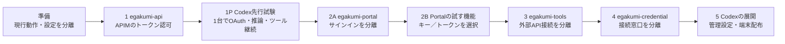
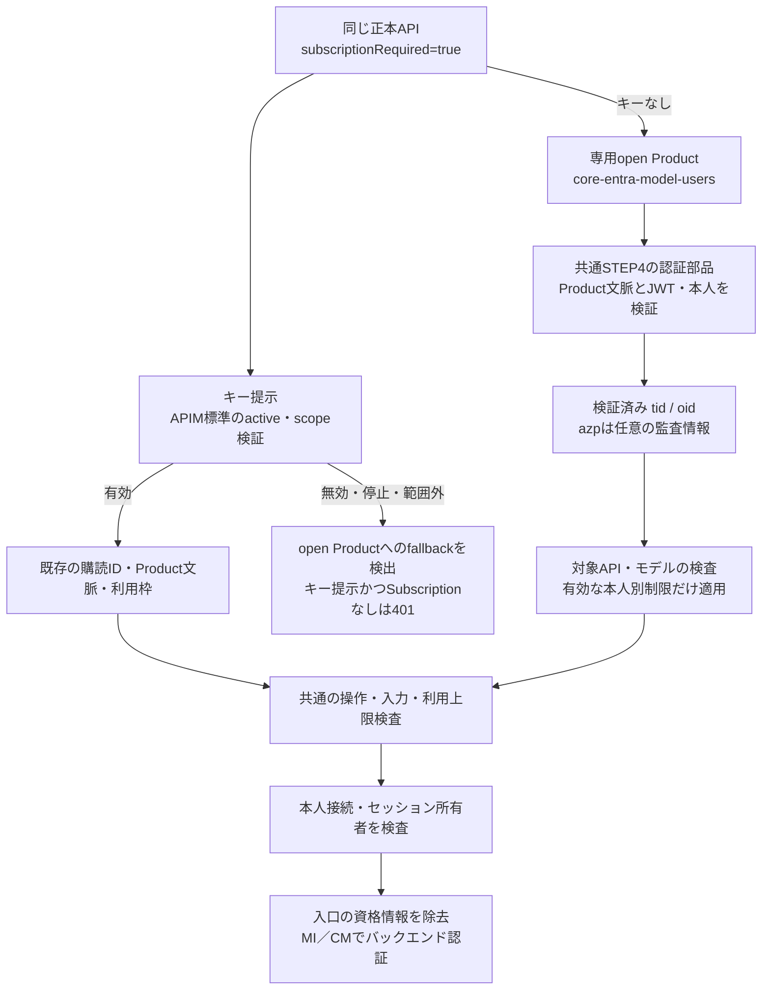

# Entraアプリ分離とアクセストークン認可の作業計画

状態：段階実装中。本書は一般化した計画であり、特定環境のアプリ作成・配備・実接続の完了記録ではない。実環境の作業状態と証跡は保護したローカル領域に分けて管理する。

## 現在の実装範囲

| 範囲 | 現在の状態 |
|---|---|
| Entraの追加登録 | [egakumi-api](../setup/02a-entra-api.md)と[egakumi-codex](../setup/02b-entra-codex.md)の画面付き準備手順を用意 |
| APIMの業務API認可 | 設定schema、JWT検証ポリシーの生成、検証済み本人による利用上限・監査、専用open Productの生成と公開controllerを実装。対象はAPI正本・生成MCP・設定済みCM保護入口から自動生成。HTTP・WebSocket・gRPC・MCPのAPI型を区別するV2 source、管理プレーン読戻し、所属解除／追加、競合検出と失敗復旧を含む |
| CM本人確認設定の独立 | `credentialLogin.identity`を追加。省略時は従来構成を維持。アプリの実切替は別工程 |
| 実APIMでのBearer受付 | 配備・反映と実接続の受入は対象環境ごとに確認する。APIの`subscriptionRequired:true`を維持し、専用open ProductとキーなしJWT分岐を照合する。管理プレーンの配備・読戻し成功だけで実接続の受入完了とは判定しない |
| 全モデル・ツール対応 | CM、MCP、WebSocket、gRPC、Realtime、非同期操作等の認可・所有者資材を拡張。CMのSQL v4・Broker・XML更新を含む。実readback・モデル・クライアント・各transportの受入は未実施 |

第1段階の公開資材は上記の範囲で実装しているが、この全API対応の変更はAzureへ再配備しておらず、特定環境での受入完了を示すものではない。購読キーの提示を優先し、キーなしBearerを同じ業務APIのURLで認可する。Entra設定を省略した旧構成はキー方式を保持する。同じURLで既存キーの状態・API／Product範囲を検証する実APIM試験、継承ポリシーの照合、公開・復旧の確認を対象環境ごとに行い、必要な確認がそろうまで利用を開始しない。公開設定に有効化スイッチは設けない。

## 進める順序



| アプリ名 | 責務 | 基本構成 |
|---|---|---|
| egakumi-api | APIMで公開するAPIのリソース登録。Gateway.Invokeを公開 | 認証用EntraのSingle tenant。API公開。secret・redirect不要 |
| egakumi-portal | Portalサインイン、Portal管理機能のGraph、APIを試す本人のトークン取得 | Web。証明書client assertion。Graph管理はアプリケーション権限、API呼出しは委任権限 |
| egakumi-tools | Graph等の外部API用トークンをCMで取得・更新 | Web。外部APIの委任権限。CMが対応する認証方式 |
| egakumi-credential | 本人接続を選択・管理する窓口のサインイン | Web。OIDC本人確認。外部API業務権限は付与しない |
| egakumi-codex | CodexからAPI向けユーザートークンを取得 | Public client。Authorization Code＋PKCE。secret不要 |

認証用EntraとAzure基盤は別の設定とする。同一・別テナントの双方を対象にし、両tenant IDの一致を必須条件にしない。Azure側のManaged Identityは、この5アプリと別に管理する。

## 初期導入の方針

- **APIエンドポイントを共通にし、同じURLへ`api-key`または`Authorization: Bearer ...`を送る。** 別URL・社員APIの複製は作らない。既存APIの正本・Product・キーの購読範囲を維持する。
- Bearer対象は全業務APIの正本・生成MCP・設定済みCM保護入口から自動生成する。ブラウザー／callbackは専用の一時取引認証を保持する。全transportの実受入を完了条件とし、一部の試験だけを全対応の受入と記録しない。
- **APIの`subscriptionRequired=true`を維持する。** 対象APIだけを、購読不要の専用Product `core-entra-model-users`へ追加する。既存の購読必須Product・関連付け・キーを変更しない。
- 有効なキーはAPIM標準のactive状態・API／Product／all-APIs／service範囲検証へ進め、キーなし要求だけを専用open Productの文脈でJWT検証する。無効キーがopen Productへフォールバックしても、キー提示と`context.Subscription == null`を共通認証で検出して401にする。有効なJWTでも救済しない。
- 認証用Entraテナントのユーザー全員を利用対象とする。専用の利用者／グループ許可台帳を初期必須条件にしない。APIMにクライアントアプリの許可リストは設けず、クライアントへの委任許可・同意・割当はEntraで管理する。
- Bearer利用は基本無制限とし、毎分トークン上限・月間等の期間quotaは`null`で明示的に無効化する。機械的な大量要求を抑えるrequest rateだけを暫定的に設け、有効な制限は全員共通の設定値を本人`tid+oid`ごとに計数する。キー側の既存上限・counterは維持する。
- Gateway.Invokeは入口の呼出権限。API・モデルの許可、利用枠、CM接続所有者の検査を省略する条件にしない。
- トークン認証失敗をキー方式へ自動的に切り替えない。本人が不明な要求、認可障害、制限設定の欠落・不正値を明示的な`null`と同じ無制限設定へ変換しない。
- 各段階の受入完了まで旧アプリ・旧provider・必要な旧証明書を残す。撤去は独立した最後の作業にする。

## 準備：変更前に確定・記録すること

| 作業 | 成果物・完了条件 |
|---|---|
| 作業差分と現在の正本を確認 | 既存の未コミット変更を破棄せず、認証変更の差分を分ける。既存機能の基準試験を記録 |
| 対象の棚卸し | 有効API、REST操作、MCP、SSE、WebSocket、gRPC、WebRTC制御、非同期結果・取消、CM補助操作の一覧 |
| 実際の設定を読戻す | APIM SKU、API/Productの購読要件、global→product→API→operationの有効ポリシー、MI/RBAC、AppGW経路・buffer・timeout |
| テナントと管理担当を分離 | Azure側の作業と認証Entra側のアプリ・同意作業を別工程にする |
| CM設定の結合を解消 | credentialLoginの本人確認設定をcredentialProvidersから独立させる。当初は旧アプリを参照し、外部API用Client ID変更で本人確認まで変わらないようにする |
| 復旧単位を用意 | ポリシー・API公開定義・イメージdigest・構成・証明書versionを戻せる記録と、機能の無効化手順 |

実値・secret・token・環境証跡はチェックアウト直下の.local/<environment>/と.azure/に限定する。公開文書にはプレースホルダーだけを使う。計画・読戻し・変更内容を分け、環境と所有resourceを照合する既存CLI方式を利用する。

現行仕様の根拠は[キー認証の設計](gateway-key-auth-plan.md)、[ポリシー一覧](apim-policy-catalog.md)、[本人接続v2](../setup/credential-manager-login.md)。これらの現行仕様は、実装完了時に新旧経路を区別して更新する。

## Entraの事前準備手順を改訂する

現行の[02-entra.md](../setup/02-entra.md)は、Portal・接続窓口・CMを1つのWebアプリで共用し、Graph権限7件、Web戻り先3件、共通client secretを準備する手順である。今回の変更では、名前だけでなく、登録の役割・権限・資格情報・準備順を改訂する。この改訂を準備工程から始め、各機能の実装と同じ単位で正式手順へ反映する。

### 事前準備で作る設定一覧

| アプリ | プラットフォーム・戻り先 | 権限・scopeの分担 | 資格情報 |
|---|---|---|---|
| egakumi-api | APIリソース。戻り先不要 | Gateway.Invokeを公開、requestedAccessTokenVersion=2。Graph権限は追加しない | secret・証明書不要 |
| egakumi-portal | Web。Portalの/api/auth/callback/microsoft。API追加認証のcallbackは実装確定後に別途登録 | ログインはopenid/profile/email。管理GraphはGroupMember.Read.All・User.ReadBasic.Allのアプリケーション権限。「試す」はegakumi-apiのGateway.Invoke委任権限と必要なoffline_access | KV署名用証明書の公開部分。Entra client secretは作らない |
| egakumi-tools | Web。CM標準redirect | Graph /meは委任User.Read、OIDC・更新に必要なscope。WorkIQはresource別に確認。Portal管理Graph権限は付けない | 現CM契約に対応するサーバー専用secretを基本候補とし、証明書対応を推測しない |
| egakumi-credential | Web。接続窓口の/auth/connections/browser/identity-callback | OIDC本人確認。Graph業務委任やPortal管理権限を付けない | 専用secretまたは独立PoC済みの証明書方式。共用secretのまま最終構成にしない |
| egakumi-codex | Mobile and desktop／Public client。http://127.0.0.1:<PORT>/callback等、対象runtimeと一致するloopback | egakumi-apiのGateway.Invoke・offline_access。Graph User.Readは追加しない | secret・証明書不要。Authorization Code＋PKCE |

登録先は認証用Entraを基本とし、Azure基盤のtenantを自動的に採用しない。Single tenant、Implicit grant OFF、clientごとの管理者同意・Enterprise applicationの利用者割当・MFA／条件付きアクセスを確認する。Public clientのプラットフォームとAllow public client flowsを区別し、Codexの後者は通常OFFを起点に対象runtimeで検証する。

OIDCのscope、外部APIの委任権限、Graph管理のアプリケーション権限を分けて説明する。現在の「7権限を全部同じアプリへ追加」「3戻り先を同じWebアプリへ追加」「1つのsecretを全用途で共用」という手順を、新構成の手順として残さない。

### 新規構築と既存環境の移行を分ける

| 導入方式 | 手順に含めること |
|---|---|
| 最終構成での新規構築 | 採用機能に必要なアプリを役割別に準備。まずapp ID・scope・予定redirectを確定し、資格情報と基盤依存を満たしてから各アプリを配備する。Codex等の未採用機能の登録は必須にしない |
| 既存共用アプリからの移行 | 現アプリのclient ID、権限、redirect、利用先、secretの用途を確認。新アプリを並行追加し、段階ごとの切替・再同意・取引排出・rollbackを案内する |
| 開発用認証 | 本番の登録・鍵と分け、Portalのlocalhost Web callbackとCodexのPublic client loopbackを別手順で扱う。本番アプリへ開発戻り先を無条件に追加しない |

Portal証明書を非exportableなKV鍵で生成するにはAzure側Key Vaultが先に必要である。新規構築手順には、(1)認証Entraのアプリ登録・API公開、(2)Azure側のCore基盤・KV・署名identity準備、(3)KV証明書生成と認証Entraへの公開証明書登録・同意、(4)資格情報preflight、(5)Gateway／Portal配備、の依存順を明記する。

現在の一括azd upへ未準備の証明書構成をそのまま渡さない。Coreだけを準備して認証準備を待てる工程・再開方法を配備CLI／lifecycleに設計し、アプリ未配備の状態を全構築完了と記録しない。既存環境では既存KVを照合して利用できるか確認する。

構築前の入力検査とアプリ配備直前の証明書preflightを分ける。初期入力の段階で未生成の鍵version／thumbprintを必須にしてCore構築を止めない。証明書実体・公開証明書登録・署名の対応は、基盤準備後に確認してからアプリを有効化する。

### 改訂対象のファイルと成果物

| 対象 | 計画に含める改訂 |
|---|---|
| [02-entra.md](../setup/02-entra.md) | 5アプリの責務、機能別の必要登録、準備順、画面ごとの設定、同意・割当、確認値、新規／移行の分岐を示す案内へ改訂。詳細はアプリ別小節または新規docs/setup/entra/配下へ分ける |
| [prepare_registration.py](../../scripts/prepare_registration.py)・[registration-names.bicepparam](../../infra/registration-names.bicepparam)・[登録準備試験](../../tests/test_prepare_registration.py) | 役割別の予定redirect・必要な入力を案内できる形式へ拡張。Portal host、Codex port/pathは用途を分けて検査。既存命名出力と呼出元の互換性も確認。登録済みIDやsecretを要求せず事前計算できる契約を維持 |
| [04-params.md](../setup/04-params.md)・schemas・configuration.py | 5アプリのclient ID／認証tenant／scope／資格情報参照の記入先を役割別に説明。CM providerからPortalや接続窓口の設定を暗黙に導出しない |
| [portal.md](../setup/portal.md)・[Portalローカル認証](../testing/portal-local-auth.md) | Portal専用アプリ、公開／開発callback、証明書準備、API追加同意、KV到達・署名認可、ローカルruntime設定へ更新 |
| [credential-manager-login.md](../setup/credential-manager-login.md)・[credential-sql.md](../setup/credential-sql.md) | toolsのCM認可とcredentialの本人確認を分離。redirect、provider/profile、secret参照、旧接続移行の対応表を更新 |
| [README](../../README.md)・[01-prerequisites.md](../setup/01-prerequisites.md)・[scripts README](../../scripts/README.md) | Entra準備への導線、担当権限、機能別前提、Core bootstrapと再開手順を整合させる。既存リンク・見出し参照を確認 |
| [06-deploy.md](../setup/06-deploy.md)・配備CLI／lifecycle | Core準備→認証証明書準備→Gateway／Portal配備の停止・再開と段階別preflightを案内。「一括構築1回で常に完了」の前提を改訂 |
| [construction-tests.md](../testing/construction-tests.md)・[integration-tests.md](../testing/integration-tests.md) | アプリ別登録・権限種別・同意・redirect・credential・v2 aud/scp・同一／別tenant・移行／rollbackの受入項目を追加 |
| Entra説明画像・設定図 | 共用アプリ画面を新構成の設定例として流用しない。役割別の画面・説明を用意し、実画面を扱う場合はAGENTS.mdの保存・公開規則に従う |

prepare_registration.pyは現在、公開名・CM redirect等をローカル計算するCLIであり、アプリを作成しない。この責務を維持する。アプリ作成／更新を自動化するなら、別の管理操作CLIで認証tenant・対象ID・所有stateを照合し、読取計画と実行を分ける。Graph／KV操作をARM用clientへ混在させず、秘密値を出力しない。

### 事前準備の受入と旧設定の整理

- 5アプリの設定一覧から、登録先tenant、client IDとObject IDの違い、権限種別、redirect、同意、資格情報の保管先を確認できる。
- 新規環境は必要な機能だけの準備手順で配備へ進め、別tenant構成でもCore→証明書準備→アプリ配備を再開できる。
- 既存環境は旧アプリを再作成・一括改名・secret失効せず、新アプリと旧接続を並行利用できる。
- 旧Portal redirect／Graph管理権限、旧CM redirect／外部API権限、旧本人確認redirectは、それぞれの利用先とrollbackが不要になってから個別回収する。他環境・他アプリが使う権限やsecretを削除しない。
- 旧PRE-003〜PRE-009の登録・権限7件・戻り先3件・共用secretのPASSを、新5アプリ構成の合格へ読み替えない。新条件は未実施として独立して記録する。
- 手順の追加と実装は段階ごとに揃える。新しい準備手順を、まだ未対応の現行CLIで実行できるものとして掲載しない。

## 第1段階：egakumi-apiとAPIMのトークン認可

### 1-1 Entraを準備する

認証用Entraにegakumi-apiをSingle tenantで登録し、次を設定する。

| 設定画面 | 設定 |
|---|---|
| APIの公開 | Application ID URI = api://<API_APP_CLIENT_ID> |
| スコープの追加 | Gateway.Invoke。基本は管理者同意 |
| Microsoft Graph形式のmanifest | api.requestedAccessTokenVersion = 2 |
| 証明書とシークレット・認証 | このAPIリソース登録にはsecret・証明書・redirectを追加しない |

実接続試験にはクライアント登録も必要。egakumi-codexのPublic client登録と画面付き事前準備手順を先行する。第1段階のAzure反映とAPI直接確認の後に、1台のCodexで先行試験を行う。Codexの先行試験が終わってからPortal本体の認証切替などのアプリ分離へ進み、端末への管理設定配布は第5段階で行う。利用資格は認証テナント全ユーザーとし、全体配布前に検証環境で受入を行う。

### 1-2 認証主体と利用枠を分ける



Bearer要求では、署名・期限・自社tenant/issuer・v2のaud=<API_APP_CLIENT_ID>・scp内のGateway.Invoke・有効なtid+oidを検証する。api://...という要求scopeをv2のaudへそのまま設定しない。ID token、Graph token、アプリケーション専用tokenをユーザー委任tokenの代わりに認可しない。azpは単一の有効GUIDなら監査へ記録し、欠落・不正・重複・空・zero GUIDでも認可を狭めない。

利用対象は認証テナントの全ユーザー。検証済み本人に対し、対象API・モデルと有効にした全員共通の制限だけをサーバー側で適用する。`userLimits`の`requestRate`・`tokensPerMinute`・`tokenQuota`はすべて指定し、各`null`はその制限だけの明示的な無効化とする。非nullは内部必須項目と有限の正整数・period・boundsを検査する。クライアント申告の購読ID・所有者・providerを信用しない。有効な制限は複数API・モデル・clientをまたいでtid+oid単位に集計する。

初期案はrequest rateの暫定防御値を1000 requests／60秒とし、毎分トークン上限・期間quotaは`null`とする。1000は確定した推奨値ではなく、対象Codexで長い処理・ツール継続・retry・並列処理を確認して調整する。HTTP要求数は人のプロンプト数と異なり、これらの継続や再送は複数callになる。1推論内のreasoningだけで別HTTPが発生するわけではない。rateだけで攻撃を判定せず、既存WAF・Entra認証・client権限・API／モデル制約を維持する。提供元とAPIMの技術上限は別に適用される。

内部コンテキストは「認証方式」「検証済み本人」「正本API ID」「利用許可／利用枠ID」「監査主体」を区別する。context.SubscriptionはAPIMが検証したキー要求だけで使用し、トークン要求に仮の購読オブジェクトを作らない。

### 1-3 変更する箇所

| 対象 | 変更候補 |
|---|---|
| [schemas](../../schemas/)・[configuration.py](../../scripts/deployment/helpers/configuration.py) | gateway.authentication.entraはaudience・requiredScope・userLimitsだけを公開。enabled・allowedClientIds・apiNamesは未知項目として拒否。3つの制限は各nullで無効化でき、欠落・不正値は拒否。Entra設定のない旧構成は従来キー方式 |
| [api-publication.bicep](../../apps/gateway/apim/api-publication.bicep)・[api_publication.py](../../apps/gateway/deploy/api_publication.py)・[entra_publication.py](../../apps/gateway/deploy/entra_publication.py) | APIはsubscriptionRequired=trueのまま、固定ID `core-entra-model-users`・所有marker `core-owned-entra-model-users-v1`のopen Productを作成。業務API正本・生成MCP・設定済みCM保護入口を自動関連付け、Productは各sectionのbaseだけを継承。CMブラウザー入口は除外。同名未所有resource・別open Product・未知policyで停止し、URL・operation・既存Productを保持してreadback |
| [service.xml](../../apps/gateway/apim/policies/service.xml)・[core-common-authentication](../../apps/gateway/apim/policies/fragments/authentication/core-common-authentication/README.md)・[apim_authentication.py](../../scripts/deployment/helpers/apim_authentication.py)・[apim_common_authentication.py](../../scripts/deployment/helpers/apim_common_authentication.py) | 信頼した入口検査後、キー提示時は従来キー検証。無効キーのopen Product fallbackを401で拒否し、キーなしでは専用Productの文脈を共通側で確認してJWT検証する。全API共通とし、API名・操作の対応フラグによる認証分岐は設けない。標準検証の失敗は共通on-errorのcore-entra-authentication-errorで処理する。base継承と既存キー＋任意Authorizationの互換性を保持 |
| gateway.xml・mcp.xml・protocol.xml | 共通の検証済み主体を使う認可へ拡張。API ID固定判定、モデル・query検査を両認証方式で維持 |
| subscription-profile.xml・[entra-user-profile.xml](../../apps/gateway/apim/policies/entra-user-profile.xml)・rate-limit.xml・token-limit.xml | 既存キーのcounterと設定を保持。社員分岐はAPIへ埋め込むchooseから、入れ子のincludeを持たない`core-entra-user-profile`を呼び、構成由来制限を検証する。nullの制限は実行せず、本人不明・構成不正を拒否 |
| audit-context.xml・fragments/audit/core-gateway-telemetry/core-gateway-telemetry.xml | 認証方式、tid/oid、任意のazp、利用枠、正本API、request ID、モデルを関連付ける。token・key・本文を記録しない |
| credential-connection.xml・credential-login/*.xml・[credential-broker](../../apps/gateway/credential-broker/) | Bearer本人を初回取引からcallback・業務利用・更新・logout/disconnectまで照合。キーとユーザーcs2は相互流用せず、確認済み接続はtid+oidで再利用。SQL v4・Broker・XMLを揃えて更新し、既存キーv2契約を維持 |
| realtime-create/observer/hangup・live・非同期結果取得 | 本人と利用枠をticket・call・結果所有者へ結び付ける。旧購読所有の契約も維持 |
| [application-gateway.bicep](../../infra/modules/application-gateway.bicep)・経路の更新処理 | 共通URLでBearerがAPIMへ到達すること、既存rewrite・WAF範囲・タイムアウトを確認。gRPC固定メソッドpathと認証metadataは対象transportで検証する |

初期の利用対象は認証テナント全ユーザー、利用は基本無制限で有効な制限だけ構成の共通値を使い、個人grant台帳・利用許可resolverは追加しない。CMとsessionの本人所有者契約は入口認可と別に維持する。将来、グループ別の利用枠が必要になった段階で、責務に沿って追加する。内部通信ではAPIM以外が本人情報を偽装できないことを試験する。既存グループ購読を利用枠へ対応させる場合は、実際の購読状態・API範囲・停止の反映も確認する。

Bearer認証は全API共通で、実行時にAPI名の一覧や対応フラグで受付を選別しない。API一覧は配備対象・Product所属・読戻しの照合に使い、認証分岐の条件とは区別する。キー提示時はキー検証を優先し、無効なキーを有効Bearerで救済しない。キーなし要求は、共通側で専用open Productの文脈と購読情報の混在がないことを確認したうえでBearer検証へ進む。APIの購読要件は配備中・公開後・閉鎖後もtrueのままにする。

STEP4の認証成功は、キー／Bearer共通の`gatewayCommonAuthenticationValidated`と、Bearerのトークン・本人・会社設定までの`gatewayEntraAuthenticationValidated`で後続へ伝える。標準検証、本人情報、会社設定を確認する順序と、認証不備401・設定／内部不備500の分類を維持して部品化する。XMLと同名C#の対応は[認証部品の説明](../../apps/gateway/apim/policies/fragments/authentication/core-common-authentication/README.md)を参照する。

公開controllerはcurrent・onlineのrevision 1が1つだけある対象APIを照合し、V2 source manifestでAPI型・全操作・生成MCP・CM保護入口と必要なimport内容を管理する。gRPCのproto format/valueを含む実readback形式は未確認で、期待する読戻しが得られなければ停止する。複数revisionや既存の保護source不足を新規構築へ流さない。旧形式は既知の生成元と実policyが厳密一致する場合だけ移行する。真の新規構築は過去配備・checkpoint・旧managed Entra・選択API全revision・共有資材の衝突がないことを完全GETで確認し、closed stagingでsourceを確立してから公開する。部分再公開は旧sourceと新sourceを合わせ、既存の所有APIのBearer受付も維持する。

既存globalの手動処理は保持し、既知のCore NamedValue/backendを事前照合する。globalが存在しない場合のclosed baseline作成は、APIM全API inventoryが空であることを確認した新規構築だけに限定する。

[MicrosoftのSubscriptions仕様](https://learn.microsoft.com/en-us/azure/api-management/api-management-subscriptions)では、APIのsubscriptionRequired=falseは提示キーを無視する。一方、trueのAPIへopen Productを1つ関連付けると、有効キーは従来の購読文脈、キーなしはopen Product文脈になる。不正キーもキーなしへフォールバックするため、rawキーの存在と検証済み購読の欠落をJWT検証より先に拒否する。専用Productの非公開化だけではアクセスを無効化できない。

旧CM v2のsubscriptionId欄へ社員の利用枠IDを代入しない。ユーザー経路は検証済みcaller IDを取引とsessionへ結び付け、旧キーv2の索引・所有権・更新契約を保持する。Bearerへの切替はCM startからユーザー用cs2を取得する。CM本人確認tenantがGateway認証tenantと違うprofileは拒否する。SQL v4・Broker・全補助ポリシーを揃えた実受入が完了するまで、CM経路の利用開始を完了としない。

Globalの共通ブロックは既知の旧形式だけ移行する。ETag付き更新とreadbackを維持し、APIを先に安全な無効状態で準備してから認証分岐を有効化する。baseを削除して親の拒否を迂回する実装にしない。

### 1-4 受入ゲートと公開順

1. 同じAPIM SKUで、購読必須APIの変更前と専用open Product追加後を比較する。APIのsubscriptionRequired=true、open Productが最大1つ、正本APIとrevisionの関連付け、所有marker、Productのbaseのみのpolicyを読戻す。
2. primary/secondary、無効・停止・削除・別Product/API範囲のキーを比較する。API／all-APIs／serviceキーもAPIM標準の文脈で検証し、Product policyが適用される範囲を変更前と比較する。masterを社員へ配布せず、serviceキーは隔離した非破壊試験に限定する。
3. 無効キー＋有効JWT、空・重複・query提示を拒否する。APIキーをAuthorization: Bearerへ移した要求も拒否し、正しいキー＋既存用途のAuthorizationはキー側の従来動作を維持する。
4. 正常tokenとtenant/issuer/aud/v2/scp不一致、tid/oid欠落・不正、期限切れ、改変、app-only、認証なしを確認。azpの欠落・不正・重複が認可を狭めず、単一の有効GUIDだけ監査へ残ることも確認する。global→Product→API→operationのbase継承と、JWT検証前のAuthorization・キー変更やearly returnがないことを有効policyで確認する。
5. キー利用枠が変わらず、社員の有効なrequest rateと監査が効き、nullの毎分トークン・期間quotaは適用されないことを確認。対象Codexで長い推論・ツール継続・retry・並列処理の通常利用を比較する。有限枠の拒否境界は隔離した少数の合成要求で別途確認し、CM session・call ticket・非同期結果の別人／認証方式間の転用拒否を確認する。
6. 全業務APIをキーとBearerで確認する。Graph本人接続、REST-backed MCP、非同期API、音声・Realtime、WebSocket handshake・gRPC開始の認可と所有者を含める。CMブラウザー／callbackは一時取引認証を保持し、未登録operation/methodと無認証を拒否する。
7. Responsesはresponse.completed・エラー・function_call/call_id・function_call_output・複数ターンを確認。モデルaliasとdeployment、api-version、store=falseの場合の入力履歴再送も確認。
8. AppGWを含む逐次転送・timeoutを確認。共有AppGWのresponse buffering変更が必要なら、既存APIの回帰試験を行ってから変更する。
9. 安全なキー専用状態でAPIとpolicyを準備し、読戻し後に対象open Product関連付けとBearer分岐を有効化する。途中失敗ではキーなしを拒否できる状態を維持する。無効化・rollbackを新しい試行として確認し、成功した有効化試験を復旧の合格へ流用しない。

キーなしのBearer要求は専用open Productの文脈となり、既存の購読必須Productのpolicyを引き継ぐとは仮定しない。専用Productはbaseのみとし、必要な認可・制限・監査・変換はglobal/APIで実行する。有効なProductキーは従来のProduct policyを維持する。API／all-APIs／serviceキーではProduct policyが適用されないという[既存の継承仕様](https://learn.microsoft.com/en-us/azure/api-management/api-management-howto-policies)も維持する。バックエンド定義・MIのtoken宛先・RBACはAPIごとに確認し、APIアプリの委任権限と別に検証する。

MCPのREST-backed operationIdは同じREST操作へ関連付け、Bearer検証済みの主体が内部呼出し先へ引き継がれることを確認する。WebSocketはhandshake、gRPCはRPC開始、WebRTCは制御APIと所有者を検証し、接続後frameやメディアまでHTTP JWT検証が繰り返されるとは扱わない。

### 試験用のPKCE補助CLI

[entra_signin.py](../../scripts/entra_signin.py)の`user-token`は、MSAL PublicClientApplicationとAuthorization Code＋PKCEで試験用access tokenを取得する再利用候補である。既存登録だけを使い、secret・Graph User.Readを追加しない。認証tenantとCodex client ID、登録済みloopbackを明示する。これは受入の補助手段で、CodexのGateway OAuthや更新試験を代替しない。

```bash
python3 -B scripts/entra_signin.py user-token \
  --environment '<ENVIRONMENT>' \
  --tenant-id '<AUTH_TENANT_ID>' --client-id '<CODEX_CLIENT_ID>' \
  --scope 'api://<API_APP_CLIENT_ID>/Gateway.Invoke' \
  --redirect-uri 'http://127.0.0.1:43127/callback' \
  --token-file '.local/<ENVIRONMENT>/secrets/gateway-user-token.txt' \
  --cache-file '.local/<ENVIRONMENT>/secrets/gateway-msal-cache.json' \
  --login-url-file '.local/<ENVIRONMENT>/secrets/gateway-signin-url.txt'
```

上記はプレースホルダーを使ったPOSIX環境用の例である。保存先の所有者限定権限・リンク・既存ファイルとの分離を先に確認する。`--environment`を明示してazdの既定環境読取りを避け、token・cache・認証URLを別の保護ファイルへ保存する。URLは公開ログへ出さず、本人が保護された引渡し先からブラウザーで開く。

依存は[auth-requirements.txt](../../scripts/auth-requirements.txt)のMSAL 1.39.0を専用runtimeへ用意する。このMSALは`openid`・`profile`・`offline_access`を内部追加するため、補助CLIの`--scope`へこれらを明示すると予約scopeとして失敗する。Codexの直接OAuth設定に`offline_access`を含める方針とは区別する。補助CLIは毎回対話flowを開始し、保存cacheからのsilent refresh専用操作を実装していない。

現在の`protected_text`はPOSIXの`os.fchmod`を使用するため、Windows native Pythonでそのまま使えるとは記録しない。Windows ACL対応は別変更。WSL等から使う場合もWindowsブラウザー→WSL loopbackの到達とport/pathを先に非秘密のcallback試験で確認する。実Entraサインイン・Codexでの更新・モデル推論は未実施として記録し、MSALの合成PKCE試験だけを実接続のPASSへ置き換えない。

**戻し方：** 所有を照合した専用open Productの対象API所属を先に解除し、社員経路の閉鎖を読戻してから共通認証のBearer分岐を無効化する。APIは購読必須のままにし、キーなし要求の拒否と既存キー利用を確認する。途中失敗ではBearer受付を停止し、閉鎖を確認できなければ復旧未完として新しい読戻しを行う。Productを非公開にするだけ、Incremental Bicepの定義を省くだけでは復旧完了にしない。旧globalを戻す場合もETag・現在値・継承を確認する。進行中streamの扱いと新方式sessionの排出は別に定義し、SQL状態を無条件に削除しない。

## 第1P段階：1台のCodexによる先行試験

Portal・tools・credentialのアプリ分離を開始する前に、Gateway OAuthからResponses推論までを端末で確認する。全APIの実装範囲は維持し、CodexのResponses試験だけを全transportの受入完了へ読み替えない。

1. 旧sourceと実APIM資材、SQLの移行・復旧条件、Brokerの更新順を確認してからGatewayを反映する。Foundryの現在のcapacityは保持する。
2. 同じAPI URLへのキー／Bearerの正常・拒否、利用者監査、ResponsesのSSE・モデルルーティングを直接確認する。
3. Desktop内蔵runtimeとCLIの版、Gateway OAuthの設定項目、モデルカタログの対応を確認する。既存OpenAI接続と認証キャッシュを保持し、先行試験では端末全体のproviderを強制しない。
4. Codex本人のブラウザーサインインでトークンを取得し、モデル応答、複数ターン、ローカルツールと結果継続、更新または再サインインを確認する。固定token・env_key・外部token取得コマンドはCodexの接続設定に入れない。
5. DesktopとCLIの実施結果を別に記録する。CLI単独の成功をDesktopの成功にせず、未実施・版不足・経路障害を明示する。

実際の接続先・版・設定・結果は保護したローカル証跡へ記録する。先行試験の完了後に第2A段階へ進み、全体配布・管理設定・併用端末の検証は第5段階で行う。

## 第2A段階：egakumi-portalの分離

| 作業 | 対象・条件 |
|---|---|
| 新Portalアプリ | 認証EntraにSingle tenant／Web。redirectはhttps://<PORTAL_HOST>/api/auth/callback/microsoft。Implicit grant／Public client flowsはOFF |
| Graph権限 | 現行管理機能のGroupMember.Read.All・User.ReadBasic.Allを新アプリへ設定し管理者同意。全Graph操作で権限不足がないことを確認 |
| 証明書認証 | Azure側Key VaultでPortal認証専用の非exportable証明書・鍵を生成し、公開証明書だけを認証Entraへ登録 |
| 専用identity | Portal本体とGraph照合jobへportal-auth UAMIを追加。対象鍵scopeの署名権限。既存SQL/APIM/ACR用identityを変更しない |
| 独立設定 | portal.authenticationに認証tenant/clientとversion付き鍵参照・対応thumbprintを追加。既存portalAuthenticationのSQL性能・backup設定は保持 |
| コード | auth-options.tsのclientSecretをasync clientAssertionへ変更。GraphはClientAssertionCredentialへ変更。KV署名を共通化しkeyvault-keysを直接依存へ追加 |
| 配備 | deploy_portal.py、application.bicep、database.bicep、group-reconciliation-job.bicep、ローカル準備からCM共用secret依存を外す |

Better Auth 1.7.14のMicrosoft providerと@azure/identity 4.13.0はclient assertionの足場を持つ。事前の合成検証は実Key Vault／Entra／Graphの受入を代替しない。

**受入：** 同一・別tenant構成で署名→認証コード交換→Portalログイン→Graph管理→定期jobを確認。provider=microsoft、tid+oidによる既存ユーザー・所有権・CM状態を維持し、client変更で変わるsubを移行キーにしない。

BETTER_AUTH_SECRETと既存の暗号化資材は保持する。AppGW向けexportable TLS証明書を認証へ流用しない。証明書versionとthumbprintを組で固定し、新公開証明書の先行登録→配備切替→確認→旧証明書回収の順に更新する。

ローカルで実認証を試す場合は開発用アプリ・鍵を使用する。Azure CLI credentialはAzure側Key Vault署名の認可にだけ使用し、CLIのユーザーtokenをPortalのclient assertionへ転用しない。端末からprivate endpointへ届かなければAzure上の検証Portalで確認する。

**戻し方：** 旧アプリ・旧secret参照・旧読取権限を受入まで残し、イメージと構成を組で戻す。切替中のOAuth取引は期限待ち／無効化する。新旧のtokenを別clientへ転用しない。旧Portal専用grant・redirectの撤去は確認後に明示的に行い、CM用secretとCM redirectは保持する。

## 第2B段階：Portalでキー／アクセストークンを選んで試す

最初の案は、Portalログインを維持したまま「アクセストークンで試す」を選んだときに追加のAPI認証を行う方式。API向け追加同意・再認証の失敗で、キー管理などのPortal全体を利用不能にしない。

| 作業 | 実装内容・完了条件 |
|---|---|
| API用OAuth | egakumi-portalへGateway.Invokeの委任権限を追加。必要なoffline_access。サーバー管理のAuthorization Code＋PKCEで取得 |
| 認証callback PoC | Better AuthのAPI／hook再利用か、独立した小さなOAuth処理かを実際のcallbackで確認して決定。現行のtoken破棄hookを全用途で解除しない |
| 本人照合 | openidとAPI scopeを要求。nonce・一回限りstate・PKCE・固定callbackをPortal sessionへ束縛。署名・issuer・audienceを検証したID tokenのtid/oidとPortal本人を比較。API tokenの単純decodeで本人を確定しない |
| API token保存 | CM接続とは別の暗号化SQL保存。Portal session、tid/oid、client、resource/scopeを紐付け、保存期限・削除・鍵versionを管理。tokenが有効でも毎要求でPortal SQL sessionの有効性を確認 |
| 更新 | DB時刻の共有lease、revision・失効世代・有効状態による比較更新。lease喪失／disconnect後の遅延応答を保存しない。外部token交換中にSQL transactionを保持しない。invalid_grantと通信障害を区別 |
| 実行依存 | apiKeyId必須の契約を認証方式別に分ける。同じ登録済みAPIのURLへ、サーバーでapi-keyまたはAuthorizationを送る |
| 全Try機能 | Text、Embedding、Rerank、Image、Speech、Document、PII、Graph、MCP、Realtime等を対象一覧と照合。GraphのCM session client、非同期結果ticket、call所有者も対応 |
| UI | shadcn/uiの認証方式選択。秘密値の入力・表示を標準導線にしない。日本語・英語の状態・再認証案内を同時追加 |

変更候補はauth関連module、app/apiの追加認証route、新しいAPI OAuth保存module／SQL migration・runtime grants、componentsの試すpanel、各種*-gateway.ts、model-catalog／integration、connection-session/client.ts・store.ts、realtime-relay・webrtc、i18n。

追加候補の配置はapps/portal/lib/api-auth/のcontracts・authorization・token-service・crypto・store、apps/portal/app/api/api-auth/のstart・callback・status・disconnect。SQL migration番号は現行の最大番号と照合して決め、runtime権限とreadinessも同じ変更で管理する。

API tokenの暗号化は専用用途・鍵versionで管理する。既存CM保存の索引をそのまま流用しない。AAD／保存索引には認証方式・本人・利用枠を含め、他人の行・別resourceのtokenを利用できないことを確認する。

**受入：** 全Try対象でキー／tokenの正常利用、期限切れ・更新競合・logout・別本人callback・scope不足を確認。token・key・refresh tokenをブラウザー、URL、ログ、例外本文へ出さない。ID tokenやGraph管理tokenをAPIMへ送らない。

ブラウザーのWebSocketへBearerをURL queryで埋め込まない。既存のサーバーrelayから送る。SSE途中やツール実行後の認証失敗で、要求を自動再送してモデル課金・副作用を二重にしない。WebRTC終了・非同期結果取得まで同じ所有者を確認する。

WebSocketのAuthorizationは確立後に更新できない。接続上限・再接続と、複数instanceでPortal sessionのlogout／disconnectを反映する通知または共有世代確認・最大遅延を定義する。SSE・WebSocket・WebRTCのどこまでをPortal側で終了できるかを試験し、Portal保存の失効とEntra token自体の失効を区別する。

**戻し方：** UIのtoken機能と新規追加認証を無効化し、キー機能を継続。API token保存は失効・期限に従って処理する。SQLを追加互換のまま保持し、コードrollbackで旧runtimeが新形式を誤使用しないことを確認する。

## 第3段階：egakumi-toolsの分離

1. 認証Entraに新Webアプリを作成しCM標準redirectを登録。Graph業務委任User.Read・更新用offline_access等を準備する。Portal管理Graph権限を移さない。
2. 現CMのclientSecret契約は分離だけで証明書方式に変わるとは扱わない。必要な専用secretはサーバー側で保管・secure入力し、社員へ配布しない。
3. 旧CM providerのClient IDを上書きせず、新provider／pool／profileを並行追加する。本人の再同意で新接続を作る。
4. 現接続PKはTenantId・ObjectId・ProfileName。同じprofileにpoolだけ増やして新旧接続を並行保存できると仮定しない。初期は新profileによる限定移行を候補とする。
5. profile選択は検証済み本人と運用側の移行状態から行う。任意のprovider・pool名をクライアントに選ばせない。
6. 旧refresh tokenは旧Client IDに結び付くため、新アプリへコピー・転用しない。旧接続の回収は利用・更新・pool回収jobを確認してから行う。

主な対象はcredential_pools.py、configuration.pyとschemas、gateway/deployのCM・broker定義、credential_broker/settings.py・identity.py・service.py・store.py、SQL／allocator、APIポリシー、PortalとCLIのprofile契約。

**受入：** 新旧接続の並行利用、pool容量、再同意、失効、回収job競合、同一UPN別oid、provider偽装、Bearer AによるBのsession利用拒否、CM token更新を確認。

WorkIQは同じアプリのAPI権限へ追加できるかを公式仕様で確認する。異なるresource/audienceは別token・CM provider/profileとして扱う。WorkIQ tokenでGraph /meを呼んで本人照合できると仮定しない。WorkIQ実装そのものは今回の分離作業に含めない。

**戻し方：** 新規移行を止め、旧provider/profileへ戻す。新tokenを旧接続として偽装しない。旧アプリと接続を残し、既存利用者の接続状態に合わせて復旧する。

## 第4段階：egakumi-credentialの分離

準備工程で独立させた本人確認設定を、新Webアプリへ切り替える。redirectはhttps://<GATEWAY_HOST>/auth/connections/browser/identity-callback。OIDC本人確認だけを担当し、Graph業務委任・Portal管理権限を持たせない。

MSAL、PKCE、state、nonce、署名・issuer/audienceの検証を維持する。secretなしをこのアプリにも求める場合は、Portalと別の証明書・Key Vault鍵によるclient assertionを独立PoCしてから採用する。CM対応を含め全アプリが自動的にsecretなしになるとは扱わない。

新規認証開始を短時間止め、旧取引を設定された寿命まで排出または無効化してから切り替える。有効なCM session・接続はtid+oidの対応で維持できることを確認し、UPNやsubで所有者を移さない。

**受入：** 正常・別人callback、旧取引、replay、state/nonce不一致、logout/disconnect、既存session継続と失効を確認。

**戻し方：** 本人確認client設定とruntimeを旧構成へ戻す。切替中の取引は再認証し、egakumi-toolsのCM接続は変更しない。

## 第5段階：Codexの管理設定と端末配布

- 第1P段階の先行試験を基準に、配布対象のCodex CLIとDesktop内蔵runtimeのversion、Gateway OAuth・管理構成・カタログ対応を確認する。更新した版や専用／併用端末で再確認する。
- 認証EntraにSingle tenant／Mobile and desktop Public clientを登録。loopback redirectとCodexのport/pathを一致させる。secret・Implicit grant不要。Allow public client flowsは通常OFF起点で対象版を確認する。
- egakumi-apiのGateway.Invokeへ委任許可・管理者同意を追加し、Entraの利用者割当と条件付きアクセスを確認して段階配布する。APIMのクライアント許可リストへ追加する操作はない。
- company provider、Responses base_url、モデルalias、requires_openai_auth=false、gateway_oauthを構成する。固定token・env_key・外部token取得コマンドを標準構成へ追加しない。
- config.tomlは変更可能な既定、requirements.tomlは強制項目と完全なprovider定義を担当。対象versionで置換・優先順位を確認する。
- ChatGPT Enterpriseを同じ端末で併用する群は、machine-wide model_provider固定が切替を妨げない配布方針にする。会社専用群と併用群を分けて検証する。
- 同じ会社providerのrequires_openai_authをtrueへ変えるだけでは、現在のAuthorization Bearer入口と併用できない。会社専用providerと独立したEnterprise用provider／profileを使い、Gateway OAuthとOpenAI認証を同じproviderで併用する場合は別header／cookieの認可実装を独立検証する。
- Intune/SCCMでProgramDataへローカル配布。管理者／SYSTEM更新・一般ユーザー読取。公開するURL・ID・scopeだけを配り、本人tokenは各自のサインインで取得する。
- 独自aliasのmetadataが必要ならローカルCodex形式models.jsonを配布。一般的な/v1/models応答を同じものとして扱わない。

**受入：** Entraログイン、refreshまたは再サインイン、OpenAIサインイン不要の経路、SSE完了・エラー、複数ターン、ローカルfunction実行と結果継続、model→deployment、監査、専用／併用端末の設定を確認。必要なtool calling・context・reasoning設定を実モデルで確認する。

**戻し方：** Intune配布と会社provider利用を段階停止し、EntraのCodex向け委任許可・同意・利用者割当を回収する。Portalや他clientのAPI許可は維持する。新規トークン取得の停止と、発行済みアクセストークンの有効期限・既存streamの終了は別に扱う。APIMにクライアント許可リストはないため、回収だけで即時に既存tokenが拒否されたとは判定しない。

## 実装・配備前の判断事項

| 判断 | 推奨初期案 | 決めるための情報 |
|---|---|---|
| 共通URLの有効化条件 | APIの購読必須を維持し、専用open ProductでキーなしJWTを受ける | primary／secondary、停止、API／Product／all-APIs／service範囲、無効キーfallback拒否、policy継承、有効化・復旧の実APIM結果 |
| 社員の利用資格と上限 | 認証Entraの全ユーザー。基本無制限で毎分トークン・期間quotaはnull。request rateは本人単位の暫定防御値 | 1000 requests／60秒の例を実Codexのツール継続・retry・並列要求と比較して調整。rateだけで攻撃を判定しない |
| API OAuth保存と取得 | on-demand追加認証、サーバー暗号化SQL、共有更新lease | Better Auth callback PoC、logout要件、保存・監査・鍵rotation方針 |
| 実装対象とpilot順 | 実装は全業務API。pilotは1モデルHTTP/SSEから進め、全transportを必須受入ゲートとする | 実際に有効なAPI・client・モデル・ネットワーク、gRPC等の実readback形式 |
| tools移行 | 新profile＋本人再同意の並行移行 | 現接続数、pool容量、旧接続を残す期間、移行対象client |
| credentialもsecretなしにするか | 分離は必須。認証方式は独立PoCで判断 | CM・MSALの対応方式、証明書運用と署名経路 |
| Codex／Enterprise併用 | 配布対象群を分ける | CLI/Desktop version、会社固定範囲、同端末でのprovider切替要件 |

ここでの判断は、実装・配備の受入条件を確定するためのもの。計画作成のために実環境のアプリ作成・secret発行・権限付与を行わない。

## 検証・作業記録

- 合成・ローカル試験と実環境試験を別に記録し、未実施項目をPASSにしない。
- 第1段階は既存common authentication／publication／quota／CM／protocol試験を拡張し、tokenの正常・拒否・所有権・rollbackを追加する。
- Portalはauth-flow、runtime grants、SQL migration、token cacheの更新競合、全Try機能の契約を試験する。依存追加時はnpm auditを確認する。
- 各段階は「構成と差分」「合成試験」「検証環境」「限定利用者」「対象拡大」「旧資材回収」の順に進める。
- 転用不能なtokenや新形式sessionをrollback時に旧方式へ偽装しない。データの追加migrationを原則とし、受入前の破壊的schema変更を避ける。
- 実装開始後は[構築試験](../testing/construction-tests.md)と[動作試験](../testing/integration-tests.md)へ新旧経路の受入項目を追加する。

## 管理者作業とコード管理の分担

| 対象 | コードで管理する部分 | 管理者が実施・確認する部分 |
|---|---|---|
| Entraアプリ | manifest例、scope・権限一覧、対象照合・保護state保存の準備CLI | 認証tenantでのアプリ作成、API公開、管理者同意、利用者割当、条件付きアクセス |
| Azure／APIM | Bicep、公開定義、policy、構成schema、内部公開状態、ETag/readback | 対象環境の変更計画確認、RBAC付与、限定公開、実接続受入 |
| 証明書 | 専用生成・登録・rotationの手順／CLI、鍵versionと公開証明書の組照合 | Azure側KV生成権限、認証Entra側の公開証明書登録、更新担当・期限 |
| 接続移行 | 新旧provider／profile、SQL追加migration、状態別切替、回収手順 | 本人の再同意、移行対象・期間、旧接続の停止と撤去判断 |
| 端末配布 | プレースホルダーのTOML／catalog、配布・rollback手順 | 対象群の選定、Intune/SCCM配布、読み取り権限、利用者受入 |

Entraアプリはdisplay nameだけで再利用・更新対象を決めない。Application client ID、Application Object ID、Service Principal Object IDを用途別に記録し、認証tenantと所有stateを照合する。新しい準備CLIは既存scripts/operations/common.pyの保護記録・対象照合を参考にし、ARMとMicrosoft Graph／KV data-planeの通信を混同しない。

## レビューできる変更単位

| 単位 | 内容 | 次へ進む条件 |
|---|---|---|
| R0 | 基準試験・棚卸し、Entra事前準備の改訂設計、CM本人確認設定の独立 | 役割別準備と新規／移行手順が定義され、旧設定で既存キーとCMの動作が同じ |
| R1 | egakumi-api／codexの登録手順、schema、購読必須APIへの専用open Product追加 | 登録入力・権限・Entra設定を持たない旧構成の互換と、closed staging時の安全な拒否を確認 |
| R2 | JWT検証、本人別の有効な制限・null無効化・監査 | 正常・拒否・停止・上限なしと有限枠の試験を分けて通過 |
| R3 | CM、非同期ticket、MCP、音声／protocol所有者対応 | 必要な全transportを検証し、限定公開とrollbackを確認 |
| R4 | Portal証明書認証・Graph管理・配備 | 新旧ユーザーと既存状態の継続を確認 |
| R5 | Portal API認証・暗号化保存・更新／失効 | callback本人照合、共有更新、logout・競合試験を通過 |
| R6 | 全Try機能の資格情報選択・共通API target | 全対象でキーとtokenを確認。部分対応のまま完了としない |
| R7 | tools新provider／profileと本人再同意 | 新旧並行利用と復旧・回収を確認 |
| R8 | credential窓口の新アプリ切替 | 旧取引の排出・本人照合・既存接続継続を確認 |
| R9 | Codex、モデルcatalog、端末配布 | 対象runtimeと専用／併用端末の実接続を確認 |

各単位に必要な試験・文書を含める。reviewを分けても生成元・認可・所有者の照合が未完の新経路は公開せず、内部のclosed stagingを維持する。公開paramsの有効化スイッチや対象API選択へ置き換えない。

## 参照する公式仕様

- [APIM Entra token検証](https://learn.microsoft.com/en-us/azure/api-management/validate-azure-ad-token-policy)
- [APIMの購読](https://learn.microsoft.com/en-us/azure/api-management/api-management-subscriptions)
- [MIバックエンド認証](https://learn.microsoft.com/en-us/azure/api-management/authentication-managed-identity-policy)
- [Entra証明書client assertion](https://learn.microsoft.com/en-us/entra/identity-platform/certificate-credentials)
- [Key Vaultの証明書と秘密鍵](https://learn.microsoft.com/en-us/azure/key-vault/certificates/about-certificates)
- [Gateway OAuth](https://learn.chatgpt.com/docs/enterprise/connect-to-a-gateway)
- [Responses／SSE互換性](https://learn.chatgpt.com/docs/enterprise/gateway-compatibility)
- [管理構成](https://learn.chatgpt.com/docs/enterprise/managed-configuration)
- [Windows配布](https://learn.chatgpt.com/docs/enterprise/windows-deployment)

公式仕様は対象製品version・API世代と照合してから設定例を確定する。本書は接続成功・本番利用可能性を保証した記録ではない。

