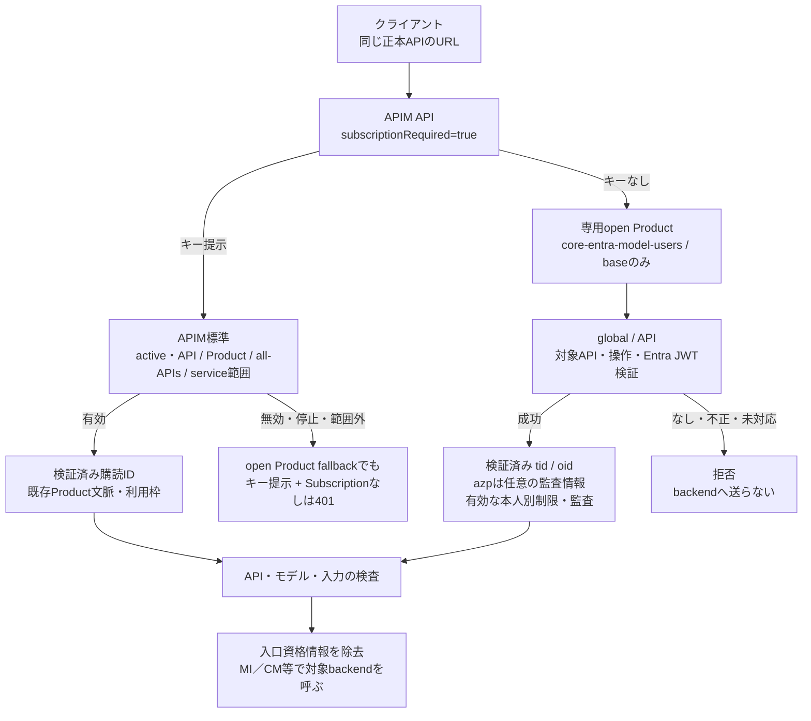

# Gatewayの購読キー認証

本書は現行のGateway認可とPortal・本人接続の分担を説明します。APIの正本は [登録定義](../../apps/gateway/apim/apis/)、共通認可は [service.xml](../../apps/gateway/apim/policies/service.xml)、配備は [Gateway配備コマンド](../../scripts/deploy_gateway.py)です。実環境への反映状況は配備記録と試験結果で確認します。

社員のGateway OAuthは段階実装中です。設定・JWT検証・専用open Product生成の実装と、合成によるローカル検証を、新方式の実配備・受入と分けます。この全API対応の変更はAzureへ再配備しておらず、実受入は未実施です。既存のキー認証の実績を合格へ流用しません。

## 利用経路と認証の分担

| 場所 | 担当すること |
| --- | --- |
| Portal | Entraサインイン、現在のグループ所属に基づくキーの管理・利用、利用者別の本人接続状態を管理する |
| Portalのサーバー処理・APIクライアント | 有効な購読キーを秘密保管先から取得し、Gatewayの公開APIへ付ける |
| APIM共通ポリシー | 信頼した入口経路を確認し、キー提示時は検証済み購読、キーなしBearer時は検証済みEntra本人を確認する |
| API・Operation | 操作・モデル・入力・出力上限、購読プロファイル、必要な本人接続を検査する |
| APIMの下流接続 | Foundry等にはマネージドID、本人のGraphにはCMの委任tokenを使う |



購読キーはAPIの利用範囲と利用枠を表します。Portalへログインした本人や、Graphを利用する本人をキーだけで識別しません。キー・pollSecret・本人接続セッションはサーバー側で保持し、ブラウザーのJavaScript・URL・公開設定へ埋め込みません。

## 受信するキー

既定ヘッダーは`api-key`です。環境共通の名前は`gateway.authentication.subscriptionKeyHeader`で設定し、APIMのAPI設定と共通ポリシーへ同じ値を反映します。

内部所有者ヘッダー`X-Core-Caller-Id`・`X-Core-Subscription-Id`は購読キーヘッダーとして指定できません。旧指定は配備前に入力エラーで停止し、通常の専用ヘッダーへ変更します。変更時はAPI設定とクライアントの送信設定を揃えてください。

```http
POST /models/openai/v1/chat/completions HTTP/1.1
Host: gateway.example.com
api-key: <APIM_SUBSCRIPTION_KEY>
Content-Type: application/json
```

APIM標準の購読検証と、共通ポリシーの`context.Subscription.Id`確認を使います。空値・重複や、URL queryでのキー提示を拒否します。キーも有効なBearerもない要求は拒否します。`Authorization: Bearer <APIキー>`は標準ヘッダーと自動的に同じものとして扱いません。別のクライアントを接続するときは送信するヘッダー、公開パス、要求・応答方式を契約に合わせます。

検証済み購読の存在と購読IDの空値、キー用ヘッダーの空・空白と値の数は共通認証で確認し、HTTP・protocol・MCPのAPIテンプレートでは再検査しません。各APIは`<base/>`で共通認証を実行し、完了を確認してから検証済みIDを利用枠・監査・API固有の処理へ渡します。空値やAPIM上の値数が1以外のキーは共通側で401を返し、有効なBearerを同時に送っても救済しません。MCPからRESTへの転送は別要求なので、REST側の共通認証は維持します。

キー用には専用のヘッダー名を使います。`x-ms-client-request-id`は各APIが要求IDへ書き換え、`x-appgw-trace-id`はAppGWの相関に使うため、配備前の設定検査でキー用への指定を拒否します。既定の`api-key`、`Ocp-Apim-Subscription-Key`、内部処理と衝突しない独自のヘッダーは引き続き利用できます。

Entra設定を持つ構成では、HTTP・WebSocket・MCP・Realtime・CMを含む全業務APIで、キーなし要求に有効なEntraユーザー委任tokenを要求します。CMのブラウザー受付の例外を除く通常要求は、設定キーheaderの有無だけで認証方法を選び、実行時のAPI名一覧でBearer対応を判定しません。有効キー＋既存用途のAuthorizationはキー側の従来動作を維持します。無効キー＋有効JWT、空・重複・queryの提示は救済しません。操作・モデル・入力の既存契約は両方式で検証します。

公開Entra設定は`audience`・`requiredScope`・`userLimits`の3項目だけです。`enabled`・`allowedClientIds`・`apiNames`は公開入力として拒否し、APIMにクライアント許可リストを設けません。署名・期限・tenant/issuer・v2 aud・委任scp・有効なtid+oidを要求し、azpは単一の有効GUIDだけを監査へ記録します。azpの欠落・不正・重複で認可範囲を狭めません。Entra設定を省略した旧構成はキー方式を維持します。

入口のキーやAuthorizationは下流へ引き継がず、対象サービス用の認証を設定します。匿名healthとブラウザー認証の一時取引は用途を限定した経路です。業務APIの購読認可を解除して実装しません。

## ProductとPortalのキー管理

通常のPortal発行キーは`released-apis`へ所属します。標準APIは各定義の`released`に従って関連付けられます。用途別の`model-users`・`pii-users`・`connection-users`も登録されますが、利用可否は実際の購読scope・Product/API関連付け・APIの公開操作で判断します。

PortalはEntraグループをキーの所有者として管理し、現在の所属により発行・閲覧・更新・停止・移管・削除を認可します。APIMが業務呼出しごとに所有グループの所属を再照会する構成ではありません。配布済みのキーを止める場合は購読の停止やキー交換も行います。

primaryとsecondaryは同じ購読ID・利用枠・音声セッションの所有主体を使います。APIキーの値はPortal SQLの正本データとして保存しません。台帳とAPIMの同期は [Portal](../setup/portal.md)の管理機能で行い、配備資材の`keySubscriptions`を通常のキー台帳へ置き換えません。

社員経路は既存APIの購読必須設定を変えず、固定ID `core-entra-model-users`・所有marker `core-owned-entra-model-users-v1`の専用open Productへ業務API正本・生成MCP・設定済みCM保護入口を自動的に追加します。CMブラウザー入口は含めません。専用Productは`subscriptionRequired=false`ですが、APIはtrueです。これにより有効キーの標準検証と既存Product policyを維持します。API／all-APIs／serviceキーにProduct policyが適用されない既存仕様も保持します。キーなしでは専用Productのbaseからglobal/APIのJWT検証を継承します。専用Productに所属させるAPI集合は配備処理で自動生成・読戻し照合し、要求ごとのBearer分岐条件には埋め込みません。

Bearer要求のProductの存在と専用ProductのIDは、共通認証で一度だけ確認します。各APIはProduct確認を重複させず、共通認証・Entra検証の完了と本人情報の整合性を確認します。GUIで専用ProductからAPIを外すと、購読必須設定によって共通ポリシーの前に拒否される場合があります。

[Microsoftの購読仕様](https://learn.microsoft.com/en-us/azure/api-management/api-management-subscriptions)に従い、open Productへ不正キーがfallbackする場合も、共通ポリシーで提示キーと検証済み購読の欠落を検出して拒否します。API自体の購読必須を外すと提示キーが無視されるため、その設定に変更しません。

## 本人接続が必要なAPI

Graph `/me`は、入口のキーまたはBearer認可に加えて`X-Core-Connection-Session`を要求します。CMはMicrosoftのaccess/refresh tokenを保管・更新し、BrokerとSQLが確認済み本人、CM接続、呼出所有者、期限、失効、更新世代を管理します。Bearer経路は検証済みtid+oidを初回取引から固定し、CM本人確認tenantがGateway認証tenantと違うprofileを拒否します。

未接続時は409 `ConnectionRequired`と認証案内を返します。Portalのサーバー処理は仮セッションと取引を保存し、利用者へ`loginUrl`を案内します。statusは状態・本人・期限のメタデータを返し、セッション平文を再発行しません。確認した本人がPortalのログイン本人と一致した場合に、保存済みセッションで元の要求を再開します。

現在の本人接続はv2です。無操作期限・最長期限・日次更新、共有保存先の排他・世代比較、logout・全失効・接続解除を別々に扱います。契約は [CM接続手順](../setup/credential-manager-login.md)、[プールとセッション](credential-pool-design.md)、[クライアント実装](connection-session-clients.md)を参照してください。

キー用とユーザー用のcs2セッションは相互流用せず、Bearerへ切り替えるときはCM startから別セッションを取得します。同じtid+oidの既存CM接続は再利用できます。この変更にはSQL migration v4・Brokerイメージ・CMポリシーの更新が必要で、実SQL移行とBearer CMサインインの受入は未実施です。

## 音声セッションと利用上限

Realtimeの作成・終了・observerは、キー経路は検証済み購読ID、Bearer経路は検証済みtid+oidのcaller IDを所有者とし、署名ticket・call ID・期限を照合します。既存キーticket v3を保持し、ユーザーticket v4は別人・別tenant・キーとの相互流用を拒否します。同じ共有キーを使うPortal利用者間の分離は、Portalが保持する実行とログイン本人の対応でも確認します。

HTTP・SSE・WebSocketの接続開始には、対象ポリシーの購読単位の利用上限を適用します。Portalの購読プロファイルと共通設定の扱いは [購読単位の制限・観測](../testing/subscription-limits.md)を参照してください。WebSocket接続後のframeとWebRTCメディアは、APIMのHTTP本文検査・要求回数とは別の境界です。

追加する社員の業務API利用は基本無制限とし、`userLimits.tokensPerMinute`・`tokenQuota`を`null`で明示的に無効化します。3つの制限項目をすべて指定し、`requestRate`も`null`で無効化できます。欠落・空object・未知項目・不正値を無制限へ変換せず、非nullには有限の正整数等を要求します。有効な制限はAPI・clientをまたいで検証済み`tid+oid`で計数し、既存キーのcounterは維持します。

機械的な大量要求の抑制に1000 requests／60秒を暫定防御値の例としますが、確定した推奨値ではありません。実Codexの長い処理・ツール継続・retry・並列処理を確認して調整します。HTTP回数は人のプロンプト数と異なり、ツール結果の継続や再送は複数callになります。1推論内のreasoningだけで別HTTP要求が発生するわけではありません。rateだけでは攻撃を判定できないため、WAF・Entra認証・client権限・API／モデル制約と提供元／APIMの技術上限を維持します。

## 配備・確認の入口

`azd up`は共通基盤の完了後、Gateway→Portalを順に配備します。Gateway更新は同じparams・配備記録を使い、計画確認後に`--execute`を付けて実行します。DB・CM・Broker起動確認の後にAPIと共通ポリシーを反映します。詳細は [運用手順](../operations.md)を参照してください。

共通ルール・ローカル実行は [DEVELOPMENT.md](../../DEVELOPMENT.md)、動作の受入条件・結果は [動作テスト仕様書](../testing/integration-tests.md)、資材と構築・更新・撤去の受入条件・結果は [構築テスト仕様書](../testing/construction-tests.md)で管理します。構築・登録成功だけで業務APIの実通信を合格にしません。

社員経路の公開は、APIの購読必須・全revision・global/Product/API/全operationの継承・参照先を読戻してから、専用open Product所属を最後に追加します。更新・rollback時は所属を先に解除して社員経路を閉じ、内部の配備状態でBearer分岐を切り替えます。公開設定に有効化スイッチは設けません。途中失敗はBearer受付を停止し、正常キーと拒否境界の読戻しを確認してから復旧します。未知のpolicy・resource所有やETag競合を上書きせず、Product非公開化やBicep省略だけで閉鎖完了としません。詳細は [Entra作業計画](entra-app-rollout-plan.md)を参照してください。

公開controllerはcurrent・onlineのrevision 1が1つだけある対象APIに限定し、API型を区別するV2 source manifestで業務API・生成MCP・CM保護入口を照合します。複数revisionや既存の保護sourceの欠落は停止します。source不足を新規構築とみなさず、旧形式は既知の生成元と実policyが一致する場合だけ移行します。真の新規構築を確認した場合は、社員経路を閉じた状態でsourceを準備してから公開します。

## 整理前の記録

変更前の調査・設計・検証記録は [2026-11-01整理前のスナップショット](../history/pre-20261101-gateway-key-auth-plan.md)に保存しています。現在の仕様・手順・受入判定と区別して参照してください。
