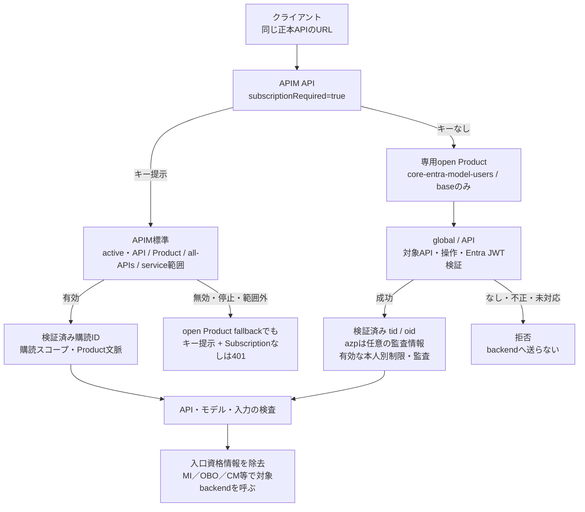

# Gatewayの認証と購読キー

本書は現行のGateway認可とPortal・本人接続の分担を説明します。APIの正本は [登録定義](../../../apps/api-gateway/apis/)、共通認可は [service.xml](../../../apps/api-gateway/policies/service.xml)、配備は [Gateway配備コマンド](../../../scripts/deployment/deploy_gateway.py)です。実環境への反映状況は配備記録と試験結果で確認します。

OAuthを標準の利用経路とし、購読キーは基盤管理者が例外として発行します。 [Entraアプリと認可](entra-apps.md)

## 利用経路と認証の分担

| 場所 | 担当すること |
| --- | --- |
| Portal | Entraサインイン、本人の `Gateway.Invoke` BearerによるAPI試用 |
| 外部APIクライアント | OAuthを優先し、特別に発行された購読キーを使う場合は保護された秘密保管先から取得する |
| APIM共通ポリシー | 信頼した入口経路を確認し、キー提示時は検証済み購読、キーなしBearer時は検証済みEntra本人を確認する |
| API・Operation | 操作ごとの経路、モデル設定、必要な本人接続を適用する |
| APIMの下流接続 | Foundry等にはマネージドID、本人のGraphにはBearerでOBO、購読キーでCredential Managerを使う |



購読キーはAPIの利用範囲を表します。Graphで本人を識別する場合は下流への認証が必要です。キー・pollSecret・本人接続セッションは保護し、ブラウザーのJavaScript、URL、公開設定へ埋め込みません。

## 受信するキー

既定ヘッダーは`api-key`です。環境共通の名前は`gateway.authentication.subscriptionKeyHeader`で設定し、APIMのAPI設定と共通ポリシーへ同じ値を反映します。

内部所有者ヘッダー`X-Core-Caller-Id`・`X-Core-Subscription-Id`は購読キーヘッダーとして指定できません。これらの指定は配備前の入力検査で拒否します。変更時はAPI設定とクライアントの送信設定を揃えてください。

```http
POST /models/openai/v1/chat/completions HTTP/1.1
Host: gateway.example.com
api-key: <APIM_SUBSCRIPTION_KEY>
Content-Type: application/json
```

APIM標準の購読検証と、共通ポリシーの`context.Subscription.Id`確認を使います。空値・重複や、URL queryでのキー提示を拒否します。キーも有効なBearerもない要求は拒否します。`Authorization: Bearer <APIキー>`は標準ヘッダーと自動的に同じものとして扱いません。別のクライアントを接続するときは送信するヘッダー、公開パス、要求・応答方式を契約に合わせます。

検証済み購読の存在と購読IDの空値、キー用ヘッダーの空・空白と値の数は共通認証で確認し、HTTP・protocol・MCPのAPIテンプレートでは再検査しません。各APIは`<base/>`で共通認証を実行し、完了を確認してから検証済みIDを監査・API固有の処理へ渡します。空値やAPIM上の値数が1以外のキーは共通側で401を返し、有効なBearerを同時に送っても救済しません。MCPからRESTへの転送は別要求なので、REST側の共通認証は維持します。

キー用には専用のヘッダー名を使います。`x-ms-client-request-id`は各APIが要求IDへ書き換え、`x-appgw-trace-id`はAppGWの相関に使うため、配備前の設定検査でキー用への指定を拒否します。既定の`api-key`、`Ocp-Apim-Subscription-Key`、内部処理と衝突しない独自のヘッダーは引き続き利用できます。

Entra設定を持つ構成では、HTTP・WebSocket・MCP・Realtime・CMを含む全業務APIで、キーなし要求に有効なEntraユーザー委任tokenを要求します。CMのブラウザー受付の例外を除く通常要求は、設定キーheaderの有無だけで認証方法を選び、実行時のAPI名一覧でBearer対応を判定しません。有効キー＋既存用途のAuthorizationはキー側の従来動作を維持します。無効キー＋有効JWT、空・重複・queryの提示は救済しません。操作・モデル・入力の既存契約は両方式で検証します。

公開paramsにAPIの `audience`、共通configに `userLimits` を設定します。共通認証は署名・期限・tenant／issuer・v2のaudience・委任scope `Gateway.Invoke`・有効な `tid` と `oid` を確認します。クライアントの `azp` は単一の有効なGUIDの場合に監査へ記録します。

入口のキーやAuthorizationは下流へ引き継がず、対象サービス用の認証を設定します。匿名healthとブラウザー認証の一時取引は用途を限定した経路です。業務APIの購読認可を解除して実装しません。

## Productと購読キー

基盤管理者がAzureポータルから例外の購読を作成します。利用範囲はAPIMの購読スコープ、製品とAPIの関連付け、現在の購読状態で決まります。同じ購読の主キーと副キーは、同じ購読IDとリアルタイム音声セッションの所有主体を使います。[購読キーの運用](../../operations/access-and-keys.md)

社員経路は既存APIの購読必須設定を変えず、固定ID `core-entra-model-users`・所有marker `core-owned-entra-model-users-v1`の専用open Productへ業務API正本・生成MCP・設定済みCM保護入口を自動的に追加します。CMブラウザー入口は含めません。専用Productは`subscriptionRequired=false`ですが、APIはtrueです。これにより有効キーの標準検証と既存Product policyを維持します。API／all-APIs／serviceキーにProduct policyが適用されない既存仕様も保持します。キーなしでは専用Productのbaseからglobal/APIのJWT検証を継承します。専用Productに所属させるAPI集合は配備処理で自動生成・読戻し照合し、要求ごとのBearer分岐条件には埋め込みません。

Bearer要求のProductの存在と専用ProductのIDは、共通認証で一度だけ確認します。各APIはProduct確認を重複させず、共通認証・Entra検証の完了と本人情報の整合性を確認します。GUIで専用ProductからAPIを外すと、購読必須設定によって共通ポリシーの前に拒否される場合があります。

[Microsoftの購読仕様](https://learn.microsoft.com/en-us/azure/api-management/api-management-subscriptions)に従い、open Productへ不正キーがfallbackする場合も、共通ポリシーで提示キーと検証済み購読の欠落を検出して拒否します。API自体の購読必須を外すと提示キーが無視されるため、その設定に変更しません。

## 本人接続が必要なAPI

標準の `GET /tools/graph/v1/me` には2つの認証経路があります。

- **購読キー**。クライアントは対象APIに有効な `api-key` と、本人の `X-Core-Connection-Session` を送ります。未接続時の `409 ConnectionRequired` を受けたクライアントは、仮セッションと取引をサーバーに保存し、利用者にMicrosoftサインインを案内します。本人の一致を確認してから元の要求を再開します。Graph用トークンはAPIM Credential Manager（CM）が保管・更新します。
- **Bearer**。クライアントは本人の `Gateway.Invoke` アクセストークンを送ります。BrokerがEntraのOBOで本人のGraph用トークンへ交換します。この経路ではCMの接続セッションは不要です。PortalのGraph試用もこの経路を使います。

CMを使う業務APIでは、BrokerとSQLが本人・呼出主体・CM接続・期限・失効・更新世代を管理します。キー用とBearer用のCMセッションはそれぞれの呼出主体に結び付きます。 [CM接続手順](credential-manager-login.md) · [クライアント実装](connection-session-clients.md)

## 音声セッションと利用上限

Realtimeの作成・終了・observerは、キー経路は検証済み購読ID、Bearer経路は検証済みtid+oidのcaller IDを所有者とし、署名ticket・call ID・期限を照合します。キーticket v3とユーザーticket v4の間で流用を拒否します。

購読キーの共通上限は標準資材で設定しません。Bearerの接続開始には既存の利用者単位の上限を適用します。WebSocket接続後のframeとWebRTCメディアは別の境界です。 [購読単位の観測](../../testing/subscription-limits.md)

テスト・本番の標準configは、Bearerの `requestRate` を利用者ごとに60秒当たり1,000要求、`tokensPerMinute` と `tokenQuota` を `null` に設定します。有効な制限は、対象のAPI・クライアントをまたいで、検証済みの `tid` と `oid` をキーに計数します。各項目を無効にする場合は明示的に `null` を設定します。

## 配備・確認の入口

初回は`azd up`で共通基盤を作り、Entra登録後にGateway、Portalの順で個別配備します。Gateway更新は同じparams・配備記録を使い、計画確認後に`--execute`を付けて実行します。DB・CM・Broker起動確認の後にAPIと共通ポリシーを反映します。詳細は [運用手順](../../operations/README.md)を参照してください。

共通ルール・ローカル実行は [DEVELOPMENT.md](../../../DEVELOPMENT.md)、動作の受入条件・結果は [動作テスト仕様書](../../testing/integration-tests.md)、資材と構築・更新・撤去の受入条件・結果は [構築テスト仕様書](../../testing/construction-tests.md)で管理します。構築・登録成功だけで業務APIの実通信を合格にしません。

社員経路の公開は、APIの購読必須・全revision・global/Product/API/全operationの継承・参照先を読戻してから、専用open Product所属を最後に追加します。更新・rollback時は所属を先に解除して社員経路を閉じ、内部の配備状態でBearer分岐を切り替えます。公開設定に有効化スイッチは設けません。途中失敗はBearer受付を停止し、正常キーと拒否境界の読戻しを確認してから復旧します。未知のpolicy・resource所有やETag競合を上書きせず、Product非公開化やBicep省略だけで閉鎖完了としません。詳細は [Gatewayの配備](../../setup/11-deploy-gateway.md)を参照してください。

公開controllerはcurrent・onlineのrevision 1が1つだけある対象APIに限定し、API型を区別するV2 source manifestで業務API・生成MCP・CM保護入口を照合します。複数revisionや既存の保護sourceの欠落は停止します。同じ資材で配備した環境の更新には保護された生成元を使います。新規構築時は、Bearer経路を閉じた状態で生成元を準備してから公開します。
