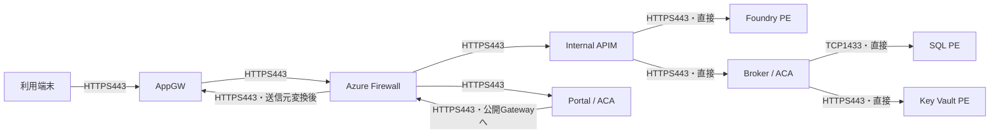

# 通信要件とネットワークの設計前提

[基盤仕様](platform.md) · [NSG設計](network-security-design.md) · [Firewall Policy設計](firewall-policy-design.md) · [検証と実証結果の管理](network-security-validation.md)

本書は、現在の構築資材が必要とする業務・保守・Azure基盤通信の参照元である。同一の接続を複数のAPIが使う場合は通信を共通化し、APIごとにNSGのポートを追加しない。HTTP、SSE、WebSocket、MCPのAPI契約と公開範囲は、[API定義](../../apps/apim/apis/)と[API設計](api-design-proposal.md)を参照する。

`FLOW-...`は通信要件のIDであり、Azureのルール名ではない。NSG設計の各レコードとFirewall設計の各レコードから同じIDを参照する。終端Denyと既定規則は通信そのものではなく制御方針であるため、NSG側の`POLICY-...`で記録する。通信IDの行にある「FW」は現在の構築経路でFirewallを通過する区間だけを示す。

## 設計前提と判断

| 判断 | 採用する設計 | 理由と境界 |
| --- | --- | --- |
| 初期ネットワーク | 独立VNet、6サブネット、5 NSG、4ルートテーブル | AppGW、APIM、Private Endpoint、管理VM、ACAへNSGを関連付ける。AzureFirewallSubnetに顧客NSGを関連付けない |
| 固定ルール集合 | NSG catalog v5は77カスタム規則（Allow69、Deny8）、Firewallは35規則（Network14、Application21）。名称・優先度・用途・作成を資材で固定 | ルール作成だけを切り替えるparams/configのフラグ・任意追加配列は設けない。構築した資源のアドレスは動的に設定する |
| 公開入口 | AppGWのHTTP80とHTTPS443 | HTTPはHTTPSへのリダイレクト用。公開IPv4の初期範囲は`0.0.0.0/0`。企業の許可元IP制限は引渡し後に手動で変更する |
| AppGWのバックエンド | APIMとPortalのACA入口へHTTPS443 | AppGWで再暗号化し、Firewall PremiumでTLS検査後に再暗号化する。 |
| APIMからの接続 | Foundry・Key Vault PE、BrokerのACA入口等へHTTPS443 | AppGWのバックエンド設定とは別接続。サービスのHTTPS契約と認証を維持する |
| gRPC | 初期要件から廃止 | gRPC専用入口、8443、転送設備、API定義・設定を設けない。管理VMとAPIM間のHTTPS保守は残す。AppGW公開側HTTP/2は維持し、APIMのServer.Http2は`false`固定。HTTP/2受付とgRPC提供を区別する |
| L7入口保護 | AppGWが`X-Core-L7-Ingress`を上書きし、APIMが検査 | 通常HTTP/HTTPS APIの入口保護として常設する。gRPC設定から独立させ、値は公開文書・paramsへ記載しない。業務APIの購読キー・Bearer認可も別に維持する |
| 標準DNS | VNetとFirewallの上流DNSをAzure提供DNSへ固定。Firewall DNS proxyを保持 | DNS変更入力と初期カスタムDNS用NSG規則を設けない。Azure提供DNSのNSG例外を、他のDNSや全宛先53番へ一般化しない |
| 標準時刻 | APIMの外部NTP、管理VMのAzureホストPHC同期 | APIMはNSG328でInternet宛UDP123、FirewallでAPIMサブネットからUDP123を許可。管理VMはChronyでPHC／`AZUR`だけを参照し、非IPのVMBus／PHCにNSG／FWのUDP123／319／320許可を作らない |
| 明示Allowと既定許可 | ACAは受信・送信とも明示Allowの後に終端Deny。AppGWとPEの送信は既定規則も評価 | ACA両方向の例外、AppGW OutboundとPE Outboundの境界は[NSG設計](network-security-design.md#既定規則と拒否範囲)を参照 |
| ACAの外向き経路 | 公開宛TCP443は固定`0.0.0.0/0` UDRで構築Firewallへ転送し、許可済みの宛先に限定 | ACAサブネットの既定送信アクセスとルート表のBGP伝搬を無効化。CoreとNSG限定配備は既存経路を照合し、迂回可能な設定があれば停止する |
| 共有SQLの接続方式 | Proxy固定、SQL PEへTCP1433で直接接続 | [Proxy採用理由](sql-proxy-decision.md)を参照。PortalのSessionロックと接続層を維持し、Redirectへの移行は見送る |
| Firewallの記録範囲 | 実際にFirewallを通る通信だけをルールにする | PEへ直接接続するSQL/Key Vault等に、将来の迂回を想定したFW規則を置かない。通信要件は本書で記録する |
| 引渡し後の企業接続 | ハブ＆スポーク、中央DNS、企業NTP、許可元IPを手動で調整 | 初期構築の固定資材を企業設定の再適用手段としない。再実行は手動変更を戻し得るため、必要になった場合は別途差分と所有範囲を確認する |

設定・経路の実装元は[network.bicep](../../infra/modules/network.bicep)、[network-bindings.bicep](../../infra/modules/network-bindings.bicep)、[Portalの経路binding](../../infra/modules/portal-network-bindings.bicep)である。[ハブ＆スポーク移行手順](../setup/07-hub-spoke.md)は、初期要件と企業側変更の所有範囲を分けて読む。

## 主な業務経路

AppGWは構築APIM VIPとACA VIPの`/32`宛UDRでFirewallを経由する。APIM/ACAからAppGWサブネットへの復路もFirewallへ向ける。AppGWのInternet向けデフォルトルートをFirewallへ変更する構成ではない。

APIM、管理VM、ACAの外部向け通信は各デフォルトUDRでFirewallを経由する。ただしVNet内・PE宛などの、より具体的なシステム経路が優先される区間と、APIM管理用`ApiManagement → Internet`のUDRは別扱いである。PEサブネットにルートテーブルは関連付けず、`privateEndpointNetworkPolicies: NetworkSecurityGroupEnabled`で対向NSGを評価する。経路とNSGのどちらか一方だけで成立を判定しない。

NSGはstatefulである。許可された接続への応答に逆向きの新規Allowを追加する必要はない。APIM内同期やPortalから公開Gatewayへ送る要求は、新たな接続なので別の通信要件として扱う。

## 公開入口と業務・内部接続

「送信元 → 宛先」は接続を開始する主体を示す。ACAの80/443は環境入口のポートであり、内部のNodePortやコンテナーのtargetPortとは区別する。

| 通信ID | 送信元 → 宛先 | プロトコル・宛先ポート | 用途 | 経路・制御 |
| --- | --- | --- | --- | --- |
| `FLOW-CLIENT-HTTP` | 公開クライアント → AppGW | TCP80 / HTTP | HTTPS入口へのリダイレクト | AppGW Inbound NSG。FW非通過 |
| `FLOW-CLIENT-HTTPS` | 公開クライアント → AppGW | TCP443 / HTTPS、WSS | API、SSE、WebSocket、MCP、Portal | AppGW Inbound NSGとWAF。バックエンド接続は次の行で区別 |
| `FLOW-FIREWALL-PUBLIC-APPGW` | 構築Firewallのpublic IP → AppGW | TCP443 / HTTPS | Portal等の公開Gateway呼出しでFWの送信元変換を経る通信の明示 | AppGW Inbound NSG。クライアントAllowと重なるため、この1規則だけで公開元を限定したとは扱わない |
| `FLOW-APPGW-APIM` | AppGW → APIM内部VIP | TCP443 / HTTPS | API転送とAPIM health probe | FW経由。AppGW Outbound、APIM InboundとFWの対となる規則 |
| `FLOW-APPGW-ACA` | AppGW → ACA環境VIP / Portal | TCP443 / HTTPS。ACA受信NSGは443と31443 | Portal転送と`/api/health`のprobe | FW経由。AppGW Outbound、ACA InboundとFWの対となる規則 |
| `FLOW-APPGW-KV` | AppGW → Key Vault PE群 | TCP443 / HTTPS | 公開TLS証明書参照・更新 | PE直接。AppGW Outbound、PE Inbound。FW規則なし |
| `FLOW-APIM-FOUNDRY` | APIM → Foundry PE群 | TCP443 / HTTPS、WSS | モデル、音声、PII、文書解析等の上流API | PE直接。APIM Outbound、PE Inbound。API認可は別条件 |
| `FLOW-APIM-ACA` | APIM → ACA環境VIP / Broker | TCP443 / HTTPS。NSGは443と31443 | 本人接続・資格情報の内部窓口 | VNet直接。APIM Outbound、ACA Inbound。FW規則なし |
| `FLOW-APIM-KV` | APIM → 構築Key Vault PE群 | TCP443 / HTTPS | Named Value等の基盤秘密参照、カスタムドメイン証明書参照・更新 | PE直接。APIM Outbound、PE Inbound。AzureKeyVaultタグ宛の基盤依存とは別 |
| `FLOW-ACA-KV` | ACA App/Job → Key Vault PE群 | TCP443 / HTTPS | Portal/Broker等の構築秘密参照 | PE直接。ACA Outbound、PE Inbound。FW規則なし |
| `FLOW-ACA-SQL` | ACA App/Job → SQL PE群 | TCP1433、Proxy接続時のTLS | 本人接続台帳、Portal台帳、schema初期化・更新 | PE直接。ACA Outbound、PE Inbound。FW規則なし |
| `FLOW-ACA-ACR` | ACA → 構築ACR PEの全IP | TCP443 / HTTPS | App/Jobイメージ取得 | PE直接。login/dataのPE全IPを両NSGへ設定 |
| `FLOW-ACA-APPGW` | Portal/ACA → 構築AppGW public IP | TCP443 / HTTPS、WSS | Portalサーバーから公開Gateway APIを呼ぶ | FW経由。ACA Outbound、AppGW Inbound。PortalのHTTPS入口への転送とは別 |

公開側TLS、AppGWからFirewall、Firewallからバックエンド、APIMから上流へのTLSはそれぞれ別の接続である。FirewallはAppGWからAPIMとPortalへの2つのApplication規則でTLSを検査する。ACAから外部へのFirewall規則は宛先を制御する。[Firewall設計](firewall-policy-design.md)

## 管理VMからの保守接続

| 通信ID | 送信元 → 宛先 | プロトコル・宛先ポート | 用途 | 経路・制御 |
| --- | --- | --- | --- | --- |
| `FLOW-MGMT-KV` | 管理VM → Key Vault PE群 | TCP443 / HTTPS | 証明書・秘密の所定保守処理 | PE直接。管理VM Outbound、PE Inbound、用途別MI/RBAC |
| `FLOW-MGMT-FOUNDRY` | 管理VM → Foundry PE群 | TCP443 / HTTPS | Foundryデータ面の保守 | PE直接。管理VM Outbound、PE Inbound。ARM管理は別接続 |
| `FLOW-MGMT-ACR` | 管理VM → ACR PEの全IP | TCP443 / HTTPS | イメージ配備・取得の保守 | PE直接。管理VM Outbound、PE Inbound |
| `FLOW-MGMT-SQL` | 管理VM → SQL PE群 | TCP1433、SQL接続時のTLS | 構築Gateway/PortalのDB直接保守 | PE直接。管理VM Outbound、PE Inbound。担当者本人のEntra認証、作業期間中の対象DB内の権限、ODBC clientが必要 |
| `FLOW-MGMT-APIM` | 管理VM → APIMサブネット | TCP443 / HTTPS | private Gateway側の保守確認 | VNet直接。管理VM Outbound、APIM Inbound。APIM管理用ARMとは別 |
| `FLOW-MGMT-ACA-HTTPS` | 管理VM → ACA環境VIP | TCP443 / HTTPS。ACA NSGは443と31443 | Broker等のprivate HTTPS入口確認 | VNet直接。管理VM Outbound、ACA Inbound。Dev gatewayは別接続 |
| `FLOW-MGMT-AUDIT-JAPAN` | 管理VM → collectJapan監査StorageのBlob PE群 | TCP443 / HTTPS | 日本側監査Blobの閲覧 | PE直接。管理VM Outbound227、PE Inbound229。担当者本人への構築コンテナー単位の一時読取権限 |
| `FLOW-MGMT-AUDIT-FOUNDRY` | 管理VM → collectFoundry監査StorageのBlob PE群 | TCP443 / HTTPS | Foundry側監査Blobの閲覧 | PE直接。管理VM Outbound228、PE Inbound230。担当者本人への構築コンテナー単位の一時読取権限 |
| `FLOW-MGMT-ACA-DEV` | 管理VM → 構築リージョンのACA Dev gateway | TCP443 / HTTPS、WSS | App/環境/Jobのライブログ、App exec | FW経由。NSGのInternet443とFWの単一リージョン宛FQDN規則。担当者本人のARM token、作業対象へのAzure RBAC、対象実行の存続も必要 |

保守操作の権限とclientは[管理VMの保守操作](../operations.md#管理vmから保守データを取得する)を参照する。NSGのTCP1433/443許可だけで、SQL保守、Blob閲覧、ACA execが認可されるわけではない。手動Jobのログ確認のためだけにDDLや初期データ更新を再実行しない。

## Azure製品の仕様上の通信

ここではサービス・タグを宛先分類に使う。タグは構築資源1件への限定ではなくAzureが管理する範囲であり、NSGのAllowと後段のFQDN規則・サービス認可を区別する。

| 通信ID | 送信元 → 宛先 | プロトコル・宛先ポート | 用途・境界 |
| --- | --- | --- | --- |
| `FLOW-APPGW-GATEWAY-MANAGER` | GatewayManager → AppGW | TCP65200–65535 | 採用AppGW v2の基盤管理Inbound。業務リスナーと別。FW非通過 |
| `FLOW-APPGW-LOAD-BALANCER` | AzureLoadBalancer → AppGW | NSGは全プロトコル・全ポート | 基盤probe用の常設Allow。タグ内を広く許可する採用判断であり、全ポートで業務通信が発生するという意味ではない |
| `FLOW-APIM-MANAGEMENT` | ApiManagement → APIM | TCP3443 | classic APIMの管理通信。管理専用UDRと復路も確認 |
| `FLOW-APIM-LOAD-BALANCER` | AzureLoadBalancer → APIM | NSGは全プロトコル・全ポート | 公式probe要件のTCP6390を包含。AppGWとAnyへ統一した判断であり、最小ポート許可と同義ではない |
| `FLOW-APIM-COUNTER-SYNC` | APIMインスタンス間 | UDP4290 | rate-limit counter同期。APIM両方向NSG。FW非通過 |
| `FLOW-APIM-INTERNAL-CACHE` | APIMインスタンス間 | TCP6381–6383 | 内部cache依存。APIM両方向NSG。FW非通過 |
| `FLOW-APIM-STORAGE` | APIM → Storageタグ | TCP443 / HTTPS | APIM自身の基盤Storage。FW経由。ACAアプリのStorage依存とは別 |
| `FLOW-APIM-SQL-PLATFORM` | APIM → Sqlタグ | TCP1433 | APIM自身の基盤SQL。FW経由。構築業務SQL PEとは別 |
| `FLOW-APIM-KV-PLATFORM` | APIM → AzureKeyVaultタグ | TCP443 / HTTPS | Azure基盤Key Vault依存。FW経由。構築Vault PE用のFLOW-APIM-KVとは別 |
| `FLOW-APIM-MONITOR` | APIM → AzureMonitorタグ | TCP1886、443 | 監視・診断。FW経由 |
| `FLOW-APIM-EVENT-HUBS` | APIM → EventHubタグ | TCP443、5671、5672 | Event Hubs依存。FW経由。実イベント送信は採用logger設定にも依存 |
| `FLOW-APIM-ENTRA` | APIM → AzureActiveDirectoryタグ | TCP443 / HTTPS | Entra認証・ID基盤。FW経由 |
| `FLOW-APIM-CREDENTIAL-MANAGER` | APIM → AzureConnectorsタグ | TCP443 / HTTPS | CMの接続基盤。FW経由。利用する本人OAuth providerは別に整理 |
| `FLOW-APIM-INTERNET` | APIM → Internetタグ | TCP80、443 | APIM NSG側の外向き許可枠。FWは下表の具体的なFQDN用途で制限。全Internet宛がFWでAllowになるわけではない |
| `FLOW-APIM-NTP` | APIM → 外部時刻源 | UDP123 | FW経由。NSGはInternet、FW宛先は`*`。DNS回答差で時刻同期を遮断しない。内部daemonの可視性とAPIMの時刻応答を区別 |
| `FLOW-ACA-LOAD-BALANCER` | AzureLoadBalancer → ACAサブネット | TCP30000–32767 | ACA基盤probe。FW非通過。AppGW/APIMのAny判断をACAへ適用しない |
| `FLOW-ACA-INTERNAL` | ACAサブネット内 → 同サブネット | 全プロトコル・全ポート | managed基盤の内部通信。送受信とも同じACAサブネットのCIDRを明示する |
| `FLOW-ACA-ARM` | ACA → ARM | TCP443 / HTTPS | PortalのAPIM操作、BrokerのCM操作、管理API。FW経由 |
| `FLOW-ACA-ENTRA` | ACA → Entra ID基盤 | TCP443 / HTTPS | 認証・ID基盤とMicrosoft Graph。同タグのFW規則とlogin用FQDN規則が重なり得る |
| `FLOW-ACA-MONITOR` | ACA → AzureMonitorタグ | TCP443 / HTTPS | 監視・ログ送信。FW経由 |
| `FLOW-ACA-MCR` | ACA → Microsoft Container Registry | TCP443 / HTTPS | Microsoft提供イメージ取得。FW経由。構築ACR PEとは別 |
| `FLOW-ACA-PLATFORM-PACKAGES` | ACA → AzureFrontDoor.FirstPartyと基盤パッケージ配布先 | TCP443 / HTTPS | CDN経由のパッケージも含め、NSGから構築Firewallへ到達させる。Firewallの許可済みFQDNに限定する |
| `FLOW-ACA-MANAGED-IDENTITY-UPSTREAM` | ACA基盤 → 管理IDの上流サービス | TCP443 / HTTPS | managed基盤側の依存先。FWの承認FQDNで扱う。AppからIDENTITY_ENDPOINTへのローカルtoken取得とは別 |
| `FLOW-MGMT-ARM` | 管理VM → AzureResourceManagerタグ | TCP443 / HTTPS | VM/ACA等の管理、token発行API、Azure DNSによる証明書更新。FW経由 |
| `FLOW-MGMT-ENTRA` | 管理VM → AzureActiveDirectoryタグ | TCP443 / HTTPS | Entra SSHと担当者本人のAzure CLI認証。FW経由 |
| `FLOW-MGMT-MONITOR` | 管理VM → AzureMonitorタグ | TCP443 / HTTPS | AMA送信・保存ログ照会。FW経由。監査Blob PE閲覧とは別 |
| `FLOW-MGMT-AGENT-STORAGE` | 管理VM → Storageタグ | TCP443 / HTTPS | Agent/拡張の直接Storage接続等。FW経由。接続済みManaged Disk I/Oやmanaged Boot Diagnostics内部保存をこの接続へ置き換えない |
| `FLOW-MGMT-INTERNET` | 管理VM → Internetタグ | TCP80、443 | NSG側の外向き許可枠。FWはOS更新、CA、build、ACA Dev等へ用途を分ける |

## Firewallを通る外部HTTP/HTTPSの用途分割

`AzureActiveDirectory`タグはサインインとMicrosoft Graphを含む。ACAパッケージのCDN宛はNSGの公開TCP443枠とFirewallのFQDN規則で制御する。[サービス・タグの仕様](https://learn.microsoft.com/en-us/azure/virtual-network/service-tags-overview) · [ACAのFirewall要件](https://learn.microsoft.com/en-us/azure/container-apps/use-azure-firewall)

下表の宛先群は、[Firewall設計の全35レコード](firewall-policy-design.md#ルールと通信要件の対応)でFQDN・protocol・port・collectionへ対応付ける。Network Ruleに先に一致する接続もあるため、各Application Ruleが必ずhitするという前提を置かない。

| 通信ID | 送信元 | 用途・宛先選択 | NSG側の許可枠 |
| --- | --- | --- | --- |
| `FLOW-APIM-CERTIFICATE-VALIDATION` | APIM | Azure基盤の証明書確認互換として維持する7宛先のOCSP/CRL等。7宛先すべてへの実通信発生を意味しない | APIM Internet TCP80/443 |
| `FLOW-APIM-WINDOWS-UPDATE` | APIM | Windows Update依存 | APIM Internet TCP80/443 |
| `FLOW-APIM-MICROSOFT-REDIRECT` | APIM | Microsoftの基盤redirect依存 | APIM Internet TCP80/443 |
| `FLOW-APIM-PLATFORM-DIAGNOSTICS` | APIM | Azure基盤診断先 | APIM Internet TCP443 |
| `FLOW-APIM-WINDOWS-DEFENDER` | APIM | Defender基盤更新・配布先 | APIM Internet TCP443 |
| `FLOW-APIM-PORTAL-DIAGNOSTICS` | APIM | Microsoft管理Portalの診断先 | APIM Internet TCP443 |
| `FLOW-APIM-APPROVED-SERVICES` | APIM | 検証済みAPI backend、本人OAuth identity endpoint等から生成した承認FQDN | APIM Internet TCP443。資源/業務設定から宛先を生成し、任意FW追加入力は使わない |
| `FLOW-MGMT-CERTIFICATE-VALIDATION` | 管理VM | 公開CAの7宛先へのOCSP/CRL等の証明書検証。ACME発行先は別行で管理 | 管理VM Internet TCP80/443 |
| `FLOW-MGMT-LINUX-PACKAGES` | 管理VM | Ubuntu等のOS package取得 | 管理VM Internet TCP80/443 |
| `FLOW-MGMT-APP-BUILD` | 管理VM | GitHub、Node/npm、DockerのApp build依存 | 管理VM Internet TCP443 |
| `FLOW-MGMT-PYTHON-BUILD` | 管理VM | Python package、ODBC、Brokerイメージbuildの配布先 | 管理VM Internet TCP443 |
| `FLOW-MGMT-APPROVED-SERVICES` | 管理VM | 構築公開Host、選択ACME directory、検証済み保守接続先から生成するFQDN | 管理VM Internet TCP443 |

FWの許可先が一定でも、各通信が常に発生するという意味ではない。CA検証、OS更新、build、Event Hubs logger、外部backend等は該当処理を使用した際に発生する。固定集合に将来の業務通信を推測して追加せず、用途が増えるときは接続先・実経路・認可を別途確認する。

## 通常NSGルールへ置き換えない通信

以下は操作端末・サービス側の制御通信の要件である。構築のAzure CLI認証は操作端末で行い、管理VMで保守クライアントを使う担当者はゲスト内のAzure CLIにも本人でサインインする。SSHの到達経路と作業中の許可は[管理VMへの接続手順](../operations/management-vm-access.md)に従う。

| 主体 → 宛先 | プロトコル・用途 | 構築VNet側の制御との関係 |
| --- | --- | --- |
| Windows操作端末/ブラウザ → Entra | HTTPS443、CLI/Portalの認証・同意 | 端末/企業NW側の制御。App/VM自身のMI取得とは別 |
| Windows操作端末 → ARM/Graph | HTTPS443、構築・読戻し・RBAC・Entra登録/所属の所定操作 | 管理VMのARM/Entra Allowを端末通信の許可と解釈しない |
| 操作端末 → Serial Console/診断取得先 | HTTPS/WSS443、serial対話・診断表示/返却URIからの取得 | 端末の認可と接続先を確認。VMへのInbound SSH22を追加しない |
| Azure診断基盤 → 構築監査Storage/Workspace | 診断設定によるログ・監査の保存 | provider送信と、VMからのBlob/保存ログ読取を区別 |
| CM/外部OAuth基盤/利用ブラウザ → 所定の認可・callback先 | HTTPS443、本人同意と接続の更新 | 正式API/CM契約に従う。自VNetを通る区間だけを対応NSG/FWへ紐付ける |

詳細な成立条件と公式根拠は[NSG規則にしない基盤通信](platform-communications.md)を参照する。これらも通信設計の対象であるが、架空のAllow名やポートを割り当てない。

| 記録 | 主体・処理 | 通信方式 | NSG/FWとの関係 |
| --- | --- | --- | --- |
| Azure提供DNS | AppGW/APIM/ACA/管理VM等のresolver | UDP/TCP53、Azure提供DNS | 通常NSG/UDRの基盤例外。Private DNS zone/link/PE zone groupと回答を確認。カスタムDNSに同じ例外はない |
| VM IMDS | 管理VMのSDK/worker → IMDS | Metadata付きHTTP、proxy/redirect回避 | 通常Denyと専用AzurePlatformIMDS制御を区別。token取得後のVault/ARM等は別のFLOW |
| ACA管理ID取得 | App/JobのSDK → 提供IDENTITY_ENDPOINT | 提供URLへの内部HTTP GET | IP/portをparamsやNSGへ固定しない。用途別MIと後続サービス認可を確認 |
| DHCP | 管理VM guest ↔ Azure DHCP | client UDP68 / server UDP67 | 基盤例外。初回IP取得と更新を、割当済VM /32への普通のAllowで表さない |
| VM Agent/HostGAPlugin | 管理VM → Azure host/WireServer | TCP80/32526のhostchannel | 通常NSG/UDRの基盤例外。直接Storage等のfallbackは別のFLOW |
| Managed Run Command/拡張 | Azure Compute制御 → VM Agent/guest | ARM制御とAgentの処理 | VMへの通常SSH22 Inbound接続へ置き換えない。スクリプトの外部接続は別途制御 |
| rsyslog → AMA | 同VM内の監査転送 | loopback TCPまたはUnix Domain Socket | remote Syslog Inboundを追加しない。実Agent版、生成forwarder、DCRとログ到着を確認 |
| `FLOW-MGMT-HOST-TIME` | Azure Hyper-V/VMBus/PHC → 管理VMのChrony | 非IPのホスト連携 | Ubuntu24.04で`/dev/ptp_hyperv`と`clock_name=hyperv`を検証し、PHC／`AZUR`を唯一sourceとして選択・`Normal`同期を確認。旧管理外部NTP許可を撤去し、UDP123／319／320を追加しない |
| Managed Disk I/O | guest → 接続済みOS Disk | 仮想block device | guest Storage HTTPS通信ではない。backup/import/exportは別要件 |
| Boot Diagnostics | Azure Compute基盤 → managed診断保存先 | provider内部収集・保存 | 顧客VM NICを通るStorage接続に推測対応付けしない。閲覧取得のARM/Storageは実行主体で区別 |
| Serial Console | Windows操作端末 → Azure Serial Console → guest serial channel | 操作端末側のHTTPS/WSSと非IPのserial channel | 管理VM Inbound NSGでSSH22を開けない。利用者認可、Boot Diagnostics、guestのローカル認証が必要 |
| Private Link/provider処理 | PE応答とサービス内部のHA/backup/保守 | 許可接続へのstateful応答・provider内部処理 | 応答専用Outbound Allowやprovider内部の推測IP/portを追加しない |
| 診断・監査のprovider送信 | APIM/Firewall等 → 診断設定の保存先 | Azure診断基盤の処理 | Storage PEの読取接続とは別。顧客NSGを通るguest接続と一律に扱わない |
| Azure Firewall自身の基盤通信 | Firewallサービス・上流DNS・管理基盤 | managedサービスの依存通信 | AzureFirewallSubnetへ顧客NSGを追加しない。利用者転送の35規則と内部管理wireを混同しない |

## params/configとアドレスの依存

| 入力・出力 | 変わるもの | 変えないもの |
| --- | --- | --- |
| `network.subnetPrefixes`、VNet address space | 各サブネットの送受信範囲、構築UDR | ルールの存在・名前・priority・protocol・port |
| 構築VM/Firewall/AppGW/APIM/ACAの割当IP | VM/公開IP/VIPの対象。単一IPは`/32` | 企業外部IPの任意入力や公開client許可元入力を再導入しない |
| PEの構築出力 | Foundry、Vault、SQL、ACR、監査Blob PE NICの全IP | 最初のIPだけを採用したり、PEサブネット全体へのAllowへ広げたりしない |
| 構築リージョン・公開Host・Azure cloud | ACA Dev等のリージョン宛先、公開Host、公式cloud endpoint | 宛先を任意FW AllowedFqdnsで追加する入口を設けない |
| 検証済みAPI backend / 本人接続provider設定 | API定義のbackend/operation overrideと、`gateway.authentication.credentialLogin.providerNames`で選択したproviderの`identityEndpoint`から必要FQDNを生成 | Broker本体とRCGを省略しない。credential profileの空/非空をFW規則作成だけのフラグへ使わない |
| 証明書のproduction/staging選択 | 資材が用意したCA接続先の選択 | OCSP/CRLとACME発行の違い、公開TLS/入口保護を維持 |
| Firewall SKU、IDPS、Threat Intelligence等 | 検査機能・動作mode | 固定Allow集合の作成有無とは別。TLS inspectionが自動で有効になるとは扱わない |

廃止した`network.clientAddressPrefixes`、`network.certificatePublicProbeEnabled`、DNS変更/NSG用入力、`managementAdditionalSecurityRules`、FW任意追加配列、`gateway.grpc`等の代替switchを作らない。入力の詳細と廃止検査は[NSG設計](network-security-design.md)・[Firewall設計](firewall-policy-design.md)・[運用テスト](../testing/operations-tests.md)を参照する。

## 再構築と実証の範囲

構築資材は、同じ固定通信集合と構築資源からのアドレスbinding、標準DNS、APIMの外部NTP許可と管理VMのAzureホストPHC同期、L7入口保護、監査Blob PE、管理VMの保守clientとSerialの初期準備を再現するための正本である。担当者の権限は作業期間に合わせて別途付与・回収する。既存の管理VMはPHC実同期成立後に旧管理NSG325の完全一致tupleをETag付きで限定削除し、所有FW collectionを更新・読戻しする。未知の企業ルール・時刻設定は自動削除しない。限定パッチだけに存在し、初期構築には存在しない設定を完了形の設計へ持ち込まない。

資材生成・ローカル合成検証・既存環境への限定反映/読戻し・実操作・新規環境の一式再構築は別の確認段階である。ルール全件の設定一致を、各ルールのパケット実証済みと読み替えない。判定と結果の扱いは[検証と実証結果の管理](network-security-validation.md)で定める。
