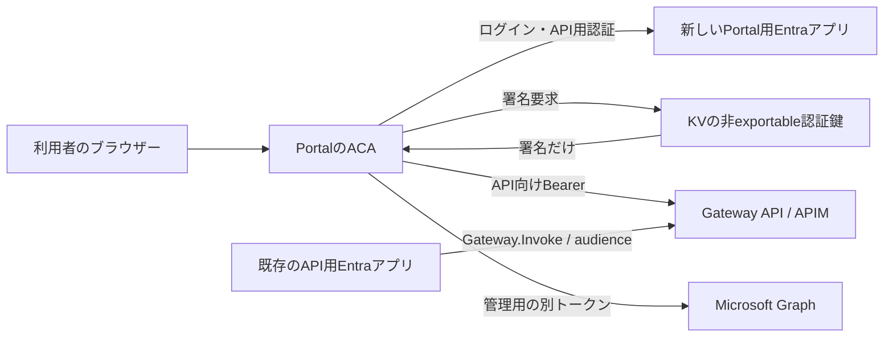
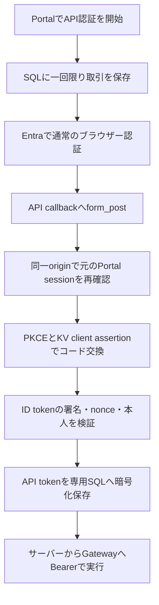

# Portal工程4：API認証・保存・全Tryの設計

状態はWIPです。工程4のOAuth、保存用資材、試用機能を新規構築に組み込みました。Azure適用、Entraの実コード交換、SQLと全試用機能の実環境受入は未実施です。ドメイン・IDは独立した例示か用途付きプレースホルダーです。

## 合意済みの実装方針

Portalへログインする仕組みは工程3のBetter Authを維持し、APIをユーザーのアクセストークンで試す認証を追加する。API用認証に失敗・取消しても、PortalのログインやAPIキー管理を失効させない。

次の5点を一式の実装範囲とする。初回のEntra作成・証明書・権限設定は、既存の`Gateway.Invoke`契約に合わせ、一度の依頼にまとめる。

1. 新しいPortal用Entraアプリを、Portalログイン・Graph管理・API用OAuthのクライアントとして使う。APIを表す既存Entraアプリは別に維持する。
2. API用OAuthは独立したサーバーモジュールで扱い、既存Better Authの公開OAuth関数とJOSEを使う。Portalのログイン用accountへAPIトークンを保存しない。
3. APIトークンと認証途中の秘密を、Portal SQL内の専用テーブルへ暗号化保存する。KVにAPI保存専用の暗号鍵を用意し、Portal本体だけへ読取り権限を付ける。
4. 各Tryの要求をAPIキー／Bearerの型に分け、開始・結果取得・接続終了まで本人と認証方式を維持する。
5. logout／API接続解除を複数instanceへ反映する。進行中のWebRTC停止に必要な場合だけ、停止専用のアクセストークンを最大60秒、暗号化して保持する。通常APIや更新には使わない。

合意の対象は工程4の実装方針である。初回のEntra登録内容を[手動登録手順](../setup/09-egakumi-portal.md)へ確定し、一度の手動作成・設定で工程3を受入する。初回構築の手順は[配備手順](../setup/08-provision-core.md)に従う。Azure・Entraでの工程3、工程4の認証は順に受け入れる。

## アプリとトークンの役割

| 対象 | 役割 |
| --- | --- |
| 新しいPortal用Entraアプリ | Webクライアント。Portalログイン、Graph管理、API用Authorization Codeのクライアント認証を、KVの証明書client assertionで行う |
| 既存のAPI用Entraアプリ | Gateway APIを表すリソース。`Gateway.Invoke`を公開し、APIMがこのAPIのaudienceを検証する |
| egakumi-tools | 購読キー経路のCM本人接続を担当する。専用secretを使用 |
| PortalのACA | サーバー処理とブラウザー向け画面を実行する。共有資材で枠を準備し、登録結果を受け取った後に本体イメージを配備する |

PortalのID tokenはPortal利用者の確認、GraphのApplication tokenはグループ・ユーザー管理、APIのaccess tokenはGateway呼出しに使う。API tokenをGraphへ転送せず、ID tokenやGraph管理tokenをAPIへ送らない。Graphでは購読キーに本人のCM接続、BearerにAPIアプリによるOBOを使う。

PortalとGatewayの利用者認証は同じ認証tenantを前提とし、署名検証した`tid`と`oid`を一致させる。KV・ACA・SQLのAzure tenantは同一・別tenantの双方を扱う。Gatewayの認証tenantがPortalと異なる構成を、メールやゲストの別Object IDで自動対応したものとして扱わない。

## 新規構築の順序

[基盤用アプリの登録手順](../../README.md#新規クローンから構築する)に沿って、API・Tools・Credentialを先に登録し、次の順に構築する。

| 順序 | 作業 | 担当 |
| --- | --- | --- |
| 1 | `azd up`で共通基盤とPortal ACA初期サンプルを配備し、専用ACA JobでPortal認証用とGateway OBO用の鍵・公開証明書を準備 | 構築資材 |
| 2 | APIアプリにGateway OBO用の公開証明書を登録。Portal用Entraアプリを作成し、公開`.cer`、2つのWeb戻り先、必要な権限、管理者同意を同じ依頼で設定 | Entra管理チームの手動操作 |
| 3 | 登録結果を保護paramsへ設定し、Gatewayの成功後にPortalを配備。Portal配備時にAPI保存暗号鍵とSQLを準備し、ログインとAPI試用を受入 | Portal配備資材と受入担当 |

Azureポータルの画面操作は「新規登録→証明書・権限等の設定」になるが、途中に資材構築やPortal配備を挟まない。Portalアプリの作成だけを先に依頼し、工程4のために別の編集依頼を後から追加する手順にはしない。

登録・保護入力・配備の照合を終えた後、実AzureではPortalのログイン・Graph管理と、API試用の本人認可・更新・失効を確認する。

## 一度のEntra登録に必要な設定

以下を新しいPortal用アプリへまとめる。URIのホストはACAの内部FQDNではなく、保護paramsで定めたPortalの公開HTTPSホストを使う。

| 項目 | 内容・用途 |
| --- | --- |
| 登録先・アカウント | 利用者の認証tenant、Single tenant |
| プラットフォーム | Web |
| Portalログインの戻り先 | `https://portal.example.com/api/auth/callback/microsoft`。工程3の既存導線 |
| API用認証の戻り先 | `https://portal.example.com/api/api-auth/callback`。工程4の`form_post`受付 |
| 証明書 | 共有資材で取得したPortal認証用の公開`.cer`。新Portalのclient secretを作らない |
| Graph Application権限 | `GroupMember.Read.All`、`User.ReadBasic.All`。Portal管理・定期照合 |
| GraphのOIDC Delegated権限 | `openid`、`profile`、`email`、`offline_access`。ログイン・ID token・API用更新トークンの要求に対応する同意を同じ作業で確認 |
| API Delegated権限 | API試用には既存APIアプリの`Gateway.Invoke`、購読管理には`Subscription.Manage`をPortalアプリへ追加。完全な要求scopeはそれぞれ`api://<API_APP_CLIENT_ID>/Gateway.Invoke`と`api://<API_APP_CLIENT_ID>/Subscription.Manage` |
| 管理者同意 | 上記権限をこのPortalクライアントへ付与。API側でscopeをAdmins onlyにしたことだけでは同意済みにならない |
| その他 | Implicit grantとPublic client flowsは無効。利用者割当・条件付きアクセス・受入利用者も同じ依頼で確認 |

API用アプリのClient IDはAPI tokenのaudience、新しいPortalアプリのClient IDはID tokenのaudienceとOAuthクライアントの識別子である。Gatewayの現契約は`azp`を監査情報として扱い、クライアント許可リストには使わない。今回のためにAPI用アプリへPortalの戻り先・証明書を登録しない。

実際のAzureポータル操作と引継ぎは[手動登録手順](../setup/09-egakumi-portal.md)へ集約する。公開`.cer`と確定した手順を使って依頼する。申請票・依頼メール・manifestは生成しない。

## API用認証の流れ

利用者はPortalへ通常どおりログインし、「アクセストークンで試す」を選ぶ。初回はAPI接続を開始する。Entraの既存サインイン状態が使えればSSOで進み、条件付きアクセス等が要求するときにMicrosoftの通常認証画面で操作する。端末コード認証やブラウザーでのtoken貼付けを導入しない。

1. PortalがSQLセッションと本人を確認する。固定API scope、戻り先、Portal Client IDと、10分の一回限り取引を束縛する。PKCE verifier・nonce・stateをサーバーで生成する。
2. 公開OAuth関数でAuthorization Code＋S256 PKCEのURLを生成する。API scopeと`openid profile offline_access`を要求する。利用者から任意のscope・tenant・URLを受け取らない。
3. EntraからAPI callbackへ`form_post`で認証コードが戻る。専用のHttpOnly相関CookieとSQL取引を照合し、stateを一回だけ消費する。
4. 認証コードを最大60秒、専用SQL取引へ暗号化して置き、同一originの`/api/api-auth/complete`へ303で移す。この内部パスはEntraのRedirect URIへ追加しない。GETでは通常のPortal Cookieも戻るため、開始時と同じSQL sessionであることを再確認する。
5. ライブラリが生成したtoken要求へ、KV署名による新しいclient assertionを付ける。SQL transactionは外部HTTPの前に終了し、コード交換を一度だけ送る。
6. ID tokenの署名、issuer、Portal向けaudience、期限、nonce、`tid/oid`を検証する。Portal利用者と一致した場合だけAPI access/refresh tokenを暗号化保存する。認証コード・verifier・nonceの秘密部分は回収する。
7. 各Tryのサーバーが保存済みAPI tokenを使う。ブラウザーへ返すのは接続状態、結果、必要な不透明な操作参照だけとする。

`form_post`のクロスサイトPOSTには通常のSameSite=LaxセッションCookieが付かない場合があるため、SQL sessionの一致を省略せず、内部GETの完了段階で確認する。相関Cookieは`Secure`・`HttpOnly`・`SameSite=None`・host限定・短期とし、raw値のハッシュをSQLへ束縛する。戻り先は許可したPortal内の言語付きページだけにする。

## ライブラリの再利用と確認範囲

| 案 | 評価・採否 |
| --- | --- |
| Better Authのsocial/genericOAuth providerを追加 | 通常のsocial callbackはaccountの作成・連携とPortal sessionを扱う。API tokenの専用保存・既存sessionへの固定を一緒に組み替える負担があるため、API認証の入口には採用しない |
| **Better Auth公開OAuth関数＋既存JOSE** | **採用案。** プロトコルの要求生成を既存の公開APIへ任せ、Portal側は取引・本人・暗号化保存・API実行の境界を担当する。新しい依存を追加しない |
| MSAL Node | 現行配布版に非同期client assertion callbackがある。利用可能だが、SDKのtoken cacheをSQLの失効世代・暗号化保存へ同期する別adapterが必要になるため今回は選ばない |
| openid-client | 比較候補。追加依存とJOSEの版変更が必要になる。現行公開APIで必要な要求生成を扱えるため今回は追加しない |

確認した既存版はBetter Auth `1.7.14`、JOSE `6.2.14`。`better-auth/oauth2`の公開exportから`createAuthorizationURL`、`authorizationCodeRequest`、`refreshAccessTokenRequest`を使う。`tokenEndpointAuth: { method: "private_key_jwt", getClientAssertion }`はPromiseを待ち、コード交換・更新の両方で署名callbackを呼ぶ。

同じ工程3の`createClientAssertion`を使い、key versionとthumbprintを固定する。token endpointとClient IDが要求文脈と一致することを確認してから署名する。client secretとclient assertionを併用しない。

配布型・実装の読取りと、合成データの9ケースを確認した。公開export、PKCE/S256・form_post・state/nonce、非同期assertionのコード要求と更新要求、更新時の保護パラメーター、client secret併用拒否、ID token署名・本人・nonce・別署名の拒否が対象で、全件成功した。実KV・Entra・SQLへ通信せず、秘密鍵をファイルへ保存していない。

これはライブラリの機能確認であり、工程4のHTTP handler・SQL競合・Cookie・WAF・全Try・実環境の成功を意味しない。公開のrequest builderを使った後のHTTPは、固定HTTPS endpoint・redirect拒否・本文上限・operation全体の中止期限を持つ薄いadapterで送る。生のOAuthエラーを画面・ログへ渡さない。

参照：[Better Auth OAuthの公開実装](https://github.com/better-auth/better-auth/tree/v1.7.14/packages/core/src/oauth2)、[MicrosoftのOIDC scope](https://learn.microsoft.com/en-us/entra/identity-platform/scopes-oidc)。Portalログインのtoken破棄hookは維持する。API access tokenはopaqueな資格情報として扱い、decode結果を本人の根拠にしない。JWT・scope等のAPI向け検証はAPIMの既存契約が担当する。

## SQL・暗号鍵・保存期限

SQLは既存Portal DBとTedious/KyselyのProxy接続を維持する。専用テーブルを追加し、CM用の保存領域と鍵を使わない。Portal SQLのmigrationは、API用の認証状態を扱う専用テーブルを作る。

| 提案テーブル | 保存するもの・寿命 |
| --- | --- |
| `portalApiAuthContext` | Portal SQL session、検証済みtid/oid、Portal Client ID、API resource/scope、Gateway origin、設定版、失効世代、token revision、lease、有効なtoken暗号文、初回ID tokenに束縛したnonce hash。現在は全Tryで一つのAPI audienceを共有する |
| `portalApiAuthorizationTransaction` | 開始時のsession・context世代・認証試行ID、state hash、相関Cookie hash、暗号化したverifier/nonce、callbackの一回消費状態。最大10分。受け取ったcodeは暗号化して最大60秒 |
| `portalApiActiveOperation` | 長い接続・非同期結果の本人session、認証方式、context世代、登録済みAPI/model、暗号化したticket・call情報、終了状態 |
| `portalApiCallCleanup` | logout／disconnect後の固定hangupに必要な場合だけ、停止専用のaccess token snapshot・ticket・call参照を暗号化して最大60秒保持。refresh tokenは置かない |

context・認証取引のsession削除はFK等で反映する。明示的なdisconnectではcontextの世代を進め、token暗号文を消す。contextの行はsessionの寿命までtombstoneとして残し、再接続で世代を初期値へ戻さない。通常のtoken更新・同じ本人/resourceでの再認証はtoken revisionを進め、明示disconnectの世代とは区別する。これにより、単なるtoken更新でDocument等の本人参照を失わず、disconnect後の参照は復活させない。

AES-256-GCMを使う。新しい保存用32-byte鍵をKV secretへ置き、version付き参照を配備する。暗号文のAADへsession・本人・client・resource/scope・用途・行ID・失効世代を結び付け、token暗号文にはtoken revision、認証取引には認証試行IDを加える。操作ticketとcleanupは固有の操作ID・保存版へ束縛し、通常refreshによるcontextのtoken revision変更だけで有効な操作ticketを復号不能にしない。別行やその行の過去版の暗号文を採用しない。復号で使えるkey versionは配備設定のallowlistに限り、暗号文が指定した任意KV URLを読み出さない。

| 秘密・ID | 扱い |
| --- | --- |
| 認証RSA秘密鍵 | KVの非exportable鍵。Portal・Graph jobは署名を要求する。private key/PFXを取り出さない |
| API保存暗号鍵 | 認証鍵・Cookie鍵・CM鍵と別用途のKV secret。暗号処理のためPortalサーバーのメモリーに入るがブラウザーへ出さない。Entra client secretではない |
| API保存用UAMI | Azure資材で新規作成しPortal本体だけへ関連付ける。対象secret名scopeの読取りだけを許可。Graph jobへ関連付けず、既存の署名専用IDのsign権限を広げない |
| 初期化 | 構築端末のプロセスが暗号鍵を生成し、ARM経由でKey Vaultへ保存する。鍵は構築資材へ出力せず、Portal本体が専用の実行IDで読み取る |

Portal配備時は対象のKey Vaultとsecretの所有・参照先を照合し、同じ環境の再実行で既存の暗号鍵を再利用する。署名用の鍵とAPIトークンの暗号鍵は用途別に管理する。

暗号鍵の更新では新versionを準備し、現行/旧versionを読める配備から新鍵で暗号化する。残存行・取引・cleanupの旧versionがなくなったことと全instanceの参照を確認してから旧版を無効化する。証明書更新とは別運用で、Entraアプリの追加編集を要求しない。現行の配備コマンドは初回固定版の作成と再利用に対応する。旧版と新版を運用中に併用する計画更新は、この設計条件に沿って別途検証する。

## 競合・失効・エラーの契約

leaseはDB時刻で取得し、token処理のHTTP中はSQL transactionを保持しない。結果保存は元のsessionが有効で、context世代・token revision・認証試行ID・lease tokenが一致し、lease期限内の場合だけCASで行う。資格情報を変えないheartbeatはtoken revisionを進めない。

| 項目 | 既定案・動作 |
| --- | --- |
| 認証取引 | 10分、stateは一回消費。認証開始だけでは現在の有効なAPI接続を消さない |
| callback codeの内部引継ぎ | 60秒、暗号化・一回消費。結果不明のコード交換を再送しない |
| API接続の絶対期限 | 認証成功から8時間とPortal session期限の早い方。refreshで8時間を滑らせない |
| token期限 | `expires_in`を検査し、DB基準の送信開始時刻から保守的に計算。access token期限前に更新。更新tokenが返れば置換し、返らなければ既存のものを保持 |
| 外部token処理 | 全体45秒以内を目標とし、KV署名10秒・HTTP/JWKS各期限も設定する。再送はしない |
| lease | 90秒。期限切れ／世代・revision不一致の結果は保存しない。取得競合はbusyとして返す |
| 長い接続の失効確認 | SQLを5秒周期、確認timeoutを2秒に制限。Portal側のrelay・結果アクセスを10秒以内に停止する受入目標 |
| cleanup snapshot | 最大60秒、かつaccess tokenとcall ticketの期限まで。固定停止操作に限り、一回の送信intentを先に記録。停止成功／期限で削除 |

初回コード交換では、更新トークンを得られることも受入条件に含める。更新応答にID tokenがある場合は、署名・issuer・audience・同じtid/oidを再確認し、nonceが含まれる場合はcontextへ保存した初回nonce hashと照合する。初回検証後はnonceのraw値を保持しない。API access tokenの中身を本人の根拠にする処理は追加しない。

API認証の取消・本人不一致はその取引だけを終了し、既存接続が有効なら保持する。`invalid_grant`はAPI接続を再認証必要にし、PortalのSQLログインは維持する。通信障害と設定不備を区別し、証明書/client設定の不備で利用者へ何度もログインを要求しない。refreshの送信後に結果が不明なら、以前の有効access tokenを期限まで使える状態を保っても、同じ更新要求を盲目的に再送しない。新しいAPI認証で復旧する。

logout／disconnect後に戻ったコード交換・refresh応答は破棄する。通常の新規API、結果取得、接続再開へcleanupのcredentialを流用しない。Portalでの解除はMicrosoftが発行済みtokenを即時失効させる操作ではなく、Portal内の使用・保存を止める。API接続解除でMicrosoft全体やCMをログアウトしない。

## 認証方式ごとの要求と全Try

サーバーへ渡す選択を`api-key`と`bearer`の判別可能なunionにする。キー側だけ`apiKeyId`を要求する。Bearer側は有効なPortal sessionからサーバーでcontextを解決し、APIキー処理へ擬似IDを入れない。

登録済みの同じGateway URLへ、選択方式のヘッダーだけを送る。Gatewayはキー提示優先なので、Portalが両ヘッダーを混在させない。利用者の本文・header・URLから別tenant、scope、上流URL、tokenを受け取らない。401/403時に別認証へfallbackせず、モデル呼出し・課金・stream開始後の自動再送をしない。

| 対象 | 公開正本／主なPortal処理 | 対応するライフサイクル |
| --- | --- | --- |
| Text | `openai-inference-v1.json`、`cohere-inference-v1.json`／`model-gateway.ts` | 同期・SSE、開始認可、失効確認、切断 |
| Embedding / Rerank | `openai-embeddings-v1.json`、`cohere-inference-v1.json`／各gateway | 同期要求・結果、本人と方式 |
| Image | `openai-images-v1.json`、`blackforest-images-v1.json`／`image-gateway.ts` | JSON/multipart、生成・編集、結果の秘密検査 |
| Speech / Audio | `azure-speech-v1.json`、`openai-audio-v1.json`／`speech-gateway.ts` | 音声入力・binary応答・streamの終了 |
| Decision | `microsoft-decision-v1.json`／`decision-gateway.ts` | 登録済み処理の入力・認可・応答 |
| Document | `document-analysis-v1.json`／受付・status・`document-operation-handle.ts` | 受付からticket付き結果取得までsession・方式・世代を束縛 |
| PII REST / MCP | `pii-v1.json`のRESTと生成MCP／各gateway・transport | MCP開始、tool call、session継続・終了も同じ本人・方式 |
| Graph | `graph-profile-v1.json`／`graph-tool-server.ts`、CM client | GatewayへAPI bearer、下流GraphはCM本人接続。接続・非同期処理・結果・切断 |
| Realtime WebSocket | realtime/live/transcription/voice-liveのWS API／`realtime-relay.ts`、`realtime-gateway.ts` | ブラウザーはPortal Cookie＋Originで接続。上流Bearerはサーバーrelayが付け、認証失効・token期限で終了 |
| Realtime WebRTC | realtime/live/voice-liveの制御API／`realtime-webrtc.ts` | SDP受付、control/observer、call ticket、停止、媒体終了の確認 |

API JSON正本は[公開API一覧](../../apps/api-gateway/apis/)、Gatewayの認証契約は[共通認証](../../apps/api-gateway/policies/fragments/authentication/core-common-authentication/README.md)を参照する。`tid/oid`のBearer本人とキーの購読主体を区別する。APIのClient ID許可リストを新設しない。最新Gateway資材の統合・Azureでの代表受入が残っていることを、工程4の成功として読み替えない。

実装前に各公開operationと実行可能なPortal routeを対応表へ落とす。カタログだけのAgent/A2Aデモや未提供transportを成功対象へ追加せず、廃止transportを復活させない。

WebSocketでAPI bearerをブラウザーのqueryやsubprotocolへ入れない。既存relayの内部認可をsession・認証unionへ対応させ、公開Originを確認する。MCPは開始時だけでなく後続のtool call・結果・DELETEでも同じ本人を確認する。

Document/callの参照は方式を含むversion付きopaque handleとする。キー用の既存形式を維持し、Bearer用は開始時session・context世代・API/modelと束縛する。単なるtoken refresh・同じ本人/resourceの再認証では参照を壊さず、logout／明示disconnect後の参照は復活させない。

WebRTCの音声はブラウザーと提供元を直接通る場合がある。Portalの制御・結果アクセスを10秒以内に止めることと、提供元の媒体・課金停止確認を区別する。現行Portalの9分上限と各API ticket期限を維持し、必要ならtoken/session期限で短くする。固定hangupを持つRealtimeは停止確認を行い、Live/Voice Liveの制御切断・媒体終了はfamilyごとに実測する。未確認の停止を`confirmed`とせず、失敗時は`unconfirmed`を表示し成功件数に含めない。

## UI・配備・運用

shadcn/uiの認証選択、Zustandの状態、Zodの入力検査、日英の案内を一緒に整備する。初期選択は既存のAPIキー方式を維持する。API接続状態・busy・再認証の案内だけをブラウザーへ返し、access/refresh/ID token、client assertion、PKCE verifier、KV参照、内部session IDを返さない。方式変更・接続解除時は進行中の画面要求を終了する。

新規モジュールは`lib/api-auth/`と`app/api/api-auth/`を中心とし、認証取引・token要求・本人検査・SQL・暗号・実行credential・接続監視を役割で分ける。callback POSTと内部complete GETは専用境界で許可し、既存PortalログインのOrigin検査を広く解除しない。callbackのcode/stateをURLへ載せず、body・Cookie・token類をアプリ/WAF診断へ残さない。WAFはAPI callbackの必要なフォーム項目だけを対象に確認する。

Core/hook、Portal Bicep、API保存用ID・secret参照、SQL migration・runtime grants、readiness、ローカル起動、暗号鍵更新/回収、正式手順を新規構築の順に確認する。Entra Client ID未確定で共有資源と鍵準備を行え、Portal本体配備では登録結果と必要metadataがなければ停止する。

SQLはProxy/TCP1433、KV PE・EntraへのHTTPS443を使う。外部CAの通信を追加しない。通信の定義上の許可はDNS・実効経路・実通信の成功とは区別する。

工程4を戻すときは、保護paramsの`portal.apiAuthentication.enabled=false`で再配備する。再有効化の前に残るAPI接続の期限・失効状態を確認する。SQL migrationは互換的な追加として扱い、登録済みEntraアプリと工程3の通常ログインを引き続き使う。

## ローカル実装と実受入の区切り

- Portalは新しい専用アプリの証明書で、API用の認可コード交換と更新を行う。SQL取引には`state`と相関Cookieの照合ハッシュを保存し、`verifier`と`nonce`、および一度受け取った`code`は別用途の暗号文で保持する。
- キーとBearerは同じ登録済みAPIへそれぞれのヘッダーだけを送る。テキストSSEとRealtimeの中継はBearerの期限、SQLセッションと失効世代を監視する。Bearerで開始した文書の状態照会とWebRTCの停止参照は、SQLに保存した開始時セッション・方式・世代に照合する。Realtimeの社員BearerはAPIMのv4所有チケットを使う。
- OpenAI Realtimeの停止では、先に制御接続を閉じる。稼働中の処理が専用SQL行で送信を一度だけ確保し、同じ通話の固定hangupを呼ぶ。暗号化した停止専用snapshotは、アクセストークンと通話チケットの有効期限内かつ最大60秒だけ送信に利用できる。結果確定後に暗号文を消去し、期限切れの行は後続の準備確認・認証状態照会で回収する。処理が途中で失われ、記録済みの送信結果が不明なら`unconfirmed`で扱う。各系列で提供元の音声・媒体と課金が終了する条件は実受入で確認する。
- SQL実行権限・一回消費・更新リース・解除後の旧世代拒否・停止の重複防止は、`apps/portal/tests/api-authentication.sql.test.ts`で確認する。この試験はローカル専用SQL Serverとテスト用実行ログインに接続する。`PORTAL_SQL_INTEGRATION_TESTS=1`を明示し、[開発用SQLの手順](../testing/portal-local-auth.md)に従って準備する。通常のNode試験ではこの試験をスキップする。

## 実装順と受入条件

| 作業 | 確認すること |
| --- | --- |
| 1. 登録手順確定と工程3受入 | 合意済みの本書に沿って、新Portalアプリの一度の手動作成・証明書・権限設定を確定し、工程3の認証切替・受入を終える |
| 2. 取引・保存・資材 | Cookie/SQL stateの一回消費、元session確認、AES/AAD、暗号鍵初期化・限定権限、全体構築hook、readiness・migrationの合成検証 |
| 3. OAuthと競合 | 正常な署名・nonce・同一本人、別本人/issuer/audience/署名拒否、取消時の既存接続保持、lease/revision/世代、並行認証・更新・解除、送信後応答不明、鍵version、期限回収 |
| 4. HTTP・各Try | 正本との全対象対応表、方式ごとの所有者、APIキー既存回帰、秘密反射、binary/multipart/SSE、API拒否での非再送 |
| 5. 長い接続・非同期 | WS/MCP/Document/Graph/WebRTCの開始から終了・結果取得、複数instanceのlogout/解除、Portal側10秒目標、提供元停止確認、cleanup60秒削除、旧参照拒否 |
| 6. ローカル品質・適用案 | TypeScript型検査・lint・build、関連試験、依存変更時audit、文書参照・混入検査。確認済み共有コミットを統合し、Azure差分と復旧手順を提示 |
| 7. 実適用・受入 | 判断済み差分だけを適用し、Entra設定、実コード交換、全Try両方式、Graph/CM、更新・再認証・失効・停止・rollback・通常の新規構築手順を確認 |

API用OAuth、暗号鍵、各Tryの受入は、対象環境で上記の確認が通った結果を記録する。実値・資格情報・実受入の証跡は、各checkout直下の`.local/`と`.azure/`だけで扱う。
