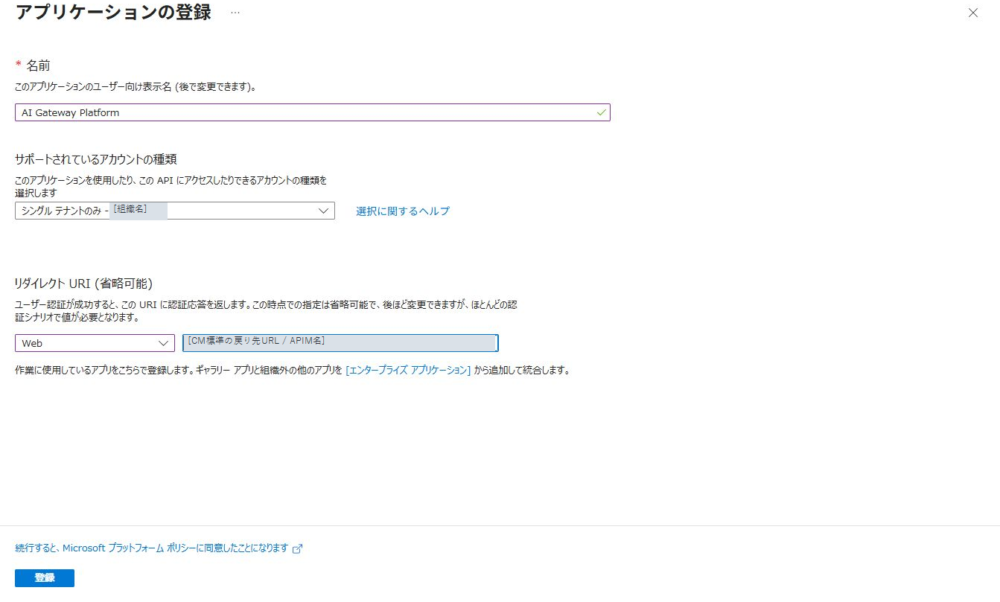
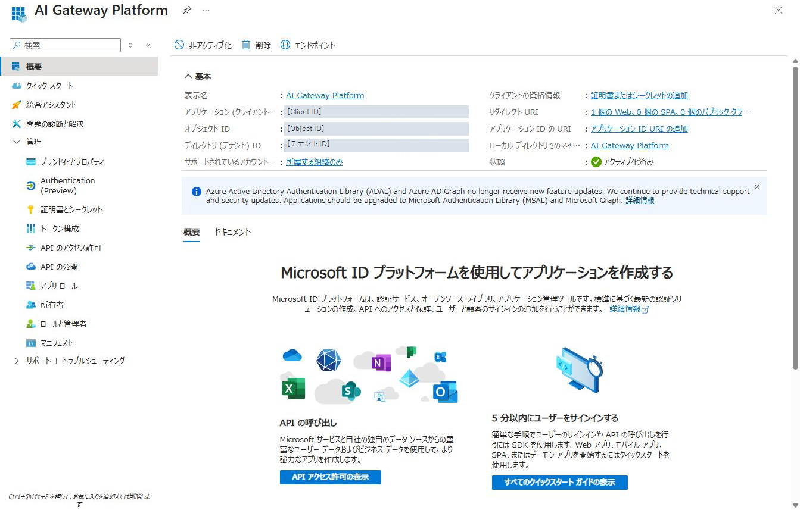
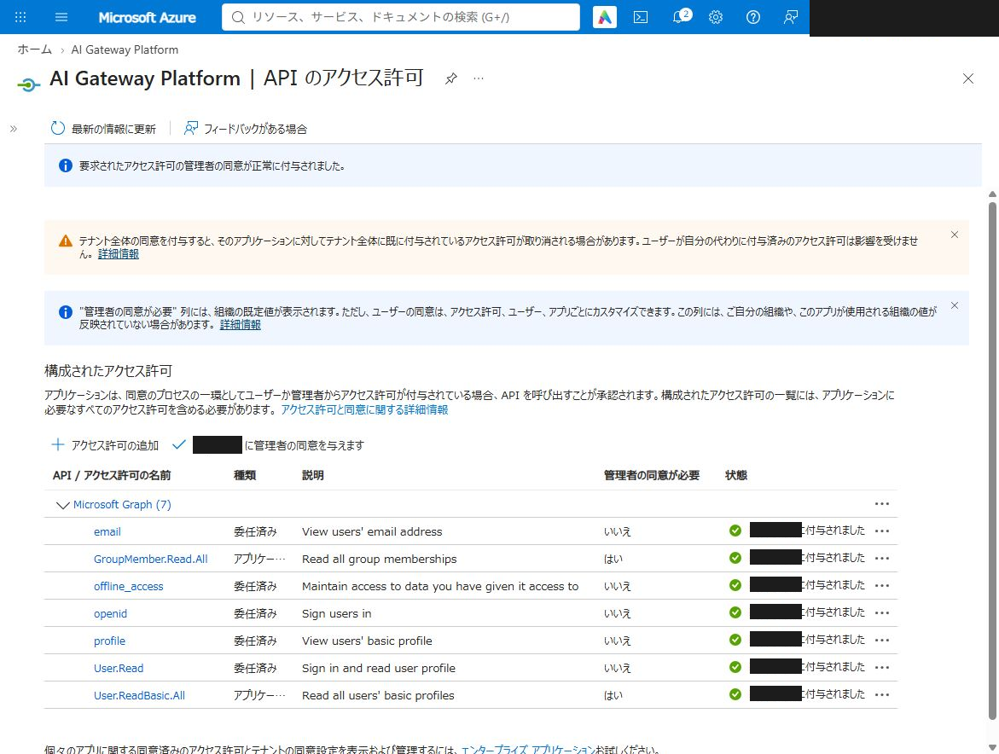
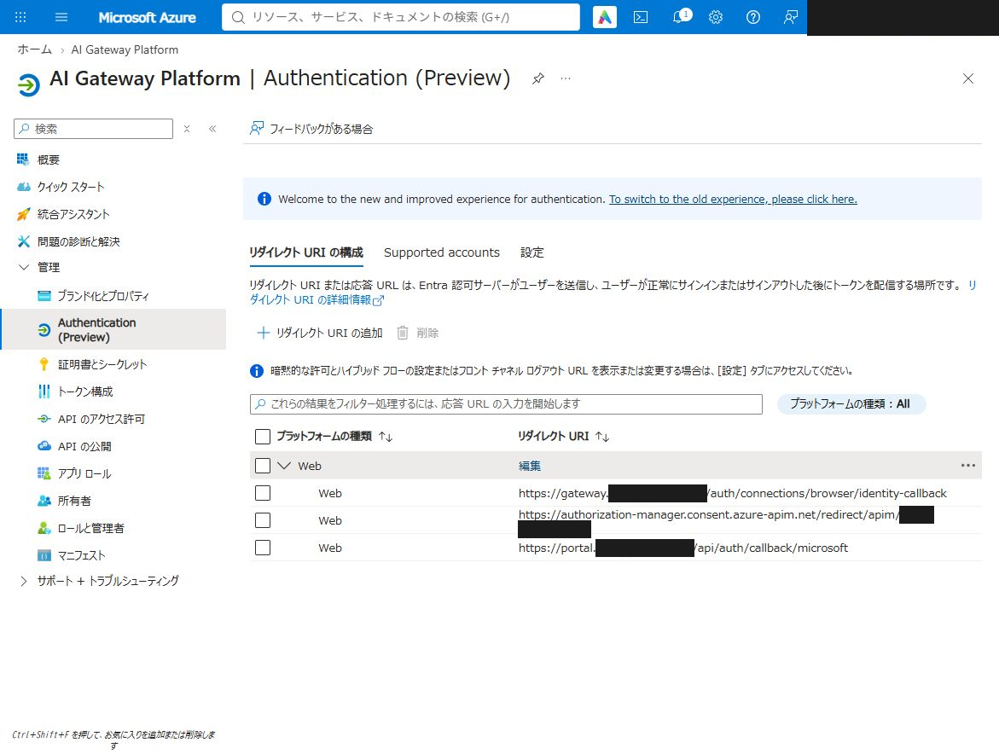
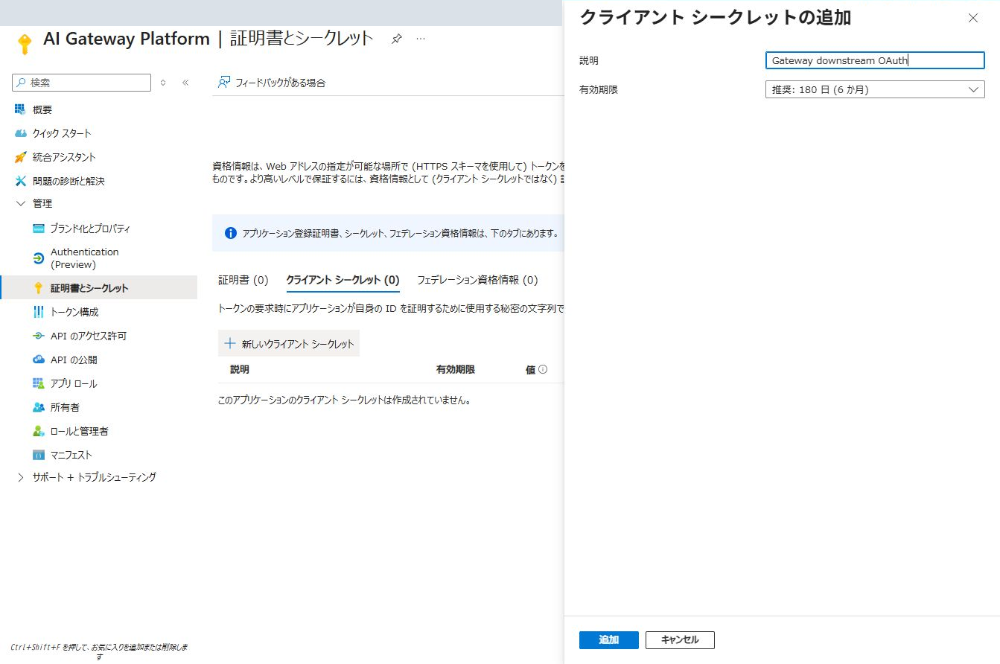

# 02. 共用Entraアプリを準備する

[← 01. 前提を確認する](01-prerequisites.md) · [次へ：03. 公開DNSを準備する →](03-public-dns.md)

業務APIの共通入口はAPIM購読キーです。モデル・PII等の基本利用と、APIMのマネージドIDからFoundryへ接続する通信は、この章のアプリ登録を前提にしません。本人のGraph接続、Portalへのサインイン、Portalでのグループ所有APIキー管理には、同じ単一テナントのEntraアプリ`AI Gateway Platform`を使います。

通常の`azd up`はGatewayとPortalを両方配備するため、構築担当者は本章の共用アプリを準備します。API利用者が購読キーでモデルを呼び出すために、利用者ごとの追加アプリ登録を行う必要はありません。

| 利用する機能 | この章で準備するもの |
| --- | --- |
| 購読キーでモデル・一般Toolsを使う | API利用者用の追加アプリ登録は不要。キーはGatewayのProductとPortalの購読管理で発行 |
| CMで本人のGraph接続を使う | 認証窓口・CM・Portalで共用するWebアプリ、Graph委任権限、各Web戻り先、client secret |
| Portalへサインインする | 同じWebアプリにPortal用の戻り先を追加。別のアプリ登録は不要 |
| Portalでグループ所有のAPIキーを管理する | 同じアプリにGraphアプリケーション権限を追加し、管理者同意を付与。APIキーの所有者はEntraグループとし、所属メンバーだけが管理できるようにする |

この章ではEntraの事前設定を行います。既存アプリを更新する場合は、手順3でグループ所属照会用のアプリケーション権限を追加して管理者同意を付与し、手順4でPortalの戻り先を確認します。既存の委任権限と有効なclient secretはそのまま使えます。Portalのグループ所有APIキー管理は、この準備後に配備します。構築後のGraph接続・API疎通は、[CM共通接続手順](credential-manager-login.md)で確認します。

Entraのアプリ登録・管理者同意はEntra担当者の権限で行います。Azure SubscriptionのOwnerはAzure RBACの権限です。画像は操作箇所の例です。表示名は用途に合わせ、ID・テナント・APIM名には自社の値を使います。

## AzureとEntraのテナントを決める

Azureリソースと共用Entraアプリの認証テナントは、同一でも別でも構成できます。

| 設定 | 用途 |
| --- | --- |
| `azureTenantId` | Azure構築、RBAC、Key Vault、管理VM、DNS、APIMのMI |
| `entraTenantId` | 下流OAuthテナントの既定値。省略時はAzure側 |
| `credentialProviders[].oauthTenantId` | そのCM providerのOAuth認証先 |

CM接続を読み取るaccess policyにはAzure側のAPIM MIを設定します。共用アプリはproviderのOAuthテナントに登録します。Portalもこのアプリを登録したEntraテナントを認証先に指定します。Azure側と異なる場合、Portalの認証先に`azureTenantId`を使わないでください。

## 認証窓口・CM・Portalの共用アプリを設定する

以下の画面ショットは、組織固有のテナント名・ID・ドメイン・アカウント情報をマスクした操作例です。画面内の例示値は、実際の登録画面から取得した自社の値に置き換えます。

### 1. 新規登録画面を開き、アプリを登録する

Azure Portal右上のアカウントメニューから、Microsoftサインインに使うEntraテナントへ切り替えます。続いて「Microsoft Entra ID」→「アプリの登録」→「新規登録」を開きます。

このアプリは、認証窓口での本人確認、APIMのCredential Manager（CM）によるGraph接続、Portalへのサインイン、グループ所有APIキーの管理権限を確認する所属照会で共用します。既存の`AI Gateway Platform`がある場合は、そのアプリを開きます。作り直しや追加登録は不要です。

| 入力欄 | 設定する内容 |
| --- | --- |
| 名前 | `AI Gateway Platform` |
| サポートされているアカウントの種類 | 「この組織ディレクトリのみに含まれるアカウント」の単一テナント |
| リダイレクトURI | 「Web」を選び、下記のCM標準URIを入力 |

`<APIM_NAME>`を配置予定のAPIM名に置き換えます。

```text
https://authorization-manager.consent.azure-apim.net/redirect/apim/<APIM_NAME>
```



入力内容を確認し、「登録」を押します。

### 2. 概要からClient IDとテナントIDを控える

登録後の「概要」で次の2項目を控えます。

| 画面の項目 | 控える値 |
| --- | --- |
| アプリケーション（クライアント）ID | 共用アプリのClient ID |
| ディレクトリ（テナント）ID | このアプリを登録したEntraテナントのID |

「オブジェクトID」はアプリ登録自体を識別する値です。Client IDとして控えるのは、アプリケーション（クライアント）IDです。



### 3. Graphの委任権限5件とアプリケーション権限2件を追加し、管理者同意を付与する

「APIのアクセス許可」→「アクセス許可の追加」→「Microsoft Graph」→「委任されたアクセス許可」を開き、次の5件を設定します。初期登録で`User.Read`が追加済みの場合は、その項目を使います。

| アクセス許可 | 用途 |
| --- | --- |
| `openid` | Microsoftサインインで本人を識別するためのIDトークンを要求する |
| `profile` | サインインした本人の名前など、基本プロフィールの情報を要求する |
| `email` | アカウントに設定されたメールアドレスの情報を要求する |
| `offline_access` | 利用者が毎回サインインし直さずに済むよう、トークン更新の許可を要求する |
| `User.Read` | Microsoft Graphの`/me`から本人のプロフィールを読み取る |

本人確認には、EntraのテナントIDとユーザーのオブジェクトIDを使います。CM接続後には、Graphの`/me`が返す`id`と、確認済みのユーザーのオブジェクトIDを照合します。UPNは対応表での表示と接続名の初期作成に使います。`email`の情報はアカウントによって返らない場合があります。

続いて「アクセス許可の追加」→「Microsoft Graph」→「アプリケーションの許可」を開き、次の2件を追加します。上記の「委任されたアクセス許可」とは種類が異なるため、追加先を確認してください。

| アクセス許可 | 種類 | 用途 |
| --- | --- | --- |
| `GroupMember.Read.All` | アプリケーション | APIキーの所有者に指定されたグループについて、ログインした本人がメンバーかをサーバーで確認する |
| `User.ReadBasic.All` | アプリケーション | 対象ユーザーの基本情報を読み取る権限。ユーザーを対象とする所属確認APIで、上記のグループ権限と組み合わせる |

これらはテナント内のグループ所属とユーザー基本情報を、サインイン中の利用者に代わらずアプリ自身で読み取れる権限です。Portalで管理対象にしたグループだけにEntra側の読み取り権限が限定されるものではありません。この権限の範囲をEntra担当者が確認し、管理者同意を付与してください。ディレクトリの書き換え権限は追加せず、`Directory.Read.All`や`Directory.ReadWrite.All`も追加しません。

追加後、「＜組織名＞に管理者の同意を与えます」を押し、委任5件・アプリケーション2件の計7件が表示され、状態が「＜組織名＞に付与されました」になっていることを確認します。既存アプリへ権限を追加した場合も、追加した権限への管理者同意が必要です。



ここで登録するアクセス許可と、接続時に要求するscopeは別の設定です。標準のCM providerは`openid profile email offline_access https://graph.microsoft.com/User.Read`を要求します。Portalのログインでは引き続き`openid profile email`だけを要求します。グループ所属照会のために、利用者のログインscopeを増やしたり、Portalが利用者のGraphトークンを保存したりする必要はありません。

グループ所属の照会では、Portalサーバーが同じアプリのClient ID・client secretでアプリケーション用トークン（`https://graph.microsoft.com/.default`）を取得します。署名を検証したログイン情報のユーザーObject IDを使い、`POST /users/{確認済みのユーザーObject ID}/checkMemberGroups`へ管理対象のグループObject IDを渡します。利用者が入力したユーザーIDやUPNで照会先を切り替えません。このAPIは間接的な所属も確認でき、1回に指定できるグループは20件までです。[Microsoftの所属確認APIと必要権限](https://learn.microsoft.com/en-us/graph/api/directoryobject-checkmembergroups?view=graph-rest-1.0)

APIキーの所有者はユーザー個人ではなく、テナントIDとグループObject IDで管理します。発行者や操作した本人は監査記録として別に残します。グループに所属していることと、そのグループにどの製品のキー発行を許可するかはPortal側で別に判定します。グループから外れた利用者のPortal管理権限は失われますが、コピー済みのAPIキー自体を無効にするにはAPIMでキーの再生成や購読の停止・削除が必要です。

認証窓口は本人を確認し、CMはGraph用のアクセストークンと更新トークンを保管します。Portalのログインセッション、APIキー管理時のアプリケーション用Graphトークン、Graph用の本人接続セッションは別に扱います。

### 4. 本人確認・CM・Portal用のWeb戻り先を登録する

「認証」（または「Authentication (Preview)」）を開き、既存の「Web」の設定で「編集」を押します。CM・認証窓口のURIを残したまま、Portal用のURIを追加します。`<APIM_NAME>`はAPIM名、`<GATEWAY_HOST>`はGatewayの公開ホスト名、`<PORTAL_HOST>`はPortalの公開ホスト名に置き換えます。

```text
https://authorization-manager.consent.azure-apim.net/redirect/apim/<APIM_NAME>
https://<GATEWAY_HOST>/auth/connections/browser/identity-callback
https://<PORTAL_HOST>/api/auth/callback/microsoft
```

Portalの戻り先も「Web」です。「シングルページアプリケーション（SPA）」には登録しません。

「保存」を押した後、「認証」画面を再表示し、上記3件が「Web」として登録されていることを確認します。まだWebの設定がない場合は、「リダイレクトURIの追加」（旧画面では「プラットフォームの追加」）から「Web」を選んで登録します。

フロントチャネルのログアウトURLは空欄、「暗黙的な許可およびハイブリッドフロー」のアクセストークン・IDトークンのチェックはオフを確認します。Preview画面では「設定」タブからこれらの項目を確認できます。



CM標準の戻り先は、Microsoftの認可コードをCMが受け取る窓口です。`identity-callback`は、SQL台帳から本人の接続を選ぶ前に、認証窓口が本人を確認するための戻り先です。`/api/auth/callback/microsoft`は、PortalのサーバーでBetter Authが認証結果を受け取る戻り先です。言語別URLの`/ja`・`/en`は含めません。

### 5. 有効期間6か月のclient secretを作成する

既存アプリを更新し、有効なclient secretがある場合は、Portal戻り先やGraph権限の追加だけで再発行する必要はありません。新規作成時は次の手順を行います。

「証明書とシークレット」→「クライアントシークレット」→「新しいクライアントシークレット」を開きます。

| 入力欄 | 設定する内容 |
| --- | --- |
| 説明 | 共用する用途を識別できる名前。例：`Gateway and Portal authentication` |
| 有効期限 | 6か月 |



「追加」を押し、発行直後に表示される「値（Value）」を組織承認済みの秘密管理先へ控えます。「シークレットID」は値の代わりに使用できません。更新漏れを防ぐため、有効期限と更新担当者も記録します。

シークレットの値は、この手順書・画面ショット・チャット・params・config・Gitへ記録せず、専用の秘密管理先で扱います。作成後の画面を撮影する場合は、値が表示されていないことを確認します。

後続の`azd up`が用途・保存先を案内してから非表示入力を受け付け、共有するclient secretをKey Vaultへ保存します。Gateway配備時には同じsecretをCM providerへsecure入力で渡し、認証窓口からはKey Vaultを参照します。Portalもサインインとグループ所属照会のサーバー側設定として同じKey Vault secretを共用します。ブラウザーへ渡す公開環境変数には設定しません。本人の接続tokenはCMが管理します。シークレットを更新するときは、これらの利用先への反映も確認してください。

ここまでで、共用Entraアプリの準備は完了です。新規構築では、控えたIDとシークレットの参照先を[04. paramsの設定](04-params.md)の「OAuth provider」で構築用ファイルへ記入します。同じ既存アプリへのPortal戻り先・Graph権限の追加でClient IDやsecretが変わらない場合、CM用paramsの変更は不要です。[MicrosoftのCM設定](https://learn.microsoft.com/en-us/azure/api-management/credentials-how-to-azure-ad)・[Better AuthのMicrosoft設定](https://www.better-auth.com/docs/authentication/microsoft)

## 次へ進む確認

- 購読キーだけで使うAPIと、本人OAuthが必要なAPIを決めた。
- 共用する単一テナントのアプリに、Graph委任権限5件とアプリケーション権限2件を設定し、管理者同意を付与した。
- グループ所有APIキーの所属照会がテナント内の読み取り権限を持つことと、製品の発行可否はPortal側で別に制御することを確認した。
- 本人確認とCMの戻り先・有効な共用secretを準備した。
- Portal公開用のWeb戻り先を追加し、Webの戻り先3件を確認した。
- 環境固有のIDとsecretを、公開文書やGitへ追加していない。

[次へ：03. 公開DNSを準備する →](03-public-dns.md)
