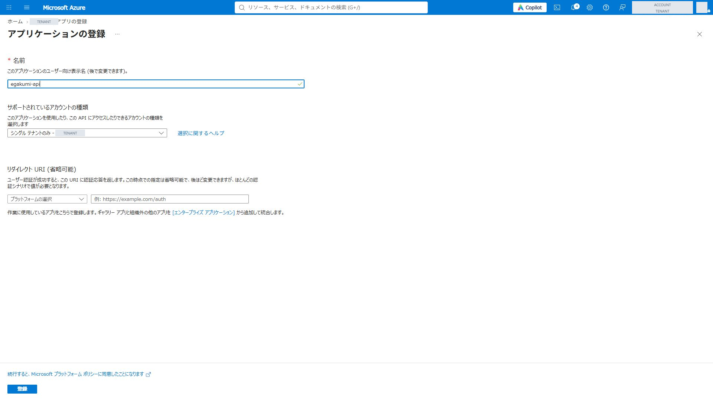
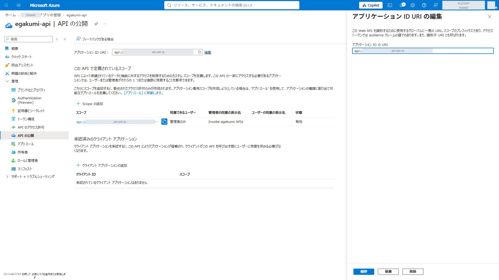
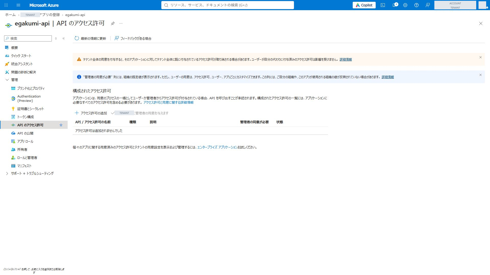
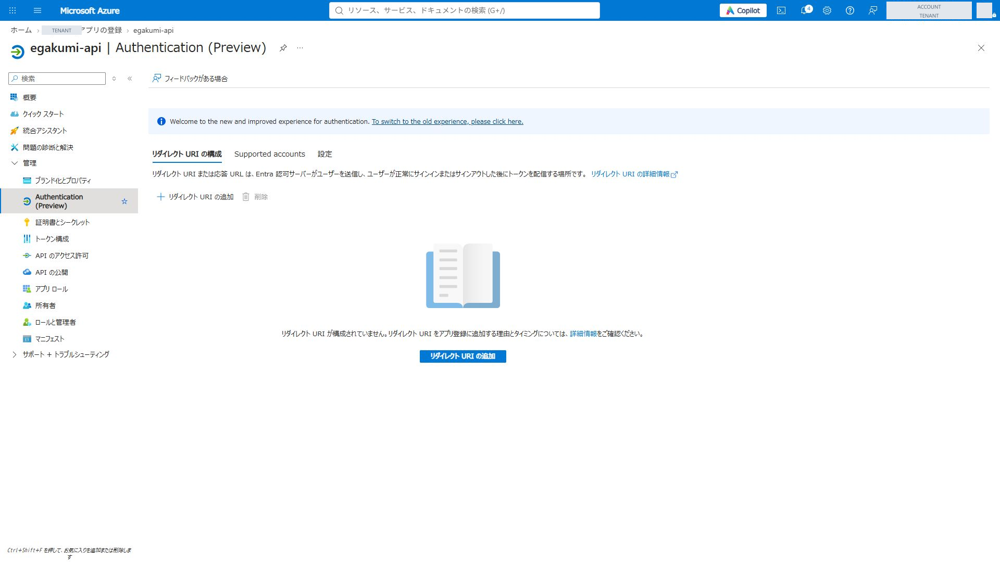
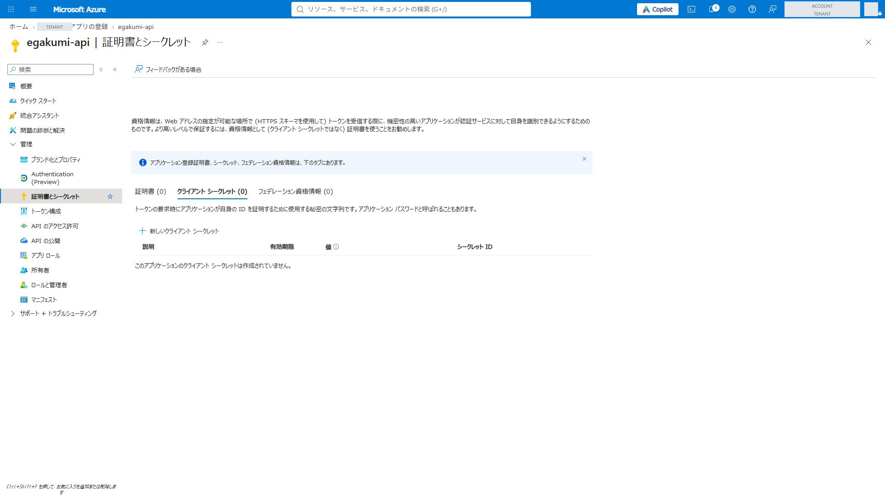

# 02a. egakumi-apiを登録し、Gateway.Invokeを公開する

[← 現行の共用Entraアプリの準備](02-entra.md) · [Codexクライアントの準備 →](02b-entra-codex.md) · [paramsの設定](04-params.md) · [アプリ分離の作業計画](../reference/entra-app-rollout-plan.md)

APIMで公開するAPIをEntra ID上で表すリソースアプリ`egakumi-api`を準備します。このページは一般化した登録手順であり、特定環境での作業完了や接続成功を示す記録ではありません。

**APIM入口は購読キーの提示を優先し、キーなしのBearer要求をEntraで認可します。** HTTP・WebSocket・MCP・Realtime・CMを含む業務APIの対象は正本から自動生成します。APIMポリシー、本人別利用上限・監査、専用Productの生成と公開controllerは資材の実装範囲です。この全API対応の変更はAzureへ再配備しておらず、登録だけではBearer認可を利用できません。対象環境への反映、呼出元クライアントの設定と接続受入を別途確認します。現在のPortal・CM・本人確認が使う[共用アプリ](02-entra.md)は引き続き必要です。

## 1. 認証テナントでAPIアプリを登録する

Entraのアプリ登録を担当できるアカウントで、社員の認証先テナントを選びます。Azure基盤のテナントと同じとは限りません。「Microsoft Entra ID」→「アプリの登録」→「新規登録」を開き、次を入力します。

| 入力欄 | 設定 |
| --- | --- |
| 名前 | `egakumi-api` |
| サポートされているアカウントの種類 | この組織ディレクトリのみに含まれるアカウント（単一テナント） |
| リダイレクトURI | 未設定。プラットフォームも追加しない |

[](../images/entra-api-setup/03-register-form.png)

内容を確認して「登録」を実行します。ポータルに同意や確認が表示される場合は、内容を確認し、組織の担当者が判断します。

登録後の「概要」で、次の値を保護した設定表へ控えます。実値はチェックアウト直下の`.local/<environment>/`で管理し、公開文書・Gitへ転記しません。

| 画面の項目 | 用途 |
| --- | --- |
| アプリケーション（クライアント）ID | `<API_APP_CLIENT_ID>`。APIの識別子と、後続のAPIM audience検証に使う |
| ディレクトリ（テナント）ID | `<AUTH_TENANT_ID>`。APIアプリを登録した認証テナント |
| オブジェクトID | アプリ登録自体の管理用ID。Client IDとは別に扱う |

[](../images/entra-api-setup/04-overview.png)

## 2. Application ID URIを設定する

「APIの公開」→「Application ID URI」の編集を開きます。

| 項目 | 設定 |
| --- | --- |
| Application ID URI | `api://<API_APP_CLIENT_ID>` |

`<API_APP_CLIENT_ID>`には、このAPIアプリのアプリケーション（クライアント）IDを使います。Object ID、APIMのManaged Identity、PortalやCodexのClient IDは使いません。保存後にURIを再表示して確認します。

[](../images/entra-api-setup/05-api-uri.png)

## 3. 委任スコープGateway.Invokeを公開する

「APIの公開」→「スコープの追加」を開き、次を設定します。

| 入力欄 | 設定 |
| --- | --- |
| スコープ名 | `Gateway.Invoke` |
| 同意できるユーザー | 管理者のみ（Admins only）。manifestでは`type: "Admin"` |
| 管理者の同意の表示名 | `Invoke egakumi APIs` |
| 管理者の同意の説明 | `Allows the signed-in user to invoke egakumi APIs through APIM.` |
| 状態 | 有効（Enabled） |

[](../images/entra-api-setup/06-scope-form.png)

「スコープの追加」を実行し、「APIの公開」で次を確認します。

| 確認項目 | 期待する値 |
| --- | --- |
| 完全なスコープ名 | `api://<API_APP_CLIENT_ID>/Gateway.Invoke` |
| 同意の種類 | Admin |
| 状態 | Enabled |

[](../images/entra-api-setup/07-expose-api.png)

**「管理者のみ」は、同意できる人を定める設定です。** PortalやCodexへ実際の管理者同意を付与したことにはなりません。後続工程で各クライアントアプリにこの委任アクセス許可を追加し、管理者が対象クライアントへ同意を付与します。この段階ではクライアントの事前承認も追加しません。

## 4. v2アクセストークンを要求する

「マニフェスト」でMicrosoft Graph形式の`api.requestedAccessTokenVersion`を`2`にして保存します。変更対象を示す断片は次のとおりです。

```json
{
  "api": {
    "requestedAccessTokenVersion": 2
  }
}
```

公開したスコープを含む`api.oauth2PermissionScopes`などの既存項目は保持します。この断片でマニフェスト全体や`api`全体を置き換えず、保存後に値とスコープの保持を確認してください。

[](../images/entra-api-setup/08-manifest-v2.png)

v2のAPI向けアクセストークンでは、APIMが検証する`aud`は`<API_APP_CLIENT_ID>`のGUIDです。要求するスコープの`api://.../Gateway.Invoke`文字列とは区別します。実際のトークン取得・検証は後続の接続試験で確認します。

## 5. 外部権限・認証・資格情報を確認する

このアプリはAPIを表す登録です。保存後に次を確認します。

| 画面 | 確認する状態 |
| --- | --- |
| APIのアクセス許可 | 外部APIへの要求権限なし。新規登録時のMicrosoft Graphの`User.Read`があれば、この新しいAPIアプリから削除する |
| 認証 | プラットフォーム・リダイレクトURIなし |
| 証明書とシークレット | 証明書・クライアントシークレットなし |

`requiredResourceAccess`は、このアプリが外部APIへ要求する権限です。今回のAPIリソース登録では空配列`[]`とし、公開した`Gateway.Invoke`は`api.oauth2PermissionScopes`へ保持します。既存の共用アプリのGraph権限やsecretは変更しません。

APIMからFoundryへの権限は、APIMのManaged Identityに対するAzure RBACで別に設定します。このAPIアプリへGraphやFoundryの外部アクセス許可を追加する工程ではありません。

<details>
<summary>追加確認画面：APIのアクセス許可・認証・証明書とシークレット</summary>

[](../images/entra-api-setup/09-api-permissions.png)

[](../images/entra-api-setup/10-authentication.png)

[](../images/entra-api-setup/11-certificates.png)

</details>

## 後続工程へ引き継ぐもの

| 引継ぎ項目 | 後続の用途 |
| --- | --- |
| 認証テナントとAPIのClient ID | APIMのtenant・issuer・audience検証 |
| Application ID URIとGateway.Invoke | Portal・Codex等の委任アクセス許可、管理者同意、要求scope |
| 単一テナント・scope・token versionの保存後確認 | アプリ登録の受入。接続試験の結果とは別に記録 |

**APIのClient IDを既存の`credentialProviders[].clientId`へ設定しません。** そこはCMの下流OAuthクライアント用です。[paramsの認可設定](04-params.md)の`gateway.authentication.entra.audience`へ引き継ぐ値です。公開Entra設定は`audience`・`requiredScope`・`userLimits`の3項目だけで、有効化・対象API・クライアント許可リストは入力しません。専用Productの所属を閉じた配備段階で資材を照合し、対象環境での実APIMの検証・公開・接続受入を別に確認します。登録だけで既存共用アプリを置き換えません。

掲載画像はフルHD（1920×1080ピクセル）の画面を原寸で撮影し、拡大縮小せずPNGで保存しています。文書上で縮小表示される場合は、画像をクリックして原寸画像を開き、確認してください。

画像は操作項目の説明のために設定画面を再表示・再撮影したものです。登録済みのアプリに`Gateway.Invoke`を重複して追加しないでください。

画面は操作箇所の例として扱い、公開する画像から実環境のID・組織・ドメイン・アカウント等を除去します。原本と作業結果は`.local/<environment>/`で保護します。登録確認、クライアントへの同意、APIM認可、実接続の結果をそれぞれ分けて記録してください。

公式仕様：[Web APIとアクセス許可](https://learn.microsoft.com/en-us/entra/identity-platform/quickstart-configure-app-access-web-apis) · [Microsoft Graph形式のアプリマニフェスト](https://learn.microsoft.com/en-us/entra/identity-platform/reference-microsoft-graph-app-manifest) · [アクセストークンのクレーム](https://learn.microsoft.com/en-us/entra/identity-platform/access-token-claims-reference)

[Codexクライアントの準備へ進む](02b-entra-codex.md) · [現行の共用アプリの準備へ戻る](02-entra.md) · [後続のAPIM認可・アプリ分離計画](../reference/entra-app-rollout-plan.md)
