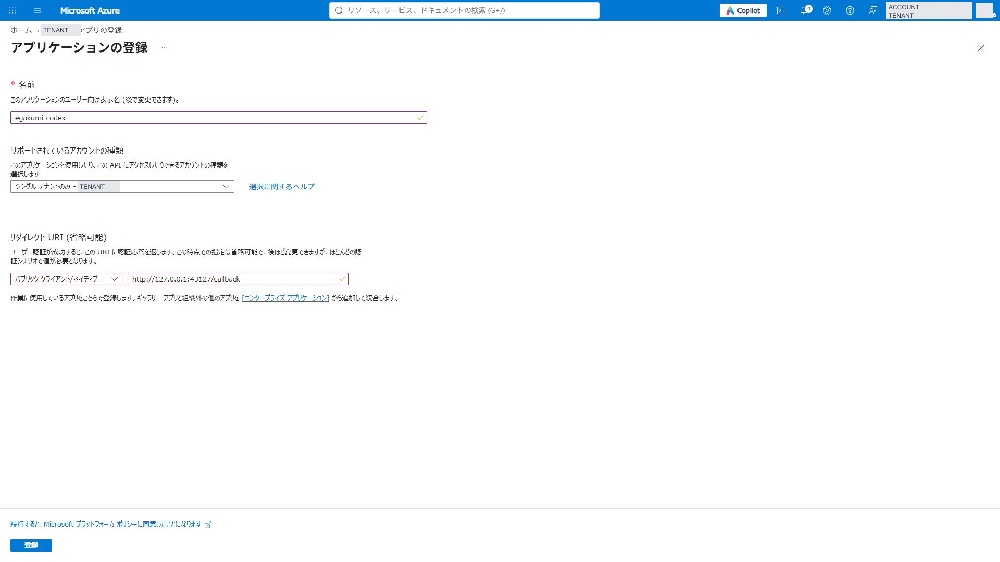
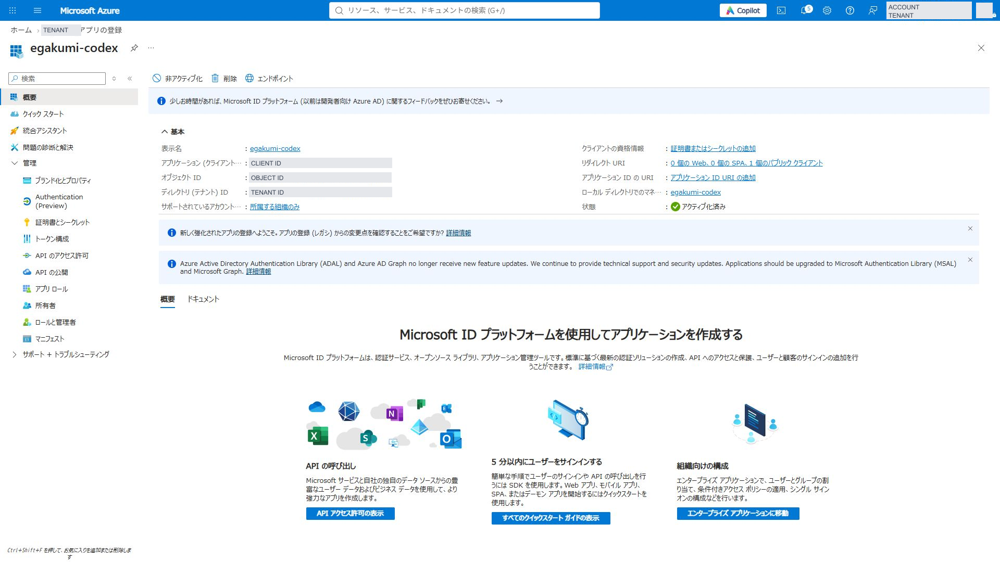
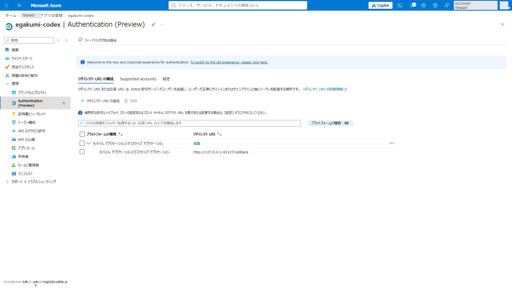
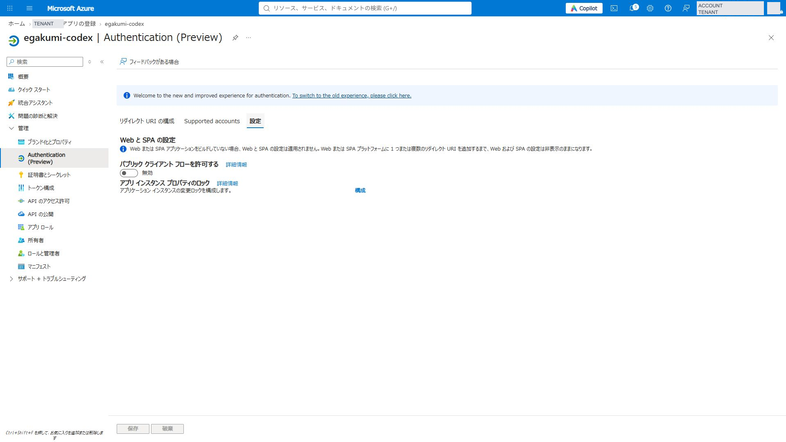
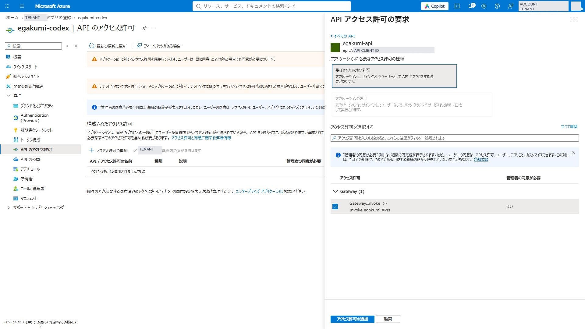
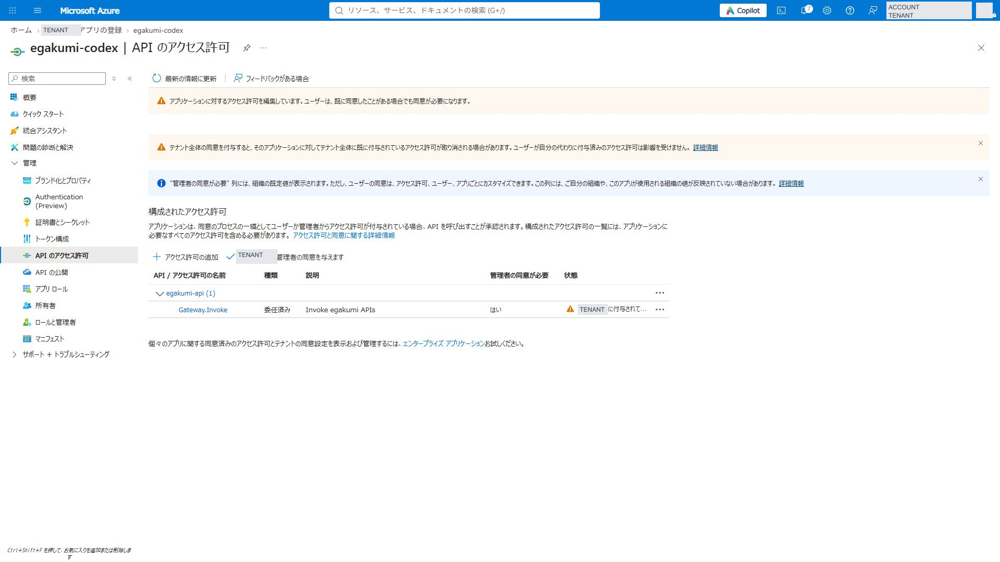
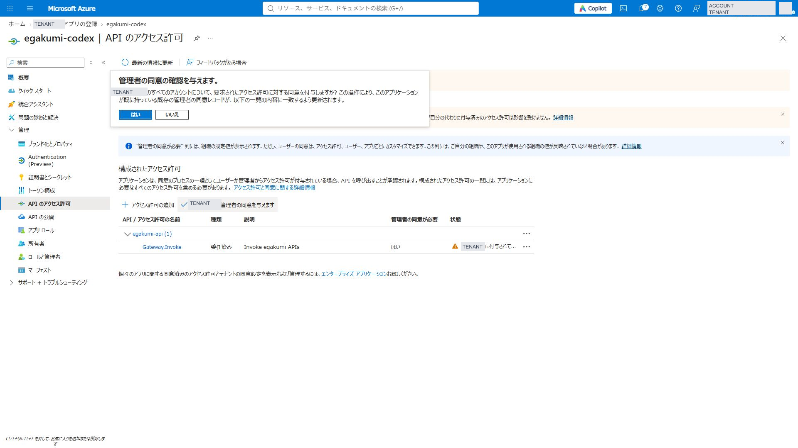
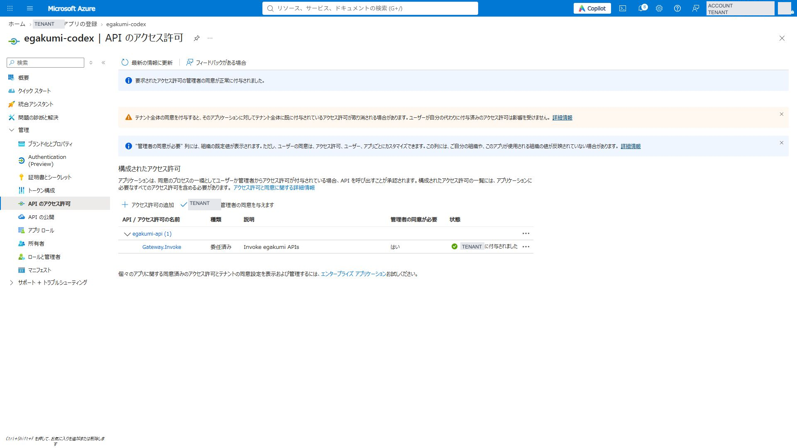
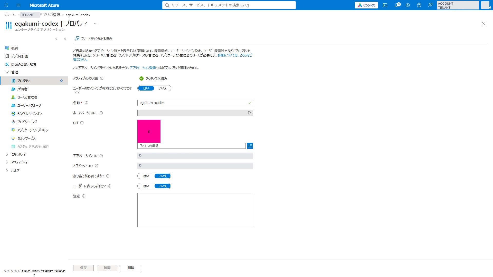
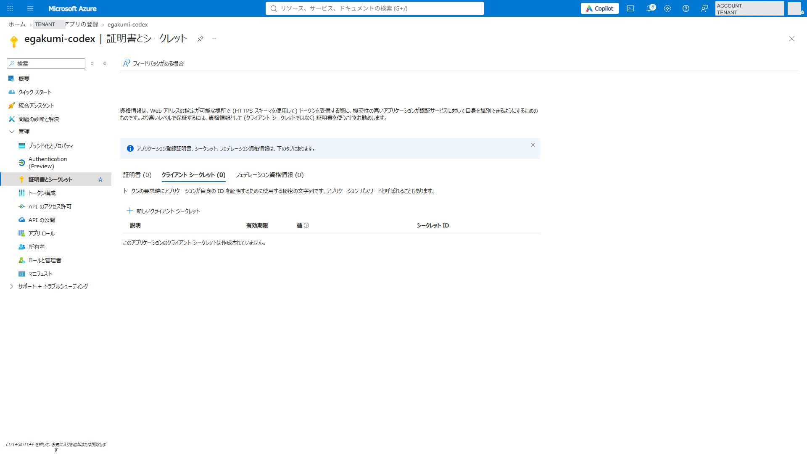

# 02b. egakumi-codexをPublic clientとして登録する

[← egakumi-apiの準備](02a-entra-api.md) · [Entraの5アプリ](02-entra.md) · [アプリ分離の作業計画](../reference/entra-app-rollout-plan.md)

社員のPC上のCodexが、Entra IDから`egakumi-api`向けのユーザーアクセストークンを取得するためのアプリを準備します。APIを表す`egakumi-api`と、サインインするクライアントの`egakumi-codex`は別の登録です。本ページは一般化した事前準備手順であり、特定環境での接続成功を示す記録ではありません。

初回配備前に登録し、保護paramsの `codex.clientId` へApplication（Client）IDを設定します。APIMの配備・受入後は[接続設定の生成と端末配布](../reference/codex-endpoint-rollout.md)に進みます。

## 1. 認証用テナントでアプリを登録する

[egakumi-api](02a-entra-api.md)と同じ認証用Entraテナントを選び、「アプリの登録」→「新規登録」を開きます。Azure基盤のテナントとは独立して選びます。

| 入力欄 | 設定 |
| --- | --- |
| 名前 | `egakumi-codex` |
| サポートされているアカウントの種類 | Single tenant。この組織ディレクトリのみ |
| リダイレクトURIのプラットフォーム | パブリック クライアント／ネイティブ（モバイルとデスクトップ） |
| リダイレクトURI | `http://127.0.0.1:43127/callback` |

[](../images/entra-codex-setup/03-register-form.png)

内容とポータルの同意表示を確認し、「登録」を実行します。今回の画面ではHTTP＋127.0.0.1のURIを通常の登録欄へ入力できます。入力を拒否する画面では、リダイレクト未設定で登録した後、Microsoft Graph形式のマニフェストの`publicClient.redirectUris`へ同じURIを登録します。Web／SPAの戻り先へ登録しません。

ポート`43127`は公式資料の固定ポート例です。別のポートを採用する場合は、Entraの登録URIとCodexの`gateway_oauth.redirect_port`を一緒に変更します。URIのパス`/callback`も一致させます。

## 2. Client IDと登録テナントを確認する

「概要」で値を確認し、チェックアウト直下の`.local/<environment>/`の保護した設定表へ控えます。実値は公開文書・Gitへ転記しません。

| 画面の項目 | 用途 |
| --- | --- |
| アプリケーション（クライアント）ID | `<CODEX_APP_CLIENT_ID>`。CodexのOAuth client_id、委任アクセス許可と管理者同意の対象 |
| ディレクトリ（テナント）ID | `<AUTH_TENANT_ID>`。社員の認証先 |
| オブジェクトID | 登録自体の管理用。OAuthのclient_idへ使わない |
| サポートされているアカウント | 所属する組織のみ |
| リダイレクトURI | Web 0件、SPA 0件、Public client 1件 |

[](../images/entra-codex-setup/04-overview.png)

## 3. Public clientと認証フローを確認する

「Authentication (Preview)」の「リダイレクトURIの構成」で、プラットフォームが「モバイル アプリケーションとデスクトップ アプリケーション」、URIが`http://127.0.0.1:43127/callback`であることを確認します。

[](../images/entra-codex-setup/05-public-redirect.png)

「設定」で「パブリック クライアント フローを許可する」は**無効を起点**とします。Public clientのプラットフォーム登録と、この設定は別です。登録済みnative redirectを使うAuthorization Code＋PKCEが今回のフローです。Device CodeやROPCを有効にする目的でこのスイッチを変更しません。

[](../images/entra-codex-setup/06-public-flows-off.png)

Web／SPAの戻り先を持たない登録ではImplicit grantの項目が画面に表示されない場合があります。Microsoft Graph形式のマニフェストで次を確認します。

```json
{
  "publicClient": {
    "redirectUris": ["http://127.0.0.1:43127/callback"]
  },
  "web": {
    "implicitGrantSettings": {
      "enableAccessTokenIssuance": false,
      "enableIdTokenIssuance": false
    }
  }
}
```

これは確認する部分だけの断片です。マニフェスト全体や`web`をこの断片で上書きしません。`api.requestedAccessTokenVersion = 2`は[APIリソース側のegakumi-api](02a-entra-api.md#4-v2アクセストークンを要求する)で設定します。

## 4. APIの委任アクセス許可を追加する

「APIのアクセス許可」→「アクセス許可の追加」→「所属する組織で使用しているAPI」で`egakumi-api`を検索します。同名の登録がある場合は、保護した設定表の`<API_APP_CLIENT_ID>`と照合します。

| 選択項目 | 設定 |
| --- | --- |
| API | `egakumi-api` |
| アクセス許可の種類 | 委任されたアクセス許可 |
| スコープ | `Gateway.Invoke` |

[](../images/entra-codex-setup/07-delegated-scope.png)

新規登録時にMicrosoft Graphの`User.Read`が追加されている場合は、この新しいCodexアプリから削除します。この接続だけを目的にGraphの権限を追加しません。既存Portal・CMアプリの権限を変更しません。

構成されたアクセス許可への追加と、管理者同意の付与は別の操作です。「アクセス許可の追加」を実行した後、一覧が`egakumi-api / Gateway.Invoke / 委任`だけになっていることを確認します。この時点ではまだ管理者同意を付与していません。

[](../images/entra-codex-setup/08-permissions-before-consent.png)

組織の管理者が「管理者の同意を与えます」を選び、対象アプリとテナント、権限を確認して同意します。

[](../images/entra-codex-setup/09-admin-consent-confirmation.png)

完了後、`Gateway.Invoke`の状態が「付与されました」と表示されることを確認します。権限追加だけを同意済みとして扱いません。

[](../images/entra-codex-setup/10-permissions-consented.png)

全ユーザーを対象にする場合は、Enterprise applicationで「割り当てが必要」が有効になっていないか確認します。Single tenantにはテナント内のゲストも含まれ得ます。社員に限定する運用では、ゲストを含めるか、会社の既存の条件付きアクセス・利用者管理でどう扱うかを確認します。MFA・条件付きアクセスをこの手順で無効化しません。

「概要」→「エンタープライズ アプリケーションに移動」→「プロパティ」で、「ユーザーのサインインが有効」は「はい」、「割り当てが必要」は「いいえ」であることを確認します。既存の会社方針で割り当て必須の場合は、全ユーザー対象との整合を管理者が判断します。

[](../images/entra-codex-setup/12-assignment-not-required.png)

## 5. シークレットを作らず、後続へ引き継ぐ

「証明書とシークレット」でクライアントシークレット・証明書がないことを確認します。社員に配布するクライアント資格情報は作成しません。PCごとのアクセストークンは本人のサインインで取得します。

[](../images/entra-codex-setup/11-no-credentials.png)

後続のCodex設定へ渡す公開可能な項目の例です。プレースホルダーは保護した設定から記入します。端末への実配布はAPIM受入後に行います。

```toml
[model_providers.aigateway.gateway_oauth]
authorization_url = "https://login.microsoftonline.com/<AUTH_TENANT_ID>/oauth2/v2.0/authorize"
token_url = "https://login.microsoftonline.com/<AUTH_TENANT_ID>/oauth2/v2.0/token"
client_id = "<CODEX_APP_CLIENT_ID>"
scopes = ["api://<API_APP_CLIENT_ID>/Gateway.Invoke", "offline_access"]
redirect_port = 43127
```

`offline_access`はトークン更新のためにOAuth要求へ含めます。上の設定はprovider全体の定義ではありません。最終配布では`base_url`、`wire_api = "responses"`、`requires_openai_auth = false`等とまとめて管理し、`env_key`や外部トークン取得コマンドを追加しません。

OpenAIの公式資料では、Gateway OAuthのみの認証でAuthorization Bearerを既定送信する条件は**Codex CLI 0.166.0以降**です。Desktopの内蔵runtimeも別に確認します。独自モデルのカタログが必要な場合はローカルのCodex形式`models.json`を使います。OAuthだけでリモートカタログの取得が有効になるとは扱いません。

APIMにクライアントアプリの許可リストは設けません。配布対象の制御や停止は、Entraの委任許可・管理者同意・Enterprise applicationの割当と会社の条件付きアクセスで行います。新しいトークン取得の停止、発行済みアクセストークンの有効期限、既存streamの終了は別に扱い、許可回収だけで直ちに全接続が失効したとは判定しません。

同じ端末でChatGPT Enterpriseも使う場合は、会社専用providerと独立したprovider／profileを配布し、切替を許す既定を`config.toml`へ置く案を対象runtimeで確認します。同じ会社providerの`requires_openai_auth`を`true`へ変えるとAuthorizationの用途が変わるため、現在のEntra Bearer入口へその変更だけで接続できるとは扱いません。

## 6. 事前準備の確認表

| 確認 | 期待する状態 |
| --- | --- |
| 登録先 | egakumi-apiと同じ認証用Entra。Azure配備テナントと独立 |
| アカウント種別 | Single tenant |
| プラットフォーム・戻り先 | Public client、固定loopback URI |
| 認証フロー | Authorization Code＋PKCE。Implicit grant無効 |
| Public client flows | 無効起点。対象runtimeで実フローを確認 |
| 委任アクセス許可 | egakumi-apiのGateway.Invoke |
| 同意 | 管理者による同意状態を確認。権限追加だけを同意済みと記録しない |
| 資格情報 | Client secret・証明書なし |
| 外部API | Graph User.Readを今回の接続に追加しない |
| 実接続 | APIM認可・更新・SSE等の接続受入は別工程 |

## 公式資料

掲載画像はフルHD（1920×1080）の画面を拡大縮小せずPNGで保存しています。文字を原寸で確認する場合は、画像をクリックして開いてください。公開画像のID・組織・アカウント等は値全体を不透明に隠し、原本と作業記録は`.local/<environment>/`で保護します。

- [OpenAI: Connect to a gateway](https://learn.chatgpt.com/docs/enterprise/connect-to-a-gateway)
- [Microsoft: Authorization Code＋PKCE](https://learn.microsoft.com/en-us/entra/identity-platform/v2-oauth2-auth-code-flow)
- [Microsoft: loopbackリダイレクトURIの制約](https://learn.microsoft.com/en-us/entra/identity-platform/reply-url)
- [Microsoft: アプリマニフェスト](https://learn.microsoft.com/en-us/entra/identity-platform/reference-microsoft-graph-app-manifest)
- [Microsoft: offline_accessなどのスコープ](https://learn.microsoft.com/en-us/entra/identity-platform/scopes-oidc)
- [Microsoft: Public client判定とAllow public client flows](https://learn.microsoft.com/en-us/troubleshoot/entra/entra-id/app-integration/confidential-client-application-authentication-error-aadsts7000218)
