# Azure DNS用のマネージドIDを事前に準備する

[03. 公開DNSの準備に戻る](03-public-dns.md) · [04. paramsを設定する](04-params.md)

Azure Portalでユーザー割り当てマネージドIDを先に作成し、そのIDへ公開DNSの操作権限を付与します。IDの公開参照を構築前に環境別paramsへ設定すると、`azd up`がメンテナンス用の管理VMへ紐づけ、証明書の初回取得・定期更新に使用します。

`<...>`は導入先で確認して入力する値です。画面中の黒帯は、アカウント、Subscription、RG、DNS名、リソースIDなどの固有情報をマスキングしたものです。画面の値を転記せず、自分の環境で値を確認してください。公開DNSの委任は[03. 公開DNS](03-public-dns.md)で済ませます。

## 1. 作成先と権限の対象を決める

| 項目 | 導入先で確認する値 | 用途 |
| --- | --- | --- |
| ID作成先のSubscription | `<IDENTITY_SUBSCRIPTION>` | IDを作成・保持するSubscription |
| ID作成先のSubscription ID | `<IDENTITY_SUBSCRIPTION_ID>` | IDのリソースIDに含まれるSubscriptionのGUID |
| IDの作成先RG | `<IDENTITY_RESOURCE_GROUP>` | Coreの構築・撤去対象RGとは別にIDを保持 |
| マネージドID名 | `<DNS_MANAGED_IDENTITY_NAME>` | 管理VMへ紐づけるユーザー割り当てID |
| IDのリージョン | `<IDENTITY_LOCATION>` | IDの配置リージョン |
| DNS側のSubscription | `<DNS_SUBSCRIPTION>` | 公開DNSゾーンを保持するSubscription |
| DNS側のSubscription ID | `<DNS_SUBSCRIPTION_ID>` | 構築前にparamsへ設定するDNS側SubscriptionのGUID |
| DNS権限の対象RG | `<DNS_RESOURCE_GROUP>` | 公開DNSゾーンがあるRG。このRGのIAMからDNS操作ロールを付与 |
| 対象の公開DNSゾーン | `<PUBLIC_DNS_ZONE>` | 上記RG内の公開DNSゾーン |
| 付与するロール | `DNS Zone Contributor`（日本語表示: DNS ゾーンの共同作成者） | ゾーン探索と検証用TXTの作成・削除に使用 |

IDの置き場所と、DNS権限を付ける対象RGは別々に確認します。同じRGを使っても構いませんが、ロールは**DNSゾーンがある側のRG**で付与します。DNS側とID側のSubscriptionを分ける場合も同じEntraテナントを使います。

このRG単位のロールは、対象RG内のすべての公開DNSゾーンへ継承されます。TXT以外のレコード編集も含むため、標準例ではDNS専用RGを使います。ゾーン単位・TXTだけに絞る構成は、ゾーン探索の読取権限も含めて[公式プラグインの権限例](https://poshac.me/docs/v4/Plugins/Azure/)を確認してください。

作業するアカウントには次のAzure RBAC権限が必要です。

- ID作成先RGでユーザー割り当てIDを作成できること。例: `Managed Identity Contributor`。
- DNS側RGでロール割り当てを作成できること。例: `Role Based Access Control Administrator`や`Owner`。割り当て可能ロールの条件がある場合はDNS用ロールを許可すること。
- 後のCore構築時には管理VMの作成・更新と、既存IDの割り当てができること。ID側の権限例は`Managed Identity Operator`です。既に持つロールで満たしていれば追加付与は不要です。

これらはAzureリソースの権限です。このDNS用IDの準備で、Entraのアプリ登録やclient secretを作成する作業はありません。

## 2. ユーザー割り当てマネージドIDを作成する

1. [Azure Portal](https://portal.azure.com/)の上部検索欄に「マネージド」と入力します。
2. 「サービス」で絞り、**マネージドID**を開きます。
3. 一覧の**作成**を選びます。同名IDが既にある場合はSubscription・RG・用途を照合してから再利用します。

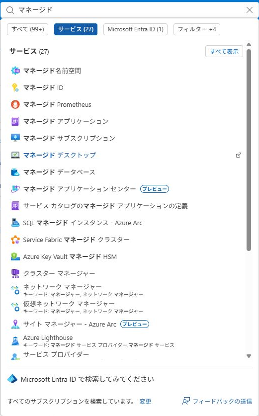

4. 「ユーザー割り当てマネージドIDの作成」の**Basics**で、前述のSubscription、ID作成先RG、名前、リージョンを指定します。
5. 標準構成の**分離スコープは「なし」**です。ここで管理VMを選ぶ作業はしません。管理VMへの紐づけは後の`azd up`が行います。

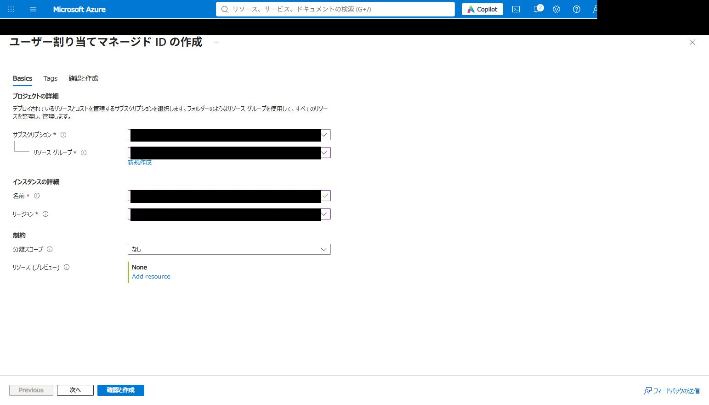

6. **確認と作成**を選び、Subscription・RG・名前・リージョンを確認して**作成**します。

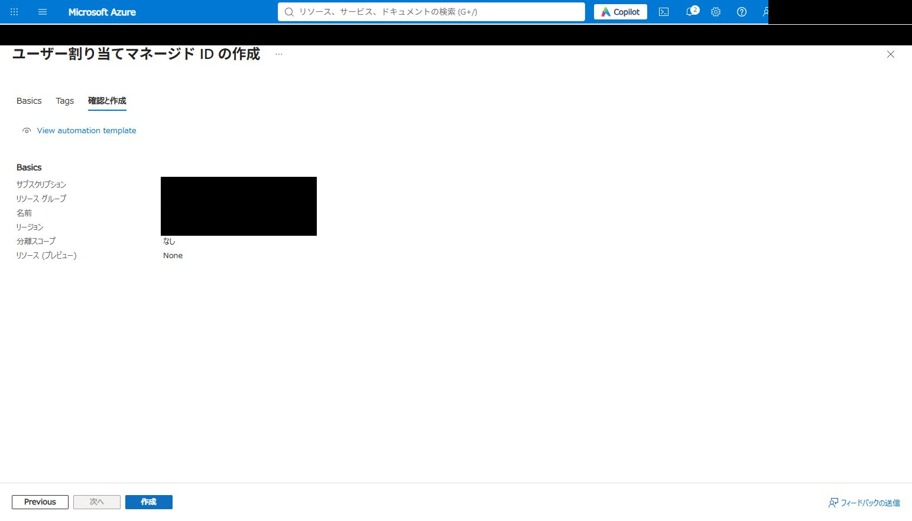

7. デプロイ完了後、`<IDENTITY_RESOURCE_GROUP>`を開き、作成したIDがあることを確認します。DNSゾーンを同じRGに配置した場合は、そのゾーンも一覧に表示されます。

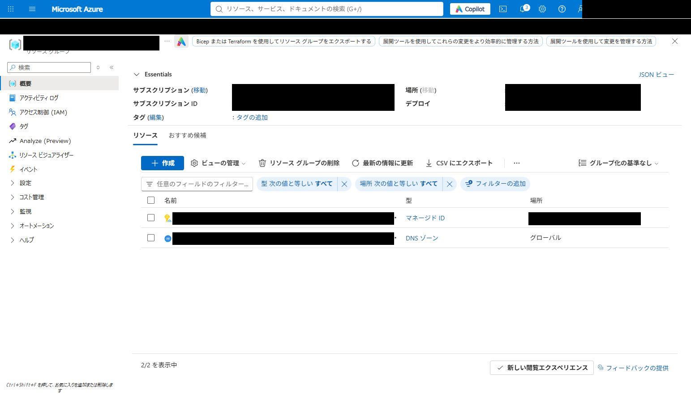

## 3. azd upに渡すリソースIDを控える

1. 作成した`<DNS_MANAGED_IDENTITY_NAME>`を開き、左側の**設定 → プロパティ**を選びます。
2. **Essentialsの「ID」**をコピーします。ツールヒントは「リソースID」で、`/subscriptions/`から始まる完全な文字列です。Client IDやObject（Principal）IDのGUIDとは異なります。Portalが`resourcegroups`と小文字で表示していても、そのままコピーできます。

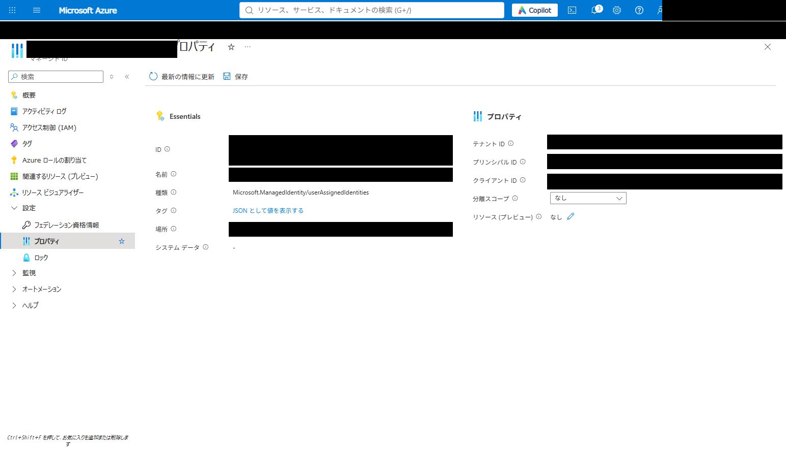

リソースIDの形式は次のとおりです。`<...>`を含む例そのものを入力せず、Portalからコピーした実際の値を使います。

```text
/subscriptions/<IDENTITY_SUBSCRIPTION_ID>/resourceGroups/<IDENTITY_RESOURCE_GROUP>/providers/Microsoft.ManagedIdentity/userAssignedIdentities/<DNS_MANAGED_IDENTITY_NAME>
```

DNSゾーンを別Subscriptionに置いている場合、paramsへ設定するDNS側Subscription IDはこの文字列から拾わず、**対象DNSゾーンの概要**で確認します。

## 4. DNSゾーンがあるRGからロールを割り当てる

1. 公開DNSゾーンがある**リソースグループ**`<DNS_RESOURCE_GROUP>`を開きます。
2. RGの左側の**アクセス制御（IAM）**を開き、**追加 → ロールの割り当ての追加**を選びます。

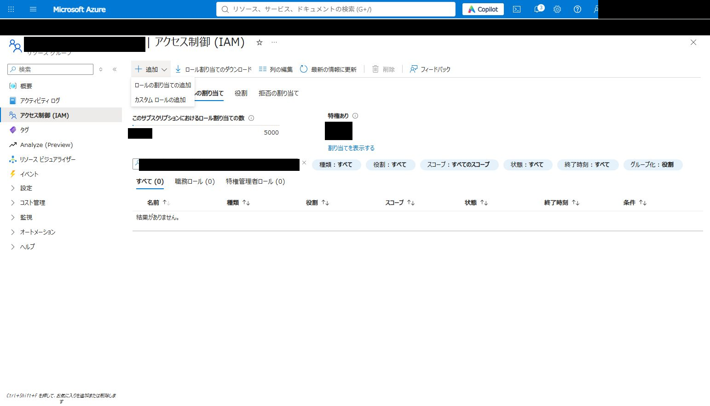

この操作は、マネージドIDリソース自身の「アクセス制御（IAM）」でIDを管理する人の権限を追加する作業とは異なります。対象が**DNS側RG**であることを画面の見出しで確認します。

3. 「ロール」で`DNS`を検索し、**DNS ゾーンの共同作成者**（`DNS Zone Contributor`）を選択して**次へ**進みます。日本語のPortalでは英語名全体の検索に一致しないことがあります。「プライベート DNS ゾーンの共同作成者」や「DNS Resolver Contributor」は選びません。

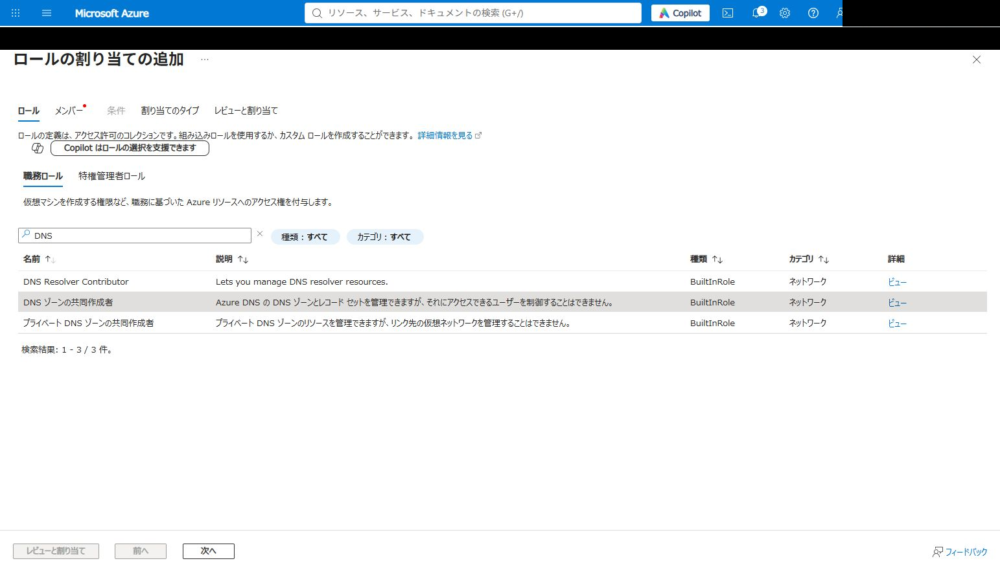

4. 「メンバー」で**アクセスの割り当て先：マネージドID**を選び、**メンバーを選択する**を開きます。
5. IDを作成したSubscriptionと、マネージドIDの種類**ユーザー割り当てマネージドID**を選びます。
6. `<DNS_MANAGED_IDENTITY_NAME>`を検索・選択して確定します。DNSのSubscriptionとIDのSubscriptionを分けている場合、ここは**ID側**を選びます。

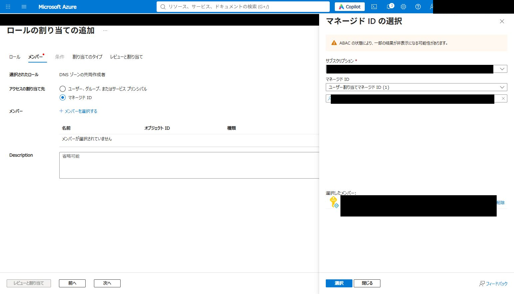

7. **割り当てのタイプ**を開きます。標準構成は自動更新で継続利用するため、**アクティブ・Permanent（永続的）**を使います。組織の規則で期限付きにする場合は、証明書の自動更新が継続できるようロールの有効期限も管理します。

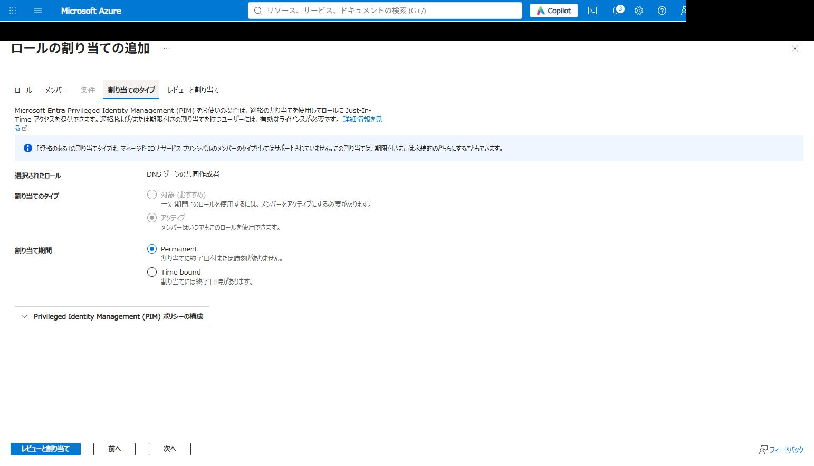

8. **レビューと割り当て**で、ロール、スコープ、メンバー、割り当て期間を確認します。

| 確認項目 | 確認する値 |
| --- | --- |
| ロール | DNS ゾーンの共同作成者（`DNS Zone Contributor`） |
| スコープ | `<DNS_RESOURCE_GROUP>` |
| メンバー | `<DNS_MANAGED_IDENTITY_NAME>` |
| 種類・期間 | Active・永続的 |

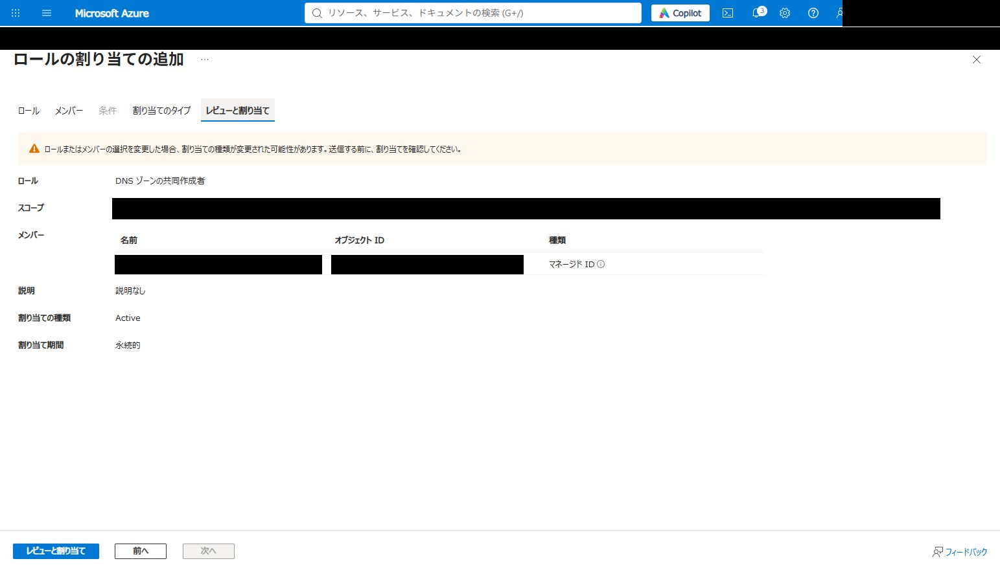

9. 内容を確認したうえで、画面下の**レビューと割り当て**ボタンを押して割り当てを実行します。
10. RGの**ロールの割り当て**一覧でID名を検索し、DNS ゾーンの共同作成者が**このリソース**のスコープで登録されたことを確認します。権限の反映には時間がかかる場合があります。

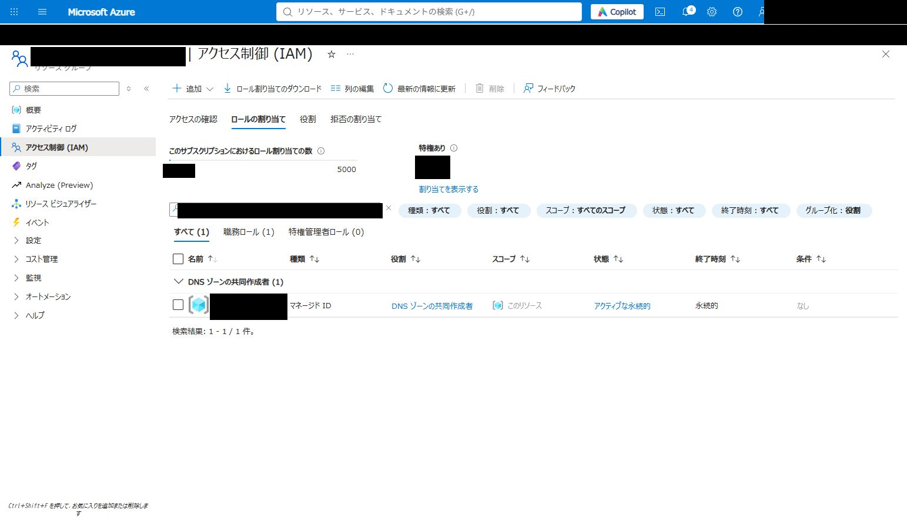

## 5. 構築前にparamsへ設定する

次の[params](04-params.md)で、環境別の`.local/<environment>/params.local.json`に次の2項目を設定します。その後に[config](05-config.md)・[構築手順](06-deploy.md)へ進みます。

| paramsへ設定する項目 | 確認する値 |
| --- | --- |
| DNSゾーンがあるSubscription ID | `<DNS_SUBSCRIPTION_ID>` |
| DNS更新用マネージドIDのリソースID | 手順3でコピーした`/subscriptions/.../userAssignedIdentities/<DNS_MANAGED_IDENTITY_NAME>`の全文 |

設定先は`certificate.azureDnsSubscriptionId`・`certificate.azureDnsManagedIdentityResourceId`です。`azd up`は準備済みの参照を検査し、不足・不正があれば構築前に停止します。

Coreは証明書取得前に指定したIDを管理VMへ紐づけます。初回取得・定期更新ではそのIDでDNSのTXTを作成し、認証後に該当の検証値を回収します。Key Vaultへのアクセスには管理VMのシステム割り当てIDを使います。IDとDNS権限は外部の事前準備資源として維持し、Coreの`azd down`で削除する構成にはしません。

入力の形式検査やロール割り当ての登録確認は、実際の証明書発行・更新の成功確認とは別です。構築後の証明書・更新timerの確認は[運用手順](../operations.md)を参照してください。

[Microsoft公式：ユーザー割り当てIDの作成](https://learn.microsoft.com/en-us/entra/identity/managed-identities-azure-resources/manage-user-assigned-managed-identities-azure-portal) · [Azureロールの割り当て](https://learn.microsoft.com/en-us/azure/role-based-access-control/role-assignments-portal) · [Azure DNSの権限](https://learn.microsoft.com/en-us/azure/dns/dns-protect-zones-recordsets)
