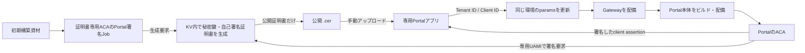

# 09. Core完成後のEntra登録

前：[08. 共用基盤を構築](08-provision-core.md) · [README](../../README.md) · 次：[10. ハブ＆スポーク（任意）](10-hub-spoke.md) · [11. Gatewayを配備](11-deploy-gateway.md)

[第08章](08-provision-core.md#8-5-coreの完了を確認する)で取得した公開証明書2枚を、認証用の`entraTenantId`の各アプリに登録します。この作業はEntraの登録・同意の権限を持つ担当が実施します。公開`.cer`だけを渡し、秘密の署名鍵はKey Vault内で管理します。

| Coreの出力 | Entraでの登録先 | 確認すること |
| --- | --- | --- |
| `generated/gateway-obo-public.cer` | 第02章で登録した`egakumi-api` | API用の証明書と、Microsoft Graphの委任`User.Read`の管理者同意 |
| `generated/portal-auth-public.cer` | この章で作成する`egakumi-portal` | Portal用の証明書、2つのWeb戻り先、GraphのOIDCとGateway APIの委任許可・管理者同意 |

## APIのOBO用公開証明書を登録する

1. 認証テナントのアプリ登録で、Application（Client）IDが保護paramsの `gateway.authentication.entra.audience` と一致する `egakumi-api` を開きます。
2. 「証明書とシークレット」→「証明書」で `.local/<environment>/generated/gateway-obo-public.cer` をアップロードします。登録した証明書と有効期限を今回の公開証明書・`state/gateway-obo-certificate.json` と照合します。
3. 「APIのアクセス許可」からMicrosoft Graphの委任されたアクセス許可 `User.Read` を追加し、管理者同意を確認します。 [Microsoft EntraのOBO](https://learn.microsoft.com/en-us/entra/identity-platform/v2-oauth2-on-behalf-of-flow)

通常の初回配備では、Gatewayが同じ環境の保護stateからOBO鍵の版と公開証明書の情報を取得します。

## Portal専用アプリを作成する

PortalログインとBearerによるAPI試用のために、専用のWebアプリを登録します。同じ依頼でログインとAPI試用の戻り先・権限を登録し、管理者同意を確認します。

### 初期構築で用意するもの

第08章のCore構築で共有資源とPortal ACAの初期サンプルを用意します。証明書専用ACAのPortal署名Jobから要求し、KVが認証専用の3072bit RSA鍵と自己署名証明書を生成します。秘密鍵は非exportableです。HTTPS用のACME証明書とは別です。

`postprovision`は開始したACA Job実行の正常終了と保護された結果を照合し、公開証明書を`.local/<environment>/generated/portal-auth-public.cer`へ、固定参照を同じ環境の`state/portal-auth-certificate.json`へ保存します。単にファイルが存在するだけで初期構築の成功とは判断せず、今回のJob実行の終了結果を確認してください。

Core構築で用意した公開`.cer`を使い、以下の一度のEntra登録依頼へ進みます。Jobが失敗した場合は、[Coreの発行結果と再開手順](../operations/portal-authentication.md#初期証明書の発行と確認)を確認してください。



KVの秘密鍵、PFX、backing secretは取り出しません。Entra担当へ渡す成果物は公開`.cer`です。申請票、メール、manifestを生成する処理はありません。公開証明書も実資源に対応するため、OSSのソース・Git・配布物には追加しません。

### 一度の登録依頼に含める設定

以下のドメインとIDは独立した例示・プレースホルダーです。実際の値は対象環境の保護入力・保護stateから担当者間で確認します。

登録作業前に、構築担当が次の入力を確認します。PortalアプリのClient IDは新規作成後に決まります。

| 入力 | 確認元・用途 |
| --- | --- |
| 認証tenant | 保護paramsの`entraTenantId`。Portalと既存APIの利用者認証を同じtenantへ揃える。`azureTenantId`はKV・ACA等のAzure管理用であり、登録先の代わりに使わない |
| Portalの公開HTTPSホスト | 保護paramsの`portal.publicHostName`。以下の2つの戻り先へ同じホストを使う |
| 既存APIアプリのClient ID | 保護paramsの`gateway.authentication.entra.audience`。アクセス許可の追加で既存APIアプリを選ぶために使う |
| 公開証明書 | 初期構築で取得した`portal-auth-public.cer`と同じ環境の`state/portal-auth-certificate.json`。証明書のthumbprint・期限を照合する |

| 項目 | 設定 |
| --- | --- |
| 登録先tenant | Portalの利用者を認証するEntra tenant。KV/ACAのAzure tenantとは区別する |
| アプリ | 専用Portalアプリ。名前は組織の命名規則で決める |
| サポートされるアカウント | この組織ディレクトリ内のアカウントのみ（Single tenant） |
| プラットフォーム | Web |
| PortalログインのRedirect URI | `https://portal.example.com/api/auth/callback/microsoft` |
| 工程4のAPI用Redirect URI | `https://portal.example.com/api/api-auth/callback`。API試用の追加認証からPortalへ戻る固定経路 |
| 証明書 | 初期構築で取得した`portal-auth-public.cer` |
| GraphのOIDC Delegated権限 | `openid`、`profile`、`email`、`offline_access`。ID tokenとAPI用更新トークン要求に対応する同意を同じ作業で確認 |
| API Delegated権限 | 既存のAPI用アプリが公開する`Gateway.Invoke`を、新しいPortal用アプリに追加。完全なscopeは`api://<API_APP_CLIENT_ID>/Gateway.Invoke`。ユーザー本人のアクセストークンでGateway APIを呼ぶための許可。API用アプリの構築・scope公開は[APIアプリの準備](02-entra-api.md)の前提 |
| 管理者同意 | 上記権限を組織の手続きに従って同意 |
| Implicit grant / Public client flows | 無効 |
| 新Portalのclient secret | 作成しない |
| 利用者割当・条件付きアクセス | 組織のルールを確認し、割当必須の場合は受入利用者の割当も同じ作業で実施 |

Portalログインで要求する`openid profile email`はOIDCのscopeです。API用OAuthの`offline_access`は更新トークンを要求するscopeです。どちらもKV鍵やGraph Application権限を表すものではありません。Portalログイン用ID tokenをAPI試行へ送信しません。GraphのBearer試用はAPIアプリのOBO資格情報と委任許可を使います。 [APIアプリのOBO設定](02-entra-api.md#6-core配備後にobo用の公開証明書を登録する)

`/api/api-auth/complete`はPortal内部の完了処理で、Entraの戻り先には登録しません。既存APIアプリへPortalの証明書や戻り先を追加する操作はありません。公開済みの`Gateway.Invoke`を新しいPortalクライアントへ許可し、管理者同意を付与します。

### Azureポータルで操作する

1. 認証対象tenantへ切り替え、「Microsoft Entra ID」→「アプリの登録」→「新規登録」を開きます。専用PortalアプリをSingle tenantで作成し、WebのPortalログイン戻り先を指定します。
2. 「認証」（`Authentication (Preview)`と表示される場合があります）でWebのRedirect URIを確認し、API用戻り先も同時に追加します。タブに分かれている画面では「リダイレクト URI の構成」からWebを選んで追加し、「設定」でフローを確認します。2件とも実際のPortal公開HTTPSホストを使い、表の固定パスと一致させます。Implicit grantのアクセストークン・IDトークンのチェック、Public client flowsはOFFにします。ローカル開発を行う場合だけ、専用の開発用アプリとlocalhost戻り先を別途設計します。
3. 「証明書とシークレット」→「証明書」→「証明書のアップロード」から公開`.cer`を登録します。「クライアントシークレット」で新しいsecretを作成しません。
4. 登録されたthumbprintと有効期限が、保護stateの`current.certificateThumbprint`・`current.expires`と一致することを確認します。別用途のTLS証明書を選んでいないことも確認します。
5. 「APIのアクセス許可」→「アクセス許可の追加」でMicrosoft Graphの委任アクセス許可を選び、OIDC用の `openid`、`profile`、`email`、`offline_access` を追加します。Portalで使用しない既定の `User.Read` は削除します。次に「所属する組織で使用しているAPI」で `gateway.authentication.entra.audience` に対応するAPIアプリを選び、委任アクセス許可の `Gateway.Invoke` を追加します。
6. 必要な管理者同意を実施し、許可の種類・対象API・同意状態を確認します。Entra担当が必要とする申請・承認は組織の手続きに従います。
7. 「概要」のDirectory tenant IDとApplication client IDを構築担当へ安全に渡します。Object IDをClient IDの代わりに入力しません。利用者割当必須や条件付きアクセスがある場合は、受入用の利用者も許可されていることを確認します。

同じ作業の最後に、2件のWeb戻り先、公開証明書と期限、OIDCの委任アクセス許可、既存APIの`Gateway.Invoke`、管理者同意、受入利用者の割当を保存後の画面で再確認します。構築担当へはDirectory tenant ID・新PortalのApplication client IDと、この確認が完了した結果を引き継ぎます。登録だけをPortalログインや工程4の実接続の成功に数えません。

### 操作画面を取得する

アプリ内ブラウザの表示領域そのものを**1920×1080ピクセル（フルHD）**にして撮影します。ページ全体の縦長画像や、撮影後に拡大縮小した画像を代用せず、撮影APIが返す原寸JPEG（`.jpg`）を保存して、実寸と原寸表示での文字・設定値の可読性を確認します。PNGが必要な場合は、原本を残して解像度を変えずに変換します。各画面は実際の作成・設定・保存後確認に合わせて取得します。

文字の輪郭と設定値を原寸で読み取れる画像を採用します。手順書で画像を縮小表示する場合は、原寸の画像を開ける導線も用意します。文字がぼやけて読めない画像は撮り直し、撮影後の拡大や形式変換を画質改善の代わりにしません。

エラー通知が写った場合は、該当画面を開き直して通常の操作での再現性と保存済みの設定を確認し、正常に表示された画面を撮り直します。確認結果と採用画像は保護台帳に残します。

撮影前に不要なメニューを畳み、一覧の列幅・表示位置を調整して、戻り先や設定値が省略されず読めることを確認します。設定値そのものは撮影のために変更しません。撮影後は表示領域の撮影用設定を元に戻します。

| 操作 | 取得する画面 |
| --- | --- |
| 新規登録 | 名前・Single tenant・Web戻り先を入力した画面と、作成後の概要 |
| 認証 | 2件のWeb戻り先と、Implicit grant／Public client flowsの保存後の状態 |
| 証明書 | 公開`.cer`の選択・登録操作と、保存後の証明書一覧・thumbprint・期限 |
| APIのアクセス許可 | OIDC委任権限、既存APIの`Gateway.Invoke`を選択する画面と、追加後の一覧 |
| 管理者同意・利用者割当 | 同意操作と保存後の状態。利用者割当が必要な場合は割当後の確認 |

原本と操作記録は`.local/<environment>/evidence/`へ所有者限定で保存します。サインイン・MFA・認証コード・秘密値が表示される画面は撮影しません。公開手順へ画像を追加する前には[公開情報の混入検査](../public-data-guard.md)とルートの[AGENTS.md](../../AGENTS.md)に従い、実情報の除去と内容確認を行います。画面の未取得・登録未実施・未確認を、撮影済み・登録成功として扱いません。

## 登録情報をparamsに追加する

環境別paramsの`portal.authentication`へ次の2項目を設定します。実値は`.local/<environment>/params.local.json`だけで管理します。

```json
{
  "portal": {
    "publicHostName": "portal.example.com",
    "authentication": {
      "tenantId": "<PORTAL_ENTRA_TENANT_ID>",
      "clientId": "<PORTAL_ENTRA_CLIENT_ID>"
    }
  }
}
```

値の例はプレースホルダーです。Coreで使用した同じparamsに専用アプリの登録結果を追加します。鍵の版と指紋は保護stateから取得し、明示入力がある場合は記録と照合します。Portal専用アプリのClient IDは、API・Tools・Credentialとは別の値を使います。

企業ハブに接続する場合は[10. ハブ＆スポーク対応](10-hub-spoke.md)、接続が不要な場合は[11. Gatewayを配備する](11-deploy-gateway.md)へ進みます。Gatewayの配備を確認してから第12章でPortal本体を配備し、第13章でサインイン・Graph・API試用を確認します。証明書の更新は[Portal認証の運用](../operations/portal-authentication.md)を参照してください。
