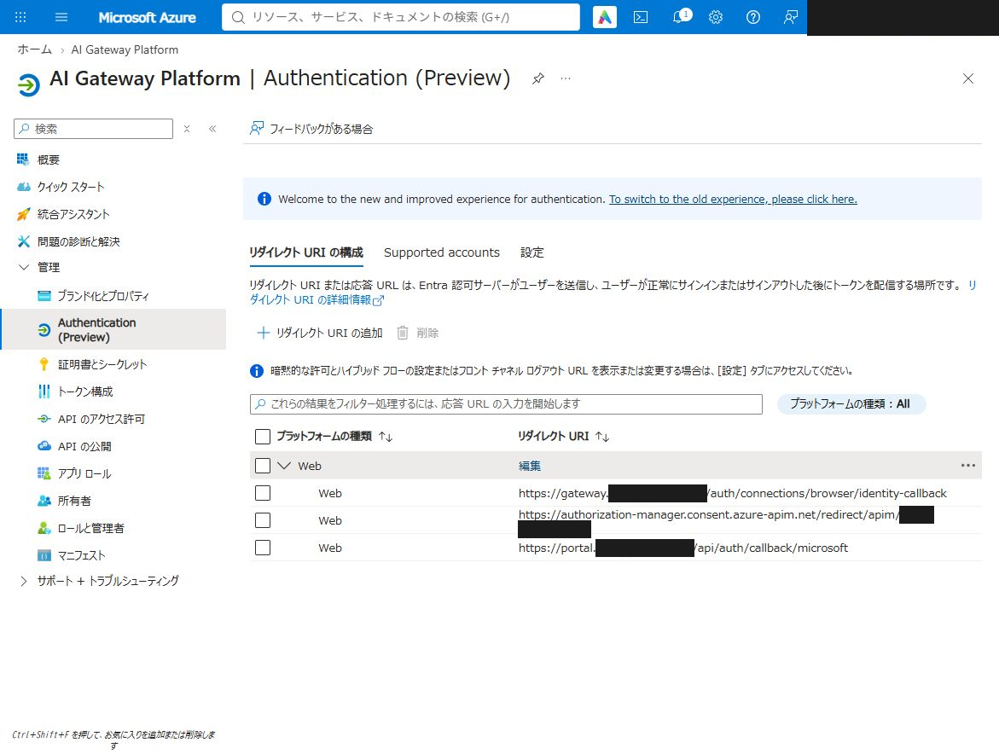

# GatewayとCredential Managerの配備

対応表をAzure SQLで管理し、同じ本人には同じCM接続を再利用する。クライアントは論理名`graph-delegated`を指定し、基盤が設定されたプールから割当先を選ぶ。公開paramsの初期値では`graph-delegated-a`〜`graph-delegated-l`を使う。UPNは表示と初期命名に使い、本人確認にはEntraのテナントID・オブジェクトIDを使う。

本書は[第4章](04-params.md)で作成した`DEPLOY_PARAMS_FILE`と、第1章で決めた`DEPLOY_ENVIRONMENT`を使う。別のターミナルでは、実際に構築した環境の値を設定し直す。

## 1. Entraの戻り先を確認する

[Entraの事前準備](02-entra.md)で作成した共用アプリの「認証」→「Web」に、次の戻り先が登録されていることを確認する。

```text
https://authorization-manager.consent.azure-apim.net/redirect/apim/<APIM_NAME>
https://<GATEWAY_HOST>/auth/connections/browser/identity-callback
https://<PORTAL_HOST>/api/auth/callback/microsoft
```

`<APIM_NAME>`・`<GATEWAY_HOST>`・`<PORTAL_HOST>`は対象環境の名前に置き換える。認証窓口・CM・Portalは同じアプリを共用し、Graphの委任権限、Portalのグループ所属照会用アプリケーション権限、有効なclient secretを準備する。



## 2. 本人接続の設定を確認する

公開paramsには`graph-delegated`の論理プロファイルとプール設定が含まれる。導入先のClient ID・secretファイル参照、認証テナント、`gateway.authentication.credentialLogin.providerNames`が同じプロファイルを参照することを確認し、設定を検査する。Portalの`portalAuthentication.credentialProviderName`も同じ論理プロファイルを使う。

```bash
python3 scripts/deployment/lifecycle.py validate --config "$DEPLOY_PARAMS_FILE"
```

SQLの容量・バックアップ・ゾーン冗長化は`config/test.json`または`config/production.json`の`credentialBroker`で管理する。

## 3. 初期構築を実行する

新規構築は、同じparamsで共通基盤→Gateway→Portalの順にまとめて実行する。Entraの戻り先・秘密ファイル・公開DNSを準備し、paramsの `publishApis: true` を確認する。Portalのグループ設定は初回の対話で入力するか、無人実行なら [Portalの配備手順](portal.md#配備の実行)に従って事前設定する。

```bash
export WORKFORCE_CONFIG="$DEPLOY_PARAMS_FILE"
azd up --environment "$DEPLOY_ENVIRONMENT"
```

`azd up` はAPIM本体、共通SQLサーバー、SQL初期化用ID、Private Endpoint、ACA環境・ACR、Key Vaultと共有Entra secretを準備する。`postprovision` が実出力と入口設定を整え、`postup` が `scripts/deploy_applications.py --execute` を通じてGateway配備、Portal配備の順に実行する。credentials DB、CMプロバイダー、認証窓口の実行用ID・Container App・ジョブ・専用鍵・APIMバックエンドはGateway工程が担当する。初期構築では、次節の個別コマンドを重ねて実行する必要はない。

公開用exampleは `publishApis: true` で、既存のlocal paramsは自動変更しない。`false` のまま全体構築を実行すると、課金資源の構築前に停止する。基盤だけを準備する場合は `azd provision` を使う。

SQLサーバーは`sql-<stem>`、Private Endpointは`pe-<stem>-sql`。`<stem>`には環境名とプロダクト名が入る。SQLへの公開アクセスとSQLパスワード認証は無効とし、後続のジョブとアプリはマネージドIDで接続する。

## 4. Gatewayを配備する

以下は、構築済み環境でGatewayだけを更新・再試行する場合のコマンドである。同じparamsとCore stateを使う。GitHub Actions、PC上のDocker、PCからのSQL／ACRへの直接接続は不要。

```bash
python3 scripts/deploy_gateway.py \
  --config "$DEPLOY_PARAMS_FILE"

python3 scripts/deploy_gateway.py \
  --config "$DEPLOY_PARAMS_FILE" \
  --execute
```

最初のコマンドはローカル計画`.state/gateway-plan.json`を作る。通常は保存済みCore stateから生成し、Azureへのアクセス・変更やparamsの編集は行わない。CIなどで`--deployment-name`を指定した場合は、Coreの配備結果をAzureから読み取る。`--execute`は次を順に実行する。

1. 共通基盤の実IDを確認し、認証窓口の公開ソースだけを既存管理VMへ転送する。params・secrets・個人セッションはイメージへ含めない。
2. 管理VMへACRスコープの組み込み`AcrPush`を一時付与し、イメージを作成して非公開ACRへ登録する。実際のdigestを取得し、そのビルドで作成した一時Run Commandと一時権限を回収する。
3. credentials DB、認証窓口の実行用ID、CMプロバイダー・必要な組み込みロール、専用鍵とAPIMの名前付きの値・バックエンドを配備する。
4. 同じdigestのSQL初期化ジョブを実行し、テーブル・プール台帳・実行用IDのSQL権限を準備する。本人対応とCMプールは保持する。本人セッションv2へ初めて切り替える際は`002_session_lifecycle.sql`が旧取引・旧セッションを無効化し、セッション関連テーブルを新定義へ置き換える。v2配備の通常再試行では有効なセッションを初期化し直さない。
5. SQL初期化に成功してからContainer Appと定期照合ジョブを配備し、認証窓口の正常起動を確認する。初期化に失敗した場合はアプリ更新とAPI登録に進まない。
6. API・バックエンド・Product・購読・ポリシーを登録する。必要な診断ログと初期サンプルの整理も行う。

本人接続を使わない設定では認証窓口の配備を省略し、APIの登録を行う。`apiDefinitions: []`は標準19 APIを意味する。APIを公開する実行には`publishApis: true`が必要。

本人接続のDB名は`sqldb-<stem>-credentials`、SQL初期化ジョブ名は`caj-<stem>-schema`、定期照合ジョブ名は`caj-<stem>-recon`。SQLの容量・バックアップ・ゾーン冗長化は`credentialBroker`設定を使う。保存データの暗号化はAzure SQL Databaseのサービス管理TDEを使う。[MicrosoftのTDE仕様](https://learn.microsoft.com/azure/azure-sql/database/transparent-data-encryption-tde-overview)

ACR・SQLの公開アクセスは無効のまま。追加の常設VMやカスタムロールは作らない。実行者には管理VMのRun Command操作、対象資源の配備、必要なスコープでのロール割当・解除権限が必要。`Owner`、または`Contributor`と`Role Based Access Control Administrator`等の組み込みロールの組合せを使う。通常実行用IDへ`AcrPush`やSQL管理者権限は付けない。

配備結果は`.state/gateway-deployment.json`、イメージ作成と一時資源の回収状況は`.state/credential-broker-build.json`へ記録する。`azd up` から呼ぶ場合も同じ記録を使い、Coreの `.state/latest.json` は維持する。実行したコマンドの終了コードと更新された記録で結果を確認し、古い成功JSONを流用しない。

Gatewayが失敗するとPortalへ進まず、全体構築も失敗で終了する。Portalだけが失敗した場合は、作成済みの基盤・Gatewayを保持して原因を修正し、Portalの個別コマンドから再試行できる。Gatewayを再試行するときも、同じ環境・同じソースで登録済みのイメージを再利用し、既存のDB・CM接続・購読キーを初期化し直さない。

継続配備では`.github/workflow-templates/gateway.yml.example`が同じコマンドを使う。`--image-digest`は別途作成済みのイメージを指定する場合に使い、通常の初期構築では指定しない。

## 5. 本人接続を試験する

API登録は手順4に含まれるため、別の登録コマンドは不要。配備完了と、Microsoftサインイン・Graphの実通信は分けて確認する。

[本人接続の手順](credential-manager-login.md)に沿って、購読キーを付けたGraph APIの呼び出しから始める。セッションがないときの409に含まれる認証URLを利用者へ案内し、アプリのバックエンドで完了確認・本人セッションの保存・元要求の再実行まで確認する。

共通ポリシーの反映先は、APIMの「API」→「すべてのAPI」のポリシー。定義は`apps/gateway/apim/policies/service.xml`、適用処理は`apps/gateway/deploy/api_publication.py`、認証関連の生成処理は`scripts/deployment/helpers/apim_authentication.py`にある。

- 有効な本人セッションでは認証画面を挟まずGraphを実行できること。
- セッション未指定・期限切れ・CM再認証時には、同じGraph APIの応答から認証を開始できること。
- 同じ人で2回サインインし、CM接続数が増えないこと。
- 別の人では別の接続になること。
- 別購読のセッションを使用すると拒否されること。
- CMの切断・削除時に他の資格情報へ切り替わらず、再認証が必要になること。
- DBへの到達不能時に、本人接続APIが利用を許可しないこと。
- キー不正・権限不足・SQLや外部通信の障害を認証のやり直しに置き換えないこと。
- 初回同時サインインと空き枠の境界を、実SQLで確認すること。

## 運用と復旧

SQLの主要テーブルは`broker.Pools`、`broker.Connections`、`broker.Transactions`、`broker.Sessions`。資格情報のトークンはCM内に保持する。通常実行用IDにはDDLやユーザー管理の権限を付けない。スキーマ変更は初期化用IDのジョブで行う。

本人セッションv2は`broker.SubjectSecurity`と`broker.SessionRotationCandidates`も使用する。`Sessions`には認証完了時刻、最終業務利用時刻、無操作・最長期限、現行/旧値の検証ハッシュ、世代と失効状態を保持する。`SubjectSecurity`は本人単位の全失効、`Connections`の失効番号は接続解除と関連セッション失効に使う。`rowversion`はSQLの比較更新用であり、通常の時刻更新でも変わるため失効番号とは区別する。仮値・現行値・候補の平文やCMトークンを台帳へ保存しない。

`Transactions.ConnectionEpochAtVerification`はCM接続を準備・照合した時点の接続失効番号であり、認証完了時にも一致を確認する。認証途中の接続解除と、古いコールバックの完了が競合しても接続を復活させない。

期限は`gateway.authentication.credentialLogin`の`idleTimeoutSeconds`（既定7日）、`absoluteLifetimeSeconds`（30日）、`rotationIntervalSeconds`（24時間）等で指定する。SQLの時刻で失効・期限を判定し、検証済み業務APIでだけ最終利用を更新する。既存セッションの最長期限は設定変更や値の更新で伸ばさない。[本人セッションの契約](credential-manager-login.md)を参照する。

初めて`002_session_lifecycle.sql`を適用する既存DBでは、セッション関連定義の変更と旧取引・旧セッションの無効化を伴う。保守時間を確保してSQL→Broker→APIMまで同じ資材で更新し、本人接続を再認証する。適用済みmigrationの通常再配備では、この初期化を繰り返さない。

SQLの実行用ユーザーはマネージドIDのクライアントIDをSIDとして登録する。Azure RBACの割当で使うオブジェクトIDとは用途が異なる。[Microsoft公式のCREATE USERの例](https://learn.microsoft.com/en-us/sql/t-sql/statements/create-user-transact-sql?view=azuresqldb-current#k-create-a-contained-database-user-from-a-microsoft-entra-principal-without-validation)に従う。

毎時の照合ジョブはCMとSQLを突き合わせ、消失・切断した接続を利用未確認に戻す。CM側だけにある接続、pool上限、照合不能は件数として調査する。正常な接続を削除したり、観測だけで予約済みの枠を解放・再割当したりしない。利用者が接続解除を要求済みで、SQLが`deleting`の接続は削除を再試行し、CMのGET 404を確認してから解除を完了する。

CM側だけに残る接続を確認したpoolは`broker.Pools.AllocationBlocked=1`として、新規割当を止める。CMの実在接続・本人対応表・`Allocated`件数を運用者が照合・修復してから解除する。通常の照合や`migrate`では解除しない。既存の正常な接続はGraph本人照合を継続する。

`loginCallsPerMinute`は購読単位の開始回数制限である。同時サインイン数、SQLの待ち時間、CM管理APIの制限を測定して設定する。`pool.count × pool.capacity`は保管枠であり、同時処理性能の保証ではない。

SQLの時点復元はCMを巻き戻さない。次の順で復旧する。

1. 本人接続APIとbrokerを停止し、新規セッション発行を止める。
2. バックアップを別名のSQL DBへ復元し、台帳・スキーマを確認する。
3. 復元DBの`broker.Sessions`と`broker.Transactions`を全て失効させる。過去のセッションを再使用させない。
4. CMと対応表を照合する。紐付けが不明な接続は利用を止め、担当者が確認する。
5. 保守手順で検証済みDBを稼働先へ切り替え、SQL初期化ジョブで権限とスキーマを検査する。
6. 再サインイン・Graph本人照合を確認して本人接続APIを再開する。

検証環境で復元訓練を実施し、復元可能時点と復旧所要時間を記録する。ゾーン障害、DBの論理破損、CMとの不一致を別々の試験として扱う。

公開版のActionsファイルは無効な `.yml.example` テンプレートです。自身のrunner・Environment・OIDCを設定してから必要なファイルを `.github/workflows/` へコピーします。[設定上の注意](../../.github/workflow-templates/README.md)を参照してください。
