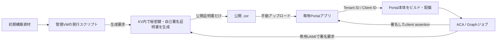

# Portal専用Entraアプリの手動登録

状態：工程3の資材・運用手順をローカル検証中。実環境の初回構築・Entra登録・更新受入は未実施です。工程4のAPI用OAuthは詳細設計の判断前で、ここでは初回申請に必要な設定を先行して整理しています。

初期構築の後に、この手順でアプリ作成と公開証明書の登録を一度の依頼にまとめます。Entraを管理する担当がAzureポータルで操作します。構築資材からEntraアプリを作成したり、管理者同意を自動付与したりしません。

## 初期構築で用意するもの

`azd up`は共有資源、Gateway、Portal ACAの初期サンプルまでを用意します。管理VMへ`portal-auth-certificate.ps1`を配置・実行し、KVが認証専用の3072bit RSA鍵と自己署名証明書を生成します。秘密鍵は非exportableです。HTTPS用のACME証明書とは別です。

`postprovision`はVM Run Commandの正常終了と出力を照合し、公開証明書を`.local/<environment>/generated/portal-auth-public.cer`へ、固定参照を同じ環境の`state/portal-auth-certificate.json`へ保存します。単にファイルが存在するだけで初期構築の成功とは判断せず、今回のコマンドの終了結果を確認してください。

この初期発行は全体構築のCoreとhookに組み込まれており、構築後に別の発行コマンドを追加で実行する手順にはしません。すでに構築済みの環境へ証明書準備だけを追加する場合は、[初期発行の限定追加手順](../operations/portal-authentication.md#初期構築と既存環境への限定追加)を使います。どちらも公開`.cer`を取得してから、以下の一度のEntra登録依頼へ進みます。



KVの秘密鍵、PFX、backing secretは取り出しません。Entra担当へ渡す成果物は公開`.cer`です。申請票、メール、manifestを生成する処理はありません。公開証明書も実資源に対応するため、OSSのソース・Git・配布物には追加しません。

## 一度の登録依頼に含める設定

以下のドメインとIDは独立した例示・プレースホルダーです。実際の値は対象環境の保護入力・保護stateから担当者間で確認します。

| 項目 | 設定 |
| --- | --- |
| 登録先tenant | Portalの利用者を認証するEntra tenant。KV/ACAのAzure tenantとは区別する |
| アプリ | 専用Portalアプリ。名前は組織の命名規則で決める |
| サポートされるアカウント | この組織ディレクトリ内のアカウントのみ（Single tenant） |
| プラットフォーム | Web |
| PortalログインのRedirect URI | `https://portal.example.com/api/auth/callback/microsoft` |
| 工程4のAPI用Redirect URI | `https://portal.example.com/api/api-auth/callback`。固定経路の先行案。初回登録前に工程4設計の判断を受ける |
| 証明書 | 初期構築で取得した`portal-auth-public.cer` |
| Graph Application権限 | `GroupMember.Read.All`、`User.ReadBasic.All`。Portal管理と定期照合用 |
| API Delegated権限 | API用アプリが公開する`Gateway.Invoke`。工程4用。API用アプリの構築・scope公開は[Entra準備](02-entra.md)の前提 |
| 管理者同意 | 上記権限を組織の手続きに従って同意 |
| Implicit grant / Public client flows | 無効 |
| 新Portalのclient secret | 作成しない |

Portalログインで要求する`openid profile email`はOIDCのscopeです。API用OAuthの`offline_access`は更新トークンを要求するscopeです。どちらもKV鍵やGraph Application権限を表すものではありません。Portalログイン用ID tokenをAPI試行へ送信しません。Graph下流OBOは工程5の別実装です。

## Azureポータルで操作する

1. 認証対象tenantへ切り替え、「Microsoft Entra ID」→「アプリの登録」→「新規登録」を開きます。専用PortalアプリをSingle tenantで作成し、WebのPortalログイン戻り先を指定します。
2. 「認証」でWebのRedirect URIを確認し、判断済みのAPI用戻り先も同時に追加します。Implicit grantのアクセストークン・IDトークンのチェック、Public client flowsはOFFにします。ローカル開発を行う場合だけ、専用の開発用アプリとlocalhost戻り先を別途設計します。
3. 「証明書とシークレット」→「証明書」→「証明書のアップロード」から公開`.cer`を登録します。「クライアントシークレット」で新しいsecretを作成しません。
4. 登録されたthumbprintと有効期限が、保護stateの`current.certificateThumbprint`・`current.expires`と一致することを確認します。別用途のTLS証明書を選んでいないことも確認します。
5. 「APIのアクセス許可」→「アクセス許可の追加」でMicrosoft Graphの「アプリケーションの許可」を選び、`GroupMember.Read.All`と`User.ReadBasic.All`を追加します。次に「所属する組織で使用しているAPI」からAPI用アプリを選び、「委任されたアクセス許可」の`Gateway.Invoke`を追加します。
6. 必要な管理者同意を実施し、許可の種類・対象API・同意状態を確認します。Entra担当が必要とする申請・承認は組織の手続きに従います。
7. 「概要」のDirectory tenant IDとApplication client IDを構築担当へ安全に渡します。Object IDをClient IDの代わりに入力しません。利用者割当必須や条件付きアクセスがある場合は、受入用の利用者も許可されていることを確認します。

## 登録後のPortal配備

環境別paramsの`portal.authentication`へ次の2項目を設定します。実値は`.local/<environment>/params.local.json`だけで管理します。

```json
{
  "portal": {
    "publicHostName": "portal.example.com",
    "authentication": {
      "tenantId": "<PORTAL_ENTRA_TENANT_ID>",
      "clientId": "<PORTAL_ENTRA_CLIENT_ID>"
    }
  }
}
```

これは入力項目を示す例であり、プレースホルダーのまま構築できるJSONではありません。鍵の版とthumbprintは保護stateから読みます。明示入力した場合はstateと一致しなければ停止します。登録前は`authentication`全体を省略して初期構築できます。Portal本体配備では登録結果がなければ停止し、CMのsecretへ自動fallbackしません。

```sh
python3 -B scripts/deploy_portal.py --config "$DEPLOY_PARAMS_FILE"
python3 -B scripts/deploy_portal.py --config "$DEPLOY_PARAMS_FILE" --execute
```

計画を確認してから実行します。共通基盤を作り直す必要はありません。ログイン、Graph管理、定期ジョブの実受入は[認証試験](../testing/portal-authentication-tests.md)に従います。HTTPヘルスの成功だけで認証完了とは判断しません。

更新時も新しい公開証明書の登録が必要です。期限は既定で12か月であり、永続証明書ではありません。更新手順は[Portal認証の運用](../operations/portal-authentication.md)を参照してください。
