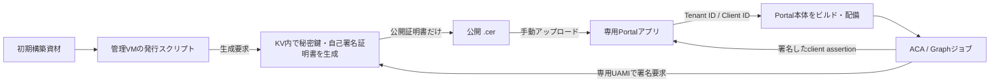

# Portal専用Entraアプリの手動登録

状態：工程3の資材・運用手順はローカル検証済みです。[工程4の詳細設計](../reference/portal-stage4-design.md)の実装方針は合意済みで、初回の手動登録に含める設定を本書へ確定しました。対象環境のEntra登録・Portal配備・実受入は保護記録で確認します。工程4の正式実装・実受入は未実施のWIPです。

初期構築の後に、この手順でアプリ作成と公開証明書の登録を一度の依頼にまとめます。Entraを管理する担当がAzureポータルで操作します。構築資材からEntraアプリを作成したり、管理者同意を自動付与したりしません。

開発・検証環境で構築担当が登録権限を持つ場合も、アプリ内ブラウザのAzureポータルで本書の画面操作を行います。Graph/APIによるアプリ作成・権限設定へ置き換えず、操作画面を取得して手順と照合します。

## この手順が対象にする工程

「専用Portalアプリ」は、Microsoft Entra IDの「アプリの登録」で新しく作る、Portal用の認証アプリを指します。Portalを動かすACAの枠は共有資材で準備し、その枠へ後からPortalのコンテナイメージを配備します。既存のAPI用アプリやCM用アプリと、今回作るPortal用の認証アプリの役割を区別します。

以下は現在の開発・段階受入の順序です。**工程3・4の実装が完成した資材を使う通常の新規構築では、共有資材・鍵準備 → Entraアプリの一度の作成・設定 → 完成済みPortalイメージのビルド・配備・受入**になります。通常の構築担当が工程4のソースを実装したり、そのための別のEntra編集依頼を出したりする手順にはしません。API／CM用アプリの従来の事前準備は維持します。

| 順序 | 実施すること | 担当 |
| --- | --- | --- |
| 1. 共有資材の構築 | KV・管理VM・ACAなどの共有資源とPortalの初期サンプルを用意。KV内に秘密鍵・自己署名証明書を発行し、公開`.cer`を取得 | 構築資材 |
| 2. 新しいPortal用Entraアプリの作成 | 新規アプリ作成、公開証明書、Portalログインの戻り先、Graph管理権限、本書の工程4用設定を一度の依頼で登録 | Entra管理担当が手動操作。本書の対象 |
| 3. 工程3のPortal配備・受入 | 登録結果を使ってPortal本体をビルド・配備し、証明書認証・Graph管理・定期ジョブ等を受入 | Portalの配備資材と受入担当 |
| 4. 工程4の実装・追加配備・受入 | 工程3の受入後、合意済みの詳細設計に沿ってAPI用認証・トークン管理・各Tryへの接続を正式実装し、追加配備・受入 | Portalの実装・配備・受入担当 |

本書の「初回登録」は、順序2の**新しいEntraアプリを作成し、必要な証明書と設定をその作成時にまとめて登録すること**です。証明書更新時は、このアプリへ新しい公開証明書を追加します。

順序2で申請を一度にまとめるため、Entraの設定に影響する工程4の設計を先に合意しました。本書の設定を同じ作成・設定作業で完了します。工程4用設定を登録しただけでは、API用OAuthや各Tryが実装・受入済みになるわけではありません。認証の流れ、ライブラリ、保存・更新・失効、全Tryと受入は[詳細設計](../reference/portal-stage4-design.md)に従います。

## 初期構築で用意するもの

`azd up`は共有資源、Gateway、Portal ACAの初期サンプルまでを用意します。管理VMへ`portal-auth-certificate.ps1`を配置・実行し、KVが認証専用の3072bit RSA鍵と自己署名証明書を生成します。秘密鍵は非exportableです。HTTPS用のACME証明書とは別です。

`postprovision`はVM Run Commandの正常終了と出力を照合し、公開証明書を`.local/<environment>/generated/portal-auth-public.cer`へ、固定参照を同じ環境の`state/portal-auth-certificate.json`へ保存します。単にファイルが存在するだけで初期構築の成功とは判断せず、今回のコマンドの終了結果を確認してください。

この初期発行は全体構築のCoreとhookに組み込まれており、構築後に別の発行コマンドを追加で実行する手順にはしません。すでに構築済みの環境へ証明書準備だけを追加する場合は、[初期発行の限定追加手順](../operations/portal-authentication.md#初期構築と既存環境への限定追加)を使います。どちらも公開`.cer`を取得してから、以下の一度のEntra登録依頼へ進みます。



KVの秘密鍵、PFX、backing secretは取り出しません。Entra担当へ渡す成果物は公開`.cer`です。申請票、メール、manifestを生成する処理はありません。公開証明書も実資源に対応するため、OSSのソース・Git・配布物には追加しません。

## 一度の登録依頼に含める設定

以下のドメインとIDは独立した例示・プレースホルダーです。実際の値は対象環境の保護入力・保護stateから担当者間で確認します。

登録作業前に、構築担当が次の入力を確認します。PortalアプリのClient IDは新規作成後に決まります。

| 入力 | 確認元・用途 |
| --- | --- |
| 認証tenant | 保護paramsの`entraTenantId`。Portalと既存APIの利用者認証を同じtenantへ揃える。`azureTenantId`はKV・ACA等のAzure管理用であり、登録先の代わりに使わない |
| Portalの公開HTTPSホスト | 保護paramsの`portal.publicHostName`。以下の2つの戻り先へ同じホストを使う |
| 既存APIアプリのClient ID | 保護paramsの`gateway.authentication.entra.audience`。アクセス許可の追加で既存APIアプリを選ぶために使う |
| 公開証明書 | 初期構築で取得した`portal-auth-public.cer`と同じ環境の`state/portal-auth-certificate.json`。証明書のthumbprint・期限を照合する |

| 項目 | 設定 |
| --- | --- |
| 登録先tenant | Portalの利用者を認証するEntra tenant。KV/ACAのAzure tenantとは区別する |
| アプリ | 専用Portalアプリ。名前は組織の命名規則で決める |
| サポートされるアカウント | この組織ディレクトリ内のアカウントのみ（Single tenant） |
| プラットフォーム | Web |
| PortalログインのRedirect URI | `https://portal.example.com/api/auth/callback/microsoft` |
| 工程4のAPI用Redirect URI | `https://portal.example.com/api/api-auth/callback`。API試行用の追加認証からPortalへ戻る固定経路 |
| 証明書 | 初期構築で取得した`portal-auth-public.cer` |
| Graph Application権限 | `GroupMember.Read.All`、`User.ReadBasic.All`。Portal管理と定期照合用 |
| GraphのOIDC Delegated権限 | `openid`、`profile`、`email`、`offline_access`。ID tokenとAPI用更新トークン要求に対応する同意を同じ作業で確認 |
| API Delegated権限 | 既存のAPI用アプリが公開する`Gateway.Invoke`を、新しいPortal用アプリに追加。完全なscopeは`api://<API_APP_CLIENT_ID>/Gateway.Invoke`。ユーザー本人のアクセストークンでGateway APIを呼ぶための許可。API用アプリの構築・scope公開は[APIアプリの準備](02a-entra-api.md)の前提 |
| 管理者同意 | 上記権限を組織の手続きに従って同意 |
| Implicit grant / Public client flows | 無効 |
| 新Portalのclient secret | 作成しない |
| 利用者割当・条件付きアクセス | 組織のルールを確認し、割当必須の場合は受入利用者の割当も同じ作業で実施 |

Portalログインで要求する`openid profile email`はOIDCのscopeです。API用OAuthの`offline_access`は更新トークンを要求するscopeです。どちらもKV鍵やGraph Application権限を表すものではありません。Portalログイン用ID tokenをAPI試行へ送信しません。Graph下流OBOは工程5の別実装です。

`/api/api-auth/complete`はPortal内部の完了処理で、Entraの戻り先には登録しません。既存APIアプリへPortalの証明書や戻り先を追加する操作はありません。公開済みの`Gateway.Invoke`を新しいPortalクライアントへ許可し、管理者同意を付与します。

## Azureポータルで操作する

1. 認証対象tenantへ切り替え、「Microsoft Entra ID」→「アプリの登録」→「新規登録」を開きます。専用PortalアプリをSingle tenantで作成し、WebのPortalログイン戻り先を指定します。
2. 「認証」（`Authentication (Preview)`と表示される場合があります）でWebのRedirect URIを確認し、API用戻り先も同時に追加します。タブに分かれている画面では「リダイレクト URI の構成」からWebを選んで追加し、「設定」でフローを確認します。2件とも実際のPortal公開HTTPSホストを使い、表の固定パスと一致させます。Implicit grantのアクセストークン・IDトークンのチェック、Public client flowsはOFFにします。ローカル開発を行う場合だけ、専用の開発用アプリとlocalhost戻り先を別途設計します。
3. 「証明書とシークレット」→「証明書」→「証明書のアップロード」から公開`.cer`を登録します。「クライアントシークレット」で新しいsecretを作成しません。
4. 登録されたthumbprintと有効期限が、保護stateの`current.certificateThumbprint`・`current.expires`と一致することを確認します。別用途のTLS証明書を選んでいないことも確認します。
5. 「APIのアクセス許可」→「アクセス許可の追加」でMicrosoft Graphの「アプリケーションの許可」を選び、`GroupMember.Read.All`と`User.ReadBasic.All`を追加します。権限グループを展開し、行頭の選択欄で対象の行を選びます。Graphの「委任されたアクセス許可」では、未使用の既定`User.Read`の選択を外し、OIDC用の`openid`・`profile`・`email`・`offline_access`を追加・確認します。次に「所属する組織で使用しているAPI」から、保護paramsの`gateway.authentication.entra.audience`で特定した既存APIアプリを選び、「委任されたアクセス許可」の`Gateway.Invoke`を追加します。保存後に、Graphの2件がApplication、OIDCの4件と`Gateway.Invoke`がDelegatedであり、新Portalアプリに`User.Read`が残っていないことを確認します。
6. 必要な管理者同意を実施し、許可の種類・対象API・同意状態を確認します。Entra担当が必要とする申請・承認は組織の手続きに従います。
7. 「概要」のDirectory tenant IDとApplication client IDを構築担当へ安全に渡します。Object IDをClient IDの代わりに入力しません。利用者割当必須や条件付きアクセスがある場合は、受入用の利用者も許可されていることを確認します。

同じ作業の最後に、2件のWeb戻り先、公開証明書と期限、Graphの許可種類、既存APIの`Gateway.Invoke`、管理者同意、受入利用者の割当を保存後の画面で再確認します。構築担当へはDirectory tenant ID・新PortalのApplication client IDと、この確認が完了した結果を引き継ぎます。登録だけをPortalログインや工程4の実接続の成功に数えません。

## 操作画面を取得する

アプリ内ブラウザの表示領域そのものを**1920×1080ピクセル（フルHD）**にして撮影します。ページ全体の縦長画像や、撮影後に拡大縮小した画像を代用せず、撮影APIが返す原寸JPEG（`.jpg`）を保存して、実寸と原寸表示での文字・設定値の可読性を確認します。PNGが必要な場合は、原本を残して解像度を変えずに変換します。各画面は実際の作成・設定・保存後確認に合わせて取得します。

文字の輪郭と設定値を原寸で読み取れる画像を採用します。手順書で画像を縮小表示する場合は、原寸の画像を開ける導線も用意します。文字がぼやけて読めない画像は撮り直し、撮影後の拡大や形式変換を画質改善の代わりにしません。

エラー通知が写った場合は、該当画面を開き直して通常の操作での再現性と保存済みの設定を確認し、正常に表示された画面を撮り直します。確認結果と採用画像は保護台帳に残します。

撮影前に不要なメニューを畳み、一覧の列幅・表示位置を調整して、戻り先や設定値が省略されず読めることを確認します。設定値そのものは撮影のために変更しません。撮影後は表示領域の撮影用設定を元に戻します。

| 操作 | 取得する画面 |
| --- | --- |
| 新規登録 | 名前・Single tenant・Web戻り先を入力した画面と、作成後の概要 |
| 認証 | 2件のWeb戻り先と、Implicit grant／Public client flowsの保存後の状態 |
| 証明書 | 公開`.cer`の選択・登録操作と、保存後の証明書一覧・thumbprint・期限 |
| APIのアクセス許可 | Graph Application権限、OIDC委任権限、既存APIの`Gateway.Invoke`を選択する画面と、追加後の一覧 |
| 管理者同意・利用者割当 | 同意操作と保存後の状態。利用者割当が必要な場合は割当後の確認 |

原本と操作記録は`.local/<environment>/evidence/`へ所有者限定で保存します。サインイン・MFA・認証コード・秘密値が表示される画面は撮影しません。公開手順へ画像を追加する前には[公開情報の混入検査](../public-data-guard.md)とルートの[AGENTS.md](../../AGENTS.md)に従い、実情報の除去と内容確認を行います。画面の未取得・登録未実施・未確認を、撮影済み・登録成功として扱いません。

## 登録後のPortal配備

環境別paramsの`portal.authentication`へ次の2項目を設定します。実値は`.local/<environment>/params.local.json`だけで管理します。

```json
{
  "portal": {
    "publicHostName": "portal.example.com",
    "authentication": {
      "tenantId": "<PORTAL_ENTRA_TENANT_ID>",
      "clientId": "<PORTAL_ENTRA_CLIENT_ID>"
    }
  }
}
```

これは入力項目を示す例であり、プレースホルダーのまま構築できるJSONではありません。鍵の版とthumbprintは保護stateから読みます。明示入力した場合はstateと一致しなければ停止します。登録前は`authentication`全体を省略して初期構築できます。Portal本体配備では登録結果がなければ停止し、CMのsecretへ自動fallbackしません。

```sh
python3 -B scripts/deploy_portal.py --config "$DEPLOY_PARAMS_FILE"
python3 -B scripts/deploy_portal.py --config "$DEPLOY_PARAMS_FILE" --execute
```

計画を確認してから実行します。共通基盤を作り直す必要はありません。ログイン、Graph管理、定期ジョブの実受入は[認証試験](../testing/portal-authentication-tests.md)に従います。HTTPヘルスの成功だけで認証完了とは判断しません。

更新時も新しい公開証明書の登録が必要です。期限は既定で12か月であり、永続証明書ではありません。更新手順は[Portal認証の運用](../operations/portal-authentication.md)を参照してください。
